# BFF 认证与会话治理技术方案 V2（技术评审终稿）

> 修订说明（2026-10-20）：合并《BFF 架构与技术方案讨论》会议结论，并对安全与一致性语义作技术校正。补充 Nacos 配置/服务发现、Kafka 事件恢复、Token 传输策略、BFF 直连防护、可观测性和发布门槛。JWT NumericDate 统一使用 Unix 秒；KMS/K2、缓存权威边界和密钥轮换以本文为准。本文中的“缓存”默认指 Redis 在线快照；BFF 进程内缓存会显式写作“本地缓存”。
>
> 术语修订（2026-10-21）：明确 JWT `alg` 写作 `EdDSA`，本方案具体采用 Ed25519 密钥与签名机制；明确 `jti` 为单枚 Access Token 标识，`sid` 为设备会话标识，一个 `sid` 可关联刷新过程中产生的多个 `jti`。

## 1. 文档目的

本文重新梳理 APISIX、API BFF、认证服务和业务服务的职责，重点解决以下问题：

1. JWT 泄漏后只能等待过期，无法及时撤销。
2. 用户退出、修改密码、封禁或权限变更后，旧 Access Token 仍可能继续使用。
3. 多设备登录缺少独立会话标识，无法只下线某一台设备。
4. HS256 要求签发方和验证方共享同一秘密，验证方理论上也能伪造 Token。
5. 认证逻辑全部放在网关时，复杂会话、权限和高风险操作难以测试和演进。
6. 认证逻辑全部下沉到 BFF 时，无效流量不能在入口提前拒绝。
7. TOTP、恢复码和 Passkey 需要复用同一套会话与 Token 签发机制。

目标不是因会议原型直接重写现有 Go BFF，而是在保留 APISIX、Go BFF、gRPC、服务发现、泛化调用和 TOTP 的基础上，补齐非对称签名、设备会话、即时撤销和业务授权。客户端 Token 以 `Authorization: Bearer` 为通用契约；Web 场景可选择 HttpOnly Cookie，但必须同时启用 CSRF 防护。

---

## 2. 已确认的设计决策

| 决策 | 结论 |
|---|---|
| BFF 技术栈 | 首期保留 Go 和 go-zero；Rust 仅在基准测试证明 Go 无法满足 SLO 且团队具备维护能力后另立迁移方案 |
| JWT 算法 | 从 HS256 演进为 EdDSA（本方案使用 Ed25519 密钥与签名机制）或 ES256 |
| 密钥选择 | JWT Header 使用 `kid`，验证方通过 JWKS 获取公钥 |
| JWT 时间 | `iat`、`exp`、`auth_time` 使用 JWT NumericDate，即 Unix 秒 |
| 网关认证 | APISIX 负责 TLS、路由、CORS、粗粒度限流和请求头清理；可做 JWT 预校验以过滤无效流量，但不是认证权威 |
| BFF 认证 | BFF 必须独立验证 JWT，并检查服务端会话、用户版本和权限；直接访问 BFF 也不能绕过认证 |
| Token 传输 | App/开放客户端使用 Bearer；同源 Web 可选 HttpOnly Cookie + CSRF，不允许把两者混成隐含行为 |
| 配置与发现 | Nacos 管理非秘密运行配置、i18n 和服务发现；主配置变更滚动重启，i18n 可热更新 |
| 状态事件 | 权威服务先持久化事实与 Outbox，再由 Kafka 通知刷新 Redis/BFF 缓存；Kafka 不是权威存储 |
| 普通接口 | 允许对会话与用户版本做 3～10 秒本地缓存 |
| 高风险接口 | 强制实时查询 Redis，不使用本地缓存 |
| Token 存储 | Access Token 不落 Redis；Refresh Token 只保存哈希 |
| 第二因素 | 保留 TOTP 和一次性恢复码 |
| Passkey | 作为独立登录方式，成功后复用统一 Token 签发流程 |
| KMS | 本地使用 Kubernetes Secret；生产优先由 KMS 直接签名 |

### 2.1 三类状态的权威边界

| 状态 | 权威来源 | Redis 的角色 | BFF 本地缓存 |
|---|---|---|---|
| 用户身份与账号状态 | user-service 持久化数据库 | 在线只读快照 | 普通接口可短时缓存 |
| 角色与权限 | 待确认的 RBAC/用户权限服务 | 派生权限快照，不是最终持久化权威 | 普通接口可短时缓存 |
| 设备会话 | Redis `auth:session:{sid}` | 在线权威状态 | 普通接口可短时缓存，高风险接口禁用 |

Redis 中的用户信息不是另一份可以独立修改的“用户主数据”。身份或权限发生变化时，必须先写入各自权威存储，再更新 Redis 快照和版本；不能只改缓存而不留下持久化事实和审计记录。

### 2.2 明确不采用的设计

- 不把完整权限列表长期固化在 JWT 中。
- 不让 APISIX 独立决定业务资源授权。
- 不让 BFF 信任客户端直接传入的 `X-User-*` 身份头。
- 不因为请求来自内网或 APISIX 就跳过 BFF 自身的 JWT/会话校验。
- 不把 Kafka 消息当作用户状态或权限变更的唯一事实来源。
- 不把密钥、数据库口令、TOTP Secret 等秘密放入 Nacos 普通配置。
- 不使用 Ed25519 公钥“加密”软件私钥；Ed25519 是签名算法，不是加密算法。
- 不在每次 Pod 启动时随机生成新的 JWT 密钥。
- 不让多个 Pod 使用各自不同且未发布到 JWKS 的随机密钥。

---

## 3. BFF 与 APISIX 的职责边界

### 3.1 总体架构

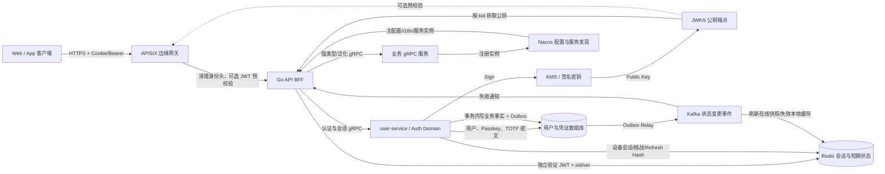

### 3.2 分层职责

| 层级 | 必须负责 | 明确不负责 |
|---|---|---|
| APISIX | TLS、入口路由、粗粒度限流、CORS、清理伪造身份头；可选 JWT 预校验和网关 HMAC | 最终认证结论、用户权限、资源归属、设备会话生命周期 |
| API BFF | 独立 JWT 验签、HTTP/JSON、参数校验、客户端响应组装、会话状态、权限上下文、高风险操作门禁、gRPC 编排 | 保存签名私钥、生成 TOTP Secret、业务资源最终归属判断 |
| user-service | 密码/TOTP/Passkey 校验、设备会话、Refresh Token、JWT 签发、用户认证版本 | 业务账户和资金规则 |
| 业务服务 | 资源归属、业务状态、业务权限和领域不变量 | 浏览器 Cookie、JWT 签发、WebAuthn Ceremony |

### 3.3 为什么 BFF 必须独立认证

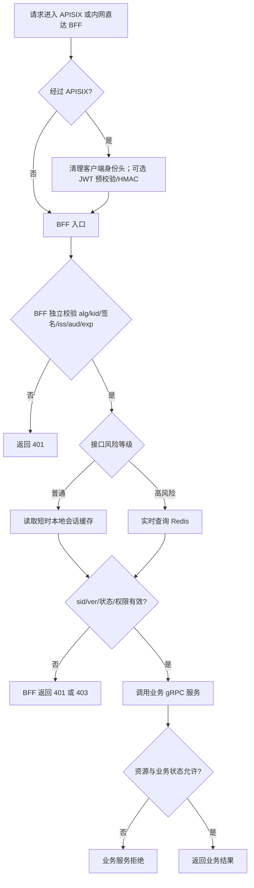

APISIX 的验签只能作为入口流量优化，不能成为 BFF 的信任前提。BFF 必须解决“Token 是否真实、会话是否仍然有效、是否具备当前操作权限”；业务服务解决“目标资源是否属于该用户、当前业务状态是否允许”。这样即使研发、发布系统或测试工具从内网直接访问 BFF，也不能伪造 `X-User-*` 头冒充用户。

APISIX → BFF 的 HMAC 或 mTLS 仍可用于识别可信网关、限制匿名入口和增强链路审计，但不能代替 BFF 对 JWT 的独立验证。网络策略应默认只允许 APISIX、受控发布系统和诊断入口访问 BFF；诊断入口同样执行完整认证。

### 3.4 Token 传输契约

| 客户端 | 推荐传输 | 安全要求 |
|---|---|---|
| App、CLI、开放客户端 | `Authorization: Bearer <access_token>` | 客户端安全存储；不得记录完整 Header |
| 同源 Web | HttpOnly Cookie | `Secure`、合适的 `SameSite`、CSRF Token/Origin 校验 |
| 内部服务 | 服务身份（mTLS/工作负载身份） | 不复用最终用户 Access Token 作为服务凭证 |

登录响应如果采用 Cookie，Token 位于 HTTP 响应的 `Set-Cookie` Header；后续由浏览器通过请求 `Cookie` Header 自动携带。如果采用 Bearer，Token 在登录响应体中返回，由客户端显式放入 `Authorization` Header。每个客户端必须固定一种 Profile，服务端不得依靠“先找 Cookie、再找 Header”的模糊优先级；同时出现两份不同 Token 时必须拒绝并记录审计事件。

### 3.5 Nacos 配置与服务发现

Nacos 在本方案中承担两种不同职责，必须分开建模、授权和监控：

| 能力 | 内容 | 更新策略 | 失败策略 |
|---|---|---|---|
| 配置中心 | BFF 监听地址、超时、后端服务别名、错误码 i18n、功能开关 | 主配置经校验后滚动重启；纯 i18n 可热更新并原子替换 | 启动时无有效主配置则 Fail Fast；运行时更新失败继续使用最后成功版本 |
| 服务发现 | gRPC 服务的 `service + group + namespace`、健康实例和元数据 | 监听推送 + 60 秒全量校准（可配置） | 保留最后健康快照并触发告警；摘除不健康实例 |

主配置不热更新是首期的风险控制，不是 Nacos 能力限制。配置发布必须经过 Schema 校验、版本号/digest 校验、审计和灰度重启。i18n 热更新采用“下载 → 完整校验 → 构造新只读映射 → 原子切换”，失败时继续使用旧版本。

Nacos 不保存 JWT 私钥、数据库密码、TOTP Secret 或 Refresh Token。秘密来自 Kubernetes Secret/External Secrets/KMS，并按最小权限注入目标工作负载。

服务发现客户端应维护本地健康实例快照，对每个下游设置连接超时、请求超时、重试预算、熔断和负载均衡策略。会议中的 5 秒仅可作为演示默认值；生产值必须按接口 SLO 设定，不能对非幂等调用进行无条件重试。

### 3.6 请求上下文传递边界

BFF 验证成功后构建 `ActorContext` 并通过受信任的 gRPC metadata 或显式请求字段传递。业务服务只接受来自 BFF 工作负载身份的上下文，并校验必需字段；来自普通客户端或非受信服务的同名 metadata 一律清除/拒绝。权限快照可避免每次调用权限服务，但业务服务仍必须检查资源归属、租户边界、业务状态和资金规则。

---

## 4. 要解决的问题与用例矩阵

| ID | 用例 | 参与者 | 期望结果 | 关键异常 |
|---|---|---|---|---|
| UC-01 | 密码登录 | 用户 | 创建设备会话并得到 Token | 密码错误、账户禁用、需要 TOTP |
| UC-02 | TOTP/恢复码登录 | 用户 | 第二因素通过后签发 Token | 动态码错误、恢复码已使用、挑战过期 |
| UC-03 | Passkey 登录 | 用户 | 验签成功后签发同类 Token | Challenge 重放、Origin/RP ID 不匹配 |
| UC-04 | 普通业务请求 | 已登录用户 | 低延迟校验会话并访问业务 | Token 过期、缓存中的版本过旧 |
| UC-05 | 高风险业务请求 | 已登录用户 | 实时验证会话与认证强度 | 会话刚被撤销、需要重新认证 |
| UC-06 | 刷新 Token | 登录会话 | 单次消费旧 Refresh Token 并轮换 | 重放旧 Token、会话已撤销 |
| UC-07 | 当前设备退出 | 用户 | 当前 `sid` 立即失效 | 重复退出必须幂等 |
| UC-08 | 指定设备下线 | 用户/管理员 | 只撤销目标设备会话 | 目标会话不存在或不属于用户 |
| UC-09 | 全部设备下线 | 用户/管理员 | 用户所有会话立即失效 | 并发刷新不能恢复旧会话 |
| UC-10 | 修改密码/封禁 | 用户/管理员 | 所有旧 Token 立即失效 | APISIX 可选预验签仍可能通过，BFF 必须按 `ver` 拒绝 |
| UC-11 | 权限变更 | 管理员 | 权限版本更新后快速生效 | BFF 短时缓存带来有限延迟 |
| UC-12 | JWT 密钥轮换 | 平台管理员 | 新旧 Token 平滑过渡 | 提前删除旧公钥导致在线用户掉线 |

---

## 5. 核心数据与 Token 契约

### 5.1 Access Token Claims

```json
{
  "iss": "local-platform",
  "aud": "api-bff",
  "sub": "user-123",
  "jti": "token-unique-id",
  "sid": "device-session-id",
  "ver": 7,
  "amr": ["pwd", "totp"],
  "auth_time": 1792243812,
  "iat": 1792243812,
  "exp": 1792245612
}
```

| Claim | 含义 | 约束 |
|---|---|---|
| `sub` | 用户唯一标识 | 不放邮箱、手机号等隐私信息 |
| `jti` | 单枚 Access Token 的唯一 ID | 用于令牌级审计和极少数紧急单 Token 撤销；不是设备标识 |
| `sid` | 设备会话 ID | Redis 会话的主索引；同一设备会话刷新出的多枚 Token 共享该 `sid` |
| `ver` | 用户认证/权限版本 | 与服务端当前版本比较 |
| `amr` | 本次认证方法 | 例如 `pwd`、`totp`、`recovery`、`passkey` |
| `auth_time` | 最近一次强认证时间 | 高风险操作判断是否需要 Step-up |
| `iat/exp` | 签发与过期时间 | Unix 秒；Access Token 建议 15～30 分钟 |

JWT Header：

```json
{
  "alg": "EdDSA",
  "typ": "JWT",
  "kid": "auth-2026-10"
}
```

术语约束：

- `EdDSA` 是写入 JWT Header `alg` 的标准算法标识。
- 本方案具体使用 Ed25519 密钥和签名机制实现 EdDSA。文档不得把 `alg` 写成 `Ed25519`，也不使用含混的“Ed25519 曲线算法”表述。
- 如果后续选择 ES256，JWT Header 的 `alg` 必须明确改为 `ES256`，不能继续标记为 `EdDSA`。

### 5.2 Redis 会话模型

```text
auth:user:{user_id}
  status               active | frozen | disabled
  account_type         personal | organization
  tenant_id            tenant-001
  roles                [member]
  permissions          [profile.read, account.read]
  ver                   7
  source_updated_at     1792243812

auth:session:{sid}
  user_id              user-123
  status               active | revoked
  user_version         7
  device_id            browser-device-id
  device_name          Chrome on macOS
  auth_methods         [pwd, totp]
  authenticated_at     1792243812
  last_seen_at          1792243900
  expires_at            1792848612

auth:user-version:{user_id} = 7

auth:refresh:{refresh_hash}
  sid                   device-session-id
  user_id               user-123
  expires_at            1792848612
```

约束：

- `auth:user:{user_id}` 是从用户/RBAC 权威来源生成的在线快照，只保存授权所需的最小字段，不保存密码、TOTP Secret、Passkey 私钥或完整个人资料。
- `auth:user-version:{user_id}` 是高频比较用的独立标量；其值必须与用户快照中的 `ver` 一致。
- Refresh Token 明文只返回客户端一次，Redis 只保存 SHA-256/HMAC 摘要。
- `auth:session:{sid}` 是设备会话的权威状态。
- 修改密码、封禁或全端下线时递增 `auth:user-version:{user_id}`。
- 单设备下线只把目标 `sid` 标为 `revoked`，无需影响其他设备。
- 会话记录与 Refresh Token 的创建、轮换、撤销应通过 Redis Lua 或事务保证原子性。

### 5.3 `ver`、`sid` 与 `jti` 的失效范围

| 标识 | 粒度 | 典型用途 | 失效影响 |
|---|---|---|---|
| `ver` | 用户级 | 修改密码、封禁、全端下线、重要权限回收 | 该用户所有旧 JWT 失效 |
| `sid` | 设备会话级 | 当前设备退出、下线指定设备 | 仅该设备会话失效 |
| `jti` | 单枚 Access Token | 审计、极少数紧急单 Token 撤销 | 仅目标 Access Token 失效 |

校验规则：

```text
JWT.ver == Redis user-version
AND session(JWT.sid).status == active
AND session.user_id == JWT.sub
```

普通资料变化（头像、昵称、展示设置）不递增 `ver`。影响认证、账号状态或重要权限的变化才递增；否则会造成所有设备无必要地重新登录。

`sid` 与 `jti` 不是一一对应关系。一次设备登录产生一个 `sid`；首次签发和后续每次刷新都会生成新的 Access Token，因此会形成多个不同的 `jti`，但在该设备会话未被替换前仍共享同一个 `sid`：

```text
设备会话 sid=session-456
  ├─ access token jti=token-a
  ├─ refresh 后 access token jti=token-b
  └─ 再次 refresh 后 access token jti=token-c
```

撤销 `sid` 会让该设备会话关联的所有 Token 失效；撤销单个 `jti` 只影响一枚 Access Token，且只有在系统实现令牌级撤销表/集合时才可即时生效。

### 5.4 两级缓存与一致性

```text
持久化权威数据
      ↓ 变更后刷新
Redis 用户/权限快照与设备会话
      ↓ 普通接口短时读取
BFF 进程内缓存（3～10 秒）
```

- Redis 是跨 BFF 实例共享的在线状态；BFF 本地缓存只是性能优化。
- 权限或版本更新后发布失效通知，BFF 主动删除本地缓存。
- 失效通知可能丢失，因此短 TTL 是正确性兜底。
- 普通接口的撤销传播上限等于本地缓存 TTL，不能宣称绝对即时。
- 高风险接口跳过本地缓存，实时查询 Redis；Redis 不可用时 Fail Closed。

#### 变更事件的可靠传播

用户状态、密码或权限变化采用以下顺序：

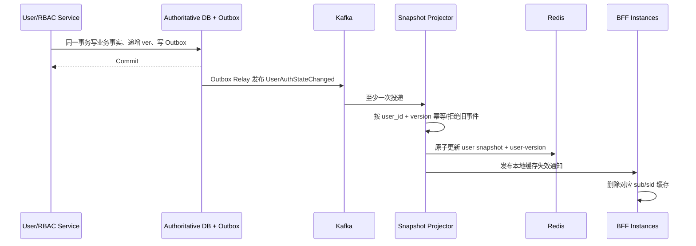

- 事件至少包含 `event_id`、`user_id`、`version`、`event_type`、`occurred_at`，不得包含密码、Token 或凭证秘密。
- 消费者必须幂等，并拒绝 `event.version <= current.version` 的重复/乱序事件。
- Kafka 延迟、重复或短暂不可用不能丢失权威变更；Outbox Relay 可重试，定时 reconciliation 负责比对权威版本与 Redis 版本。
- 权限回收、封禁等高风险变更在权威事务提交后，应同步更新 Redis 或走专用高优先级投影；仅等待普通异步消息不能承诺“立即撤销”。
- 人工“强制刷新用户缓存”只能作为受审计的恢复工具，不能代替 Outbox、重试、DLQ 和 reconciliation。

### 5.5 持久化模型

生产环境建议保存：

- 用户认证版本和账号状态；
- Passkey Credential ID、公钥、sign count、设备描述；
- AES-GCM 加密后的 TOTP Secret；
- 认证方式绑定与解绑审计日志；
- 设备会话审计摘要。

Redis 是在线会话和短期 Challenge 存储，不应成为用户凭证的唯一永久数据库。

---

## 6. 用例流程与解决方案

## 6.1 UC-01/02：密码 + TOTP 登录

### 用例契约

| 项目 | 内容 |
|---|---|
| 前置条件 | 用户存在且未禁用；密码正确 |
| 输入 | 邮箱/账号、密码；第二阶段输入 Challenge Token 和 TOTP/恢复码 |
| 输出 | Access Token、Refresh Token、CSRF Token、设备会话 |
| 持久化事实 | `sid` 会话、Refresh Hash、认证方法、认证时间 |
| 安全边界 | 密码通过不代表登录完成；挑战五分钟过期且一次性消费 |
| 排除项 | 不在 BFF 中校验 TOTP，不在 JWT 中保存密码或 TOTP Secret |

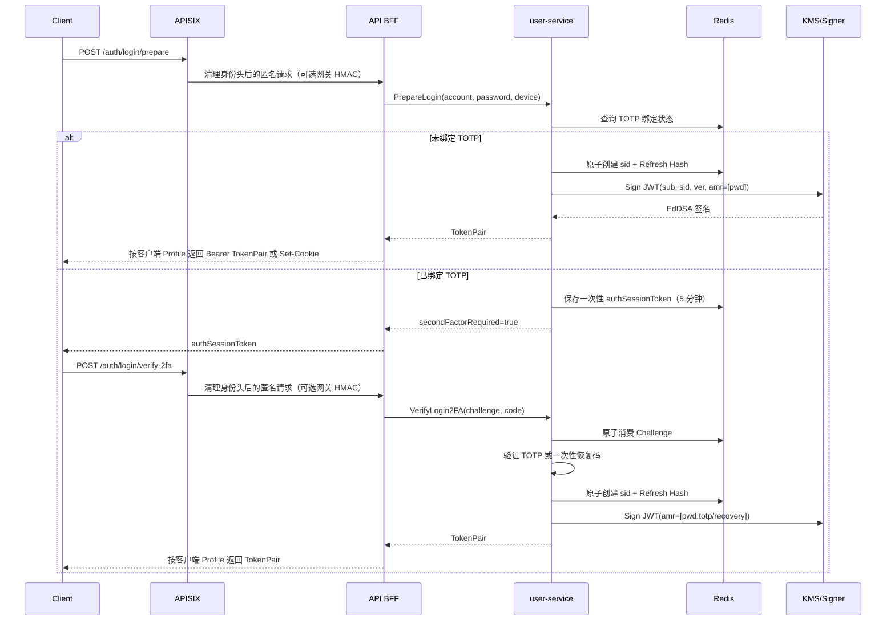

## 6.2 UC-03：Passkey 登录

Passkey 与 TOTP 是不同认证方式，但成功后进入同一个 `CreateSessionAndIssueTokens` 用例。

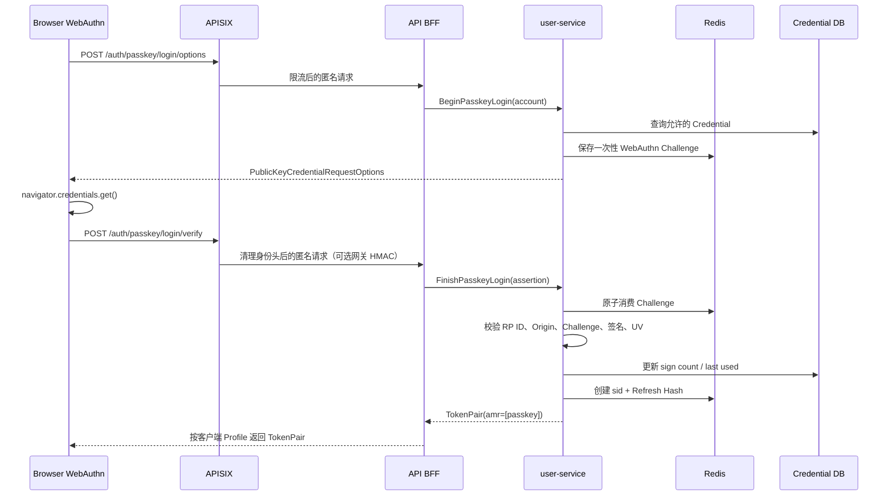

WebAuthn 本地配置：

```text
RP ID: localhost
Origin: https://localhost:18443
User Verification: required
Resident Key: required（无用户名登录时）
Attestation: none
```

## 6.3 UC-04：普通业务请求

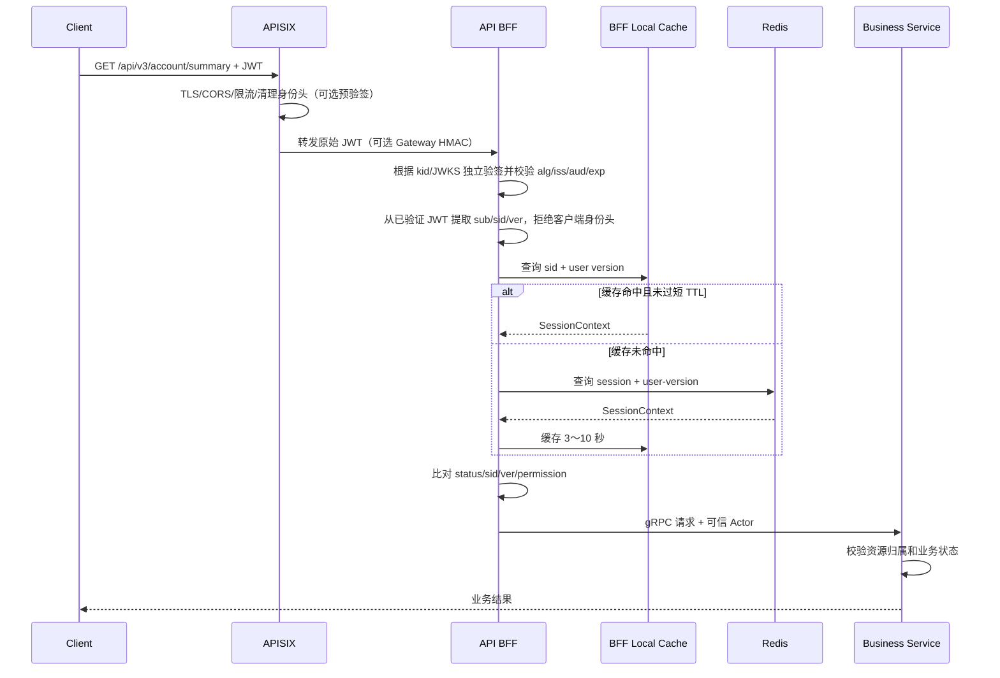

缓存意味着普通接口的撤销传播存在最多一个短 TTL。这个延迟必须成为明确的安全契约和监控指标，而不能被描述成“绝对即时”。

## 6.4 UC-05：高风险操作

高风险操作包括但不限于：提现、修改密码、Passkey/TOTP 解绑、恢复码重新生成、更换安全邮箱、管理员敏感操作。

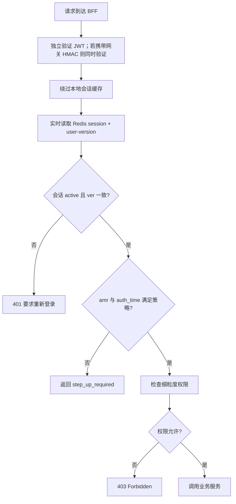

建议策略示例：

| 操作 | 最低认证方法 | 强认证新鲜度 |
|---|---|---|
| 查看个人资料 | 任意有效会话 | 不限制 |
| 重新生成恢复码 | `totp` 或 `passkey` | 5 分钟内 |
| 解绑 TOTP | 密码 + TOTP/Passkey | 5 分钟内 |
| 修改密码 | Passkey 或密码重新验证 + 第二因素 | 5 分钟内 |
| 提现 | 按业务风控策略要求 Step-up | 通常 5 分钟内 |

## 6.5 UC-06：Refresh Token 轮换与重放检测

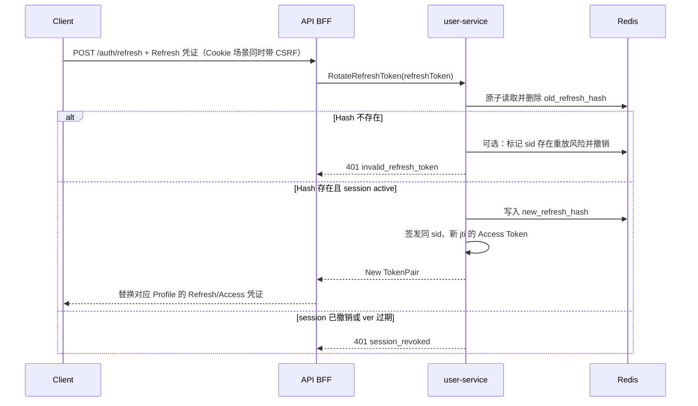

## 6.6 UC-07/08/09：退出与设备下线

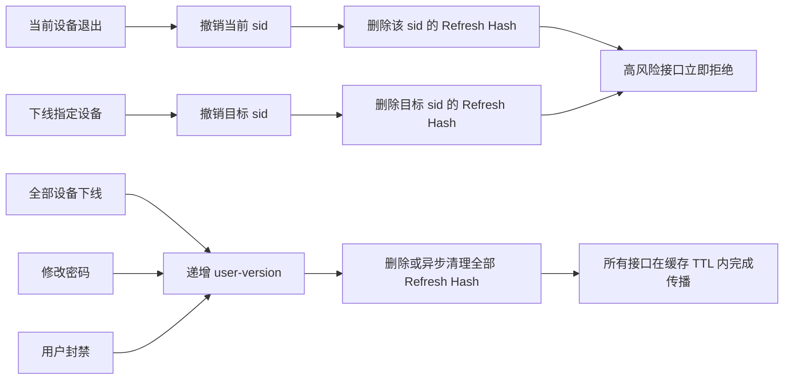

退出接口必须幂等：会话已经撤销时仍返回成功，不能因为重复请求产生 500。

## 6.7 UC-10/11：修改密码、封禁与权限变更

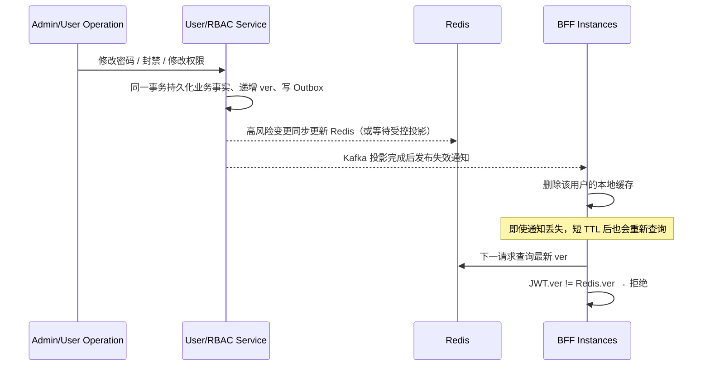

本地缓存失效通知是性能优化，短 TTL 和权威版本对账才是正确性兜底；不能把 Redis Pub/Sub 或 Kafka 消费成功当作唯一安全保证。Kafka 事件由数据库 Outbox 产生，消费者按版本幂等更新 Redis，并对失败消息重试/进入 DLQ。

## 6.8 UC-12：JWT 密钥轮换

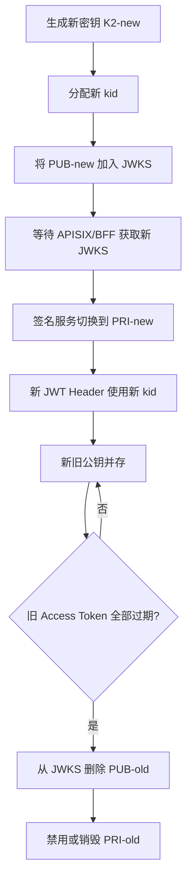

### K2 生命周期

K2 是 JWT 签名密钥对，不是在每次 Pod 启动时重新生成：

```text
初始化或主动轮换
  → 在受控内存/KMS 中生成 K2（PRI2 + PUB2）
  → 持久化受保护的 PRI2 或直接保留在 KMS
  → 将 PUB2 以 kid 发布到 JWKS

普通 Pod 启动
  → 加载同一把受保护的 PRI2，或调用同一个 KMS Key
  → 不生成新的随机 K2
```

如果每个 Pod 启动时各自生成 K2，多副本会互相无法验证 Token，滚动重启也会让旧 Token 突然失效。`PUB2` 本来就公开；只有 `PRI2` 泄漏才意味着攻击者可以伪造 JWT，并触发 K2 紧急轮换。

### 本地模式

- 启动脚本生成一对 Ed25519 密钥并持久化到 Kubernetes Secret。
- 私钥只注入 user-service；公钥/JWKS 提供给 APISIX 和 BFF。
- Pod 重启复用同一密钥，不能重新随机生成。

### 生产模式 A：KMS 直接签名（优先）

```text
user-service → KMS Sign(message) → signature
APISIX/BFF  → JWKS public key  → verify
```

私钥不可导出，KMS 记录每次签名审计。

### 生产模式 B：信封加密软件私钥

仅在 KMS 不支持目标算法、延迟或成本不满足时采用。软件私钥使用 AES-GCM 数据密钥加密，数据密钥再由 KMS 主密钥加密。不能使用 Ed25519 公钥执行加密。

会议中提到的 `K1`/`K2` 应按以下方式落地：

- `K1`：KMS 中不可导出的主密钥（KEK）或其受控解密权限，用于保护数据密钥；应用不获得 K1 明文。
- `K2`：JWT 签名密钥对；`PUB2` 公开到 JWKS，`PRI2` 要么留在 KMS 内直接签名，要么以信封加密密文持久化。
- 正常轮换：先发布新公钥，再切换新私钥签名，旧公钥保留到旧 Token 自然过期，不强制用户退出。
- 泄漏处置：若 `PRI2` 泄漏，立即停止旧 `kid`、切换 K2 并撤销受影响会话；若 K1 或 KMS 授权边界泄漏，还必须轮换 K1、所有受其保护的 K2，并审计历史解密/签名操作。

---

## 7. API 设计

### 7.1 认证接口

| Method | Path | 认证要求 | 说明 |
|---|---|---|---|
| POST | `/api/v3/auth/login/prepare` | 匿名、限流 | 密码第一阶段 |
| POST | `/api/v3/auth/login/verify-2fa` | 匿名、限流、一次性 Challenge | TOTP/恢复码第二阶段 |
| POST | `/api/v3/auth/passkey/register/options` | 已登录、CSRF、实时会话 | 开始绑定 Passkey |
| POST | `/api/v3/auth/passkey/register/verify` | 已登录、CSRF、实时会话 | 完成绑定 Passkey |
| POST | `/api/v3/auth/passkey/login/options` | 匿名、限流 | 获取登录 Challenge |
| POST | `/api/v3/auth/passkey/login/verify` | 匿名、限流 | 验证 Assertion 并创建会话 |
| POST | `/api/v3/auth/refresh` | Refresh 凭证；Cookie Profile 需要 CSRF | 原子轮换 Refresh Token |
| POST | `/api/v3/auth/logout` | 当前会话；Cookie Profile 需要 CSRF | 幂等撤销当前会话 |
| GET | `/api/v3/auth/sessions` | 已登录 | 查询自己的设备会话 |
| DELETE | `/api/v3/auth/sessions/{sid}` | 已登录、CSRF、实时会话 | 下线指定设备 |
| POST | `/api/v3/auth/logout-all` | 已登录、CSRF、Step-up | 全端下线 |

### 7.2 标准错误契约

```json
{
  "code": "step_up_required",
  "message": "recent strong authentication is required",
  "challengeMethods": ["totp", "passkey"]
}
```

| HTTP | code | 含义 |
|---:|---|---|
| 401 | `authentication_required` | 没有有效认证 |
| 401 | `session_revoked` | Token 有效但服务端会话已撤销 |
| 401 | `token_version_outdated` | JWT `ver` 落后于服务端版本 |
| 401 | `invalid_refresh_token` | Refresh Token 无效或被重放 |
| 403 | `permission_denied` | 已认证但无操作权限 |
| 403 | `step_up_required` | 需要更强或更新鲜的认证 |
| 409 | `credential_already_bound` | TOTP/Passkey 已绑定 |
| 429 | `too_many_authentication_requests` | 登录或 Challenge 请求过多 |

客户端必须以 `code` 判断行为，不能解析 `message` 文本。

错误码 i18n 只负责把稳定 `code` 映射为展示文案，不改变 HTTP 语义。`204`、`304` 等规范禁止响应体的状态不得因为配置了文案而强行添加 body；服务端错误不得暴露堆栈、内部地址、SQL 或下游原始报错。

---

## 8. 权限与认证强度

认证和授权不能混为一件事：

```text
认证：这个请求是谁发出的？会话是否有效？
权限：这个用户能否执行该动作？
资源授权：这个具体账户、订单或资金是否属于该用户？
认证强度：用户最近是否使用了足够强的方式重新确认身份？
```

BFF 构建统一 `ActorContext`：

```go
type ActorContext struct {
    UserID          string
    SessionID       string
    TokenID         string
    UserVersion     int64
    AuthMethods     []string
    AuthenticatedAt time.Time
    Permissions     []string
}
```

业务 gRPC 请求应通过受信元数据或显式 Actor 参数接收身份，不接受客户端自行传入的用户 ID 作为最终授权依据。

### 8.1 权限快照的使用规则

1. BFF 使用 Redis 权限快照判断“用户是否具备执行某类动作的资格”。
2. 业务服务仍负责资源归属和领域状态，例如 `account.read` 不代表可以读取任意账户。
3. 权限被回收时，权威服务先持久化变更，再更新 Redis 快照并递增 `ver`。
4. 新签发 JWT 写入最新 `ver`；旧 JWT 因版本不一致而失效。
5. 增加低风险权限是否强制旧 Token 失效可由策略决定；回收重要权限必须递增 `ver`。

---

## 9. 非功能要求

### 9.1 性能

- APISIX 的可选预验签不访问 Redis；BFF 的独立 JWT 验签使用本地缓存的 JWKS。
- 普通接口 BFF 会话缓存 TTL 建议 3～10 秒。
- 高风险接口始终实时读取 Redis。
- JWKS 按 `Cache-Control` 缓存；遇到未知 `kid` 可立即刷新一次，但必须限制刷新频率。
- 建立 Go BFF 基线压测：HTTP→gRPC 透传、聚合、JWT 验签、Redis 命中/未命中四类场景；未证明 SLO 不达标前不启动 Rust 重写。

### 9.2 可用性

- APISIX 无法获取新 JWKS 时继续使用未过期缓存，不能接受未知密钥。
- Redis 不可用时，高风险接口 Fail Closed。
- 普通接口是否允许使用短期缓存继续服务，应由接口风险等级明确配置。
- 登录、刷新和 Passkey/TOTP 管理在 Redis 不可用时 Fail Closed。
- Nacos 暂时不可用时，已启动实例可使用最后成功的主配置和服务快照；新实例无有效本地/挂载配置时不得带病启动。
- Kafka 消费中断不影响权威数据写入；恢复后从已提交 offset 重放，并由版本号保证幂等。

### 9.3 审计

至少记录：

- 登录成功/失败、认证方法、失败类别；
- `sub`、`sid`、`jti`、`kid`，但不记录完整 Token；
- Passkey/TOTP 绑定和解绑；
- 恢复码使用与重新生成；
- Refresh Token 重放；
- 单设备/全端下线；
- 密钥轮换；
- 高风险操作 Step-up 结果。

日志不得包含密码、TOTP Secret、完整动态码、恢复码、私钥和完整 Refresh Token。

### 9.4 监控指标

- JWT 验签成功率、失败原因和未知 `kid` 次数；
- Redis 会话查询延迟、命中率、本地缓存命中率；
- 会话撤销传播延迟；
- 登录/TOTP/Passkey 成功率；
- Refresh 重放次数；
- Step-up 触发与完成率；
- KMS 签名延迟、错误率和配额使用；
- Nacos 配置版本/digest、监听失败、服务实例数量和全量校准差异；
- Kafka consumer lag、Outbox 积压、重试/DLQ 数量、Redis 投影版本落后量；
- HTTP/gRPC QPS、P50/P95/P99、错误码、下游超时、重试、熔断和实例摘除次数。

---

## 10. 演进路线图

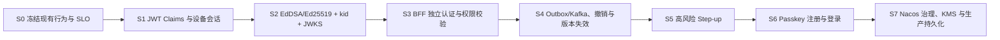

| 阶段 | 交付结果 | 依赖 | 完成门槛 |
|---|---|---|---|
| S0 | 固定密码、TOTP、Refresh、Bearer/Cookie Profile、CSRF、延迟与吞吐基线 | 无 | 现有单测、本地 E2E 和四类基线压测有可重复报告 |
| S1 | `sub/jti/sid/ver/amr/auth_time` 与 Redis 设备会话 | S0 | 登录、刷新、并发重放、撤销测试通过 |
| S2 | EdDSA（Ed25519）、`kid`、JWKS、多公钥兼容 | S1 | 新旧密钥并存和轮换测试通过 |
| S3 | BFF 独立 JWT/会话校验、可选 APISIX 预校验、短时缓存 | S2 | 直连 BFF 伪造头失败；普通缓存、过期和 Redis 故障测试通过 |
| S4 | Outbox/Kafka 投影、单设备/全端下线、权限版本失效 | S3 | 丢消息、重复、乱序、DLQ、对账、撤销传播和并发刷新测试通过 |
| S5 | 风险分级、实时校验、Step-up | S4 | 高风险接口不得使用旧缓存 |
| S6 | Passkey 绑定与无密码登录 | S5 | RP/Origin/Challenge/重放/UV E2E 通过 |
| S7 | Nacos 配置/发现治理、PostgreSQL 凭证持久化、KMS 签名与轮换 | S6 | 配置校验、滚动重启、发现校准、灰度、回滚、审计和灾备演练通过 |

### 10.1 安全发布顺序

1. 先让 BFF 验证方支持旧 HS256 和新 EdDSA 双算法，但严格按 `kid` 和算法白名单验证；APISIX 预校验保持可选。
2. 发布 JWKS 和 EdDSA 公钥。
3. 签发方切换为 EdDSA。
4. 等所有 HS256 Access Token 过期。
5. 删除 HS256 验证能力和共享密钥。
6. 再启用 BFF 会话强校验和设备管理入口；确认内网直连 BFF 也无法绕过认证。

任何阶段都不能先停止旧 Token 验证，再发布新验证能力。

### 10.2 原子提交边界

| Commit | 必须包含 | 不得混入 |
|---|---|---|
| C01/S1 | Claims、设备会话模型、Redis 原子操作、测试 | JWKS、Passkey |
| C02/S2 | Ed25519 Signer、JWKS、`kid`、轮换测试 | 权限 UI、Passkey |
| C03/S3 | BFF 独立 JWT 验签、SessionValidator、缓存、风险等级配置、直连防护测试 | 设备管理 API |
| C04/S4 | Outbox/Kafka 投影、对账、设备列表、单设备/全端撤销、版本失效 | KMS 生产适配 |
| C05/S5 | Step-up 策略和高风险接口接入 | Passkey |
| C06/S6 | Passkey 注册/登录和浏览器演练页面 | KMS 迁移 |
| C07/S7 | Nacos 配置/发现治理、KMS、数据库迁移、轮换和回滚工具 | Rust 重写、无关业务功能 |

---

## 11. 抽象决策

| 抽象 | 服务的用例 | 隔离的变化/风险 | 决策 |
|---|---|---|---|
| `TokenSigner` | 密码、TOTP、Passkey 登录，Refresh | 本地私钥与 KMS Sign 差异 | 保留 |
| `SessionStore` | 创建、刷新、撤销、设备管理 | Redis 原子操作与测试替身 | 保留 |
| `SessionValidator` | 普通和高风险 BFF 请求 | 缓存策略、Fail Closed、权限版本 | 保留 |
| `CredentialStore` | TOTP、Passkey 凭证 | Redis 演练与 PostgreSQL 生产差异 | 保留 |
| `ConfigSnapshot` | 主配置、i18n、服务发现 | Nacos 更新失败、原子切换和最后成功版本 | 保留，但主配置首期只在启动时装载 |
| `AuthStateProjector` | 封禁、密码/权限变更、全端下线 | Kafka 重复/乱序/延迟与 Redis 投影恢复 | 保留 |
| 独立签名微服务 | 所有 Token 签发 | 当前只有一个认证服务签发 | 暂缓，优先 KMS Adapter |
| Rust BFF | 全部 BFF 用例 | 语言运行时差异 | 不采用，当前没有足够收益证明重写成本合理 |

---

## 12. 会议结论采纳与校正

| 会议讨论项 | 最终处理 | 原因 |
|---|---|---|
| APISIX 不做认证，BFF 做认证 | 采纳 BFF 为认证权威；APISIX 可选预校验 | 内网直连 BFF 不能绕过认证，同时入口仍可过滤明显无效流量 |
| BFF 读取 Redis 用户与权限信息 | 有条件采纳 | Redis 是在线快照/会话权威，不是用户与 RBAC 的永久主数据 |
| Kafka 更新 Redis | 有条件采纳 | 必须由权威数据库 Outbox 产生，可重放、幂等、对账；不能靠人工刷新兜底 |
| JWT 时间使用毫秒 | 不采纳 | RFC 7519 NumericDate 使用秒；毫秒会造成标准库误判有效期 |
| BFF 把全部权限传给下游 | 部分采纳 | 可传最小权限上下文；下游仍负责资源归属、租户和领域授权 |
| K1 公私钥加密 K2 私钥 | 校正为 KMS 直接签名或标准信封加密 | Ed25519 公钥不能用于加密，应用也不应拿到 KMS 主密钥明文 |
| K2 轮换让全部用户退出 | 仅泄漏应急时采用 | 正常轮换应新旧公钥并存到旧 Token 自然过期 |
| 主配置不热更新、i18n 热更新 | 首期采纳 | 降低服务拓扑动态变更风险；i18n 可校验后原子替换 |
| 使用 Rust 重写 BFF | 暂不采纳 | 尚无 Go 实现不能满足 SLO 的基准证据，且存在团队学习和双栈维护成本 |

## 13. 技术评审待确认问题

1. 用户权限的权威来源是 user-service、独立 RBAC 服务，还是业务服务？
2. 普通接口可接受的撤销传播上限是 3 秒、5 秒还是 10 秒？
3. 哪些接口必须列为高风险并要求 Step-up？
4. Access Token 目标有效期采用 15 分钟还是 30 分钟？
5. 多设备登录是否有数量限制，超过限制时淘汰最旧会话还是拒绝登录？
6. Passkey 首期采用“用户名优先”还是可发现凭证的无用户名登录？
7. 生产签名使用哪一种 KMS，是否原生支持 Ed25519；若不支持是否采用 ES256？
8. 用户修改密码后，是否立即撤销 Passkey 会话，还是仅撤销密码派生的会话？
9. Web 首期采用 Bearer 还是 HttpOnly Cookie Profile；若并存，分别绑定哪些客户端？
10. Nacos namespace/group/dataId 命名、配置审批人、Schema 校验器和回滚负责人分别是谁？
11. 权限回收/封禁从权威事务提交到 Redis 生效的目标 SLO 是多少，是否要求同步写穿？
12. Kafka topic 分区键是否固定为 `user_id`，Outbox、DLQ 和 reconciliation 分别由哪个服务负责？
13. BFF 到业务服务采用 mTLS、工作负载身份还是网络策略 + metadata 签名，密钥/证书如何轮换？
14. Go BFF 的目标 QPS、P95/P99、CPU/内存和实例成本门槛是什么；达到何种证据才启动 Rust 评估？

这些问题不影响 S0 基线梳理，但会分别阻塞 S3、S4、S5、S6 和 S7 的最终契约。评审通过时应为每项给出负责人、截止时间和决策记录，不能以口头共识代替接口与运行契约。
