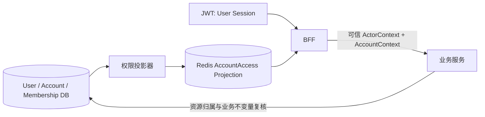
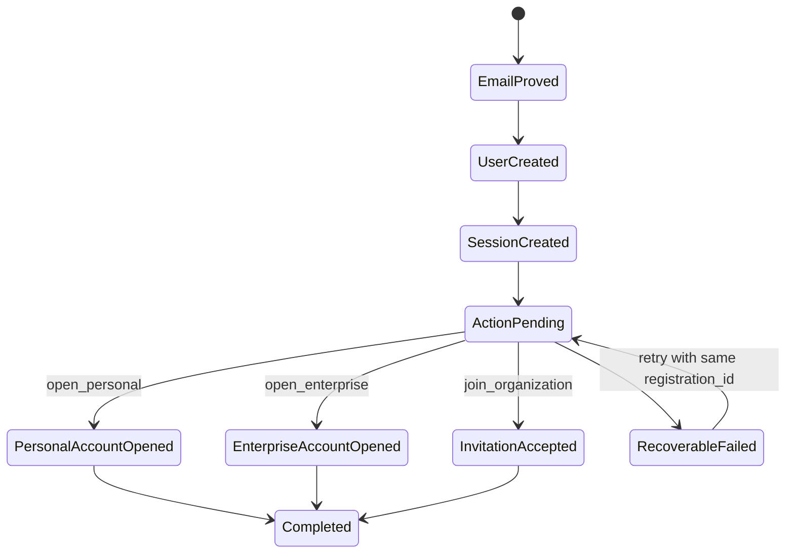
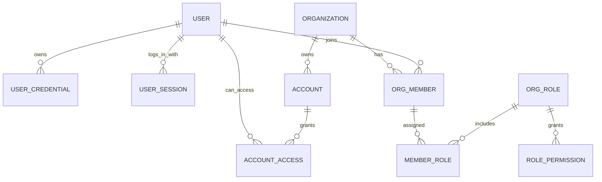
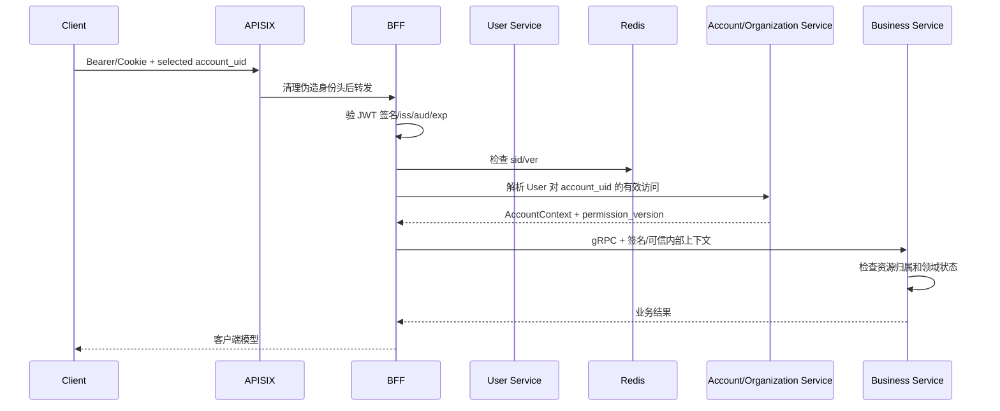

# User 与 BFF V3 差异分析及落地路线

> 状态：S0-K Kratos 框架迁移、S1a User/PasswordCredential 持久化、S2a 注册发码和 S4a AccountContext 纵向切片已完成本地与 Kind 验收；S1b 长期二次认证凭证持久化与 S2b 注册提交待实施。
>
> 依据：新版 User HTTP 契约、用户系统设计、注册流程、BFF 方案，以及本地 `user-service` / `api-bff` 和三个参考代码库的静态核对。
> 原则：附件是设计输入，不是可直接执行的实现指令；本文会修正其中的安全矛盾和未闭合边界。

## 1. 结论先行

本地已有实现可以继续演进，不需要推倒重来，也不应立刻把 BFF 改写为 Rust。User Service 与 BFF 的服务框架统一采用 Kratos v3；框架迁移必须先冻结现有接口行为，再逐条迁移业务能力。

当前本地系统已经具备以下可复用底座：

- Ed25519 签名的 JWT，含 `sub`、`sid`、`jti`、`ver`、`amr`、`auth_time`、`iat`、`exp`；
- Redis 设备会话、用户版本和 Refresh Token 单次消费；
- BFF 独立验签、Cookie/Bearer 冲突拒绝、Origin 和 CSRF 校验；
- TOTP、恢复码、Passkey Ceremony；
- BFF 每次调用 User RPC 检查权限；
- 泛化 gRPC、描述符摘要校验、服务发现和 API Key 验证实验。

但它仍是安全能力实验，不是新版 User/Account/Organization 业务系统：

- 登录用户仍是单个演示用户，密码和用户资料没有 PostgreSQL 权威模型；
- AccountContext 已完成登录投影、会话选择、签名 RPC 传播和下游解析，但账户清单仍是 Account Service 的演示投影，尚未连接正式 Account/Member 数据表；
- TOTP、Passkey 等凭证主要保存在 Redis，不满足长期凭证权威存储要求；
- 没有统一 `verify_token`、场景策略、凭据版本和业务重提协议；
- 没有注册、开户、邀请接受的可恢复编排。

所以落地顺序必须是：

```text
先固定领域与会话契约
  → 将 User/BFF 运行外壳迁移到 Kratos v3
  → 建持久化身份模型
  → 打通注册/登录纵向切片
  → 引入 AccountContext
  → 引入统一安全验证
  → 扩展组织、角色与邀请
  → 最后再评估 Rust BFF 迁移
```

## 2. 新旧方案的核心变化

| 维度 | 本地现状 | 新版目标 | 落地判断 |
|---|---|---|---|
| 身份 | 单个演示 User | User 是稳定登录身份 | 新建权威用户表和凭证表 |
| 业务主体 | BFF 仅携带 UserID | User 与 Account 分离 | 必须增加 AccountAccess/AccountContext |
| 企业关系 | 固定 `local-org` RBAC | OrgMember + Role + Permission | 不能再由全局配置决定组织 |
| 会话 | Access + Refresh，Redis 会话 | 文档倾向无 Refresh、后端滑动续期 | 保留现有短 Access + 轮换 Refresh，更安全且更清晰 |
| 登录策略 | 密码后固定判断 TOTP | primary + 场景策略 + 多验证项 | 演进为版本化 SecurityPolicy |
| 二次验证 | 每个接口单独传密码/验证码 | 统一 `verify_token` 与 P01/P02 | 建统一 VerificationSession |
| 登录结果账户 | 本地未返回真实账户 | 文档仅返回本人 Owner 账户 | 改为显式 `account_accesses`，同时表达 Owner/Member |
| BFF 权限 | 每请求 User RPC 检查固定组织 | Redis 权限上下文 + 后端二次校验 | Redis 仅作投影；权威仍是 User/Account 服务与 DB |
| 配置发现 | Go 实现已有 Nacos/etcd 实验 | Rust 参考实现使用 Nacos | 复用理念，不以语言迁移阻塞业务落地 |
| 时间与 ID | 内部多为字符串 | HTTP 文档大量 int64 JSON number | 对外 ID 使用字符串，避免 JavaScript 精度损失 |

## 3. 需要修正的新方案问题

### 3.1 JWT 不能删除 `iat` 和 `exp`

Redis 会话解决的是即时撤销，JWT `exp` 解决的是令牌自包含的最大生命周期。二者应同时存在：

```text
密码学有效期：iat / exp
         AND
服务端有效性：sid active + ver current
```

不采用“同一个 JWT 每次访问自动延长”的隐式滑动方案。刷新必须通过显式 Refresh Token 轮换，旧 Refresh Token 单次消费。

### 3.2 Ed25519 只签名，不加密

不使用 Ed25519 公私钥对加解密另一个私钥。推荐顺序：

1. 生产由 KMS/HSM 直接执行签名；
2. 次选使用 KMS 数据密钥封装 PKCS#8 签名私钥；
3. 本地 Kind 使用 Kubernetes Secret，私钥只挂载给 User 服务。

### 3.3 BFF 不是权限真相源

BFF 可以缓存权限投影，但不能自行维护一套可独立修改的身份和权限事实。



权限新增和删除都必须通过版本更新生效，不能接受“删除后读权限仍允许”的设计。

### 3.4 注册与开户不能成为一个不可恢复的大事务

客户端可以一次提交，但服务端必须按步骤编排：



`UserCreated` 后开户失败时不能回滚已证明的身份或再创建第二个 User。应以 `registration_id` 和业务动作幂等键恢复。

## 4. 推荐领域模型

### 4.1 身份、会话与主体分离



- `User`：自然人的登录身份。
- `UserCredential`：密码、Passkey、TOTP、恢复码等凭证。
- `UserSession`：一台设备的一次登录会话。
- `Account`：个人或企业业务主体。
- `AccountAccess`：User 对 Account 的访问关系和来源，来源可以是 Owner 或组织成员资格。
- `Organization`：企业团队与成员管理边界。
- `OrgMember`：User 加入 Organization 的关系，必须含 `user_id`。

### 4.2 两类上下文

```text
AuthenticationContext
  user_id, session_id, token_id, user_version, amr, auth_time

AccountContext
  account_id, account_uid, account_type,
  organization_id, member_id, role_ids,
  permission_version, selected_at
```

BFF 从已验证 JWT 得到 AuthenticationContext，再根据客户端明确选择的 `account_uid` 查询 AccountAccess，生成 AccountContext。客户端不能直接提供可被信任的组织、角色和权限头。

### 4.3 登录/注册返回结构

不再只返回 Owner 账户数组，建议返回：

```json
{
  "session": {
    "expires_at": 1794369600000
  },
  "account_accesses": [
    {
      "account_uid": "18342001",
      "account_type": "personal",
      "relationship": "owner",
      "organization_id": null,
      "name": "个人账户"
    },
    {
      "account_uid": "28342001",
      "account_type": "enterprise",
      "relationship": "member",
      "organization_id": "200001",
      "name": "示例科技"
    }
  ]
}
```

这样受邀用户登录后能看到可进入的企业主体，而不是错误地得到空数组。

## 5. BFF 与服务边界



| 组件 | 负责 | 不负责 |
|---|---|---|
| APISIX | TLS、入口路由、粗限流、清理身份头 | 最终认证和业务授权 |
| BFF | HTTP 适配、JWT/会话校验、账户上下文解析、客户端编排 | 凭证权威存储、业务资源归属终判 |
| User Service | User、Credential、SecurityPolicy、VerificationSession、Session | 资金和业务产品状态 |
| Account/Organization | Account、AccountAccess、Member、Role、Permission | 登录凭证与 JWT 签发 |
| 业务服务 | 资源归属、业务状态、资金与领域不变量 | Cookie、WebAuthn、JWT 签发 |

## 6. 参考代码的复用方式

### 6.1 `infini-bff`

可借鉴：

- Axum/Tower 分层方式；
- Nacos 服务发现、健康实例快照、连接复用；
- Global Layer、i18n、参数校验和指标骨架。

不能直接采用：

- 当前 `auth.rs` 只把 Bearer Token 解析为整数 UserID，没有验签、会话和版本检查；
- 负载均衡的权重处理仍为 TODO；
- 示例服务只有 Greeter，不代表新版 BFF 业务边界已经实现。

### 6.2 `infini-kit`

可作为 Rust BFF 的基础库候选，复用 Web Layer、gRPC discovery/LB、Nacos、错误响应和校验抽象。首期先把这些能力映射为接口契约和测试，不立即替换本地 Go BFF。

### 6.3 `infini-service-devkit`

可借鉴 Go 微服务启动方式：配置加载、秘密提供器、gRPC 拦截器、服务注册和优雅退出。示例中的 Ed25519 Seed 用秘密提供器加密保存是合理方向，但业务服务仍应通过稳定的基础库接口调用，而不是复制启动代码。

### 6.4 Kratos v3 的采用边界

Kratos v3 负责统一服务运行外壳：

```text
kratos.App
   ├── User Service: Kratos gRPC Transport
   └── API BFF: Kratos HTTP Transport
            ↓
      统一启动、信号处理、优雅退出、Health 与中间件生命周期
```

Kratos 不负责替代领域层、PostgreSQL、Redis、JWT、服务发现配置或权限真相源。本阶段也不强制引入 Wire、Ent 或 Kratos Layout 的所有目录；这些是可选工程实践，不是框架运行的必要条件。

迁移约束：

- User Service 继续使用现有 protobuf gRPC 契约，客户端无需切换 RPC 方法；
- BFF 先用 Kratos HTTP Transport 承载现有 `net/http` Handler，保持路径、Cookie 和 JSON 兼容；
- 新增公开接口优先采用 protobuf + `google.api.http` 生成绑定；旧接口只在契约测试覆盖后逐步生成化；
- 不使用 Kratos 默认请求日志中间件记录认证 RPC 参数，因为其中包含密码、OTP、恢复码、Refresh Token 和 WebAuthn 数据；
- 显式设置 404/405 Handler，避免未命中 Kratos Router 后落入进程全局 `DefaultServeMux`；
- 采用当前官方 v3 模块路径 `github.com/go-kratos/kratos/v3`，禁止混用 v2 文档与 v3 依赖。

## 7. 分阶段落地计划

### S0：契约冻结与基线（已完成）

交付物：

- 本文差异分析；
- 领域词汇和上下文契约；
- 现有登录、TOTP、Passkey、撤销和权限测试清单；
- 标记待确认的产品/安全决策。

验收：现有代码零行为变更；后续每项变更能映射到一个用例。

### S0-K：Kratos v3 框架迁移（已完成）

范围：

- User Service 从 go-zero `zrpc` 迁移到 Kratos gRPC；
- API BFF 从 go-zero REST 迁移到 Kratos HTTP；
- 删除两个服务对 go-zero 的依赖；
- 保留全部 RPC、HTTP 路径、JWT、Cookie、Redis、RBAC 和通用 gRPC 行为；
- 只记录请求元数据，不记录认证请求体；
- 暂不修改用户表、密码凭证、注册和 AccountContext。

完成门槛：

- User gRPC `GetProfile` 与标准 gRPC Health 通过；
- BFF `/healthz` 响应兼容；
- 未知路由返回 404，错误 HTTP 方法返回 405；
- User 与 BFF 全量 `go test ./...`、`go vet ./...` 通过；
- Kind 中完成登录、Profile、Redis Session 与服务发现回归。

验收结果（2026-11-14）：

- User 与 BFF 全量测试、静态检查通过；
- Kratos gRPC Health 返回 `SERVING`；
- BFF `/healthz` 返回 200，未知路由返回 404，错误方法返回 405；
- Kind 中完成密码登录，生成 Access/Refresh/CSRF Cookie，并新增 Redis Session；
- 携带 Access Token 查询 Profile 成功，请求链路为 `BFF HTTP -> User gRPC -> RBAC/PostgreSQL`；
- User 日志只记录 RPC operation、状态码和耗时，BFF 日志只记录 method/path；密码、Token 与 Cookie 均未出现在日志中；
- 旧环境中的 Nacos Pod 已处于故障状态，因此本次轻量实践通过 Kubernetes DNS 连接 BFF 与 User。该切换仅用于框架验收，不把服务发现故障伪装成 Kratos 问题。

### S1：持久化 User 与凭证（S1a 已完成）

S1a 先新增 PostgreSQL 表：

- `users`
- `user_password_credentials`

登录链路：

```text
邮箱 + 密码
   ↓ NormalizeEmail：去空格、转小写
CredentialStore（认证领域接口）
   ↓ PostgreSQL Adapter
users JOIN user_password_credentials
   ↓ 检查用户/凭证状态
Argon2id 校验密码摘要
   ↓
Redis Session + JWT
```

这个分层有两个目的：认证领域只依赖 `CredentialStore`，不直接拼 SQL；数据库实现只返回 `PasswordIdentity`，不签发 Token。以后增加密码历史、外部身份或凭证迁移时，不需要重写 BFF。

密码契约：

- 数据库只保存 Argon2id 编码摘要，不保存明文和可逆密文；
- 当前参数固定为 64 MiB、3 次迭代、并行度 2，拒绝数据库中被篡改的超大参数，避免内存消耗攻击；
- 用户不存在、用户停用、凭证停用和密码错误都对外返回同一错误；
- 数据库不可用不能伪装成密码错误，必须向上游暴露为服务故障；
- 本地演示用户只能通过显式 `BOOTSTRAP_DEMO_IDENTITY=true` 创建一次，重启不会覆盖已有密码摘要。

S1b 再迁移其余长期凭证：

- `user_passkey_credentials`
- `user_totp_credentials`
- `user_recovery_codes`
- `user_sessions_audit`

Redis 只保存短期 Ceremony、设备会话和在线版本。先把演示用户迁移为数据库用户，不改 HTTP 路由。

教练验收：修改数据库密码摘要后旧密码失败；重启 Redis 后长期凭证仍能恢复；数据库中不存在明文密码、TOTP Secret 或恢复码。

S1a Kind 验收（2026-11-14）：

- `users` 与 `user_password_credentials` 均已创建，演示密码摘要长度为 97，格式为 `$argon2id`，不含明文；
- 使用带空格和大写字母的邮箱仍可登录，证明查询使用规范化邮箱；
- 临时替换数据库摘要后旧密码返回 401，恢复摘要后登录恢复为 200；
- 精确删除该次登录的 Redis Session 与 Refresh 后，数据库凭证仍为 1 条，重新登录返回 200；
- User Pod 重启后密码摘要指纹保持不变，证明 Bootstrap 是一次性、幂等且不会静默改密；
- 单副本滚动过程中观察到一次短暂 502，约 3 秒后 gRPC 客户端自动重连恢复。生产化前仍需至少双副本、优雅下线与发布可用性验收，不能靠重试非幂等登录请求掩盖问题。

### S2：注册与密码登录纵向切片

实现：

- 注册发码；
- 注册提交；
- 密码登录；
- 显式 Refresh；
- 当前会话登出；
- 修改/重置密码后的会话版本递增。

教练验收：重复注册请求只创建一个 User；同幂等键不同内容返回冲突；密码重置后所有旧设备立即失效。

#### S2a：发送注册验证码（已完成）

接口边界：

```text
POST /v3/uc/register/send-code
  → APISIX：精确路由、入口限流、可信网关签名
  → BFF：V3 HTTP 契约、参数与语言适配
  → User Service：邮箱规范化、注册资格与 challenge 语义
  → Notification Service：验证码生成、摘要、冷却、封禁与邮件投递
```

本阶段只证明邮箱可达，不创建 User。`verify_token` 是注册流程挑战标识，验证码是邮箱所有权证明，两者不能互相替代。Redis 只保存：

- `SHA-256(verify_token)` 对应的规范化邮箱与 `registration` 用途；
- `SHA-256(code)`，而不是六位验证码明文；
- 两类记录均使用约 10 分钟 TTL。

Kind 验收结果（2026-11-14）：

- 全新邮箱返回 V3 响应 `code=200` 和随机 `verify_token`；
- PostgreSQL `users` 中该邮箱仍为 0 行；
- Redis challenge key 使用 64 字符 token 摘要，原始 token 作为 key 查询不存在；
- Notification code 值为 64 字符摘要，Mailpit 收到中文验证码邮件；
- 已注册邮箱返回 HTTP 409 / 业务码 10006，且没有发送邮件；
- 非法 `code_type` 返回 HTTP 400 / 业务码 30013；
- BFF 与 User 的单元测试、全量测试和静态检查通过。

部署实践同时固化了两个约束：

1. Kind 环境的 BFF 与 User 必须统一使用 Kubernetes DNS；不能让 BFF 强制读取空的 Nacos 实例列表，同时又关闭 User 的服务注册。
2. APISIX 启动时由 init container 把 ConfigMap 复制到运行目录；ConfigMap 更新后必须触发 Pod 滚动重启，后续应把配置摘要写入 Pod Template annotation，使 GitOps 自动产生 rollout。

S2b 将消费 `verify_token + code`，校验注册协议，并以幂等事务创建 User 与 PasswordCredential；开户或接受邀请继续由后续可恢复编排负责。

### S3：统一 VerificationSession

实现版本化场景策略、验证项、目标绑定、尝试次数、过期、凭据版本和一次性消费，落地 P01/P02。

```text
业务服务保存原请求 + 生成 verify_token
  → User Service 解析 scene policy
  → 客户端完成 password/passkey/email/totp
  → 业务服务 CheckVerification
  → 同一业务幂等键执行一次
```

教练验收：token 不能跨 User、场景、服务、目标邮箱或业务请求复用；并发消费只有一个成功。

### S4：AccountAccess 与账户切换

实现 `Account`、`Organization`、`OrgMember`、`AccountAccess`，BFF 解析客户端选择的 `account_uid`，向下游传递可信 AccountContext。

教练验收：Owner 和 Member 均能看到可访问账户；跨组织伪造 account_uid 被拒绝；权限回收后旧上下文失效。

#### S4a 已落地的纵向切片

本轮先固定上下文协议和多设备存储模型，不提前伪造完整 Account/Organization 数据库：

```text
Account Service ListAccesses
          │ 权威账户访问清单 + permission_version
          ▼
Redis 共享投影（每个 User/Version 一份）
auth:account-access:<user_id>:<permission_version>
auth:account-access-version:<user_id>
          │
          ├── 手机 Session → auth:session-account:<sid> → personal
          └── 桌面 Session → auth:session-account:<sid> → enterprise
                                          │
                                          ▼
                              BFF 解析完整 AccountContext
                                          │ HMAC-SHA256
                                          ▼
                       gRPC Metadata: payload + signature
                                          │
                                          ▼
                    Account Service Interceptor 验签并注入 context.Context
                                          │
                                          ▼
                         RPC Handler 只读取已验证 AccountContext
```

关键约束：

- 登录只加载并缓存可访问账户，不在多个候选账户之间擅自选择；只有一个候选账户时才允许自动选择。
- 账户访问投影属于 User，多个设备共享；当前选择属于 Session，每个设备可以不同。
- 客户端只提交 `accountUid`，不能提交可信的 `organizationId`、`memberId`、`roleIds` 或权限版本。
- BFF 每次业务 RPC 都根据 `user_id + sid` 重新解析投影和会话选择，再用独立内部密钥签名。
- Account Service 的业务 RPC 不信任请求体 `user_id`；标准健康检查和 `ListAccesses` 引导接口是明确白名单。
- 权限版本变化后旧 Session 选择变为 stale，必须重新加载账户清单并选择，防止权限回收后继续使用旧上下文。

Kind 验收结果：同一 `local-user` 的两个登录 Session 共用 1 条账户投影，分别保存 2 条会话选择；两个请求虽然携带相同 `user_id`，Account Service 分别返回 `account-personal-local-user` 和 `account-enterprise-local`。未选择账户返回 409，选择不可访问账户返回 403。内部签名密钥只存在 Kubernetes Secret 中，GitOps 仅保存 Secret 引用。

### S5：注册后的开户/入企编排

实现 `registration_action` 状态机和幂等恢复。注册 User 与后续个人开户、企业开户、接受邀请解耦，但客户端仍可一次提交并查询最终结果。

教练验收：人为让 Account 服务失败，User 不重复创建；恢复后继续原动作；邀请邮箱不一致时不加入组织。

### S6：组织、角色、邀请和高风险操作

按权限字典实现成员、角色、邀请；管理员增加、角色提升、邮箱变更等操作必须走 Step-up Verification。

教练验收：Owner 保护、授权上限、邀请过期/取消、跨组织访问、管理员二次验证全部通过负向测试。

### S7：BFF 技术栈评估

在业务契约稳定后，用同一组压测和故障用例比较 Go BFF 与 Rust BFF：吞吐、P95/P99、内存、CPU、冷启动、错误率、可维护性。只有 Rust 的综合收益达到门槛才迁移。

## 8. 第一轮业务实施范围

Kratos 运行外壳完成后，第一轮业务切片只做 S1，不同时做组织、邀请和全部 HTTP 接口：

```text
DemoUser
  ↓ 迁移
PostgreSQL User + PasswordCredential
  ↓ 登录
Redis Session + UserVersion
  ↓ BFF 校验
现有 /api/v3/profile
```

第一轮测试先行：

1. 根据规范化邮箱加载 User；
2. 使用 Argon2id 校验密码摘要；
3. 被冻结/禁用 User 不能登录；
4. 登录创建设备会话并签发短期 JWT；
5. JWT 仍包含 `iat/exp/sid/ver`；
6. Redis 清空后密码凭证仍存在 PostgreSQL；
7. 数据库、日志和响应均不出现密码明文。

## 9. 实施前必须确认的四项决策

1. **账户列表语义**：采用 `account_accesses`，同时返回 Owner 和 Member 可访问主体，而不是只返回 Owner。
2. **会话机制**：保留短期 Access Token + 单次轮换 Refresh Token，不采用无 `exp` 的隐式滑动 JWT。
3. **注册动作**：客户端可一次提交，但服务端使用可恢复编排；User 创建成功后不因开户失败而删除或重复创建。
4. **首期语言与框架**：继续使用 Go，User Service 与 BFF 统一采用 Kratos v3；Rust 参考库用于后续对照评估，不在 S1 迁移语言。

## 10. 当前执行状态

| 阶段 | 状态 | 验证证据 | 尚未完成 |
|---|---|---|---|
| S0 | Completed | 四份设计输入、本地实现与参考代码静态核对 | 无 |
| S0-K | Completed | 测试、静态检查、Kratos gRPC/HTTP 兼容性、安全日志、Kind 登录/Session/Profile 全部通过 | GitOps 镜像版本待最终提交时固化 |
| S1a | Completed | PostgreSQL User/PasswordCredential、Argon2id、状态校验、显式 Bootstrap、Kind 改密/删 Session/重启验收 | GitOps 镜像版本待最终提交时固化 |
| S1b | Not started | 长期凭证边界已明确 | Passkey、TOTP、Recovery Code 与 Session Audit 持久化 |
| S2a | Completed | BFF/User/Notification 纵向切片，Kind 中验证 HTTP、PostgreSQL、Redis 与 Mailpit | S2b 注册提交尚未实现 |
| S4a | Completed | 两设备登录、共享投影、独立选择、HMAC gRPC Metadata、下游拦截器解析、409/403 负向验收 | Account/Organization 权威表、权限回收事件与正式角色模型 |
| S2b-S3、S4b-S7 | Not started | 路线已定义 | 等待前置阶段 |

当前执行入口：先固化 S2a 应用源码与部署约束，再进入 S2b 注册提交；S1b 长期凭证迁移可作为独立切片推进，不与注册后的开户和组织邀请混在同一提交中。
