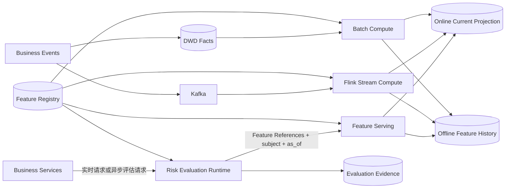
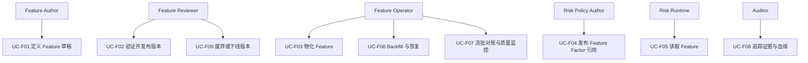
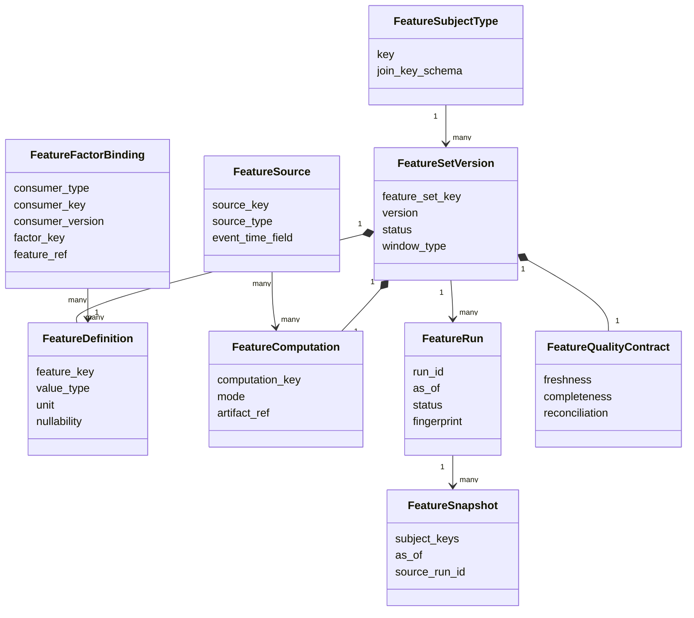
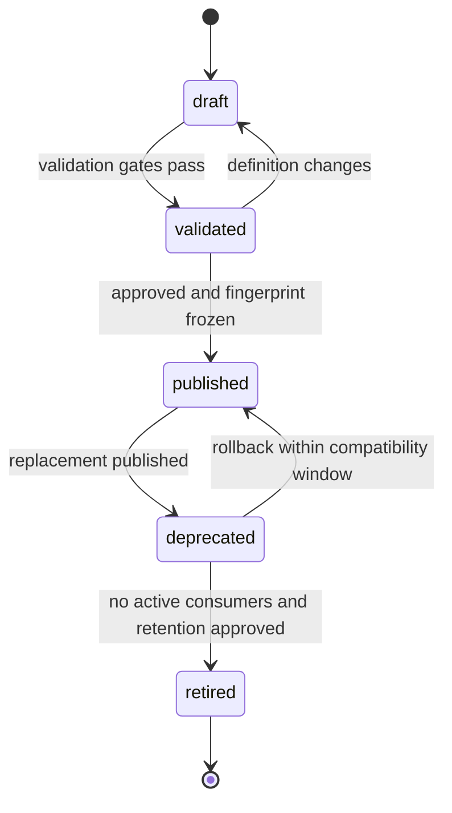
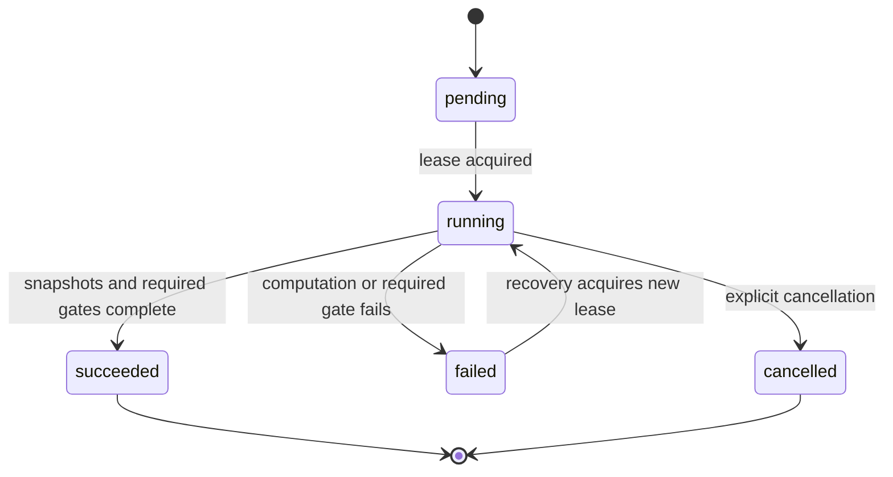

# 风险特征平台技术方案

> 状态：S6 管理接口、双人审批、持续健康检查、回滚建议与版本下线保护已实现，并通过 Kind PostgreSQL 联合验证
>
> 适用范围：本地风险控制实验平台
> 当前没有切换现有部署中的生产 Factor 来源；独立管理面与周期健康检查已部署到本地 Kind 验收

## 1. 背景与目标

当前实验平台已经具备风险特征数据面的主要基础：

- 分域 DWD 事实；
- DWS History 与 Current Projection；
- `feature_set_key`、`feature_set_version`、`window_type` 和固定 `as_of`；
- ClickHouse 历史快照；
- Airflow 批量计算与 Backfill；
- Flink Shadow 流式计算；
- 流批结果对账；
- Feature Adapter 与 Warehouse Feature Factor Provider；
- Feature Run、质量结果、内容指纹和运行血缘。

但这些能力仍以 SQL、任务、表和代码 Adapter 的形式分散存在。系统尚不能统一回答：

- 平台中有哪些 Feature，分别代表什么业务语义；
- Feature 由谁负责、从哪里计算、支持哪些主体和窗口；
- 哪个版本已经发布，哪些 Policy 正在使用；
- 实时、近线和离线评估如何读取同一个 Feature；
- Feature 缺失、过期、未定义或流批不一致时如何阻止错误决策；
- Feature 变更是否需要 Backfill，旧版本何时可以安全下线。

本方案的目标是把现有数据面提升为一个最小但完整的 Feature Platform：

```text
Feature Platform
├── Control Plane：定义、版本、发布、依赖、质量与权限
├── Compute Plane：批量、流式、Backfill 与对账
├── Storage Plane：History 与 Current Projection
└── Serving Plane：统一、类型化、点时正确的读取接口
```

### 1.1 设计目标

1. 实时、近线、离线共用 Feature 语义和读取契约；
2. Feature 与 Factor、Rule、Policy 保持清晰边界；
3. 同一 Feature 支持批量生产、流式生产和历史回放；
4. 发布后的 Feature 版本不可原地修改；
5. 所有读取都有明确主体、版本、时间与新鲜度语义；
6. Feature 生产、存储、服务和消费关系可追踪；
7. 在不推倒现有 ClickHouse、Airflow、Flink 和风险引擎的前提下逐步演进。

### 1.2 非目标

本阶段明确不实现：

- ML 模型训练平台；
- Notebook 和数据科学实验环境；
- 在线模型推理；
- 任意 SQL/UDF 在线执行；
- Feature 管理 UI；
- 多租户隔离；
- 自动改变 Policy 或执行风险 Action；
- 使用 Feature 更新事件触发普通业务近线评估。

平台当前只服务一个业务平台。收单、卡、出入金、安全和客户风险是 Source Domain，不是 Tenant。

## 2. 已确认的统一语义

### 2.1 Feature 与 Factor

```text
业务事实 Fact
    ↓ 计算、聚合、版本化
Feature Data
    ↓ Feature Factor Provider
Factor Value
    ↓ CEL Rule
Policy Strategy
    ↓
Decision + Actions
```

- Feature 属于数据和特征工程，描述可复用的数据产品；
- Factor 属于决策引擎，描述某次 Evaluation 的类型化输入如何取得；
- Feature 是 Factor 的一种来源；
- Feature Platform 不执行 CEL Rule，也不产生 pass/block；
- Rule 不访问 Feature Store、SQL、Redis、RPC 或 Flink；
- Strategy 才负责把 Rule 命中结果映射为 Decision 与 Action Intent。

### 2.2 三种评估模式

实时、近线和离线都可以读取 Feature Platform。它们的差异是评估触发、时间预算和结果交付，而不是三套 Feature 定义。

| 评估模式 | 触发 | 结果交付 | Feature 时间语义 |
|---|---|---|---|
| realtime | 业务同步请求 | 同步 pass/block | 请求时间之前最新且满足新鲜度的快照 |
| nearline | 业务请求进入 pending 后发送 MQ | 异步 Decision Event | 业务请求时间之前最新且满足新鲜度的快照 |
| offline | 调度、扫描、回放、Backfill | 批量 Evaluation/Finding | 固定历史 `as_of` 的点时快照 |

近线主链路固定为：

```text
业务请求
  → RiskEvaluationRequested
  → Nearline Risk Worker
  → 按 requested_at 读取 Feature
  → Factor / CEL / Policy
  → RiskEvaluationCompleted
```

Feature 的生产和物化独立运行，不作为普通业务近线策略的触发源。

## 3. 利益相关者与架构视图

本方案只选择支持当前决策所需的四个视图。

| 视图 | 看图者与决策 | 回答的问题 | 不负责回答 |
|---|---|---|---|
| 系统上下文 | 风控、数据和业务负责人确定边界 | Feature Platform 与业务服务、风险引擎、数据基础设施如何协作 | 表字段和部署参数 |
| 用例视图 | 产品、风控、数据工程师冻结平台能力 | 谁在什么触发下得到什么结果 | 具体数据库实现 |
| 领域模型 | 架构师和实现者冻结语言与所有权 | 核心对象、关系、不变量和生命周期 | 物理表拆分 |
| 数据流视图 | 数据和平台工程师确定时间语义 | Fact 如何变成 Snapshot 并被点时读取 | Policy 业务规则 |

### 3.1 参与者

| 参与者 | 目标 |
|---|---|
| Feature Author | 定义 Feature 语义、类型、主体、窗口、数据来源和计算契约 |
| Feature Reviewer | 审核语义、隐私、点时正确性、质量与兼容性 |
| Feature Operator | 执行 Materialization、Backfill、恢复、对账和下线 |
| Risk Policy Author | 为 Policy 选择已经发布、适合当前评估模式的 Feature |
| Risk Runtime | 根据 Policy 编译出的依赖批量读取 Feature |
| Auditor/Investigator | 追踪某次 Evaluation 使用的 Feature 版本、快照和来源运行 |
| Business Service | 发起实时或近线风险评估；不直接读取 Feature 表 |

## 4. 系统上下文与职责边界



### 4.1 Feature Platform 拥有

- Feature、Feature Set 和 Feature Computation 的定义与版本；
- Feature 发布、废弃和下线状态；
- Materialization、Backfill、质量检查和流批对账元数据；
- Feature History 与 Current Projection 的存储契约；
- 点时读取、在线读取和批量读取接口；
- Feature 生产与消费血缘；
- Feature 级权限、审计和服务指标。

### 4.2 Feature Platform 不拥有

- 业务事实的最终业务含义和生命周期；
- 风控 Factor 的非 Feature 来源；
- CEL Rule、Policy Strategy、Decision 和 Action；
- Business Service 的业务状态机；
- 案件、名单和限制的执行；
- 原始事件的业务修复。

### 4.3 相邻系统职责

| 系统 | 权威事实 |
|---|---|
| Business Service | 业务单、账户、卡、支付、提现、客户等当前业务状态 |
| Event/Data Plane | 原始事件和标准 DWD 事实 |
| Feature Platform | 已发布 Feature 的定义、运行和快照 |
| Risk Engine | Factor、Rule、Policy、Evaluation、Decision 与 Action Intent |
| Action Executor | 限制、名单、案件、通知等副作用结果 |

## 5. 用例地图



### 5.1 用例总表

| 用例 | 触发 | 成功结果 | 关键异常 |
|---|---|---|---|
| UC-F01 定义 Feature 草稿 | Author 提交定义 | 得到可编辑 Draft | Key 冲突、主体/类型/窗口不合法 |
| UC-F02 验证并发布版本 | Reviewer 审核 Draft | 不可变 Published Version | Schema、点时、质量或兼容检查失败 |
| UC-F03 物化 Feature | 调度、流事件、人工恢复 | History/Current 产生带血缘快照 | 重复 Run、迟到、乱序、部分写入 |
| UC-F04 发布 Feature Factor 引用 | Policy 发布 | 每个 Feature Factor 直接引用一个已发布 Feature | 使用未发布、过期或类型不兼容的 Feature |
| UC-F05 读取 Feature | Evaluation Fetch Plan | 类型化、点时正确的 Snapshot | missing、stale、undefined、timeout |
| UC-F06 Backfill 与恢复 | Operator 指定时间范围 | 每个 `as_of` 有可审计 Run | 中途失败、重复点、恢复越界 |
| UC-F07 对账与质量监控 | Run 完成或定时检查 | matched 或持久化差异/告警 | stream/batch 缺失、分布漂移 |
| UC-F08 证据与血缘 | 调查 Evaluation | 定位 Definition、Run、Snapshot、Factor Value | 历史版本已被破坏或证据缺失 |
| UC-F09 废弃/下线 | Owner 提交变更 | 无活跃 Feature Factor 后安全 Retire | 仍有 Factor 引用 |

## 6. 用例实施契约

### 6.1 UC-F01：定义 Feature 草稿

| 契约项 | 内容 |
|---|---|
| Actor/Trigger | Feature Author 提交一个新 Feature 或新版本草稿 |
| 权威输入 | Feature Key、类型、主体类型、窗口、单位、来源、计算契约、Owner |
| 输出 | 状态为 `draft` 的 Feature Set Version 和 Feature Definitions |
| 不变量 | Key 稳定；同版本内名称唯一；类型、单位和窗口明确；不包含 Rule 结论 |
| Owner | Feature Registry Control Plane |
| 副作用 | 只写 Registry，不启动计算、不产生 Snapshot |
| 幂等 | Author Request ID + Definition Fingerprint |
| 排除 | 不接受任意在线 SQL；不直接写 Current/History |
| 验证 | 重复提交、Key 冲突、非法主体、非法窗口、敏感字段分类 |

### 6.2 UC-F02：验证并发布 Feature 版本

| 契约项 | 内容 |
|---|---|
| Actor/Trigger | Reviewer 请求验证并发布 Draft |
| 权威输入 | Draft Definition、Source Schema、样例数据、Quality Contract |
| 输出 | 不可变 `published` Feature Set Version |
| 规则 | 编译/Schema/点时/质量/权限检查全部通过；发布后内容不可修改 |
| Owner | Feature Publisher |
| 副作用 | 写发布记录；生成 Materialization Plan；不自动切换 Risk Policy |
| 幂等 | Feature Set Key + Version + Definition Fingerprint |
| 失败 | 任一 Required Gate 失败则保持 Draft/Validated，不产生 Published |
| 验证 | 未知 Source、未来数据泄漏、Schema 不兼容、指纹冲突、重复发布 |

### 6.3 UC-F03：物化 Feature

| 契约项 | 内容 |
|---|---|
| Actor/Trigger | Batch Schedule、Flink 流处理、人工恢复或 Backfill |
| 权威输入 | Published Definition、Source Facts、固定 `as_of` 或 Event Time |
| 输出 | Immutable History Snapshot；满足条件时更新 Current Projection |
| 规则 | History 追加；Current 只接受更高语义版本/更晚 Event Time；Run 指纹幂等 |
| Owner | Materialization Runtime |
| 副作用 | 写 Snapshot、Run、Quality Result、Lineage；发布可观测指标 |
| 幂等 | Source Run ID + Content Fingerprint |
| 失败 | 同 Run 不同内容必须拒绝；部分写入必须可恢复或补偿 |
| 验证 | 重放、乱序、迟到、重复写、批流等值、Current 不被旧值覆盖 |

### 6.4 UC-F04：发布 Feature Factor 引用

| 契约项 | 内容 |
|---|---|
| Actor/Trigger | Risk Policy Author 发布包含 Feature Factor 的 Policy Version |
| 权威输入 | Factor Key、Value Type 与完整 Feature Reference |
| 输出 | 不可变 Factor Definition；Registry 中记录 Factor → Feature 的直接依赖 |
| 规则 | Feature 已发布；Factor 与 Feature 类型匹配；支持目标 Evaluation Mode；Freshness 有定义 |
| Owner | Factor/Policy Publisher 与 Feature Registry 发布 Gate |
| 副作用 | 记录直接消费血缘；不把 Feature 集合挂在 Policy 或 Strategy 下；不复制 Feature 值 |
| 幂等 | Consumer Identity + Factor Key + Feature Reference |
| 失败 | 未发布 Feature、类型/模式不兼容、同版本 Factor 改指其他 Feature 时拒绝发布 |
| 验证 | Realtime 引用 Offline-only Feature、类型漂移、完全相同绑定重放、引用冲突 |

### 6.5 UC-F05：读取 Feature

| 契约项 | 内容 |
|---|---|
| Actor/Trigger | Risk Runtime 根据一次 Evaluation 的 Fetch Plan 发起批量读取 |
| 权威输入 | Subject Keys、Feature Refs、Evaluation Mode、`as_of`、Max Age、Deadline |
| 输出 | Feature Snapshot Envelope 与每个 Feature 的类型化状态/值 |
| 规则 | 不返回 `as_of` 之后的数据；不把 missing/undefined/error 转成零；同次读取版本一致 |
| Owner | Feature Serving Plane |
| 副作用 | 读取审计和指标；不触发 Rule，不持久化业务 Decision |
| 幂等 | 只读；相同不可变引用返回相同历史结果 |
| 失败 | timeout、missing、stale、future、undefined、version_not_found |
| 验证 | 最新值、LatestBefore、ExactAt、批量字段、超时、部分缺失、权限 |

### 6.6 UC-F06/07：Backfill、恢复、质量与对账

| 契约项 | 内容 |
|---|---|
| Actor/Trigger | Operator 指定 Feature Set、版本、`as_of` 范围和步长 |
| 权威输入 | Published Definition、历史 Source Facts、Backfill Command |
| 输出 | 每个点独立 Run；完整 History；Run/Quality/Reconciliation 汇总 |
| 规则 | 固定 `as_of`；失败点可恢复；成功点不重复；流批口径共享 |
| Owner | Feature Orchestrator + Compute Plane |
| 副作用 | 批量写 History；可更新 Shadow Current；不得自动产生业务 Action |
| 幂等 | Backfill Command Fingerprint；每个 `as_of` 唯一子 Run |
| 失败 | 从失败点恢复；不能整段静默覆盖；差异超过阈值阻断 Serving Promotion |
| 验证 | 中途失败、并发恢复、流缺失、批缺失、阈值边界、统计守恒 |

### 6.7 UC-F08/09：审计、废弃与下线

| 契约项 | 内容 |
|---|---|
| Actor/Trigger | Auditor 调查或 Owner 请求下线 |
| 权威输入 | Feature Factor Binding、Snapshot Ref、Run Lineage、Retention Policy |
| 输出 | 可解释证据链，或安全的 Deprecated/Retired 状态 |
| 规则 | Published 历史不可改；有活跃消费者不得 Retire；Retire 不删除决策证据 |
| Owner | Registry + Audit Service |
| 副作用 | 状态变更、告警、保留策略；不删除已引用 History |
| 验证 | 活跃 Feature Factor 阻断、历史查询、旧 Factor 版本恢复、Retire 后新绑定失败 |

## 7. 领域模型

### 7.1 核心关系



### 7.2 Feature Subject Type

定义 Feature 可以按什么业务主体聚合和读取，例如：

```text
organization
user
merchant
account
card
provider_channel
```

它定义 Join Key Schema，不保存具体主体实例。第一阶段继续复用现有 `subject_type + subject_id`，不引入 Tenant。

### 7.3 Feature Source

一个稳定、可版本化的数据来源引用，例如 DWD 表、Kafka Topic 或受控快照。它定义：

- Source Domain；
- Source Type；
- Schema Version；
- Event Time 字段；
- 主体映射；
- 数据分类；
- Owner。

Feature Source 不是任意 SQL 字符串，也不是某个临时文件路径。

### 7.4 Feature Set Version

一组在以下方面共享生命周期的 Feature：

- 相同主体 Key；
- 相同窗口族或快照粒度；
- 相同生产和物化节奏；
- 相同存储与服务生命周期；
- 相同 Owner 和质量边界。

Feature Set 是版本化和发布单位。不同 Version 之间可以改变计算逻辑、Schema 或时间语义；已发布 Version 不可修改。

### 7.5 Feature Definition

Feature Set 中的一个类型化、可被消费的值。至少定义：

```text
feature_key
value_type
business_description
unit
defined_when
missing_semantics
freshness_requirement
supported_evaluation_modes
data_classification
```

Feature Definition 不包含 Rule 阈值，不表达“高风险”或“阻断”。

### 7.6 Feature Computation

定义 Feature Set 如何从 Feature Source 计算和物化。第一阶段使用这一术语而不是行业中容易歧义的 `Feature View`。

它包含：

- batch、streaming 或 external 模式；
- 受版本控制的代码/SQL Artifact 引用；
- Source Dependencies；
- 窗口语义；
- 输出 Schema；
- Materialization Schedule/Trigger；
- Backfill 能力。

Registry 不保存可由线上服务任意执行的脚本正文；它保存不可变 Artifact Ref 和指纹。

### 7.7 Feature Reference、Feature Factor Binding 与 Fetch Plan

完整 Feature Reference 由三部分组成：

```text
feature_set_key + feature_set_version + feature_key
```

例如 `subject_fund_activity / v2 / outflow_ratio`。其中 `feature_set_key` 标识一组共享主体、粒度、计算、物化和质量生命周期的特征；`feature_key` 标识该组中的一个具体类型化指标。

Feature Factor Definition 直接保存完整 Feature Reference。Rule 只引用 Factor Key，不直接读取 Feature。Registry 通过 Feature Factor Binding 保存版本化 Factor Definition 到已发布 Feature Definition 的直接依赖，用于影响分析和下线保护。

Feature Fetch Plan 不属于 Policy、Strategy 或 Registry 领域模型。Risk Runtime 加载不可变 Policy Snapshot 时，根据其中实际使用的 Feature Factor Definitions 临时编译 Fetch Plan，用于：

- 去重相同 Feature Reference；
- 按 Feature Set Version 合并批量读取；
- 计算本次 Evaluation 的严格新鲜度边界；
- 把 Feature 返回值映射回 Factor Key；
- Evaluation 结束后释放请求级值。

### 7.8 Feature Run 与 Feature Snapshot

- Feature Run 记录一次计算命令、输入截止时间、`as_of`、状态、计数和内容指纹；
- Feature Snapshot 是 Run 为一个主体和一个 `as_of` 产生的不可变结果；
- Current Projection 是从 History 派生的快速读取视图，不是历史事实源；
- 同一 Run ID 对应不同内容必须拒绝并报警。

### 7.9 Feature Factor Binding

记录哪个版本化 Factor Definition 正在使用哪个 Feature：

```text
consumer_type       = risk_policy
consumer_key        = withdrawal_risk
consumer_version    = 7
factor_key          = outflow_ratio_24h
feature_set_key     = subject_fund_activity
feature_set_version = 2
feature_key         = outflow_ratio
```

它不会让 Policy 或 Strategy 拥有 Feature 集合，只用于影响分析、审计，以及阻止仍被 Feature Factor 引用的 Feature 被下线。

## 8. 状态机

### 8.1 Feature Set Version



状态语义：

| 状态 | 是否可改定义 | 是否可新增 Feature Factor Binding | 是否可 Materialize | 是否可读取历史 |
|---|---:|---:|---:|---:|
| draft | 是 | 否 | 仅测试 | 否 |
| validated | 是，修改后重新验证 | 否 | 仅 Shadow | 否 |
| published | 否 | 是 | 是 | 是 |
| deprecated | 否 | 默认否 | 只为存量与回滚 | 是 |
| retired | 否 | 否 | 否 | 按保留策略只读 |

### 8.2 Feature Run



`succeeded` 表示本次 Run 的不可变结果完成，不自动表示它已经被提升为线上 Current。

## 9. Feature 读取契约

### 9.1 统一逻辑接口

暂定三个能力，而不是为实时、近线、离线定义三套 Feature 类型：

```text
BatchGetLatestBefore
  主体 + Feature Refs + cutoff + max_age

BatchGetAt
  主体 + Feature Refs + exact/as-of semantics

BatchScanAt
  多主体 + Feature Refs + as_of/range
```

实时和近线可以共用 `BatchGetLatestBefore`；离线和回放使用 `BatchGetAt/BatchScanAt`。底层选择 Current、History 或 Warehouse 是 Serving Plane 的责任。

### 9.2 请求语义

每次请求至少包含：

```text
subject keys
explicit feature refs
evaluation mode
as_of/cutoff
max_age
deadline
request_id
```

### 9.3 返回语义

每个 Feature Value 返回：

```text
feature key/version
value type
status: success/missing/undefined/stale/error
value
snapshot as_of
computed_at
source_run_id
content_fingerprint
```

Serving Service 不把缺失、未定义、过期或错误静默转换为默认值。

### 9.4 单次 Evaluation 的内存边界

读取结果只在一次 Evaluation 的 Factor Runtime 中短暂存在。权威 Feature 保存在 Feature Store；实际参与 Decision 的 Factor Values 和 Snapshot References 持久化到 Evaluation Evidence。Worker 不维护跨主体、无界增长的 Feature 内存缓存。

### 9.5 请求时间与当前业务事实

历史 Feature 默认统计到业务请求时间之前。当前请求数据通过 Value Factor 进入引擎；如果需要“历史 + 当前请求”的预测值，由 Expression Factor 计算，避免等待当前事件先进入流式窗口，也避免重复计数。

## 10. 时间与一致性不变量

所有 Feature 必须明确区分：

```text
event_time    业务事实发生时间
window_start  窗口实际开始
window_end    窗口实际结束
as_of         本次计算允许看到的最晚事实时间
computed_at   计算实际完成时间
written_at    存储实际完成时间
```

核心不变量：

1. 返回的 Snapshot `as_of` 不得晚于读取请求的 cutoff；
2. Point-in-time 计算不得读取 `as_of` 之后的 Fact；
3. History 追加，不原地改写已被消费的 Snapshot；
4. Current 只接受语义上更新的值，迟到旧值不得覆盖新值；
5. 同一 Feature Version 的 batch/stream 定义共享主体、窗口、单位、缺失和除零语义；
6. 流批差异超过 Required Threshold 时，不得提升新的 Serving Version；
7. Feature Version、Source Run、Snapshot 和 Evaluation Evidence 可相互追踪。

## 11. 发布 Gate

Feature Version 从 Validated 进入 Published 前必须通过：

| Gate | 检查内容 |
|---|---|
| Schema | 输出字段、类型、单位、主体 Key、窗口完整 |
| Source | Source 已注册，Schema Version 与 Event Time 明确 |
| Point-in-time | 样例回放不存在未来数据泄漏 |
| Quality | Required Completeness、Range、Freshness 检查通过 |
| Batch/Stream | 声明双实现时，Shadow 对账在阈值内 |
| Security | 数据分类、Owner 和读取权限明确 |
| Compatibility | 与旧版本的 Key、类型和消费者迁移策略明确 |
| Operability | Backfill、恢复、监控和下线方案存在 |

## 12. 现有实现映射与差距

| 目标对象/能力 | 当前证据 | S0 结论 |
|---|---|---|
| Feature Run | `risk_control.feature_runs` | 复用并在 S1 对齐 Registry 外键 |
| Run Fingerprint | `feature_run_fingerprints` | 复用，保持同 Run 内容不可冲突 |
| Quality Result | `feature_quality_results` | 复用，补充 Quality Contract 定义 |
| Reconciliation | `feature_reconciliations` | 复用，作为 Serving Promotion Gate |
| Backfill | `backfill_runs/backfill_points` | 复用，Feature 与 Policy 回放后续解耦 |
| History/Current | ClickHouse DWS History/Current | 复用；Current 是投影，不是权威历史 |
| Feature Adapter | `riskwarehouse.FeatureAdapterRegistry` | 演进为通用 Feature Set Adapter |
| Registry | 无完整定义表 | S1 新建 |
| Feature Factor Binding | 无 | S1 新建，直接记录 Factor → Feature 依赖 |
| Feature Serving | 无统一服务 | S2 实现 |
| Go SDK | 无 | S3 实现 |
| Online Store | ClickHouse Reference + Redis Candidate | S5 已实现受控晋升与回滚，现有部署仍未切换 |

## 13. 关键设计决策

### D1：不引入 Tenant

当前只有一个平台，不同业务模块是 Source Domain，不是租户。所有表和接口不增加没有业务意义的 `tenant_id`。

### D2：Feature Set 是版本化与发布单位

Feature Definition 属于 Feature Set Version。相同主体、窗口和物化生命周期的一组 Feature 一起版本化，避免每列独立发布造成无法验证的混合版本。

### D3：发布版本不可变

修改计算、类型、窗口、单位或缺失语义必须创建新版本。Current/History 与 Feature Factor Binding 都记录明确版本。

### D4：Feature Factor 直接引用版本化 Feature

Policy 和 Strategy 不拥有 Feature 集合。每个 Feature Factor Definition 直接引用完整的 `feature_set_key + feature_set_version + feature_key`；Rule 只使用 Factor Key。Risk Runtime 根据不可变 Factor Definitions 临时编译 Fetch Plan，避免把运行优化错误建模成业务领域对象。

### D5：计算定义引用版本化 Artifact

Registry 保存 Artifact URI/Commit/Digest 和声明式元数据，不保存可由线上服务任意执行的脚本正文。

### D6：Serving 接口统一，物理存储可替换

Factor Definition 只引用 Feature；Serving Plane 根据点时、批量规模、延迟和新鲜度选择 Current、History 或 Warehouse。

### D7：离线生产不等于离线消费

离线计算出的 Feature 如果已经物化到 Online Store，并满足新鲜度和读取预算，可以用于实时与近线 Policy。

## 14. 抽象必要性检查

| 抽象 | 服务的具体用例 | 隔离的变化/风险 | 更简单替代 | 决策 |
|---|---|---|---|---|
| Feature Set Version | 定义、发布、物化、读取、下线 | 一组 Feature 的共同生命周期和兼容性 | 每个字段独立定义 | 保留 |
| Feature Computation | batch/stream/backfill | 计算实现与业务语义解耦、可追踪 Artifact | Registry 保存任意 SQL | 保留 |
| Feature Factor Binding | Factor 发布、影响分析、下线保护 | 哪个版本化 Factor 使用哪个 Feature | 日志搜索 | 保留 |
| Feature Fetch Plan | Evaluation 批量取数 | 重复查询、请求内版本不一致 | 每个 Factor 单独调用 Serving | 保留为运行时临时对象 |
| Feature Serving Service | 实时/近线/离线读取 | 存储、点时、版本、权限和错误语义 | 所有服务直连 ClickHouse/Redis | 保留 |
| 独立 Online/Offline FactorType | 无独立业务语义 | 仅物理存储差异 | 一个 Feature FactorType | 不采用 |
| Feature 更新触发 Policy | 仅持续监控类未来用例 | 会混淆业务请求触发 | 业务请求触发近线评估 | 暂缓 |

## 15. 实施路线

```text
S0 用例、领域模型、边界与不变量
  ↓
S1 Feature Registry Schema 与发布契约
  ↓
S2 只读 Feature Serving（先复用 ClickHouse）
  ↓
S3 Go SDK、Feature Factor Provider 与 Fetch Plan
  ↓
S4 Online Store Current Projection
  ↓
S5 Materialization Publisher 与 Serving Promotion
  ↓
S6 质量、权限、监控、废弃和下线治理
```

| 阶段 | 结果 | 依赖 | 独立部署 | 完成 Gate |
|---|---|---|---:|---|
| S0 | 用例、模型、边界和术语冻结 | 无 | N/A | 文档与 Glossary 一致；无数据库行为变化 |
| S1 | Registry 表、Repository、发布状态机 | S0 | 是，不接生产读取 | 迁移/约束/幂等/状态测试通过 |
| S2 | gRPC 只读服务读取现有 Current/History | S1 | 是，Shadow | LatestBefore/At/权限/超时契约测试通过 |
| S3 | Risk Engine 批量读取 Feature | S2 | 是，Shadow Policy | 同次 Evaluation 一次 Snapshot 读取；证据完整 |
| S4 | Redis 等 Online Current Store | S2/S3 | 是，双读 | 与 ClickHouse Current 对账达标 |
| S5 | 发布后自动物化与 Promotion Gate | S1-S4 | 分阶段 | 失败不提升，回滚可恢复旧版本 |
| S6 | 完整治理与运维 | S1-S5 | 是 | SLO、告警、RBAC、废弃/下线演练通过 |

### 15.1 Commit 边界

| Commit/Stage | 必须包含 | 不得混入 |
|---|---|---|
| C00/S0 | 本方案、Glossary | SQL、服务代码、部署清单 |
| C01/S1 | Registry Migration、Repository、状态机测试 | Feature Serving |
| C02/S2 | Proto/API、只读 Service、Adapter 与契约测试 | Redis Online Store |
| C03/S3 | Go SDK、Provider、Fetch Plan、Evidence | Materialization 自动发布 |
| C04/S4 | Online Store Adapter、双读 Shadow、对账 | Policy 语义修改 |

## 16. S0 完成检查

- [x] 平台目标和非目标明确；
- [x] 实时、近线、离线触发和时间语义明确；
- [x] Feature、Factor、Rule、Policy 边界明确；
- [x] 核心参与者与九个用例明确；
- [x] 每个关键用例有输入、输出、Owner、幂等和失败语义；
- [x] 核心领域对象和关系明确；
- [x] Feature Version 与 Run 状态机明确；
- [x] Current/History、Point-in-time 和证据边界明确；
- [x] 现有表和代码的复用范围明确；
- [x] S1-S6 依赖、Gate 和 Commit 边界明确。

## 17. 当前执行入口

当前阶段：`S6 Implemented / Governance, health alert, rollback and retirement verified with Kind PostgreSQL / admin and scheduled monitor deployed in local Kind`。

S1 已完成：

```text
Feature Registry PostgreSQL Schema
Feature Set/Definition/Computation/Feature Factor Binding Repository
Feature Version 发布状态机
Definition Fingerprint 与幂等约束
```

S2 已完成：

```text
Feature Serving gRPC 只读契约
BatchGetLatestBefore
BatchGetAt
先读取现有 ClickHouse Current/History
超时、新鲜度、缺失和权限语义
```

S2 阶段排除过：

- Redis Online Store；
- Flink 作业改造；
- Policy 行为切换；
- 现有 DWS 表迁移；
- Feature 管理 UI。

S2 Shadow Serving 已准确读取既有 Current/History；S3 在不切换现有生产 Factor 来源的前提下完成 Risk Engine 接入；S4 新增 Redis Current Candidate 与双读对账，但业务结果仍由 ClickHouse Reference 决定。

## 18. S1 实现记录

### 18.1 PostgreSQL Registry 表

| 表 | 负责的领域对象 | 关键约束 |
|---|---|---|
| `feature_subject_types` | Feature Subject Type | Join Key 定义带内容指纹；同 Key 不得语义漂移 |
| `feature_sources` | Feature Source Version | Source Key + Version 唯一；内容不可修改 |
| `feature_set_versions` | Feature Set Version | 版本唯一；状态机与发布元数据由触发器保护 |
| `feature_definitions` | Feature Definition | Feature Key、顺序和类型受约束；发布后不可修改 |
| `feature_computations` | Feature Computation | 每个 Feature Set Version 只有一个计算定义 |
| `feature_computation_sources` | Source Dependencies | 只能引用已注册 Source Version |
| `feature_quality_contracts` | Feature Quality Contract | 每个 Feature Set Version 一份质量契约 |
| `feature_factor_bindings` | Feature Factor Binding | 一个版本化 Factor Key 只能直接绑定一个已发布 Feature Reference |

### 18.2 Repository 接缝

S1 暴露的是 Registry 行为，而不是 CRUD 表操作：

```text
RegisterSubjectType
RegisterSource
SaveDraft
Validate
Publish
GetFeatureSet
BindFeatureFactor
RetireFeatureFactorBinding
DeprecateFeatureSet
RestoreFeatureSet
RetireFeatureSet
```

事务与数据库共同保证：

1. 同一发布命令可安全重试，并返回相同指纹和发布时间；
2. 同一 Subject/Source 版本的相同内容可幂等重放；
3. 相同版本对应不同内容时返回冲突；
4. Feature Set 发布时冻结完整定义指纹；
5. 绕过 Repository 直接修改已发布 Definition 仍被数据库拒绝；
6. 有活跃 Feature Factor Binding 时不能退休 Feature Set；
7. Feature Factor 只能引用已发布 Feature；
8. Feature Definition 与 Computation Output Schema 类型必须一致。

### 18.3 TDD 与 Kind 证据

第一轮实现使用六个 PostgreSQL 集成测试覆盖七条契约：

```text
草稿 → 校验 → 发布 → 完整读取
发布命令幂等重试
已发布内容不可修改
Feature Factor 直接绑定已发布 Feature
活跃消费者阻止 Feature Set 退休
输出 Schema 类型不匹配时拒绝草稿
Subject Type 相同内容幂等、语义漂移冲突
```

Kind 验证结果：

- 每个测试在独立临时 Schema 中执行真实迁移和事务；
- 每次测试连续执行迁移两次，验证迁移幂等；
- 六个集成测试全部通过；
- 正式 `risk_control` Schema 连续执行迁移两次成功；
- 新增 8 张 Registry 表；Feature Factor Binding 取代了错误的 Bundle/Consumer Binding 模型；
- 未写入样例业务数据，未改变现有 Factor、Policy、Flink、Airflow 或 Feature Serving 行为。

## 19. S2 实现记录

### 19.1 Serving 行为，而不是存储表 API

S2 对外提供两个只读用例：

```text
BatchGetLatestBefore
  subject + feature refs + cutoff + max_age
  → 先读 Current
  → Current 中缺失的主体才回退 History

BatchGetAt
  subject + feature refs + exact as_of
  → 直接读取不可变 History
```

Risk Runtime 不感知 ClickHouse 表名，也不自行拼 SQL。一次请求中属于同一个 Feature Set Version 的多个字段会合并成一次 Snapshot 读取，避免按字段重复访问存储。

### 19.2 类型、状态与证据

每个返回值都携带：

```text
value_type
status = success / missing / undefined / stale / error
snapshot_as_of
computed_at
source_run_id
content_fingerprint
```

其中：

- `missing` 表示没有该主体的 Snapshot；
- `undefined` 表示 Snapshot 存在，但该值在业务上无定义，例如分母为零的比例；
- `stale` 表示 Snapshot 存在，但超过 Definition 或本次请求允许的 Max Age；
- `error` 表示质量未通过、类型不匹配或时间契约被破坏；
- 以上状态都不会被静默转换成数值零。

### 19.3 权限与调用者身份

Proto 请求不允许调用者自行填写 `principal`。gRPC Transport 通过注入的 `PrincipalResolver` 从可信调用上下文解析服务身份，再由 `FeatureAuthorizer` 检查该服务是否有权读取目标 Feature Set。

当前实现完成了接口接缝和 Allow-list 契约；独立 Pod 部署时必须接入受信的 mTLS 身份或网关签名元数据，不能使用客户端传入的普通 Header 冒充身份。

### 19.4 ClickHouse Shadow Adapter

首个 Adapter 只支持已经存在的 `subject_fund_activity` Version 1、`24h` 窗口：

```text
risk_warehouse.dws_subject_fund_activity_current_v2
  → LatestBefore 快速路径

risk_warehouse.dws_subject_fund_activity_history_v2
  → Current 缺失时回退
  → ExactAt 历史点时读取
```

这是一条受控的首个 Feature Set 接缝，不是让线上服务获得任意 ClickHouse SQL 执行能力。后续 Feature Set 应通过独立 Adapter 或声明式映射注册，并保持同样的 Snapshot 契约。

### 19.5 测试与 Kind 证据

S2 的验证覆盖：

- 同一 Feature Set 的多个字段只读取一次 Snapshot；
- `LatestBefore` 的 Current → History 缺失回退；
- `BatchGetAt` 的精确历史点读取；
- missing、undefined、stale、质量失败和类型错误；
- 服务身份 Allow-list；
- gRPC 网络往返与类型化值编码；
- 请求错误与后端故障使用不同 gRPC 状态；
- PostgreSQL Registry 发布定义与 ClickHouse Snapshot 的端到端组合。

Kind Shadow 验证读取到既有样例：

```text
feature_set      = subject_fund_activity v1
subject          = organization-risk-demo-001 / USD
as_of            = 2026-11-08T00:00:00Z
inflow_minor     = 200000
outflow_minor    = 175000
outflow_ratio    = 0.875
quality_status   = passed
source_run_id    = risk-domain-demo-20261108-fund
```

验证只读取现有 Registry/ClickHouse 数据，没有写入新的业务事实、没有触发 Decision/Action，也没有切换现有 Risk Engine 的 Feature Factor Provider。

## 20. S3 实现记录

### 20.1 Feature Set Key 与 Feature Key

Feature Set Key 是一组共享主体、粒度、计算和物化生命周期的特征身份；Feature Key 是该组内的单个类型化指标。完整引用必须固定版本：

```text
subject_fund_activity / v1 / inflow_minor
subject_fund_activity / v1 / outflow_ratio
```

这两个 Feature 共享同一个组织主体、24 小时窗口、`as_of`、计算 Run 和质量边界，因此属于同一个 Feature Set；它们是不同的 Feature Key，因此可以分别映射为不同 Factor。

### 20.2 Risk Engine 消费链路

S3 完成 Risk Engine 的消费接入：

```text
Policy Snapshot
  → Feature Factor Definitions 直接引用 Feature
  → 临时编译 Fetch Plan
  → 一次批量 Feature Serving 调用
  → Feature Factor Provider
  → CEL / Strategy
  → Evaluation Evidence 保存 Feature Snapshot 引用
```

已实现的关键契约：

- `FactorTypeFeature` 与完整 Feature Reference；
- 同一 Feature Set 的多个 Feature Factor 合并为一次批量读取；
- 实时和近线使用 `EvaluateLatestBefore`，读取 cutoff 之前最新且满足 Freshness 的快照；
- 离线和回放使用 `EvaluateAt`，读取精确 `as_of` 快照；
- missing、undefined、stale、质量失败和类型错误不会变成默认零，而是阻断决策；
- Factor Evidence 保存 `source_ref`、`snapshot_as_of`、`computed_at`、`source_run_id` 和内容指纹；
- 新证据格式持久化完整 Factor Result，同时兼容读取旧版仅含值的 Evaluation；
- Policy Publisher 可注入 Feature Factor Provider，在发布前完成 Factor、CEL 与 Strategy 的整体编译验证。

Kind Shadow 实践读取既有 `subject_fund_activity v1` 快照，两个 Feature Factors 只执行一次 Serving 读取，并由 CEL 产生 `block + activate_restriction` 候选结果。该实践只验证决策候选与证据，没有执行 Action，也没有切换现有生产 Factor 来源。

S3 继续保持 Shadow。它不引入 Redis Online Store、不改 Flink 计算，也不改变 Strategy 的 Decision/Action 语义。

## 21. S4 实现记录

### 21.1 Online Current Store 的职责

S4 把 Redis 建模为可重建的 Current Projection，而不是新的历史事实源：

```text
ClickHouse History / Current Reference
             │
             ├── 物化最新合格 Snapshot
             ▼
Redis Online Current Candidate
             │
             └── 只服务 LatestBefore 候选读取

ExactAt / 历史回放 ───────────────→ ClickHouse History
```

同一个 `feature_set_key + version + subject keys` 在 Redis 中只保留一个 Current Snapshot。写入遵守三个结果：

- 更晚 `as_of`：`applied`；
- 相同 `as_of` 且相同内容指纹：`replay`；
- 更早 `as_of`：`ignored_older`；
- 相同 `as_of` 但内容指纹不同：冲突并拒绝。

Redis Adapter 使用原子监视与事务更新，避免并发首次写入或乱序写入覆盖较新的值。值使用带类型标签的编码，保证 `int64`、`double`、`bool`、`string` 等类型经过 Redis 往返后不发生 JSON 数字类型漂移。

### 21.2 双读 Shadow 的安全边界

```text
一次 Feature 请求
      ├── Redis Candidate
      └── ClickHouse Reference
                 │
                 ▼
      比较 as_of / fingerprint / quality / values
                 │
        ┌────────┴────────┐
        ▼                 ▼
     matched           mismatch
        │                 │
        └──── 持久化对账证据 ────┘
                          │
                          ▼
             始终返回 ClickHouse Reference
```

因此 Candidate 缺失、读取失败或数据不一致只会产生对账证据，不会改变当前业务 Decision。Reference 读取失败则整个请求失败，防止在尚未完成切换 Gate 时偷偷降级到未经证明的 Candidate。

PostgreSQL 表 `risk_control.feature_serving_shadow_comparisons` 保存：请求编号、Feature Set 版本、主体、Candidate/Reference `as_of`、对比状态、差异字段、内容指纹与对比时间。相同请求和内容可幂等重放；相同身份对应不同对比内容会被拒绝。

### 21.3 Kind 联合验收

真实联合测试串起了：

```text
PostgreSQL Registry
  → ClickHouse Current Reference
  → Redis Current Candidate
  → Shadow Serving
  → Feature Factor Provider
  → CEL Rule / Strategy
  → Decision + Action Candidates
  → PostgreSQL Shadow Comparison Evidence
```

验收包含两条路径：

1. Redis 与 ClickHouse 完全一致，记录 `matched`，得到 `block + activate_restriction` 候选结果；
2. Redis 的 `outflow_ratio` 被故意改错，记录 `mismatch` 和 `value:outflow_ratio`，但最终结果仍保持 ClickHouse Reference 产生的 `block`。

本阶段没有执行 Action，没有把 Redis 切换为权威来源，也没有改动 Feature、Factor、Rule、Strategy 的业务语义。

## 22. S5 实现记录

### 22.1 受控 Current Materialization

`CurrentMaterializer` 是计算结果进入 Redis 之前的治理接缝：

```text
Feature Snapshot
      ↓
Feature Set Version 是否 published？
      ↓
Quality Status 是否 passed？
      ↓
Redis Current 的原子单调写入
```

草稿、仅校验、已退休或质量失败的 Snapshot 不允许更新 Online Current。Redis 自身继续保证旧 `as_of` 不覆盖新值、相同内容可幂等重放、同点不同内容冲突。

### 22.2 Promotion Gate

晋升按一个显式证据时间段评估，而不是凭单次成功人工切换：

```text
Shadow Comparison History
   ├── 样本数
   ├── 覆盖的时间桶数
   ├── mismatch rate
   ├── missing/error rate
   ├── 最大 freshness lag
   └── candidate p95 latency
             ↓
      Promotion Assessment
       ├── eligible = false → 只记审计，不改 Route
       └── eligible = true  → Route: shadow → online
```

首轮 Gate 同时检查：

- `minimum_comparisons`：防止样本太少；
- `minimum_distinct_buckets`：防止大量请求集中在单一时刻伪造稳定性；
- `maximum_mismatch_rate`：约束结果一致性；
- `maximum_unavailable_rate`：合并 Candidate 缺失、Reference 缺失和 Candidate 错误；
- `maximum_candidate_freshness_lag`：约束 Snapshot 相对 cutoff 的滞后；
- `maximum_p95_candidate_read_duration`：约束低延迟读取能力。

每次 Assessment 无论通过还是拒绝都会持久化。相同 Request ID、相同证据和阈值可幂等重试；相同 Request ID 对应不同内容会冲突。

### 22.3 Serving Route 与显式回滚

Serving Route 按 `feature_set_key + version` 管理：

```text
shadow
  → Redis Candidate 与 ClickHouse Reference 双读
  → 返回 ClickHouse

online
  → LatestBefore 读取 Redis
  → ExactAt / 历史回放仍读取 ClickHouse History
```

路由变化有单调递增 `generation` 和不可变事件记录。回滚只修改 Route：

```text
online → shadow
```

Factor Definition、Feature Reference、CEL Rule、Policy Strategy 均不修改。Online 模式也不做静默回退；Candidate 故障必须暴露，由明确的回滚命令恢复 Reference，避免系统在无人知情时改变证据来源。

PostgreSQL 新增：

| 表 | 用途 |
|---|---|
| `feature_serving_promotion_assessments` | 保存晋升阈值、证据汇总、通过结果和拒绝原因 |
| `feature_serving_routes` | 保存每个 Feature Set Version 当前的 shadow/online Route |
| `feature_serving_route_events` | 保存 promotion/rollback 不可变事件与 generation |

### 22.4 Kind 晋升与事故恢复演练

联合测试完成了以下完整过程：

```text
ClickHouse 正确快照
  → CurrentMaterializer 写入 Redis
  → 三个连续小时 Shadow 证据通过 Gate
  → Route 晋升 online
  → Redis 驱动 CEL 得到 block
  → 故意物化错误比例，Online 决策变成 pass
  → 执行 Rollback
  → 相同请求重新由 ClickHouse 驱动，决策恢复 block
```

这次错误值是故意注入的事故演练数据，测试结束后会删除 Redis 临时 Key 和 PostgreSQL 临时 Schema；没有执行任何业务 Action。

### 22.5 S6 前置条件

S5 只证明候选数据源可以受控晋升和显式回滚。S6 必须继续解决“谁能切换、如何持续发现退化、何时允许下线”三个治理问题。正式路由不得启用无人审核的自动晋升或自动回滚。

## 23. S6 实现记录

### 23.1 独立管理接口与职责分离

S6 新增独立管理进程 `/risk-feature-admin`，不与普通 Feature 读取流量共用接口：

```text
Operator
  → 创建 Promotion Change Request
  → status=pending

Reviewer（必须是另一个人）
  → 重新读取最新 Comparison Evidence
  → 重新执行 Promotion Gate
  ├─ eligible=false → blocked，不改 Route
  └─ eligible=true  → approved，Route 切换 online

Emergency Operator
  → 在事故证据确认后显式 rollback
  → Route 切换 shadow
```

角色分为：

| 角色 | 权限 |
|---|---|
| `feature_operator` | 只能创建晋升申请 |
| `feature_reviewer` | 只能批准或拒绝申请；不能批准自己的申请 |
| `feature_emergency_operator` | 只能执行带原因的紧急回滚 |

管理端 Bearer Token 不以明文保存，只从 Secret 中读取 `SHA-256` 摘要配置，并映射成可信 Principal 与 Roles。HTTP 请求正文不能声明或覆盖操作人身份。

PostgreSQL 表 `feature_serving_change_requests` 持久化申请人、审核人、申请内容、审核结果与 Assessment ID。相同 Request ID 和相同内容允许重放；相同 Request ID 对应不同内容会冲突。

### 23.2 Online 持续双读与健康评估

晋升 Online 后不停止对账：

```text
Feature 请求
  ├─ Redis Candidate → 返回给业务
  └─ ClickHouse Reference → 只用于持续比较
                              ↓
              feature_serving_shadow_comparisons
                              ↓ 周期任务
                  Online Health Assessment
```

Candidate 故障继续阻断在线读取；Reference 故障不拖垮已经完成晋升的请求，而是记录 `reference_error`，进入不可用率证据。周期任务 `/risk-feature-health-monitor` 必须显式接收 `as_of`，再根据证据窗口汇总：

- 样本数和时间桶覆盖；
- mismatch rate；
- candidate/reference missing 与读错误；
- Candidate 最大新鲜度滞后；
- Candidate P95 读取耗时。

健康检查不直接切换 Route。越界时只创建 `open` 告警并给出 `recommended_action=rollback`；恢复健康后，同一路由 generation 的开放告警转为 `resolved`。告警存入 `feature_serving_health_alerts`，同一 Check ID 可幂等重跑。

XXL-JOB 或 CronJob 只负责按周期传入明确 `as_of` 并执行该二进制；业务判断、窗口、阈值、证据和幂等都由健康检查模块负责。

### 23.3 Feature Version 废弃与退休保护

Feature Set Version 的安全下线路径为：

```text
published
  → deprecated
  → Route 必须 shadow
  → 不得存在 pending Serving Change
  → 所有 Feature Factor Binding 必须 retired
  → retired
```

这些条件由 PostgreSQL 生命周期触发器最终兜底。即使绕过管理代码直接执行 SQL，只要仍在线、仍被 Factor 消费或仍有待审批变更，退休都会失败。历史 Snapshot、Assessment、Route Event、Alert 和 Evaluation Evidence 保留，不随版本退休删除。

### 23.4 Kind 联合演练

S6 的 Kind PostgreSQL 验收串起：

```text
三个干净时间桶
  → Operator 申请
  → Reviewer 批准
  → Route online
  → 注入 mismatch 对账证据
  → Health Alert(open, rollback recommended)
  → Emergency Operator 回滚
  → Route shadow
  → Feature Version deprecated
  → Feature Version retired
```

负向契约同时验证：自批被拒绝；Online Route 阻止退休；Pending Change 阻止退休；重复申请、告警和审核不会产生重复副作用；同一身份不同内容会冲突。

### 23.5 部署边界

代码提供两个独立入口：

- `/risk-feature-admin`：长运行管理进程，独立端口、认证和 RBAC；
- `/risk-feature-health-monitor`：一次性周期任务，由调度系统触发。

本地 Kind 已部署独立 Admin Deployment、仅集群内可见的 Service，以及每五分钟执行的 Health Monitor CronJob；CronJob 使用 `concurrencyPolicy=Forbid` 防止前一实例未结束时再次并发执行。现有部署没有切换 Factor 的生产读取来源，也不会自动执行告警建议。要在共享环境启用时，仍必须另行配置管理凭据 Secret、NetworkPolicy 和告警通知渠道，并评审调度参数与 SLO。

## 附录 A：调研基线

本方案没有直接照搬某个 ML Feature Store，而是从以下官方资料提取共同能力，再按照规则型风控用例收敛：

- [Feast Architecture](https://docs.feast.dev/v0.53-branch/getting-started/components/overview)：Registry、Feature Server、Online/Offline Store、Materialization 与点时读取；
- [Tecton Feature Services](https://docs.tecton.ai/docs/reading-feature-data/feature-services)：用不可变 Feature Service 组织消费者所需 Feature，并统一在线与历史读取；
- [Chronon](https://github.com/airbnb/chronon)：GroupBy/Join、在线 Fetch、点时正确和线上线下一致性；
- [Feathr](https://github.com/feathr-ai/feathr)：批流统一转换、Feature Registry、窗口聚合与 Point-in-time Join；
- [AWS Feature Store Concepts](https://docs.aws.amazon.com/sagemaker/latest/dg/feature-store-concepts.html)：Record Identifier、Event Time、Online Latest 与 Offline History；
- [AWS Online Store](https://docs.aws.amazon.com/sagemaker/latest/dg/feature-store-storage-configurations-online-store.html)：通过 Event Time 防止乱序旧写覆盖较新值。

本平台与这些系统的主要差异是：消费方首先是 Factor/CEL/Policy 风控引擎，而不是模型训练和推理平台。因此第一阶段保留 Feature Registry、点时正确、物化、Serving、血缘和流批一致能力，不引入训练数据集、模型注册、实验跟踪或在线推理。
