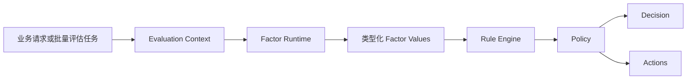
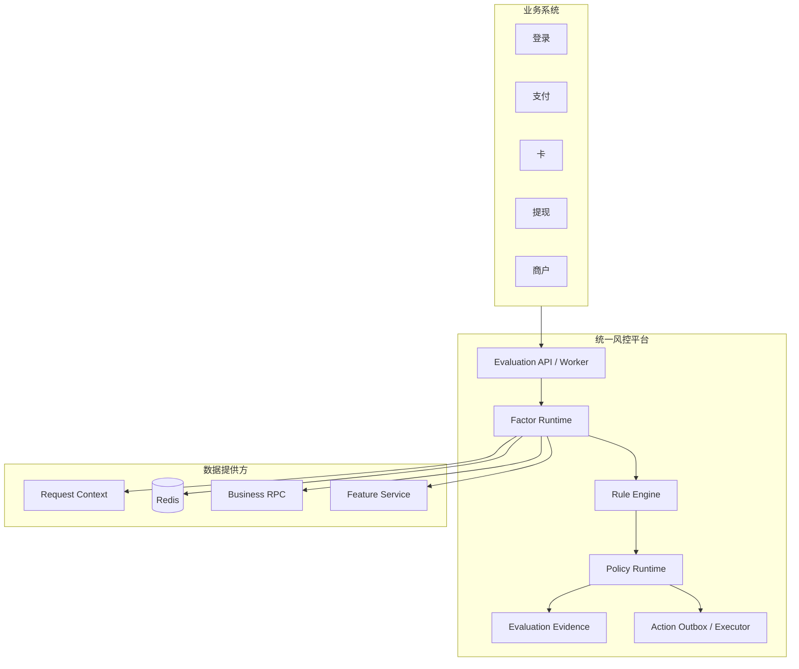
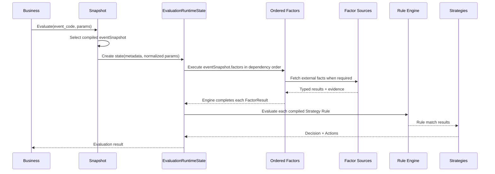

# 通用风控因子体系与规则引擎技术方案

> 文档定位：面向支付、收单、卡、账户、登录、提现、商户和客户等多业务系统的统一风控平台设计。
>
> 核心命题：业务数据和风险规则可以完全不同，但“如何取得决策输入”和“如何表达判断逻辑”可以被统一抽象。

---

## 1. 背景与目标

不同业务系统的风险问题差异很大：

- 登录关心账号、设备、IP、验证码和失败次数；
- 支付关心金额、商户、卡、渠道、设备和历史交易；
- 提现关心账户状态、余额、收款人、名单和资金流速；
- 发卡关心持卡人、卡状态、授权金额、国家和商户类别；
- 商户风控关心拒付率、退款率、投诉、关联主体和长期行为；
- 客户风控关心身份验证、制裁名单、关系网络和历史案件。

如果每个业务系统分别建设一套风控代码，会形成：

```text
支付系统：if/else + 自建Redis计数 + 自建黑名单
提现系统：另一套规则DSL + 直接查账户库
登录系统：硬编码阈值 + 本地缓存
卡系统：渠道返回码 + 独立规则表
```

最终问题不是“规则写不出来”，而是：

1. 同一个风险事实被重复定义；
2. 数据取得方式和规则逻辑耦合；
3. 规则无法统一发布、审计、灰度和回放；
4. 业务代码必须理解Redis、RPC、特征表和表达式实现；
5. 风控结果无法解释“当时使用了什么数据”；
6. 实时、近线和离线各自实现一套引擎。

### 1.1 建设目标

统一风控平台解决两类核心抽象：

```text
数据抽象：Factor，因子
规则抽象：Rule Engine，规则引擎
```

目标模型为：



### 1.2 非目标

本方案不负责：

- 替代业务系统拥有订单、账户、卡或客户状态；
- 让规则表达式直接访问数据库、Redis或RPC；
- 用规则引擎承担模型训练和大规模特征计算；
- 因Feature更新而自动触发所有近线规则；
- 在第一阶段建设复杂机器学习平台；
- 允许规则作者执行任意脚本、网络或文件操作。

---

## 2. 统一术语

统一术语是跨业务融合的前提。

| 术语 | 定义 | 示例 |
| --- | --- | --- |
| Fact | 已发生或当前存在的业务事实 | 提现10000、账户冻结、登录失败 |
| Feature | 由事实聚合、计算形成的可复用数据 | 24小时出金金额、90天拒付率 |
| Factor Definition | 规则输入如何取得、计算和解释的定义 | 从上下文读取金额、从RPC读取账户状态 |
| Factor | 由定义创建出的不可变运行时对象 | `withdrawal_amount` Value Factor |
| Factor Value | 某次评估中实际取得的类型化结果 | `withdrawal_amount=10000` |
| Rule | 只使用因子键表达的布尔判断 | `amount > 50000 && list_hit` |
| Policy | 一个业务场景下的规则、决策和可选动作组合 | 提现风险策略v7 |
| Decision | 对当前业务请求的处置结论 | `pass`、`block`、`review` |
| Action | 决策之外需要异步或受控执行的动作 | 加入名单、限制提现、创建案件 |
| Evidence | 支撑决策的因子值、版本、时间和来源证据 | Feature版本、RPC响应摘要、名单版本 |

关键边界：

```text
Feature只用于特征工程和特征平台
Factor统一用于决策引擎
Feature是Factor的一种数据来源
Rule只判断Factor，不负责取数
Policy根据规则命中产生Decision与Actions
```

Policy不直接绑定Feature集合。Feature必须通过Feature Factor转化为规则可见的因子键。

---

## 3. 用例分析：从业务差异中提炼稳定抽象

### 3.1 UC-01 实时提现拦截

| 项目 | 内容 |
| --- | --- |
| Actor | 提现服务 |
| Trigger | 用户提交提现 |
| Outcome | 在严格时延内返回`pass/block/review` |
| 输入 | 本次金额、币种、主体、收款人、设备 |
| 外部数据 | 账户状态、名单、最近失败次数、24小时资金特征 |
| 安全边界 | 超时和缺失不能静默变成零或`false` |

需要的因子：

```text
Value      本次提现金额、主体、设备
RPC        账户当前状态、当前限制
Counter    最近10分钟提现失败次数
List       收款人或设备是否命中名单
Feature    过去24小时入金和出金比例
Expression 可用余额覆盖率
```

### 3.2 UC-02 实时登录保护

```text
登录请求
  → 获取IP、设备、账号
  → 查询失败次数和名单
  → 判断新设备、异常国家、撞库特征
  → pass / challenge / block
```

登录与提现的规则完全不同，但仍然使用相同的Value、Counter、List、RPC和Expression抽象。

### 3.3 UC-03 近线异步支付审核

近线仍由业务请求触发，只是允许更长的处理时间：

```text
支付请求
  → 创建pending业务单
  → RiskEvaluationRequested
  → 近线Worker读取特征与复杂RPC因子
  → 执行同一规则引擎
  → RiskEvaluationCompleted
```

近线不是“Feature变化就自动运行规则”。Feature物化事件可以通知数据就绪，但是否发起风险评估仍由明确的业务用例决定。

### 3.4 UC-04 离线主体扫描

```text
调度任务
  → 固定as_of
  → 读取历史Feature
  → 批量执行Policy
  → Finding / Case / Restriction Action
```

离线与实时共享因子定义和规则语义，但：

- 使用更长时间窗口；
- 允许更高取数成本；
- 必须支持指定`as_of`回放；
- 不得把当前数据带入历史决策。

### 3.5 因子类型推导

| 用例中的问题 | 稳定的取值语义 | 因子类型 |
| --- | --- | --- |
| 本次请求带来了什么 | 从可信评估上下文读取 | Value Factor |
| 已有值还能计算出什么 | 对依赖因子做纯计算 | Expression Factor |
| 当前权威业务状态是什么 | 调用受控业务能力 | RPC Factor |
| 某时间窗口发生了多少次 | 查询增量聚合状态 | Counter Factor |
| 主体是否属于某集合 | 查询版本化名单 | List Factor |
| 长期历史行为如何 | 查询特征平台 | Feature Factor |

因此不应该按业务域设计：

```text
错误：PaymentFactor、CardFactor、WithdrawalFactor
正确：Value、Expression、RPC、Counter、List、Feature
```

业务差异体现在Factor Definition和Rule中，不体现在重复的运行时框架中。

---

## 4. 总体架构

### 4.1 业务与平台边界



### 4.2 控制面与数据面

```text
控制面
Factor Definition / Rule / Policy
  → 草稿
  → 校验与测试
  → 审核
  → 发布版本
  → 灰度
  → 回滚

数据面
Published Snapshot
  → 创建不可变Factors
  → 解析因子DAG
  → 执行规则
  → 输出Decision与Actions
  → 保存Evidence
```

控制面不参与每次请求的远程查询；数据面不在请求期间临时解释未发布配置。

---

## 5. 因子核心模型

### 5.1 Factor Definition

参考Customer Center现有决策引擎，`FactorDefinition`只描述“如何创建一个Factor”的最小运行定义；名称、说明、版本、生命周期和审核信息属于控制面记录，不应混进引擎定义：

```go
// FactorCode是Factor在配置、表达式、注册表和Evidence中的稳定标识。
// 底层使用string，但保留独立类型，避免与EventCode、RuleCode和ParamKey混用。
type FactorCode string
type FactorType string

type ValueType string

const (
    ValueTypeBool      ValueType = "bool"
    ValueTypeInt       ValueType = "int"
    ValueTypeDouble    ValueType = "double"
    ValueTypeString    ValueType = "string"
    ValueTypeTimestamp ValueType = "timestamp"
    ValueTypeStringSet ValueType = "string_set"
    ValueTypeList      ValueType = "list"
    ValueTypeObject    ValueType = "object"
)

type FactorDefinition struct {
    Code      FactorCode
    Type      FactorType
    ValueType ValueType
    // 仅ValueTypeObject使用，例如risk.account.AccountRiskState.v1。
    ObjectType string
    Config    json.RawMessage
}

type TypedValue struct {
    Type       ValueType
    ObjectType string // 仅Type=object时使用
    Value      any
}

// Object中每个成员都必须拥有可发布校验的类型描述，不能只依赖Go反射。
type TypeDescriptor struct {
    Type        ValueType
    ObjectType  string          // Type=object时使用
    ElementType *TypeDescriptor // Type=list时使用
}

type ObjectSchemaDefinition struct {
    ObjectType string
    Fields     []ObjectFieldDefinition
}

type ObjectFieldDefinition struct {
    Name        string
    Type        TypeDescriptor
    Required    bool
    Sensitivity string // public | internal | sensitive | secret
}
```

`ValueTypeObject`用于表达具有稳定业务语义的一组结构化事实，例如账户风险状态、客户合规状态或设备画像。它不能只是任意非空`map[string]any`：`ObjectType`必须指向已注册Schema或Protobuf消息类型，使发布阶段能够校验字段、类型和CEL访问表达式。

例如`risk.account.AccountRiskState.v1`的Schema数据应明确记录：

```yaml
object_type: risk.account.AccountRiskState.v1
fields:
  - {name: status,  type: string, required: true,  sensitivity: internal}
  - {name: level,   type: string, required: true,  sensitivity: internal}
  - {name: country, type: string, required: false, sensitivity: sensitive}
  - {name: frozen,  type: bool,   required: true,  sensitivity: internal}
```

这样CEL环境、RPC结果映射、Evidence脱敏和兼容性检查都使用同一份类型事实，而不是分别猜测Go struct成员。

> **阶段范围说明**：本阶段聚焦运行时模型，只实现`FactorDefinition → Provider.NewFactor → Factor → FactorResult`。`FactorVersion`、草稿/审核/发布、定义哈希和回滚属于后续控制面治理，不进入第一阶段代码。早期可以从受控静态配置或启动配置加载Factor Definitions，但接口边界应允许未来接入版本化控制面。

`Config`在持久化边界可以是JSON，但创建Factor时必须由对应Provider解析成强类型配置。不能在运行时到处操作无类型Map。

Customer Center当前只有Value和Expression两类内置Factor，因此直接在定义中使用`ParamKey`与`Expression`字段是一个足够简单的实现。通用平台还要支持RPC、Counter、List和Feature，如果继续把每种类型的可选字段平铺到同一个结构体，会逐渐形成大量互斥空字段。因此本方案保留它的Provider抽象和依赖解析方式，但把类型专属字段收敛到各自Config中。

`Dependencies`不属于人工配置的`FactorDefinition`。依赖关系由具体Provider在创建Factor时从类型配置中解析：

```text
Value Factor       → 没有Factor依赖
Expression Factor  → 从表达式变量引用中提取
RPC Factor         → 从RequestBindings中提取
Counter Factor     → 从SubjectCode、ScopeCodes中提取
List Factor        → 从SubjectCode中提取
Feature Factor     → 从SubjectCode和动态查询参数中提取
```

这样只有一份依赖来源，避免出现表达式已经修改、`Dependencies`列表却没有同步的双重事实。

`Timeout`和`MaxAge`也不应放在所有Factor共用的定义上：RPC的`Timeout`属于`RPCFactorConfig`，Feature的新鲜度要求属于`FeatureFactorConfig.MaxAge`；Value和Expression不需要这些无意义字段。

### 5.2 Factor运行时接口

不设计一个大而全的`ResolverDefinition`联合结构体。沿用Customer Center的`Provider → NewFactor → Factor`模型，每种因子拥有独立配置、Provider和运行时实现：

```go
// FactorContext是EvaluationRuntimeState提供给Factor的只读视图。
// 它不是另一份运行状态，也不暴露写入Factor、Rule或Strategy结果的能力。
type FactorContext interface {
    Metadata() EvaluationMetadata
    ParamValue(key ParamKey) (TypedValue, bool)
    GetFactor(code FactorCode) (FactorResult, bool)
}

type Factor interface {
    Code() FactorCode
    DependentFactorCodes() []FactorCode
    Fetch(ctx context.Context, runtime FactorContext) FactorResult
}

type FactorProvider interface {
    Type() FactorType
    NewFactor(definition FactorDefinition) (Factor, error)
}
```

Provider需要的基础设施在应用启动时通过构造函数注入，例如：

```go
rpcProvider := NewRPCFactorProvider(adapterRegistry, circuitBreakers)
counterProvider := NewCounterFactorProvider(redisClient, keyBuilder)
featureProvider := NewFeatureFactorProvider(featureServiceClient)
```

`FactorDefinition`只在`NewFactor`阶段使用。Provider完成配置解析、校验、表达式预编译和依赖提取，返回不可变Factor；单次求值创建一份`EvaluationRuntimeState`，并将它以`FactorContext`只读接口传入`Fetch`。

这个关系与Customer Center一致：完整的`RuntimeState`属于Engine，一个Evaluation只有一份；`factor.Runtime`只是它面向Factor的窄接口。本方案仅将名称收敛为：

```text
Customer Center RuntimeState   → EvaluationRuntimeState
Customer Center factor.Runtime → FactorContext
```

Factor计算并返回`FactorResult`，只有Engine可以把结果写入`EvaluationRuntimeState`：

```go
result := runtimeFactor.Fetch(ctx, state)   // Factor只读
state.CompleteFactor(runtimeFactor.Code(), result) // Engine写入
```

以Expression为例：

```text
ExpressionFactorConfig.Expression
  → Provider编译表达式
  → 提取直接Factor引用
  → 创建ExpressionFactor
  → DependentFactorCodes()暴露解析结果
  → Snapshot Compiler构建DAG并检测循环依赖
```

### 5.3 Factor Result

因子结果不能只有`any`：

```go
type FactorStatus string

const (
    FactorResolved FactorStatus = "resolved"
    FactorMissing  FactorStatus = "missing"
    FactorStale    FactorStatus = "stale"
    FactorError    FactorStatus = "error"
    FactorDegraded FactorStatus = "degraded"
)

type FactorResult struct {
    Code         FactorCode
    Value        TypedValue
    Status       FactorStatus
    Source       string
    SourceVersion string
    ObservedAt   time.Time // 数据源明确提供的业务数据时间
    FetchedAt    time.Time // 本次Evaluation实际取得该值的时间
    AsOf         time.Time
    Latency      time.Duration
    EvidenceRef  string
    ErrorCode    string
}
```

必须区分：

```text
值为0
没有这个值
数据已经过期
数据源调用失败
使用了降级值
```

它们对风险决策的含义完全不同。

### 5.4 Evaluation输入与运行元数据

```go
// 业务方调用风控平台时提交的动态请求。
type EvaluateRequest struct {
    EventCode  EventCode
    EventID    string
    OccurredAt *time.Time
    Params     map[string]any
}

// 入口按照Event参数契约校验并归一化后形成内部输入。
type EvaluationInput struct {
    Metadata EvaluationMetadata
    Params   map[ParamKey]TypedValue
}

// 除EventCode外，其余字段主要由风控服务或调用链补齐。
type EvaluationMetadata struct {
    EvaluationID string
    EventCode     EventCode
    Mode          EvaluationMode
    AsOf          time.Time
    ReceivedAt    time.Time
    TraceID       string
}
```

`EventCode`是业务场景分类和配置入口，例如`withdrawal.submit`、`card.authorization.requested`。`Params`由业务自定义，但必须先按Event参数契约校验和类型归一化，再供Value Factor读取。Rule只引用Factor Code，不能直接访问原始Params。

调用方不需要构造一个覆盖支付、卡、提现和登录的统一业务Context。规则作者也不能任意读取原始HTTP Header、未校验JSON或认证凭证。

---

## 6. Factor Engine

### 6.1 定义模型与发布阶段

运行时定义参考Customer Center，不把`FactorPlan`、`Rules`和单个`Strategy`平铺成三份互相独立的配置。Event包含多个Strategy，每个Strategy内聚一条Rule以及命中后的Decision和Action：

```go
type RuleDefinition struct {
    RuleCode   RuleCode
    Expression string
}

type DecisionDefinition struct {
    DecisionCode DecisionCode
    Priority     int
    ReasonCodes  []ReasonCode
    Cases        []DecisionCase
}

type DecisionCase struct {
    Condition    string
    DecisionCode DecisionCode
    ReasonCodes  []ReasonCode
}

type StrategyDefinition struct {
    StrategyCode StrategyCode
    Rule         RuleDefinition
    Decision     DecisionDefinition
    Action       ActionDefinition
}

type EventDefinition struct {
    EventCode  EventCode
    Strategies []StrategyDefinition
    ParamSchema []ParamDefinition
}

type Config struct {
    Factors []FactorDefinition
    Events  []EventDefinition
}
```

编译产物同样沿用Customer Center的组织方式：

```go
type compiledRule struct {
    ruleCode          RuleCode
    directFactorCodes []FactorCode
    program           CELProgram
}

type compiledStrategy struct {
    strategyCode StrategyCode
    rule         compiledRule
    decision     compiledDecision
    action       compiledAction
}

type eventSnapshot struct {
    eventCode  EventCode
    factors    []Factor             // 已按依赖拓扑排序
    strategies []compiledStrategy
}

type Snapshot struct {
    events map[EventCode]eventSnapshot
}
```

Customer Center当前使用Expr编译表达式；本方案复用它的领域组织和编译流程，但规则程序采用前文选定的CEL。

发布一份Snapshot时执行：

```text
加载Factor Definitions并调用各Provider.NewFactor
  → 遍历Event中的Strategies
  → 编译Strategy中的Rule、Decision条件和Action条件
  → 从CEL AST提取所有直接Factor Codes
  → 从这些根Factor递归展开Factor依赖
  → 检测未知Factor和循环依赖
  → 生成该Event的Factor拓扑执行顺序
  → 生成不可变eventSnapshot
  → 汇总为Snapshot.events
```

Event不再单独维护Factor列表。Factor集合由Strategy中的Rule、Decision条件、Action条件引用反向推导，再递归包含Expression、RPC等Factor的依赖。这里的依赖是编译产物，不是人工维护的第二份配置。控制面可以在发布快照中保存解析后的依赖列表用于审计和排障，但它不能反向成为Factor Definition的权威输入。

编译后的Program存在进程内存，不直接保存到数据库。数据库保存表达式源码、类型声明、版本和校验哈希；每个运行实例从已发布版本重建可缓存Program。

### 6.2 求值阶段



依赖图构建、循环检测和拓扑排序均发生在发布编译阶段，不能在每次业务请求中重新执行。

### 6.3 并发与缓存

- 同一次Evaluation中，同一个Factor只解析一次；
- 无依赖因子可以并行；
- Expression必须等待依赖因子完成；
- 请求级缓存随Evaluation结束释放；
- 跨请求缓存只能由具体Provider实现，并必须考虑版本、主体和`as_of`；
- 不能把一次请求的Factor Value放入无边界全局内存。

### 6.4 失败策略归属

Factor只报告`missing/stale/error`，不能自行决定`pass/block`。

处置策略属于Policy：

```text
登录IP信誉缺失       → challenge
小额支付设备特征超时 → 按策略降级
大额提现名单查询失败 → fail closed或manual review
离线扫描Feature缺失  → evaluation failed并重试
```

---

## 7. Value Factor设计

### 7.1 解决的问题

读取本次评估已经携带的可信事实，例如：

- 金额和币种；
- 用户、企业、商户或账户ID；
- IP、设备和国家；
- 支付方式；
- 业务请求发生时间。

### 7.2 配置与实现

```go
type ValueFactorConfig struct {
    ParamKey ParamKey
}

type ValueFactor struct {
    code      FactorCode
    valueType ValueType
    paramKey  ParamKey
}
```

Value Factor只负责把业务方随`event_code + params`传入的一个已校验参数转换为标准`FactorResult`。这里不保留`Source`、`Path`、`Required`和`Constant`：

- `Source`没有必要：Value Factor的数据源固定为本次Evaluation的`Params`；RPC、Counter、List和Feature分别由其他Factor类型负责；
- `Path`容易把任意嵌套JSON路径带入运行时，改为稳定、可在发布阶段校验的`ParamKey`；
- `Required`属于Event的参数契约。请求缺少必填参数应在进入Factor Engine前失败；可选参数缺失则由Value Factor返回`missing`，再由Strategy决定如何处理；
- `Constant`不应伪装成业务事实。规则阈值直接写在Rule中，或通过受治理的Policy参数提供。

创建后的运行时Factor不再保留原始Config，只保存已经验证过的字段：

```go
func (f *ValueFactor) Fetch(
    _ context.Context,
    runtime FactorContext,
) FactorResult {
    value, exists := runtime.ParamValue(f.paramKey)
    if !exists {
        return MissingFactorResult(f.code, f.valueType)
    }
    if value.Type != f.valueType {
        return InvalidTypeFactorResult(f.code, f.valueType, value.Type)
    }
    return ResolvedFactorResult(f.code, value)
}
```

例如：

```yaml
factor:
  code: withdrawal_amount_minor
  type: value
  value_type: int
  config:
    param_key: amount_minor
```

它只表达一件事：规则中的`withdrawal_amount_minor`来自本次请求`params.amount_minor`。

### 7.3 关键约束

- `amount_minor`必须是整数最小货币单位；
- Subject ID来自认证或业务上下文，不信任客户端覆盖；
- Event Param Schema中的必填字段缺失时，请求在进入Factor Engine前失败；
- 可选字段不存在时，Value Factor返回`missing`，不能自行决定`pass/block`；
- 禁止静默使用`0`、空字符串或`false`代替缺失；
- `ParamKey`引用和类型兼容性在发布阶段校验。

---

## 8. Expression Factor设计

### 8.1 解决的问题

将多个已有因子纯计算为新的可复用因子：

```text
available_balance_minor / withdrawal_amount_minor
outflow_minor_24h / inflow_minor_24h
distance(current_location, usual_location)
```

### 8.2 配置与实现

```go
type ExpressionFactorConfig struct {
    Expression string
}

type ExpressionFactor struct {
    code         FactorCode
    valueType    ValueType
    dependencies []FactorCode
    program      CompiledExpression
}
```

### 8.3 与Rule的区别

```text
Expression Factor：产生一个有业务含义、可复用的新值
Rule：判断一组因子是否满足风险条件，必须返回bool
```

例如：

```text
Expression Factor:
outflow_ratio_24h = outflow_minor_24h / inflow_minor_24h

Rule:
outflow_ratio_24h >= 0.90 && withdrawal_amount_minor >= 50000
```

Expression Factor不得调用RPC、Redis或数据库。其表达式应在发布阶段完成类型检查和预编译。

---

## 9. RPC Factor设计

### 9.1 解决的问题

读取其他业务系统拥有的当前权威状态：

- 账户是否冻结；
- 客户KYC/KYB状态；
- 商户当前等级；
- 卡当前状态；
- 当前业务限制；
- 当前可用余额。

### 9.2 不允许任意RPC

Factor Definition不能直接配置任意URI或反射调用任意方法：

```text
错误：service_url + arbitrary_method + arbitrary_json
正确：registered service_name + method_name + typed bindings
```

### 9.3 配置与适配器

```go
type RPCFactorConfig struct {
    ServiceName    string
    MethodName     string
    RequestBindings map[string]FactorCode
    ResultMapping  RPCResultMapping
    Timeout        time.Duration
}

// target field -> source response field。
// SourcePath只能引用已注册Response Schema中的字段，并在发布阶段完成校验。
type RPCResultMapping struct {
    FieldBindings map[string]RPCResponseField
}

type RPCResponseField struct {
    SourcePath string
    Required   bool
}

type RPCMethodDescriptor struct {
    Request               MessageDescriptor
    Response              MessageDescriptor
    ResponseSchemaVersion string
}

type RPCSource struct {
    ServiceName           string
    MethodName            string
    ResponseSchemaVersion string
}

type RPCInvocation struct {
    ServiceName string
    MethodName  string
    Input       map[string]TypedValue
}

// RPCAdapter属于基础设施层，由rpcadapter包在应用启动时注册并冻结。
type RPCAdapter interface {
    MethodDescriptor(
        serviceName string,
        methodName string,
    ) (RPCMethodDescriptor, error)

    Invoke(
        ctx context.Context,
        invocation RPCInvocation,
    ) (RPCResponse, error)
}

type RPCResponse struct {
    Message   any // 由MessageDescriptor约束的真实类型化响应，不是任意JSON
    Source    RPCSource
    FetchedAt time.Time
}

type CompiledRPCResultMapper interface {
    Map(response RPCResponse) (MappedRPCResult, error)
}

type MappedRPCResult struct {
    Value      TypedValue
    ObservedAt time.Time // 源响应未提供时保持零值
}
```

`RPCAdapter`的定位是进程级RPC泛化调用能力，封装方法注册表、服务发现、鉴权、序列化、负载均衡及RPC错误归一化。它不读取Factor业务语义、不访问`FactorContext`、不执行结果映射，也不生成`FactorResult`。应用启动时将实现注册到`rpcadapter`包并冻结；RPC Factor不保存Adapter字段。

`RPCResponse.Message`保存本次调用的真实类型化响应，例如`*accountv1.GetAccountRiskStateResponse`。由于泛化接口需要承载不同RPC方法的不同响应类型，接口层使用`any`，但实际值必须与`RPCMethodDescriptor.Response`一致；不允许返回未注册的任意Map或JSON。

`FetchedAt`只是风控服务成功取得响应的时间。RPC响应如果明确包含业务数据的`updated_at/observed_at/as_of`，由Result Mapping映射为Factor Evidence中的`ObservedAt`；如果没有，必须保持“未知”，不能用`FetchedAt`冒充。`Source`由泛化调用层根据已注册Method Descriptor生成，用于记录服务、方法和响应Schema版本。

`ServiceName + MethodName`直接描述Factor要调用的服务和方法，例如`account-service + GetAccountRiskState`。`ServiceName`是注册发现及客户端注册表中的稳定逻辑服务名，不是Pod地址、DNS或URL；`MethodName`必须来自泛化调用层预先注册的允许列表，不能作为反射入口调用任意方法。

`RequestBindings`用于把已有Factor结果组装成RPC请求。Map左边是RPC请求字段，右边是Factor Code：

```text
account_id: account_id
    │             │
    │             └─ 读取FactorResult(account_id)
    └─ 写入RPC请求的account_id字段
```

RPC方法通常返回一个有完整业务含义的结构体，RPC Factor因此通常产生一个Object类型的`FactorResult`。进程级泛化调用器只返回受方法描述约束的`RPCResponse`；`RPCFactor`使用已编译Result Mapper把它转换成风控平台注册过的稳定对象。业务服务原始Response或任意`map[string]any`不能直接泄漏给Rule。

`ResultMapping`声明如何把受控RPC Response映射成`FactorDefinition.ObjectType`指定的目标结构。Map左边是目标风控对象字段，右边是源RPC响应字段：

```yaml
result_mapping:
  field_bindings:
    status:
      source_path: status
      required: true
    level:
      source_path: verification.level
      required: true
    country:
      source_path: profile.country
      required: false
    frozen:
      source_path: restrictions.frozen
      required: true
```

这是一份可校验的字段映射声明，不是运行时解释的任意脚本。`RPCFactorProvider.NewFactor()`必须在发布阶段：

```text
通过rpcadapter.MethodDescriptor(ServiceName, MethodName)读取方法描述
  → 校验每个SourcePath是否存在
  → 校验目标字段是否存在于ObjectType Schema
  → 校验源字段和目标字段类型是否兼容
  → 校验required约束
  → 编译为CompiledRPCResultMapper
  → 将Mapper放入不可变RPCFactor
```

运行时链路为：

```text
RPCFactor.Fetch
  → 按RequestBindings从FactorContext读取依赖结果
  → 取得函数内局部invoker := rpcadapter.Default()
  → invoker.Invoke(ServiceName, MethodName, input)
  → RPCResponse
  → CompiledRPCResultMapper.Map
  → TypedValue{Type: object, ObjectType: ..., Value: struct}
  → FactorResult
```

创建后的`RPCFactor`持有已经验证和编译的调用信息，不在每次Evaluation中重新解释原始配置：

```go
type RPCFactor struct {
    code            FactorCode
    serviceName     string
    methodName      string
    dependencies    []FactorCode
    requestBindings []CompiledRequestBinding
    resultMapper    CompiledRPCResultMapper
    timeout         time.Duration
}

func (f *RPCFactor) Fetch(
    ctx context.Context,
    runtime FactorContext,
) FactorResult {
    input, err := BuildRPCInput(runtime, f.requestBindings)
    if err != nil {
        return RPCFactorError(f.code, "invalid_dependency", err)
    }

    callCtx, cancel := context.WithTimeout(ctx, f.timeout)
    defer cancel()

    invoker := rpcadapter.Default()
    response, err := invoker.Invoke(callCtx, RPCInvocation{
        ServiceName: f.serviceName,
        MethodName:  f.methodName,
        Input:       input,
    })
    if err != nil {
        return RPCFactorError(f.code, "rpc_failed", err)
    }

    mapped, err := f.resultMapper.Map(response)
    if err != nil {
        return RPCFactorError(f.code, "result_mapping_failed", err)
    }

    return ResolvedRPCFactorResult(
        f.code,
        mapped.Value,
        response.Source,
        mapped.ObservedAt,
        response.FetchedAt,
    )
}
```

`RPCFactor.DependentFactorCodes()`直接返回`RequestBindings`中引用的Factor Codes，使Snapshot Compiler先执行这些依赖，再执行当前RPC Factor。

`serviceName`和`methodName`必须保留：它们是RPC Factor定义的一部分，用于标识要调用的服务和方法，并进入日志、Trace、Evidence与配置审计。`invoker`是由这两个字段在发布阶段绑定出的执行句柄，不能反过来替代Factor自身的配置身份。

这里没有把`RPCAdapter`、`invoker`或`sourceVersion`保存在每个Factor中。`Fetch`中的`invoker`只是函数局部变量，指向应用启动时已经注册并冻结的进程级泛化调用器；来源及Schema版本由`RPCResponse.Source`返回。

这种方式成立的前提是`rpcadapter.Default()`不是可被业务请求动态修改的Service Locator：实现只能在启动装配阶段设置一次，之后只读；测试必须通过包提供的受控测试装配替换实现，并在用例结束后隔离恢复。

如果需要枚举归一化、多个源字段组合或其他复杂转换，不允许在配置中嵌入Go、CEL或脚本；应使用经过代码审查并注册的自定义Mapper实现。普通同名字段映射和嵌套字段读取优先使用上述声明式映射。

`RPCResultMapping`本质上是控制面数据，而不是硬编码在RPC Factor中的Go逻辑。第一阶段可以随`FactorDefinition.Config`使用受控YAML/JSON加载；进入控制面治理后，应把Object Schema和Mapping分别版本化，发布时将它们连同Factor Definition一起编译进不可变Snapshot：

```text
Object Schema Version
        +
RPC Result Mapping Version
        +
Factor Definition Version
        ↓ publish/compile
CompiledRPCResultMapper
        ↓ runtime
RPCFactor
```

数据化不等于运行时查询数据库。每次发布先完成Schema与Mapping校验并生成编译产物；每次Evaluation只执行内存中的`CompiledRPCResultMapper`。

例如Compiled Result Mapper把账户服务响应归一化为：

```go
type AccountRiskState struct {
    Status   string
    Level    string
    Country  string
    Frozen   bool
}
```

RPC Factor结果为：

```text
FactorCode = account_risk_state
ValueType  = object
ObjectType = risk.account.AccountRiskState.v1
```

Rule可以直接访问`account_risk_state.frozen`；如果`account_status`、`account_level`等字段需要在多个Rule中形成稳定、独立的业务概念，则通过Expression Factor从Object中派生，而不是为同一次RPC分别配置多个网络调用：

```text
account_risk_state                     RPC Object Factor
├─ account_status = .status            Expression Factor
├─ account_level  = .level             Expression Factor
└─ account_frozen = .frozen            Expression Factor
```

因此，RPC仍然只是一种`FactorType`，不会为每个服务或方法创造新的Factor类型：

```text
FactorType = rpc
    ├─ ServiceName  = account-service
    ├─ MethodName   = GetAccountRiskState
    └─ Adapter     = 运行时内部解析出的实现，不属于外部配置
```

例如：

```yaml
type: rpc
code: account_risk_state
value_type: object
object_type: risk.account.AccountRiskState.v1
service_name: account-service
method_name: GetAccountRiskState
request_bindings:
  account_id: account_id
result_mapping:
  field_bindings:
    status: {source_path: status, required: true}
    level: {source_path: verification.level, required: true}
    country: {source_path: profile.country, required: false}
    frozen: {source_path: restrictions.frozen, required: true}
timeout: 30ms
```

### 9.4 运行保护

- 单因子超时；
- Evaluation总时间预算；
- 熔断和隔离仓；
- 并发上限；
- 请求级去重；
- 第一阶段不提供跨Evaluation的RPC结果缓存；未来如需引入，必须使用独立缓存策略定义主体、参数、版本、`as_of`、新鲜度和失效语义，不能只配置一个TTL；
- 保存响应摘要和版本，不保存敏感完整响应；
- RPC失败不自动转换为安全状态。

---

## 10. Counter Factor设计

### 10.1 解决的问题

返回某主体在时间窗口内的次数、金额或去重数量：

```text
10分钟登录失败次数
1小时提现申请次数
24小时支付失败金额
7天使用过的设备数量
```

Counter Factor只返回聚合值，不包含阈值：

```text
Factor：login_failures_10m = 8
Rule：login_failures_10m >= 5
```

### 10.2 数据写入与读取必须分离

规则求值不能顺便增加计数，否则重试会改变规则输入：

```text
业务事实 / Outbox / Kafka
          ↓
Counter Materializer
          ↓
Redis Counter State
          ↓ 只读
Counter Factor
```

### 10.3 三种实现

#### 固定窗口计数

```text
risk:counter:{subject}:login_failed:202611161230
```

使用`INCRBY`和TTL，简单高效，但窗口边界可能产生双倍突发。

#### 滑动时间桶

把24小时拆成分钟桶：

```text
12:10 → 3次
12:11 → 5次
12:12 → 1次
```

读取时汇总`(as_of-window, as_of]`内的桶。适合多数金额和次数统计。

#### Sorted Set逐事件

Score使用事件时间，Member使用事件ID：

```text
ZADD key occurred_at event_id
ZREMRANGEBYSCORE key -inf window_start
ZCOUNT key window_start as_of
```

精度高但内存成本大，只适合窗口较短、事件量受控且需要逐事件去重的场景。

### 10.4 Redis Key设计

```text
risk:counter:{organization:org-123}:withdrawal_failed:minute
```

花括号内是Redis Cluster Hash Tag。需要Lua操作的多个Key必须落到同一个Hash Slot。

### 10.5 原子性

写入多个桶、去重事件和设置TTL时可使用Lua或Redis Function。Redis官方说明服务端Lua脚本具有原子执行语义；在Cluster环境中，脚本访问的Key必须显式提供，并确保位于兼容的槽位。[Redis Lua文档](https://redis.io/docs/latest/interact/programmability/eval-intro/)

### 10.6 事件时间语义

必须明确：

- 使用`occurred_at`还是消费时间；
- 允许多晚的迟到事件；
- 重复事件如何去重；
- Counter是否支持历史`as_of`回放；
- Redis丢失时如何重建。

长期、可回放的复杂聚合应升级为Feature，由Flink/批处理计算，而不是无限扩张Redis Counter。

### 10.7 Counter Factor与Feature Factor如何选择

短窗口、低延迟、高频更新且聚合逻辑简单的行为，一般适合Counter Factor：

```text
5分钟登录失败次数
10分钟尝试账号数量
1小时验证码发送次数
24小时简单金额累计
```

长时间、复杂聚合、跨业务关联或要求点时回放的数据，一般适合Feature Factor：

```text
90天常用国家
30天设备信誉
7天账号与IP关系网络
历史登录时间分布
90天商户拒付率
```

| 判断维度 | Counter Factor | Feature Factor |
| --- | --- | --- |
| 典型窗口 | 秒、分钟、小时 | 小时、天、月 |
| 数据结构 | 次数、金额、简单去重 | 画像、比率、分布、关系和模型结果 |
| 典型存储 | Redis等在线状态 | Feature Store |
| 更新方式 | 业务事件增量更新 | Flink流处理或批处理计算 |
| 读取延迟 | 通常要求极低 | 取决于Online/Historical Provider |
| 跨业务聚合 | 不推荐 | 适合 |
| 历史回放 | 通常较弱 | 应支持版本和`as_of` |
| 数据重建 | 从近期事件流重建 | 从DWD/历史事实按版本重算 |

窗口长短只是判断依据之一，不能机械地认为“小于一天都是Counter、大于一天都是Feature”。例如：

- 24小时累计支付金额虽然窗口较长，但只做简单加总且要求毫秒读取，可以使用Counter；
- 10分钟内账号、IP、设备形成的复杂关系网络虽然窗口很短，但涉及图关系和多主体关联，更适合作为Feature；
- 需要历史`as_of`回放、流批对账或跨业务复用时，即使聚合逻辑简单，也应优先建设为Feature；
- 只服务单一实时用例、允许短期状态丢失后重建、且数据量可控时，Counter成本更低。

选择过程可以概括为：

```text
是否只是简单次数、金额或去重？
  ├─ 否 → Feature
  └─ 是
      ↓
是否要求跨业务复用、历史回放或复杂血缘？
  ├─ 是 → Feature
  └─ 否
      ↓
是否要求极低延迟并可由事件流增量维护？
  ├─ 是 → Counter
  └─ 否 → 根据成本和查询模式选择Feature
```

两者也可以协同：Counter提供实时短窗口值，Feature平台定期或流式生成同口径的历史快照，并通过Shadow对账验证结果一致性。Rule只引用稳定Factor Key，不感知底层值来自Counter还是Feature；Provider切换必须通过版本发布完成，不能在同一次Evaluation中随机选择来源。

---

## 11. List Factor设计

### 11.1 解决的问题

判断主体或属性是否属于受治理集合：

```text
用户是否在黑名单
商户是否在白名单
设备是否在灰名单
收款账户是否被禁止
国家是否属于限制区域
```

### 11.2 名单不是一个Redis Set

名单需要控制面事实：

```text
List Definition
List Entry
作用域
命中原因
来源
有效时间
审批人
版本
状态
```

PostgreSQL保存权威定义和审计，Redis保存在线Serving副本。

### 11.3 配置与结果

名单因子的配置只回答两个问题：检查哪个名单，以及检查哪个Factor值。运行时取得该Factor值，完成规范化后直接判断ID是否存在。名单本身如何匹配、如何规范化和如何发布版本，属于名单定义与名单服务，不能重复配置在每个Factor上。

```go
type ListFactorConfig struct {
    ListCode    string
    SubjectCode FactorCode
}

// ListDefinition定义独立维护的名单资源，不是另一个Factor Definition。
// Factor本身仍由FactorDefinition描述，其Config解析为ListFactorConfig。
type ListDefinition struct {
    ListCode        string
    EntryType       ValueType
    MatchMode       ListMatchMode // exact | prefix | cidr
    Normalization   string        // lowercase_email | canonical_account | canonical_ip
    StorageEncoding string        // plain | sha256
}

type MembershipResult struct {
    Matched    bool
    ListCode   string
    Version    int64
    EntryID    string
    ReasonCode string
    ExpiresAt  time.Time
}
```

各字段含义如下：

- `ListCode`：名单的稳定业务编码，例如`blacklisted_beneficiary`。统一使用`Code`，不再同时使用`Key`和`Code`两套命名。
- `SubjectCode`：提供“被检查值”的Factor编码。例如检查收款账户是否命中黑名单时，它可以是`beneficiary_account_id`。这是名单因子对其他Factor的真实依赖。
- `EntryType`：名单成员的数据类型，用于在发布阶段校验`SubjectCode`的返回类型是否兼容。例如收款账户ID和邮箱通常是`string`，IP网段可能使用专门的字符串Schema。
- `MatchMode`：名单成员的匹配语义。`exact`表示规范化后完全相等，`prefix`表示前缀匹配，`cidr`表示IP是否落在网段内。它属于名单资源，不属于某个Factor；多个Factor引用同一名单时必须共享相同语义。
- `Normalization`：匹配前如何把输入和名单成员转换为统一形式。例如邮箱转小写、账户号去除允许的分隔符、IP转规范形式。它防止同一业务值因表现形式不同而漏判。
- `StorageEncoding`：名单成员在Serving存储中的编码方式。`plain`保存规范化值，`sha256`保存规范化值的摘要；它不改变`exact`等匹配语义，只决定如何存储和比较敏感标识。
- `Version`：名单版本不由`ListFactorConfig`人工固定。实时评估通过名单服务的`current`指针读取一个完整发布版本；点时回放根据`as_of`解析历史版本。实际使用的版本随`MembershipResult`写入Evidence，以支持审计和复现。若将来存在强制固定某一版本的用例，再增加显式的版本选择策略，而不是默认放一个容易过期的数字。

`ListDefinition`与名单因子的关系是：

```text
FactorDefinition
  └─ Config → ListFactorConfig
                  ├─ ListCode ─────→ ListDefinition
                  └─ SubjectCode ──→ 待检查ID的Factor
```

第一阶段只实现“根据内部稳定ID判断是否存在”，因此运行时固定使用`EntryType=string`、`MatchMode=exact`，不执行额外Normalization，并使用普通字符串Serving。后三项作为名单控制面的后续扩展，不进入第一阶段`ListFactor`运行时代码。

例如“禁止向黑名单收款账户提现”的名单因子可以定义为：

```yaml
factor_code: beneficiary_blacklisted
factor_type: list
config:
  list_code: blacklisted_beneficiary
  subject_code: beneficiary_account_id
```

这是全局黑名单，运行时只需从`EvaluationRuntimeState`取得`beneficiary_account_id`，规范化后执行等价于`SISMEMBER`的存在性判断：

```text
list_code = blacklisted_beneficiary
subject   = acct-123
as_of     = 本次Evaluation的业务时间
```

名单服务负责选择版本、执行规范化和匹配，并返回`Matched + Version + EntryID + ReasonCode`。规则可以只使用`Matched`布尔值，但Evidence必须保留完整`MembershipResult`。

### 11.4 Redis实现

精确名单：

```text
risk:list:blacklisted_beneficiary:v12 → Redis Set
```

名单发布采用版本化Key：

```text
构建v13
  → 校验数量和摘要
  → 原子切换current指针到v13
  → 保留v12用于回滚
```

超大名单可以使用Bloom Filter进行前置过滤，但Bloom存在假阳性。Redis官方文档明确说明Bloom可以确定“不存在”，但“存在”可能误判。因此决定性黑名单命中必须回查权威存储，不能仅凭Bloom直接拒绝资金操作。[Redis Bloom文档](https://redis.io/docs/latest/develop/data-types/probabilistic/bloom-filter/)

---

## 12. Feature Factor设计

### 12.1 为什么仍然需要Feature Factor

Counter适合在线短窗口增量统计；Feature适合：

- 长时间窗口；
- 跨业务域聚合；
- 复杂关联；
- 流批统一计算；
- 点时回放；
- 模型产生的分数。

### 12.2 Feature引用

```go
type FeatureRef struct {
    FeatureSetKey     string
    FeatureSetVersion int64
    FeatureKey        string
    WindowType        string
}

type FeatureFactorConfig struct {
    ProviderKey string
    Ref         FeatureRef
    SubjectCode FactorCode
    ReadMode    string // current | at_as_of
    MaxAge      time.Duration
}
```

`Feature Set Key`表示一组采用相同主体、时间语义和生产流程的特征；`Feature Key`表示其中一个具体字段：

```text
Feature Set Key     = subject_fund_activity
Feature Set Version = 2
Feature Key         = outflow_ratio
Window Type         = rolling_24h
```

### 12.3 Provider接口

```go
type FeatureProvider interface {
    BatchGet(
        ctx context.Context,
        request FeatureBatchRequest,
    ) (FeatureBatchResult, error)
}
```

Factor Runtime应根据本次所需Feature Factors临时生成Fetch Plan，把同一主体、Set Version、Window和`as_of`的请求合并为一次BatchGet。Fetch Plan是运行时优化，不是Policy与Feature之间的持久关系。

### 12.4 存储无关

Feature Factor不写ClickHouse表名、Redis Key或SQL：

```text
实时：OnlineFeatureProvider → Redis/在线KV
近线：FeatureServiceProvider → 统一Serving API
离线：HistoricalFeatureProvider → ClickHouse/对象存储
```

三种模式共享Factor Key和FeatureRef，只替换Provider和读取约束。

---

## 13. 规则、Policy、Decision与Action

### 13.1 Rule模型

沿用Customer Center的边界：Rule只定义“在什么条件下命中”，不携带Decision的优先级、原因或Action：

```go
type RuleDefinition struct {
    RuleCode   RuleCode
    Expression string
}
```

示例：

```cel
withdrawal_amount_minor >= 50000 &&
outflow_ratio_24h >= 0.90 &&
beneficiary_blacklist_hit
```

规则不能写：

```text
rpc("account-service", subject_id)
redis.get("counter:" + subject_id)
select * from feature_table
```

### 13.2 Policy模型

```text
Policy: withdrawal_risk v7
├─ Rule: beneficiary_blacklisted
├─ Rule: rapid_outflow
├─ Rule: repeated_failures
├─ Default Decision: pass
└─ Match Strategy
   ├─ Decision: block/review/pass
   └─ Actions: activate_restriction/create_case/notify
```

Rule负责“是否命中”；Policy负责“命中后做出什么决策和动作”。

### 13.3 Decision与Action分离

`Priority`和`ReasonCodes`属于Decision，而不是Rule：

```go
type DecisionDefinition struct {
    DecisionCode DecisionCode
    Priority     int
    ReasonCodes  []ReasonCode
    Cases        []DecisionCase
}
```

- `Priority`：多个Strategy命中并产生多个候选Decision时，供Policy的Decision聚合器进行确定性裁决。字段归属于Decision，因为被比较的是处置结论，不是Rule表达式本身。
- `ReasonCodes`：解释为什么产生该Decision的稳定机器码，例如`beneficiary_blacklisted`、`rapid_outflow`。它不是面向用户的自然语言，也不是CEL执行错误。Decision结果将其持久化到Evaluation Evidence，并可按接口权限返回给业务方、用于监控统计或传给后续Action。
- `Cases`：沿用Customer Center的可选分支；Rule命中后，可以根据更细条件选择具体Decision。分支可以覆盖默认Decision与对应Reason Codes。

Customer Center当前也将`Priority`定义在`DecisionDefinition`中，但其执行器聚合全部命中Strategy，并按`block > continue > pass`形成最终结果，没有使用Priority选择唯一Strategy。本通用平台应在Policy中显式定义Decision聚合算法，不能仅因为字段存在就假定其执行语义。

```text
Decision = 当前请求如何处理
Action   = 还要执行什么副作用
```

例如：

```text
Decision: block
Action: add_to_watchlist
Action: create_investigation_case
```

Action通过Outbox异步执行，必须拥有独立幂等键、状态、重试和补偿机制。Decision不能因为通知失败而改变。

---

## 14. CEL与Expr对比

### 14.1 共同点

两者都适合嵌入Go服务，支持编译后重复执行，并提供比通用脚本语言更可控的执行环境。Expr官方描述其具备静态类型检查、无副作用和保证终止；CEL定位为快速、安全、可移植、非图灵完备的表达式语言。

### 14.2 对比表

| 维度 | CEL | Expr |
| --- | --- | --- |
| 定位 | 跨语言、可移植的通用表达式语言 | Go中心的嵌入式表达式语言 |
| 类型系统 | 渐进式类型，环境可声明Factor类型 | 与Go Env结合紧密，编译期类型检查友好 |
| 跨语言 | Go、Java、C++等实现 | 主要面向Go |
| Protobuf/JSON | 原生支持较强 | 更偏Go Struct/Map |
| 规则可移植性 | 较高 | Go内部使用非常自然 |
| 语法体验 | 接近C系表达式，宏和扩展受控 | 对Go团队直观，集合函数丰富 |
| 编译模式 | compile/check一次，Program重复Eval | Compile一次，Program重复Run |
| 安全边界 | Host只暴露批准的变量和函数 | Env只暴露批准的字段和函数 |
| 生态标准化 | 有独立规范和一致性测试 | 工程库驱动，Go生态集成优先 |
| 适合场景 | 多语言平台、类型化Factor Schema、长期规则资产 | 纯Go系统、快速嵌入、直接使用Go类型 |

### 14.3 选择CEL

本方案推荐CEL，原因是：

1. 风控规则是长期平台资产，不应与Go Struct强绑定；
2. 可以根据Factor Definitions构建强类型变量环境；
3. 发布阶段可以发现未知Factor、类型不匹配和非布尔Rule；
4. 未来控制面、离线回放或其他语言执行器更容易保持语义一致；
5. Protobuf、JSON和时间类型更适合跨服务契约；
6. 只暴露Factor Values，不暴露网络、文件和数据库能力。

CEL官方建议提前完成Parse与Check，并说明生成的Program无状态、线程安全、可缓存，适合“编译一次、执行多次”。新项目应使用规范仓库和`cel.dev/cel-go`导入路径，而不是旧的兼容仓库。[CEL官方概览](https://cel.dev/overview/cel-overview)；[CEL-Go规范仓库](https://github.com/cel-expr/cel-go)

Expr仍然是优秀方案。如果系统确定长期只使用Go、需要直接暴露Go结构体，并更看重Go开发体验，Expr会更简单。[Expr官方仓库](https://github.com/expr-lang/expr)

### 14.4 CEL编译接口

```go
type RuleEngine interface {
    Compile(
        definition RuleDefinition,
        schema FactorSchema,
    ) (CompiledRule, error)

    Evaluate(
        ctx context.Context,
        rule CompiledRule,
        values FactorValueSet,
    ) (RuleResult, error)
}
```

发布检查必须覆盖：

```text
未知Factor → 拒绝发布
类型不匹配 → 拒绝发布
Rule不返回bool → 拒绝发布
禁止的函数或宏 → 拒绝发布
复杂度超限 → 拒绝发布
测试用例不通过 → 拒绝发布
```

不要用微基准宣传固定延迟。CEL与Expr都应使用真实Factor数量、表达式复杂度、并发和硬件进行压测；远程Factor通常比表达式执行本身更占时间预算。

---

## 15. 实时、近线与离线运行模式

| 维度 | 实时 | 近线 | 离线 |
| --- | --- | --- | --- |
| 触发 | 业务同步请求 | 业务异步请求/MQ | 调度或Backfill |
| 时间预算 | 毫秒级 | 秒至分钟 | 分钟至小时 |
| Value | 当前请求 | 业务请求快照 | 批次输入 |
| RPC | 少量、严格超时 | 可调用较复杂服务 | 一般避免逐主体高频RPC |
| Counter/List | 在线Redis | Redis或Serving服务 | 历史快照/批量读取 |
| Feature | Online/Serving | Serving | Historical `as_of` |
| 规则语义 | 同一CEL | 同一CEL | 同一CEL |
| 输出 | 立即pass/block | 异步Decision事件 | Finding/Case/Action |

模式决定Provider、预算和失败策略，不改变Factor Key和Rule语义。

---

## 16. 关键设计决策

| 决策 | 结论 | 原因 |
| --- | --- | --- |
| 因子按业务域还是取值语义分类 | 按取值语义 | 跨业务复用，避免重复运行时 |
| Rule是否负责取数 | 否 | 保持纯判断、可测试和可回放 |
| Counter阈值放在哪里 | Rule | Factor只提供事实值 |
| 名单权威数据是否只放Redis | 否 | Redis是Serving层，需要审计源 |
| Feature是否直接绑定Policy | 否 | 通过Feature Factor引用 |
| 编译Program是否存数据库 | 否 | 保存源码和版本，实例内编译缓存 |
| 规则引擎选择 | CEL | 类型环境、跨语言和长期可移植性 |
| 缺失因子是否默认为零 | 否 | 缺失、错误、过期必须显式处理 |
| 近线是否由Feature更新触发 | 默认否 | 近线仍由明确业务评估请求触发 |
| Action是否同步执行 | 默认否 | 使用Outbox、幂等、重试和补偿 |

---

## 17. 结论

统一风控平台的核心不是把所有业务数据放进一张表，也不是创造一个无所不能的规则DSL，而是建立两个稳定边界：

```text
Factor回答：规则需要的数据如何安全、类型化、可解释地取得？
Rule Engine回答：拿到这些数据后，风险条件如何统一表达和执行？
```

业务系统继续拥有自己的权威事实；Redis、RPC、Feature平台继续负责各自擅长的数据服务；风控平台通过Factor把这些差异收敛成类型化输入，再通过CEL Rule和Policy形成Decision与Actions。

最终完整链路是：

```text
业务事实
  → Value / RPC / Counter / List / Feature
  → Expression
  → Typed Factor Values + Evidence
  → CEL Rules
  → Policy
  → Decision + Actions
  → 审计、回放、灰度与治理
```

只有数据抽象和规则抽象同时成立，多个业务系统的风险能力才能真正融合为一个统一、可复用、可治理的风控产品。
