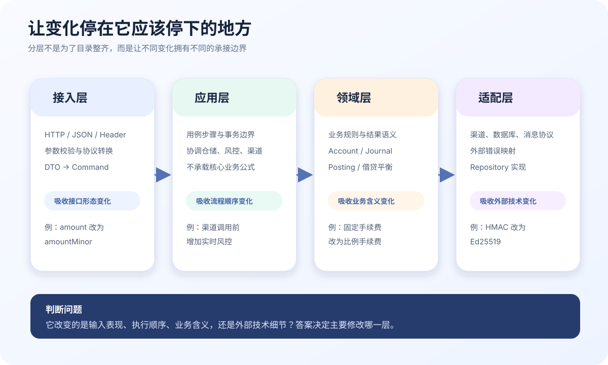
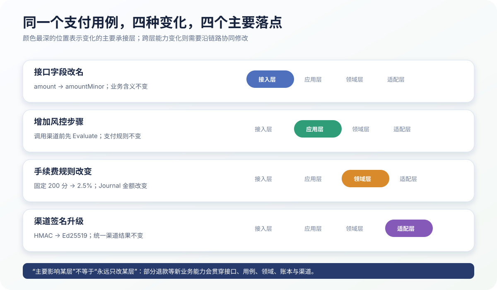

# 为什么接口改名、增加风控、修改手续费，不应该改在同一个地方？

> “从业务变化到软件边界”系列第一篇：用一笔支付和一张复式账凭证，推演接入层、应用层、领域层与适配层为什么要分开。

如果你正在设计支付、账户、风控、清结算或其他复杂业务系统，欢迎先关注本公众号。这个系列不会只展示最终架构图，而会持续还原架构决策背后的推理过程：问题从哪里来、边界为什么这样划、错误设计为什么会越来越难改，以及如何通过真实用例验证方案。

这是系列的第一阶段。我们先不讨论复杂框架，也不从“分几层”开始背答案，而是从一个更本质的问题出发：

> 当系统发生变化时，这个变化应该停在哪一层？



---

## 一、分层不是为了目录整齐

很多项目都有类似目录：

```text
handler
service
domain
repository
```

但有目录，不等于有边界。

常见情况是：

- Handler 里既解析 HTTP，又计算手续费；
- Service 里既编排流程，又拼渠道请求；
- Repository 返回数据库行，而不是业务对象；
- 渠道错误码直接穿透到前端；
- 改一个字段，需要同时修改十几个文件。

这样做的根本问题不是“代码不够优雅”，而是不同变化被绑在了一起。

一个真正有用的分层，不是回答“代码应该放进哪个文件夹”，而是回答：

```text
HTTP 契约变化时，哪些代码应该变化？
用例步骤变化时，哪些代码应该变化？
业务规则变化时，哪些代码应该变化？
渠道或数据库变化时，哪些代码应该变化？
```

如果每一种变化都有相对稳定的承接位置，系统才真正具备边界。

---

## 二、先建立一个不变的业务场景

假设平台为商户处理一笔 100 元支付，平台收取 2 元手续费，商户最终应收 98 元。

金额统一使用最小货币单位：

```text
支付金额：10000 分
平台手续费：200 分
商户应收：9800 分
```

支付成功时，系统需要记录：

```text
借：渠道应收资产       10000
贷：商户待结算负债      9800
贷：平台手续费收入        200
```

借方与贷方相等：

```text
借方合计 10000
贷方合计 9800 + 200 = 10000
```

这里出现了四个关键概念：

| 概念 | 含义 |
| --- | --- |
| Account | 资金被记录在哪个账户上 |
| Journal | 一次业务事件形成的完整会计凭证 |
| Posting | Journal 中的一条借方或贷方分录 |
| 借贷平衡 | 同一币种的借方合计必须等于贷方合计 |

它们表达的不是数据库表长什么样，而是系统必须提供的能力与结果语义：

```text
能力：记录支付成功产生的资金变化

结果：生成一张 posted Journal

内容：Journal 包含三条 Postings

不变量：借方合计必须等于贷方合计
```

这组语义是接下来判断变化边界的基准。

---

## 三、第一种变化：HTTP 字段改名

最初的创建支付接口是：

```http
POST /api/v1/payments
Content-Type: application/json
```

```json
{
  "merchant_id": "merchant-001",
  "amount": 10000,
  "currency": "USD"
}
```

后来前端和开放接口统一使用驼峰命名，并明确金额单位：

```json
{
  "merchantId": "merchant-001",
  "amountMinor": 10000,
  "currency": "USD"
}
```

变化只有两个：

```text
merchant_id → merchantId
amount      → amountMinor
```

### 第一步：先问业务含义有没有变化

商户没有变，金额没有变，币种没有变，手续费没有变，记账结果也没有变。

变化的是外部表示形式，而不是业务语义。

因此，HTTP Handler 应把新请求转换成与原来相同的应用命令：

```go
CreatePaymentCommand{
    MerchantID:  "merchant-001",
    AmountMinor: 10000,
    Currency:    "USD",
}
```

### 第二步：判断主要修改位置

主要修改：

```text
HTTP Request DTO
JSON 字段标签
参数校验
接口文档
接入兼容测试
```

不应该修改：

```text
Payment 领域模型
手续费规则
Journal / Posting
渠道调用逻辑
```

完整过程是：

```text
新的 HTTP JSON
        ↓ 接入层翻译
稳定的 CreatePaymentCommand
        ↓
原有应用与领域逻辑
```

### 为什么这类变化属于接入层？

因为接入层的责任就是把外部协议翻译成内部稳定语言。

如果一个 JSON 字段改名就迫使领域对象、记账代码和渠道请求一起修改，说明外部协议已经渗透进系统核心。

这一类变化可以概括为：

> 输入表现发生变化，业务含义没有变化。

---

## 四、第二种变化：调用渠道前增加实时风控

原来的支付流程：

```text
创建支付单
  ↓
选择渠道
  ↓
调用渠道
  ↓
等待异步回调
```

后来风险团队提出要求：

> 调用外部渠道前，必须先完成一次实时风险决策。

新流程变成：

```text
创建支付单
  ↓
调用风险决策
  ├─ block → 拒绝本次支付
  └─ pass
       ↓
    选择渠道
       ↓
    调用渠道
       ↓
    等待异步回调
```

### 第一步：先问什么发生了变化

支付金额规则没有变化，手续费公式没有变化，支付成功后的借贷分录也没有变化。

变化的是完成用例所需的步骤和顺序：

```text
原来：创建 → 路由 → 渠道
现在：创建 → 风控 → 路由 → 渠道
```

### 第二步：应用层负责协调参与者

应用服务可以表达为：

```go
func (s *PaymentApplicationService) CreatePayment(
    ctx context.Context,
    cmd CreatePaymentCommand,
) error {
    payment := s.payments.Create(cmd)

    decision := s.risk.Evaluate(ctx, payment.RiskContext())
    if decision.IsBlocked() {
        return s.payments.MarkRejected(
            payment.ID(),
            decision.Reason(),
        )
    }

    channel := s.router.Select(payment)
    return s.operations.Submit(ctx, payment, channel)
}
```

这里的应用层协调：

- Payment Repository；
- Risk Decision Service；
- Channel Router；
- Channel Operation；
- Transaction；
- Event Publisher。

### 为什么不是 Handler 直接调用风控？

如果 Handler 直接完成：

```text
解析 JSON
→ 调风控
→ 选渠道
→ 开事务
→ 保存支付单
```

那么相同用例通过 gRPC、消息或后台任务触发时，就必须复制整个流程。

应用层存在的意义，是把“如何完成一个用例”从 HTTP 协议中拿出来。

这一类变化可以概括为：

> 业务目标不变，但完成目标的步骤和参与者发生变化。

---

## 五、第三种变化：手续费规则改变

原手续费规则：

```text
每笔固定收取 200 分
```

支付 10000 分：

```text
手续费 = 200
商户应收 = 10000 - 200 = 9800
```

对应分录：

```text
借：渠道应收资产       10000
贷：商户待结算负债      9800
贷：平台手续费收入        200
```

后来业务调整为：

```text
手续费 = 支付金额 × 2.5%
最低 100 分
最高 500 分
```

同样支付 10000 分：

```text
手续费 = 250
商户应收 = 9750
```

新分录：

```text
借：渠道应收资产       10000
贷：商户待结算负债      9750
贷：平台手续费收入        250
```

### 第一步：识别真正改变的语义

HTTP 仍然提交 10000 分；渠道仍然处理 10000 分；支付用例的主要步骤也没有变化。

变化的是：

```text
相同业务输入
        ↓ 新业务规则
不同手续费和不同资金结果
```

### 第二步：把规则放进领域能力

手续费策略可以抽象为：

```go
type FeePolicy interface {
    Calculate(
        amount Money,
        merchant Merchant,
    ) (Money, error)
}
```

资金结果由领域能力生成：

```go
func BuildPaymentCapturedJournal(
    payment Payment,
    fee Money,
) (Journal, error)
```

领域层负责保证：

- 金额必须为正；
- 币种必须一致；
- 商户应收不能为负；
- 手续费满足上下限；
- Journal 至少包含两条 Posting；
- 借方合计等于贷方合计。

### 第三步：用不变量阻止错误入账

假设代码错误地生成：

```text
借方：10000
贷方：9750 + 200 = 9950
```

系统不能因为“差得不多”就写入数据库，而必须拒绝：

```text
10000 != 9950
       ↓
unbalanced journal
       ↓
禁止进入 posted
```

这说明 Account、Journal、Posting 和借贷平衡并不是数据库细节，而是资金系统的核心结果语义。

这一类变化可以概括为：

> 相同输入因为业务规则改变，产生了不同业务结果。

---

## 六、第四种变化：渠道从 HMAC 升级为 Ed25519

原渠道要求使用 HMAC：

```http
X-Channel-Key-Id: channel-v1
X-Channel-Timestamp: 1793000000
X-Channel-Signature: <HMAC-SHA256>
```

后来渠道升级为 Ed25519 非对称签名：

```http
X-Channel-Key-Id: channel-v2
X-Channel-Signature: <Ed25519 signature>
```

### 第一步：判断业务是否知道签名算法

支付领域真正关心的是：

```text
请求是否被渠道接受？
结果是 accepted、declined、pending 还是 unknown？
拒绝原因是什么？
```

它不应该知道：

- Header 叫什么；
- HMAC 还是 Ed25519；
- 私钥是什么格式；
- 渠道返回哪个原始错误码；
- JSON 字段如何排列。

### 第二步：稳定应用接口，替换适配器

应用层依赖统一接口：

```go
type ChannelAdapter interface {
    SubmitPayment(
        ctx context.Context,
        request PaymentRequest,
    ) (ChannelResult, error)
}
```

原实现：

```go
type HMACChannelAdapter struct {
    secret []byte
}
```

新实现：

```go
type Ed25519ChannelAdapter struct {
    privateKey ed25519.PrivateKey
}
```

应用层仍然调用：

```go
result, err := adapter.SubmitPayment(ctx, request)
```

### 第三步：把外部语言翻译成内部语言

渠道可能返回：

```text
PAY_0031
```

适配器将其翻译为：

```text
Decision = Declined
Reason   = InsufficientFunds
```

领域和应用层不应该到处判断 `PAY_0031`。

这一类变化可以概括为：

> 外部技术协议改变，但内部业务语义没有改变。

---

## 七、数据库变化为什么也属于适配问题？

原来支付订单存放在一张表：

```sql
SELECT id, status, amount_minor
FROM payment_orders
WHERE id = $1;
```

后来为了支持一次订单多次支付尝试，数据库拆成：

```text
payment_orders
payment_attempts
channel_operations
```

查询变成 JOIN：

```sql
SELECT
    p.id,
    p.status,
    p.amount_minor,
    a.channel_code
FROM payment_orders p
LEFT JOIN payment_attempts a
  ON a.payment_id = p.id
WHERE p.id = $1;
```

如果 Repository 接口保持稳定：

```go
type PaymentRepository interface {
    FindByID(ctx context.Context, id string) (Payment, error)
    Save(ctx context.Context, payment Payment) error
}
```

那么主要变化可以停留在 PostgreSQL Adapter：

```text
SQL
数据库字段映射
事务实现
迁移脚本
Repository 集成测试
```

应用层仍然只看到：

```go
payment, err := repository.FindByID(ctx, paymentID)
```

这就是适配器的价值：把数据库结构翻译为领域对象，而不是让领域对象变成数据库行。

---

## 八、把四次变化放在一张图里



| 变化类型 | 例子 | 主要承接位置 |
| --- | --- | --- |
| 接口形态变化 | `amount` 改为 `amountMinor` | 接入层 |
| 用例步骤变化 | 渠道调用前增加实时风控 | 应用层 |
| 业务含义变化 | 固定手续费改为比例手续费 | 领域层 |
| 外部协议变化 | HMAC 改为 Ed25519 | 渠道适配器 |
| 持久化变化 | 单表拆成订单、尝试、操作三表 | Repository Adapter |

判断时可以连续问四个问题：

```text
改变的是输入的表现形式吗？
  → 接入层

改变的是完成用例的步骤吗？
  → 应用层

改变的是业务规则或结果吗？
  → 领域层

改变的是渠道、数据库或消息协议吗？
  → 适配层
```

这比先背诵“Controller、Service、Repository”更有用，因为它从变化原因出发，而不是从技术名词出发。

---

## 九、“主要影响某层”不等于“永远只改某层”

分层不是禁止跨层修改。

假设新增“部分退款”能力：

```text
原支付 10000
第一次退款 3000
第二次退款 2000
剩余可退款 5000
```

这不是简单的接口字段变化，而是一项新的业务能力，因此会贯穿多层：

```text
HTTP Partial Refund API
        ↓
应用层协调退款用例
        ↓
领域层校验累计退款不可超额
        ↓
账本生成退款 Journal / Postings
        ↓
渠道适配器调用部分退款协议
```

每一层都要变化，但变化原因不同：

| 层 | 为何变化 |
| --- | --- |
| 接入层 | 需要表达部分退款请求 |
| 应用层 | 需要编排查询、校验、渠道和记账 |
| 领域层 | 需要定义可退金额与状态规则 |
| 适配层 | 需要调用渠道部分退款协议 |

所以正确表述是：

> 某类变化有一个主要落点，其他层只有在自己的职责确实受到影响时才协同变化。

---

## 十、反过来检查：没有边界时会发生什么？

假设所有逻辑都写进 HTTP Handler：

```text
解析 JSON
  ↓
计算手续费
  ↓
判断风控
  ↓
拼渠道签名
  ↓
执行 SQL
  ↓
生成借贷分录
  ↓
返回 HTTP Response
```

那么每次变化都会触碰同一个“大函数”：

```text
字段改名       → 改大函数
增加风控       → 改大函数
手续费调整     → 改大函数
渠道签名升级   → 改大函数
数据库拆表     → 改大函数
```

最终后果不是单纯的代码变长，而是：

- 无法单独测试手续费规则；
- 无法在消息消费者中复用支付用例；
- 渠道升级可能破坏借贷分录；
- 数据库迁移可能改变 HTTP 行为；
- 每次发布都需要回归所有功能；
- 团队无法明确谁拥有哪项规则。

分层真正降低的是变化扩散半径。

---

## 十一、如何用测试证明边界真的存在？

架构不能只靠图证明，还需要测试证明。

### 接入层测试

验证：

```text
新的 JSON 字段
        ↓
正确 CreatePaymentCommand
```

不需要连接真实渠道和数据库。

### 应用层测试

验证：

```text
风险 block
  → 不调用渠道

风险 pass
  → 选择渠道并提交操作
```

使用假的 Repository、Risk Service 和 Channel Adapter 即可。

### 领域层测试

验证：

```text
金额 10000
费率 2.5%
  → fee 250
  → merchant payable 9750
  → debit == credit
```

领域测试不需要 HTTP、Redis、PostgreSQL 或外部渠道。

### 适配层测试

验证：

- Ed25519 签名是否覆盖正确内容；
- 渠道错误码是否映射为统一结果；
- SQL 能否重建完整 Payment；
- 事务失败是否正确回滚。

当一种变化只需要运行对应层的主要测试，再加少量端到端回归，边界才真正产生了工程价值。

---

## 十二、第一阶段我们得到的结论

这次推演没有从框架选型开始，而是从变化入手，得到四个边界：

```text
HTTP 契约变化
        → 接入层吸收

用例步骤变化
        → 应用层吸收

业务规则与结果变化
        → 领域层吸收

渠道、数据库、消息协议变化
        → 适配层吸收
```

其中最核心的领域语义是：

```text
Account 定义资金归属
Journal 定义一次完整业务凭证
Posting 定义具体借贷变化
借贷平衡定义不可破坏的不变量
```

它们不应该随着 JSON 字段、数据库 JOIN 或渠道签名算法一起变化。

所以，架构设计的一个重要目标可以表达为：

> 让高频变化停在外围，让核心业务语义保持稳定；当业务语义本身发生变化时，又能在一个明确的位置修改并验证。

---

## 十三、留给读者的一道练习

假设系统新增要求：

> 金额超过 10 万的退款必须进入人工审核，审核通过后才能调用渠道。

可以尝试回答：

1. HTTP 接口是否需要变化？
2. 应用流程增加了哪些步骤？
3. 领域状态是否需要增加 `pending_review`？
4. 审核通过和拒绝分别产生什么事件？
5. 渠道适配器什么时候才允许被调用？
6. 退款 Journal 应在申请时还是渠道成功时生成？

如果答案散落在一个 Handler 中，说明边界还没有建立；如果每个问题都有明确负责人，说明架构正在形成。

---

## 结语：下一篇，我们继续把边界落到代码里

本文是“从业务变化到软件边界”系列的第一篇。

这一阶段，我们先回答了为什么要分层，以及如何从真实变化推导层次，而不是机械套用目录结构。后续文章将继续展开：

1. 应用层如何编排用例、事务和异步操作；
2. 领域层如何定义状态机、策略与不变量；
3. Journal 与 Posting 如何形成真正可靠的复式账本；
4. 渠道操作如何处理 `pending`、`unknown`、重试和补偿；
5. Repository 如何隔离数据库结构变化；
6. 如何通过契约测试、领域测试和端到端测试验证边界。

如果你希望持续看到支付、账户、账本、风控和渠道系统从“业务问题”一步步推演到“可运行代码”，欢迎关注本公众号，并把这个系列收藏下来。

我们不会只告诉你最后应该画成什么样，而会继续追问：

> 为什么这样设计？它解决了什么变化？如果不这样做，系统会在哪里失控？

下一篇见。
