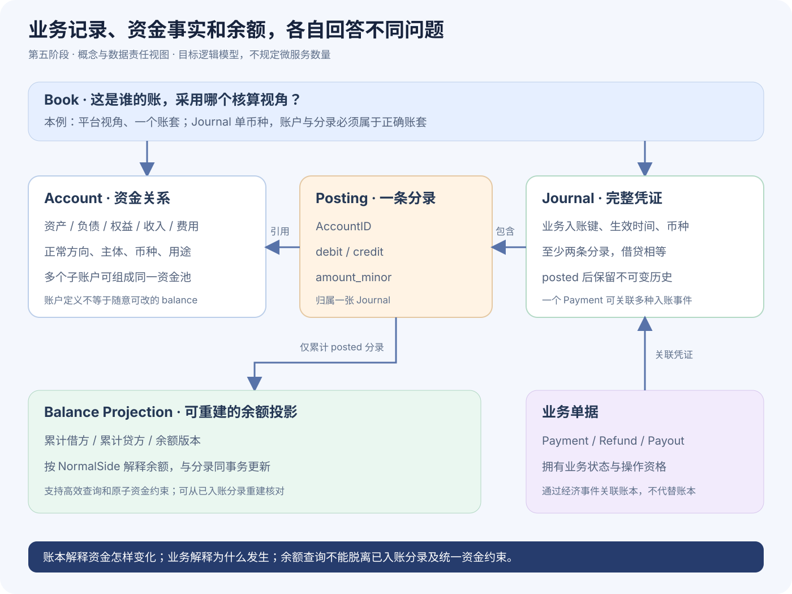
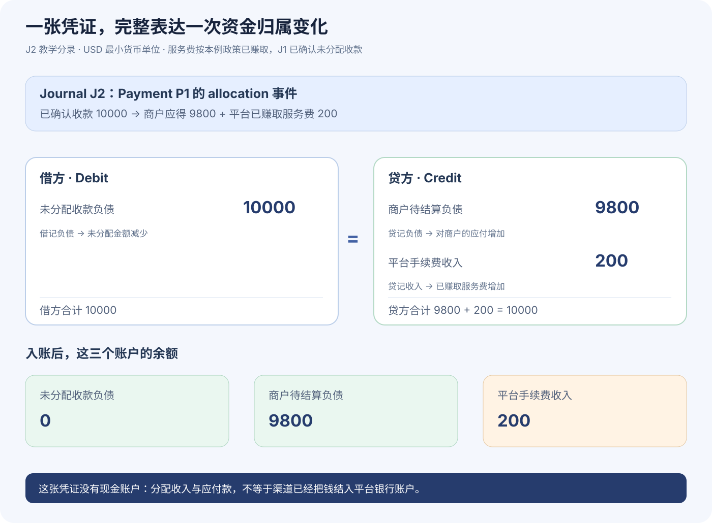
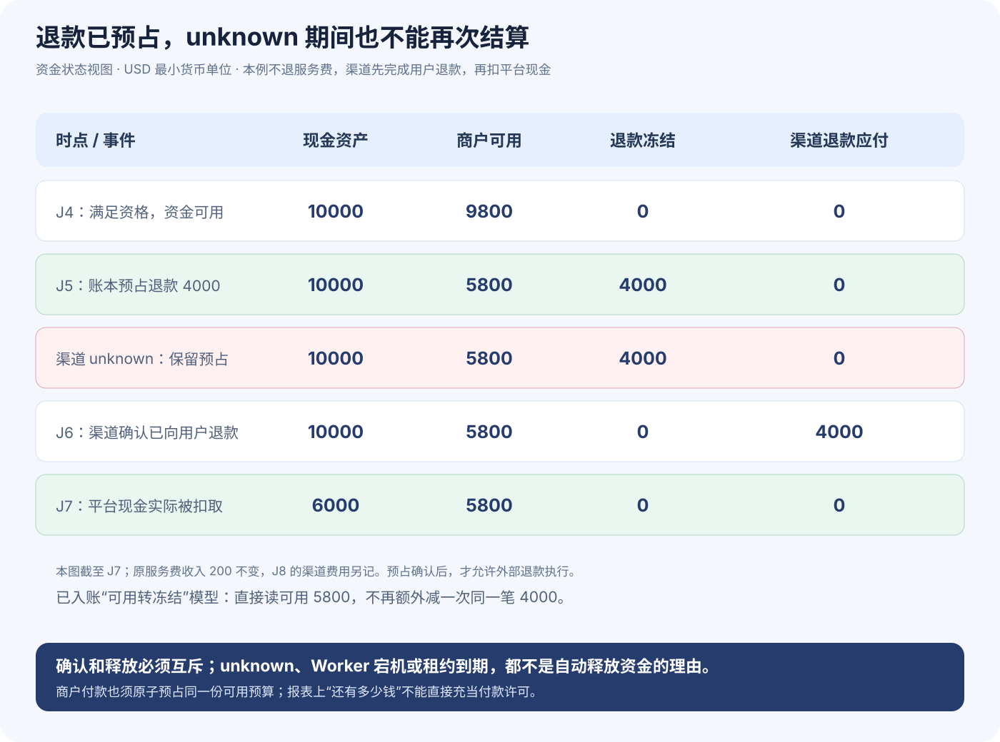
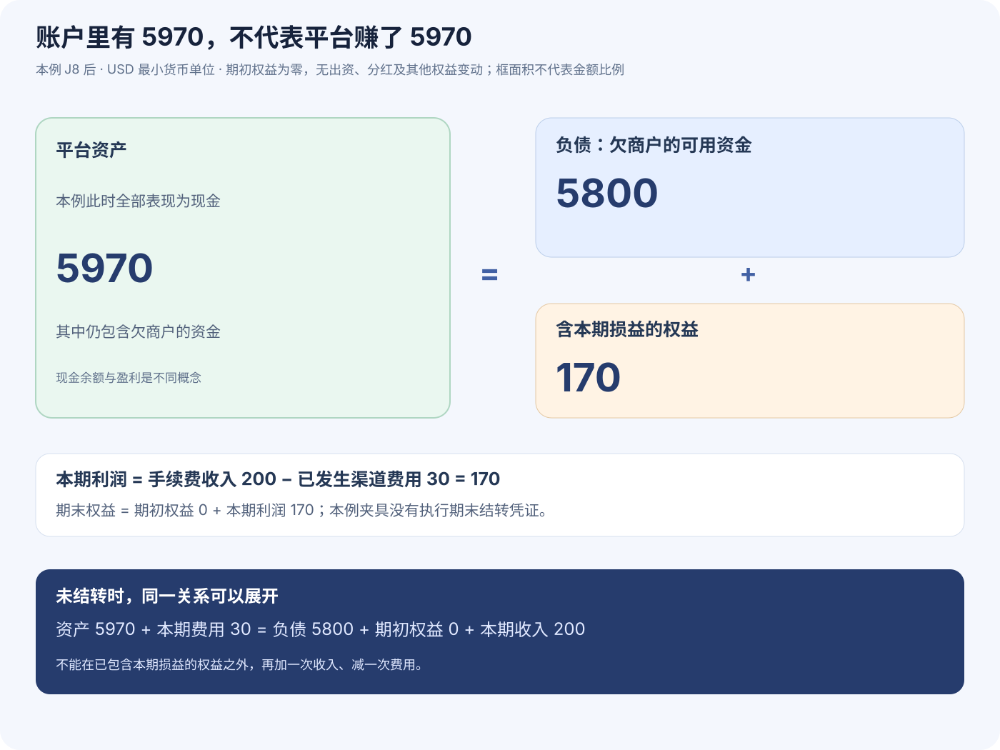

# 支付记录都在，为什么商户余额还是说不清？

> “从业务变化到软件边界”系列第五篇：从商户应收、手续费、退款预占和余额重建出发，推演 Account、Journal、Posting 与 Balance Projection 的职责，以及支付与账本之间的事务边界。

如果你正在设计支付、账户、账本、清结算或风控系统，欢迎先关注本公众号。“从业务变化到软件边界”系列会从具体用例出发，持续拆解架构演进背后的推理：旧模型在哪里开始失效，哪些事实应该独立表达，又该怎样用代码与异常场景检验设计。

前四篇已经讨论了：

1. [水平分层怎样吸收不同变化](./coach-change-driven-layered-architecture-stage-1.md)；
2. [订单、支付尝试、真实收款与退款为什么要分开](./coach-payment-order-attempt-payment-refund-stage-2.md)；
3. [多渠道场景中的路由、操作与适配边界](./coach-payment-routing-channel-adapter-stage-3.md)；
4. [外部成功、本地宕机后，如何可靠恢复](./coach-payment-reliable-operations-outbox-inbox-stage-4.md)。

现在业务开始要求：商户看余额、平台算手续费、退款不能超支，财务还要解释每一次变化。

于是出现一个新问题：

> 每笔支付和退款都能查到，为什么仍然无法可靠回答“现在欠谁多少钱，这些钱还能不能使用”？

本文使用单账套、单币种 USD 的教学模型，金额统一为最小货币单位。分录和表结构表达设计契约；附带的本地脚本只做演算，不连接数据库、渠道或真实资金，也不代表生产账本实现。

---

## 一、支付记录回答“发生过什么”，账本还要回答“现在承担什么”

最初，支付表里有金额、状态和渠道交易号；退款表里有退款金额和结果。

商户问余额时，团队可能先写一个公式：

```text
成功支付合计 - 成功退款合计 - 手续费 - 已结算金额
```

随后问题越来越多：

- 渠道确认收款，但尚未向平台结算，算在哪里？
- 同一个订单多收到的钱，还没有归属商户，算谁的？
- 退款已预占、渠道仍然 unknown，这笔钱能不能再结算？
- 手续费规则变了，历史余额应该按旧规则还是新规则计算？
- 商户还有多个 USD 资金池，退款应该占用哪一个？
- 查询结果和昨天不同，能不能解释到每一条变化？

如果每个业务模块都自己重算余额，就会出现多个互不一致的“可用金额”。

这不是再给 Payment 增加几个字段就能彻底解决的问题。平台需要明确记录资金关系、变化过程，以及所有资金操作共同遵守的约束。

---

## 二、先确定记谁的账：商户余额为什么是平台的负债？

本文统一采用平台记账视角。

假设平台确认一笔收款 10000，其中商户应得 9800，平台按约定赚取手续费 200。

对于平台来说：

```text
渠道还没把钱结给平台 → 平台对渠道的应收资产
平台未来需要给商户钱 → 平台对商户的负债
平台已经赚取的服务费 → 平台的收入
```

因此，“这个账户关联商户”不等于“它是平台的资产账户”。

同一事实在商户自己的账本里，可能表现为对支付平台的应收资产。那是另一套记账主体和视角，不能把两个主体的借贷混进同一本账。

先固定视角，再讨论 Account 的类型，否则后面的借贷方向很容易反过来。

---

## 三、四个对象，分别解决四个问题

| 对象 | 回答的问题 | 示例 |
| --- | --- | --- |
| Account | 哪一种资金关系发生变化？ | 渠道应收、商户可用资金、手续费收入 |
| Journal | 哪个经济事件形成了一次完整入账？ | 一笔收款确认、一笔退款预占 |
| Posting | 这次入账具体改变了哪个账户、哪个方向、多少金额？ | 借商户可用 4000，贷退款冻结 4000 |
| Balance Projection | 到当前为止，各账户的分录累计结果是多少？ | 商户可用 5800，退款冻结 4000 |

再加一个范围：

```text
Book：这套账属于哪个记账主体与核算边界？
```

Journal 不是“一个数据库事务”的别名。一个本地事务可以同时写入多张完整 Journal；同一 Payment 也可以因不同经济事件关联多张 Journal。



这是一张概念与数据责任视图。它区分业务事实、账本记录和派生余额，不规定必须拆成几个微服务。

---

## 四、Account 里应该有什么？余额又应该放在哪里？

可以先提炼如下运行模型：

```go
type LedgerAccount struct {
    ID             string
    BookID         string
    AccountKey     string
    AccountGroupID string
    OwnerType      string
    OwnerID        string
    Currency       string
    AccountType    string
    NormalSide     string
    Purpose        string
    Status         string
}
```

重点不是字段多，而是几个概念不能混用：

| 字段 | 负责表达什么 |
| --- | --- |
| BookID | 账户属于哪套核算边界 |
| OwnerType / OwnerID | 这个子账关联哪个主体或资金归属对象，不替代账套记账主体 |
| AccountType | 资产、负债、权益、收入或费用 |
| NormalSide | 采用哪个方向解释正常余额 |
| Purpose | 渠道应收、待结算、可用、退款冻结等业务用途 |
| AccountGroupID | 哪些子账户共同组成同一个资金池 |
| AccountKey | 同一账套内稳定的账户业务标识 |

商户在产品上看到的一个“资金账户”，可以由待结算、可用、冻结等多个账本子账户共同表达。

允许新增资金池时，增加账户组与账户记录即可；不要因为新增一个部门预算，就给余额表增加一列。

也不必用 `(owner, currency, purpose)` 限制某主体同币种同用途只能有一个账户。可以在账户组内约束某用途的唯一性，同时允许该主体拥有多个独立资金池。

余额投影可以单独存放：

```text
ledger_balances
├─ account_id
├─ posted_debits_minor
├─ posted_credits_minor
└─ version
```

这样的拆分有助于表达：Account 是账户定义，Balance 是分录形成的累计状态。二者也可以在物理上合表，但语义与写入约束仍然需要区分。

---

## 五、借和贷，究竟怎样改变余额？

先记住：借、贷是记账方向，不能直接翻译成“收入”和“支出”。

普通账户采用以下默认关系：

| 账户类型 | 增加记在哪一侧 | 正常余额计算 |
| --- | --- | --- |
| 资产 asset | 借方 debit | 累计借方 - 累计贷方 |
| 费用 expense | 借方 debit | 累计借方 - 累计贷方 |
| 负债 liability | 贷方 credit | 累计贷方 - 累计借方 |
| 权益 equity | 贷方 credit | 累计贷方 - 累计借方 |
| 收入 revenue | 贷方 credit | 累计贷方 - 累计借方 |

例如商户可用资金是平台负债：

```text
贷记 9800 → 平台欠商户的可用资金增加 9800
借记 4000 → 其中 4000 不再处于商户可用资金账户
```

借记的 4000 去哪里了，要看同一张 Journal 的另一侧。若贷记的是退款冻结负债，它只是被预占，并没有离开平台。

因此，不能看到 debit 就直接判定“钱已付出”。

备抵等特殊账户可能采用与大类相反的正常方向，需要明确建模；不能为了修复某次余额，就随意修改历史账户的 AccountType 或 NormalSide。借贷与正常余额的基础关系可以参考 [OpenStax：会计原则与复式记账](https://openstax.org/books/principles-financial-accounting/pages/3-1-describe-principles-assumptions-and-concepts-of-accounting-and-their-relationship-to-financial-statements)。

---

## 六、从业务事实到 Postings，中间需要记账政策

账本不会看到一个“支付成功”字符串，就天然知道应该产生哪些分录。

先确定经济含义，再确定账户与方向：

```text
业务已确认的事实
    ↓
资金归属、费用结果与记账政策
    ↓
解析本账套、本主体、本币种的账户
    ↓
生成 PostJournalCommand
    ↓
通用账本校验并原子入账
```

支付模块维护 Payment 与退款资格；计费模块按固定的政策版本提供费用结果；资金记账映射负责将这些事实翻译为明确分录。

通用账本负责借贷、币种、账户状态、幂等和余额约束，不应该重新判断用户是否有退款权限，也不应该临时读取最新费率来改写历史费用。

公开 HTTP 请求也不应让商户任意选择账本 AccountID 和借贷方向。外部表达业务意图，内部受控的用例与记账政策生成分录。

---

## 七、贯穿案例：先把 100 美元收款记清楚

随文夹具中，P1 是一笔真实收款，RF1 是针对它的退款，J1～J8 是不同经济事件的凭证；它们不是八次渠道扣款。ST1、EL1、CF1 分别标识本例的渠道到账、商户资金释放和渠道费用事件。

本例固定以下教学政策：

- 期初余额为零，所有金额都是 USD 的最小货币单位；
- 收款 10000，商户应得 9800，平台服务费 200 在分配时满足本例的收入确认条件；
- 渠道先形成应收，稍后才把钱结入平台现金账户；
- 商户资金满足结算资格后，才从待结算转为可用；
- 后续部分退款 4000，本例约定不退原服务费；渠道确认退款与实际扣取平台现金是两个确认点；
- 最后确认一笔已发生且已支付的渠道费用 30；没有税费、其他交易、出资或分红。

真实项目需要按合同与会计政策确定上述条件。未赚取的费用、应退费用或已计提未支付的成本，需要对应的其他分录，不能套用同一组数字。

### J1：确认真实收款，先进入未分配资金

```text
借：渠道应收资产       10000
贷：未分配收款负债     10000
```

我们确认对渠道有一项应收，同时承认这笔钱尚待确定归属。它还不是平台收入，也没有直接变成商户可用余额。

重复支付的另一笔真实收款也应单独经过这一步，不能只保留用于订单履约的那笔 Payment。

### J2：分配用于本次订单的收款

```text
借：未分配收款负债     10000
贷：商户待结算负债      9800
贷：平台手续费收入       200
```

未分配负债减少，商户应得部分和本例已赚取服务费得到明确归属。



这张图只展示 J2 的记账含义。借方合计等于贷方合计，但它没有造成平台现金到账。

### J3：渠道实际结入平台现金

```text
借：平台现金资产       10000
贷：渠道应收资产       10000
```

这是一种资产转为另一种资产，不是再次赚取一笔收入。

### J4：满足业务条件，释放为商户可用资金

```text
借：商户待结算负债      9800
贷：商户可用资金负债    9800
```

它改变的是负债分类，不是再次收到现金，也不是已经向商户付款。

本例把渠道到账与其他资格条件满足安排在同一条时间线上，不能据此推断“只要钱到账，所有商户资金都必须立即可结算”。

---

## 八、退款为什么先占可用资金，而不是等成功后再扣？

沿用第四篇的约束：退款和商户付款必须竞争同一个可用预算。

现在申请部分退款 RF1，金额 4000。资金来源为这笔已分配给商户的资金；它不是第二篇中 surplus 对应的未分配收款。

### J5：账本确认退款预占

```text
借：商户可用资金负债    4000
贷：商户退款冻结负债    4000
```

结果是：

```text
商户可用：9800 → 5800
退款冻结：   0 → 4000
商户相关负债合计：仍为 9800
```

只有预占已在权威账本提交，外部退款才获得对应资金许可。另一个结算任务不能再从商户可用资金中取得原来的 9800。

### 渠道结果 unknown 时

保留预占，余额仍为可用 5800、退款冻结 4000。

这里采用的是已入账的“可用转冻结”重分类，读取可用余额时，不能再把同一笔 4000 扣第二遍。

如果采用 Pending Posting 等待确认模型，则要用对应的余额公式。两种模型可以表达相似约束，但不能把计算方式混在一起。[TigerBeetle：Two-Phase Transfers](https://docs.tigerbeetle.com/coding/two-phase-transfers/)可以作为预留、确认和撤销模型的参考。

### J6：渠道确认已向用户退款，形成对渠道的退款应付款

本例中，渠道先为用户完成退款，稍后再扣取平台资金：

```text
借：商户退款冻结负债    4000
贷：渠道退款应付款      4000
```

商户不再拥有这部分资金，平台转为承担对渠道的退款付款义务。此刻平台现金尚未减少，不能提前伪造银行扣账。

### J7：确认平台现金实际被扣取

```text
借：渠道退款应付款      4000
贷：平台现金资产        4000
```

之后现金为 6000，商户可用负债为 5800，手续费收入仍为 200。



如果真实合同在同一确认点同时保证退款完成与平台资金扣取，可以使用相应的直接分录；如果从未结算渠道应收中净额抵扣，则对方账户也会不同。判断依据是实际资金关系，而不是统一把所有 success 都贷记现金。

### 如果退款最终没有执行呢？

只有确认旧操作未执行且不会再执行，才允许通过新的释放凭证，将原冻结资金转回可用。

同一预占的确认与释放必须在原子状态转换中互斥，不能因为两个阶段分别有幂等键，就允许两者都成功。Worker 租约到期或重试耗尽，也不是释放资金的依据。

如果 J6 已生效而 J7 尚未到达，不应凭空释放原资金；如果现金事件先到、业务结果后到，应保留事件并按前置条件补齐或核对，不能丢弃迟到事实。

---

## 九、权益、收入、费用怎样放回同一套账？

再增加一笔已发生且已支付的渠道费用 30：

### J8：确认并支付渠道费用

```text
借：渠道费用              30
贷：平台现金资产          30
```

本例最终得到：

```text
平台现金资产       5970
商户可用资金负债   5800
平台手续费收入      200
渠道费用             30
```

账户里有 5970，并不意味着平台赚了 5970，其中还有欠商户的 5800。

在这个没有其他权益变动的简化案例中：

```text
本期利润 = 收入 200 - 费用 30 = 170
期末权益 = 期初权益 0 + 本期利润 170 = 170

资产 5970 = 负债 5800 + 权益 170
```



收入、费用尚未结转时，也可以把同一关系展开为：

```text
资产 + 本期费用 = 负债 + 期初权益 + 本期收入
5970 + 30      = 5800 + 0       + 200
```

这里明确假设本期没有追加出资、分红和其他权益变动。存在这些事项时，要把相应权益变化纳入等式。

期末结转后，收入与费用的净额进入相应权益科目；不能在已经包含本期损益的期末权益之外，再加一次收入、减一次费用。

随文样例保留收入、费用的未结转余额，没有执行期末结转。输出中的 `equity_including_current_profit = 170` 是包含本期损益后的权益，不是声称某个权益账户已经记入了结转凭证。两种等式之间的关系可参考 [OpenStax：扩展会计等式](https://openstax.org/books/principles-financial-accounting/pages/3-2-define-and-describe-the-expanded-accounting-equation-and-its-relationship-to-analyzing-transactions)。

---

## 十、Balance Projection：余额能存，但不能脱离分录随便改

为每个账户累计：

```text
posted_debits_minor
posted_credits_minor
```

再按 NormalSide 解释：

```text
debit 正常方向：balance = debits - credits
credit 正常方向：balance = credits - debits
```

例如 J5 之后：

```text
商户可用资金：累计贷方 9800 - 累计借方 4000 = 5800
退款冻结资金：累计贷方 4000 - 累计借方    0 = 4000
```

余额表是为了让查询和资金校验更高效。它应与对应已入账分录在同一本地事务中更新，并能从这些分录重建。

资金许可不能只依赖一个异步刷新、可能过期的展示缓存。否则两个付款请求仍可能各自读到旧余额，并重复使用同一笔钱。

version 可以帮助并发控制与核对，但不是支付次数。一个业务可能产生多张 Journal，一张 Journal 也可能多次影响同一账户；本例约定每张首次入账 Journal 对每个受影响账户只增加一次版本。

---

## 十一、把不变量收进一个受控的入账入口

内部入口可以表达为：

```go
type PostingInput struct {
    AccountID   string
    Side        string
    AmountMinor int64
}

type PostJournalCommand struct {
    BookID       string
    BusinessType string
    BusinessID   string
    EventType    string
    Currency     string
    EffectiveAt  time.Time
    Postings     []PostingInput
}
```

至少保证：

1. 一张凭证至少有两条分录，金额为正，并存在借贷双方。
2. 同一张凭证、同一币种的借方合计等于贷方合计。
3. 账户、分录与 Journal 属于相同账套和币种。
4. 已关闭账户不能被新分录引用；其他账户控制应按具体业务矩阵执行。
5. 同一业务入账事件最多产生一套财务效果。
6. 受限的可用与冻结资金不能因本次动账而违反余额约束。
7. Journal、Postings、余额投影及相关本地业务变更原子提交。
8. posted 凭证不可随意修改或删除，纠错通过新的受控凭证完成。

借贷相等只是必要条件。把本应属于商户 M1 的钱贷给 M2，同样可以平衡，但业务仍然错误。因此还需要账户归属、权限、记账政策和业务关联检查。

金额和聚合都要精确。Go 可使用有明确范围的整数金额；数据库也要考虑累计值与聚合溢出。不要把金额先转成浮点数，再指望借贷总能相等。

---

## 十二、一次 PostJournal 怎样形成原子结果？

一种同库候选过程是：

```text
BEGIN
  1. 按业务入账键建立互斥，检查是否已入账
  2. 相同内容返回原结果，不同内容拒绝
  3. 以稳定顺序锁定受影响的账户及余额行
  4. 校验账户状态、归属、币种与业务前置条件
  5. 创建事务内的 draft Journal 与全部 Postings
  6. 校验完整凭证的借贷、分录数量与余额约束
  7. 更新余额投影和必要的预占状态
  8. 将 Journal 置为 posted，完成相关本地业务变更
  9. 写入需要可靠交接的 Outbox
COMMIT
```

Journal 与 Postings 在同一个数据库事务里写入。先写 draft、再追加分录、再置为 posted，只是事务内的构建步骤，不表示要提交一张缺腿的凭证，让别的请求以后慢慢补齐。

如果任一步失败，就回滚本地修改。事务中不调用长耗时外部渠道，避免资金网络副作用与数据库锁混在一起。

多个资金操作必须在锁定或原子条件写入之后校验同一份最新预算。先读余额、回到应用算一算、再无条件更新，仍然存在超支窗口。

稳定的锁顺序可以减少死锁；发生死锁或可重试冲突时，也需要以原业务入账身份重试完整本地事务，而不是换键再记一笔。

### 数据库约束怎样兜底？

行级约束可以保护正金额、合法方向、唯一业务键和引用关系，但普通 `CHECK` 不能负责跨多行计算 Journal 的借贷合计。PostgreSQL 对此有明确限制。[PostgreSQL：Constraints](https://www.postgresql.org/docs/current/ddl-constraints.html)。

可以结合受控入账过程、提交阶段检查和不可变保护。若采用触发器，分录写入与发布 Journal 要协调锁定同一父凭证，防止“检查总额的同时，另一个事务又追加分录”。

已 posted 的凭证应禁止追加、修改和删除分录；账户关键属性也要受控。应用角色不能通过任意改余额表来绕过入账入口。

这类保证需要真实数据库与并发测试。仅仅展示一段先 SUM、后 UPDATE 的代码，不足以证明数据库已具备这些约束。

---

## 十三、幂等键为什么不是 Journal 主键？

Journal ID 解决一张凭证的身份。业务入账键解决“这个事件是否已经记过账”。

例如：

```text
(book_id, business_type, business_id, event_type)

(book-demo, payment, P1, receipt)       → J1
(book-demo, payment, P1, allocation)    → J2
(book-demo, refund, RF1, reserve)       → J5
(book-demo, refund, RF1, confirmed)     → J6
(book-demo, refund, RF1, cash_debited)  → J7
```

每次重试都随机生成一个新 Journal ID，如果没有业务唯一约束，依然可能重复入账。

相同业务键还需要比较规范化内容指纹：账户、方向、金额、币种、生效时间，以及有业务意义的分录顺序。请求 JSON 的空格、字段排列和本次 Trace ID 不应让同一意图变成新事件。

生效时间也应来自稳定业务事实，不能每次重试都偷偷换成“现在”。

注意：reserve 和 confirmed 各自幂等，不等于同一预占已经具备“确认与释放互斥”。后者需要自己的状态前置条件和原子转换。

---

## 十四、账记错了，是修改原 Posting，还是新增凭证？

已经 posted 的原记录应作为历史证据保留。

可以通过新的冲正凭证引用原 Journal，并按受控政策生成反向分录；若需要正确版本，再创建关联明确的新凭证。原凭证的 posted 事实不因冲正而消失。

但“生成反向分录”不等于可以自动撤销任意真实资金行为。钱已经付出、商户资金已被使用，或渠道发生拒付时，还需要对应的追偿、冻结或批准的资金承担政策。

退款也是新的经济事件，不是删除原 Payment 或擦掉原收入。是否退手续费、由哪个主体承担、何时实际付出现金，都需要明确表达。

---

## 十五、同库和拆服务，改变的是一致性条件

支付与账本先作为同一个应用中的独立模块时，可以由应用层协调同一本地事务：

```text
本地事务
├─ 幂等应用已验证的支付或退款事实
├─ 通过账本模块入账并更新余额
├─ 按完成契约推进本地业务状态
└─ 写入后续事件 Outbox
```

模块化不要求先制造网络边界。账本仍通过受控接口保护规则，不是让渠道 Adapter 直接改余额表。

拆成独立服务、独立数据库后，就需要：

```text
支付本地事务：保存事实、待入账状态与请求 Outbox
    ↓
账本本地事务：幂等接收、入账、余额更新与确认 Outbox
    ↓
支付本地事务：应用确认，推进业务完成与通知
```

确认丢失时，按原业务键查询或幂等重试，找回原 Journal。它不是一个跨库本地事务。

对于退款、提现和结算付款，还要把预占确认放在外部执行之前。业务库写了“申请预占”，不能代替账本已经提交资金预占；本地缓存和报表也不能代替权威资金许可。

因此，拆服务会增加交接、确认、顺序、补偿和可观测性成本。是否值得，要根据独立扩容、数据所有权、发布节奏与团队协作需要判断。

---

## 十六、余额怎样重建，又怎样发现“投影对了，业务却错了”？

重建只读取已入账分录，不重新调用支付或退款渠道：

```sql
SELECT
    p.account_id,
    SUM(CASE WHEN p.side = 'debit' THEN p.amount_minor ELSE 0 END)
        AS posted_debits_minor,
    SUM(CASE WHEN p.side = 'credit' THEN p.amount_minor ELSE 0 END)
        AS posted_credits_minor
FROM ledger_postings AS p
JOIN ledger_journals AS j ON j.id = p.journal_id
WHERE j.book_id = $1
  AND j.currency = $2
  AND j.status = 'posted'
GROUP BY p.account_id;
```

无分录的账户初始化为零，再按 NormalSide 得到余额。该示意假设 Journal ID 在本库唯一，真实模型还要保证账户、Journal 和分录的账套与币种引用一致。

核对重建结果与在线投影时，需要同一数据库一致性快照，或明确的已提交入账边界。系统仍在记账时，不能把前后两个时点的结果直接比较。

发现投影错误，应在受控流程中核对和修复；不能在生产环境边运行边清空余额表，指望一次全表重算自动解决并发。

即使投影完全匹配，也只证明“余额等于现有分录”。如果真实渠道扣款被漏记，或者分录记给错误商户，仍然需要业务核对与外部对账发现。

---

## 十七、教练式实践：本地跑完八张凭证

本篇提供两个随文文件：

- [八张凭证与账户夹具](./examples/ledger-stage-5-journals.json)
- [只读演算脚本](./examples/verify-ledger-stage-5.mjs)

在仓库根目录运行，使用支持内置 `structuredClone` 的 Node.js：

```bash
node docs/payment-architecture-evolution/examples/verify-ledger-stage-5.mjs
```

脚本只读取本地 JSON，在内存中验证金额和约束，不访问数据库、网络，也不修改文件。示例使用 JavaScript 安全整数范围内的金额；它没有实现生产账本的持久化、隔离、权限、不可变触发器或完整退款状态机。

### 练习一：先预测，再看余额

运行前先写下：J2 会不会让现金增加？J5 会不会让平台负债减少？J6 为什么不是直接扣现金？

然后核对脚本输出：

```text
J1～J8：每张借方合计 = 贷方合计

商户可用资金负债 = 5800
商户退款冻结负债 = 0
渠道退款应付款   = 0
平台现金资产     = 5970
手续费收入       = 200
渠道费用         = 30
包含本期损益的权益 = 170
```

### 练习二：重复请求与内容冲突

脚本重复提交同一组 Journal，断言余额、凭证数量和版本不变；再用同一个业务键修改金额，断言发生幂等冲突，原结果不变。

关注两个不同结果：完全相同的请求应返回原结果；同键不同内容不能被当成正常重试。

### 练习三：借贷平衡不代表允许超支

在 J5 预占 4000 后，尝试再预占付款 9800。即使这张新凭证借贷相等，也会因商户可用金额只有 5800 被拒绝。

脚本验证这项拒绝不会产生部分余额修改。真实系统还需要以数据库事务和并发控制证明两个竞争请求不能一起通过。

### 练习四：从分录重建，发现被改坏的投影

脚本从已接受的凭证重建余额，验证与当前投影一致；再在独立副本中人为增加一个最小单位，验证差异能够被发现。

这里重建的是账本投影，不是重新发起八次外部交易。

### 练习五：让退款在渠道侧 unknown

在真实数据库或隔离测试环境中，先完成 J5，再让渠道无法确认。

验收点：可用保持 5800，退款冻结保持 4000；重试耗尽不能自动释放。之后让确认与释放并发，验证原预占最多进入一个终态。这项真实并发验证不包含在内存脚本中。

### 练习六：注入事务失败与确认丢失

同库时，让写入 Postings 后、提交前故障，验证 Journal、投影和关联业务没有部分提交。

分库时，让账本提交后丢失确认，验证通过原业务键找回同一张凭证；业务资金出口仍受预占约束。不能用换键再入账来补回复。

这两项也是后续实现阶段的集成验收目标，不能由内存演算代替。

---

## 十八、这一阶段怎样逐步落地？

```text
S0 明确记账主体、账户类型、资金归属与事件分录矩阵
S1 建立账套、账户与账户组，定义状态和余额约束
S2 实现受控 PostJournal：业务幂等、完整凭证、原子投影
S3 在业务完成点接入账本，并验证预占、确认和释放互斥
S4 加入数据库不可变与平衡保护，运行并发和故障验收
S5 通过期初凭证或受控迁移切换历史余额，保留旧证据
S6 建立余额重建、业务核对和渠道对账，明确差异处理人
```

旧表只有余额快照或单边流水时，不应假装能凭空还原全部历史分录。可以在可核对的截止点建立有明确对方账户的期初凭证；迁移差额如何归属，需要先核对并批准，不能随手贷记收入把账凑平。

如果首版已经承诺管理可用余额、冻结和结算资金，账本与相应资金约束就应从首版具备。“第五阶段”是这次教学推演的顺序，不是先上线不安全资金流程、以后再补账的理由。

支付与账本的边界也因此更清楚：

```text
支付模块：哪笔交易发生了，是否属于本订单，业务处于哪里？
账本模块：哪类资金关系改变了，变化是否合法，能否完整解释和重建？
```

---

## 参考资料与阅读方法

1. [OpenStax：会计原则、复式记账与正常余额](https://openstax.org/books/principles-financial-accounting/pages/3-1-describe-principles-assumptions-and-concepts-of-accounting-and-their-relationship-to-financial-statements)——理解借贷方向，而不是死记“借等于支出”。
2. [OpenStax：扩展会计等式](https://openstax.org/books/principles-financial-accounting/pages/3-2-define-and-describe-the-expanded-accounting-equation-and-its-relationship-to-analyzing-transactions)——区分权益、收入与费用，以及期间损益的关系。
3. [PostgreSQL：Constraints](https://www.postgresql.org/docs/current/ddl-constraints.html)——理解行级检查、唯一性、外键与跨行规则的边界。
4. [TigerBeetle：Two-Phase Transfers](https://docs.tigerbeetle.com/coding/two-phase-transfers/)——参考资金预留、确认和撤销；其 Pending 模型与本文已入账重分类模型不完全相同。

资料核对日期：2026-11-22。本文聚焦运营资金账本的工程模型，不展开完整法定总账、报表和跨币种核算；真实记账政策需与业务合同和财务口径一致。

---

如果你希望持续看到支付、账户、账本、风控和渠道系统如何从“业务问题”一步步推演到“可运行代码”，欢迎关注本公众号，并收藏“从业务变化到软件边界”系列。后续我们会继续结合分录、数据库记录和故障演练，把抽象的资金关系变成可验证的系统约束。

下一篇，我们继续追问：

> 支付、计费、清分、结算和付款都涉及资金，为什么仍然应该拥有不同的业务边界？

下一篇见。
