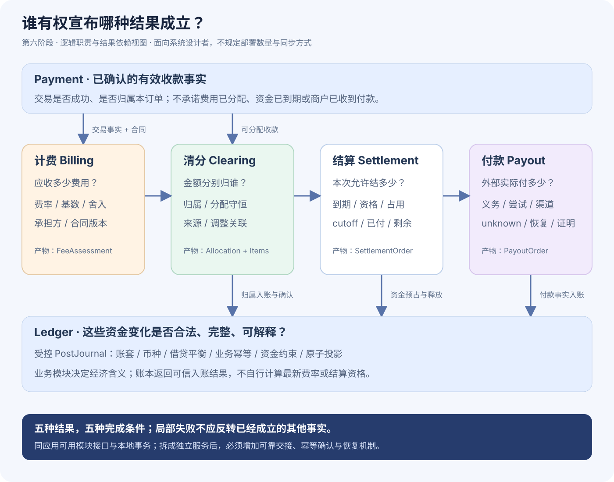
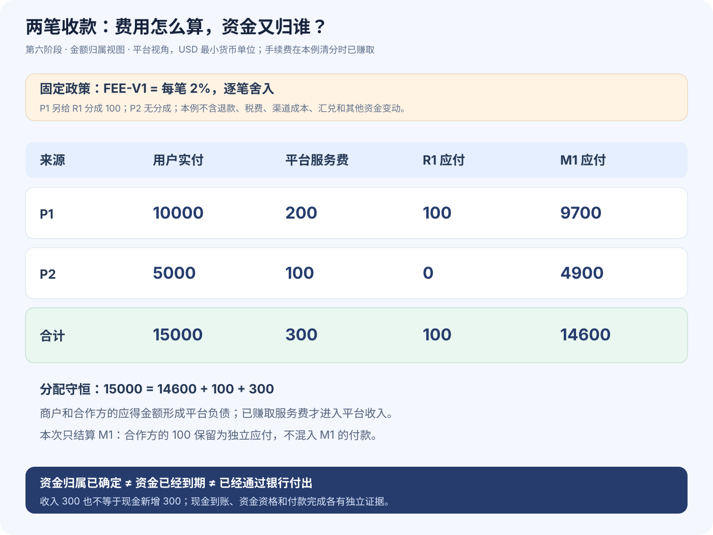
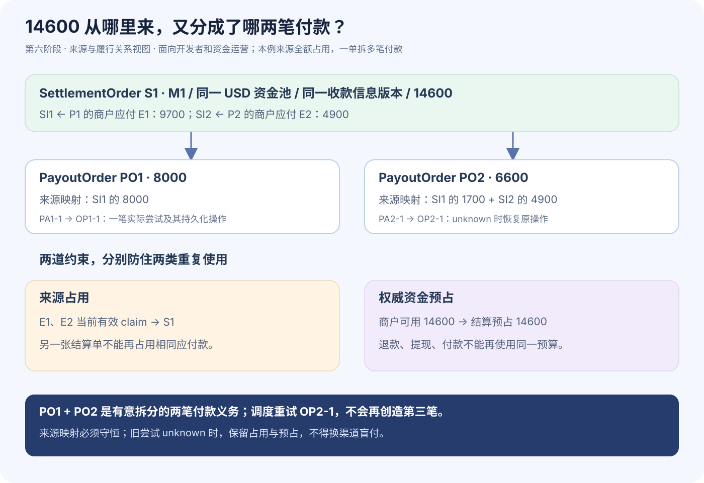
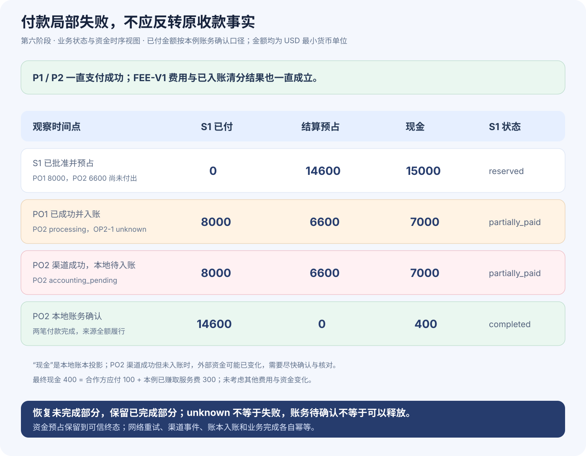
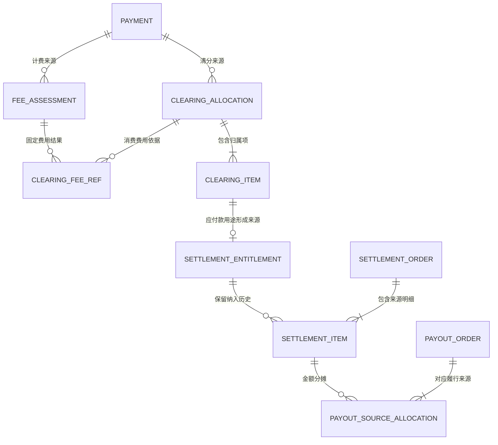

# 用户已经付了钱，为什么商户还没收到？

> “从业务变化到软件边界”系列第六篇：从两笔收款、一笔商户结算和两笔实际付款出发，推演计费、清分、结算、付款与账本的职责，理解多个业务生命周期怎样可靠协作。

如果你正在设计支付、账户、账本、清结算或风控系统，欢迎先关注本公众号。“从业务变化到软件边界”系列会从具体用例出发，讲清旧模型为什么开始不够用，新的模块边界怎样产生，以及如何用数据和故障场景检验这些边界。

[第五篇](./coach-payment-account-ledger-balance-stage-5.md)中，我们已经把 Account、Journal、Posting 和余额投影分开：交易记录说明发生了什么，账本记录资金关系怎样变化。

接下来，业务又提出一个看似简单的需求：

> 每天把符合条件的款项结给商户，扣掉手续费，并给合作方分成。

如果把这句话直接写成一个 `FinishPayment()`，很快就会遇到问题：付款超时了，原支付算不算失败？手续费改了，历史交易要不要重算？一张结算单分两次付，只成功一次，又该怎么展示？

这一篇，我们从这些问题出发继续推演。

本文采用平台记账视角、单账套、单币种 USD，金额为最小货币单位。图、契约和脚本是教学模型；脚本只做本地演算，不连接真实渠道或数据库。

---

## 一、先站在使用者面前，听清楚他们分别在问什么

同一笔支付，几个角色的问题并不相同：

| 使用者 | 他想知道的结果 | 应由谁解释 |
| --- | --- | --- |
| 消费者、商户订单系统 | 用户这次支付有没有成功？ | 支付 |
| 商户、商务 | 这一笔为什么收了这么多手续费？ | 计费 |
| 商户、合作方 | 这笔钱中，哪些属于我？ | 清分 |
| 商户、资金运营 | 哪些应付款符合这次结算条件？ | 结算 |
| 商户、渠道运营 | 这次实际付出了多少，还有多少未知？ | 付款 |
| 财务、审计 | 每次资金变化是否入账，能否解释和重建？ | 账本 |

原来的“支付完成”，开始承载多个不同结果。

商户没有收到结算款，不一定是用户没支付；可能是资金尚未到期，可能有风险留存，也可能是银行付款仍在处理中。

如果系统只有一个 `status = success`，这些问题就只能靠人翻日志猜。

**模块边界首先来自结果的所有权：谁有权宣布哪个结果成立。**

---

## 二、五个模块，不是五个步骤，也不必是五个微服务

先明确本文的术语，避免把名字相近的事情混在一起。

| 模块 | 决定什么 | 核心产物 | 不代替什么 |
| --- | --- | --- | --- |
| 计费 Billing | 按什么合同、基数和精度，应收多少费用 | FeeAssessment：费用计算结果 | 不决定商户是否已收到钱 |
| 清分 Clearing | 一笔已确认交易的金额，分别归属哪些主体 | Allocation：资金归属明细 | 不保证已经对外付款 |
| 结算 Settlement | 哪些应付款符合本次结算条件，纳入多少金额 | SettlementOrder：结算单及来源明细 | 不把结算单生成当成银行到账 |
| 付款 Payout | 将一笔付款义务通过外部渠道执行到什么程度 | PayoutOrder、PayoutAttempt | 不重新决定原收款是否成功 |
| 账本 Ledger | 资金变化是否满足约束，并形成完整分录 | Journal、Postings、Balance Projection | 不临时发明费率和结算资格 |

这里的 Clearing 指平台内部的交易资金归属计算。银行卡组织、银行和不同厂商对“清算、清分、结算”的用语可能不同；本文先以职责定义边界，不把内部模块名当成行业唯一术语。



这是一张目标逻辑职责图，帮助设计者决定事实由谁拥有；箭头表示使用哪个结果，不表示每个框必须独立部署，也不规定全部同步调用。

早期可以放在同一个应用中，通过模块接口和本地事务协作。未来是否拆服务，要由独立扩容、团队协作与发布需要驱动，而不是为了让图上的方框各占一个 Pod。

---

## 三、贯穿案例：两笔收款，最终该给谁多少钱？

我们固定一组教学合同：

- 同一商户 M1，有两笔有效收款 P1、P2，分别为 10000、5000。
- 费率版本 FEE-V1：按每笔收款的 2% 收取平台服务费，本例在清分时已满足收入确认条件。
- P1 按约定另外给合作方 R1 分配 100；P2 没有合作方分成。
- 渠道最终向平台结入 15000，暂不考虑渠道成本、税费、汇兑、退款和保证金。
- 本次只结算 M1；合作方的 100 仍然是应付款，不混入 M1 的结算。
- 示例付款通道每笔限额为 8000，所以一张商户结算单需要拆为两笔付款。

计算结果是：

| 收款 | 用户实付 | 平台服务费 | 合作方应得 | 商户 M1 应得 |
| --- | ---: | ---: | ---: | ---: |
| P1 | 10000 | 200 | 100 | 9700 |
| P2 | 5000 | 100 | 0 | 4900 |
| 合计 | 15000 | 300 | 100 | 14600 |

这次分配满足：

```text
15000 = 商户应付 14600 + 合作方应付 100 + 平台已赚取服务费 300
```



注意，合作方分成和平台费用是两种事实：前者形成对合作方的付款义务，后者在本例条件下形成收入。真实合同也可能采用其他承担方式，需要调整分配及记账政策。

读到这里，先回答三个问题：

1. 收入 300，是否意味着平台现金已经增加 300？
2. 商户应得 14600，是否意味着现在就允许付出 14600？
3. 合作方的 100，能不能顺便塞进 M1 的付款？

后面我们逐个验证。

---

## 四、计费：把“怎么算”变成可解释的结果

计费最初可能只有一行：

```text
fee = amount × rate
```

但真正需要固定的是一组含义：谁承担费用、按什么基数、哪一版合同、怎样舍入、什么时候确认、退款时是否退费。

可以先提炼这样的结果对象：

```go
type FeeAssessment struct {
    ID             string
    PaymentID      string
    FeeType        string
    Stage          string
    RuleVersion    string
    Currency       string
    BasisMinor     int64
    RateBPS        int64
    Rounding       string
    FeeMinor       int64
    ChargedPartyID string
}
```

`Stage` 区分正式计费、暂估或调整等业务阶段；本例只演示已确认的正式结果。费用计算结果不必各自拥有一张独立 Journal：本例服务费通过清分凭证入账，费用结果与凭证的对应关系由明确的业务事件关联，不能再生成一张收入凭证重复确认。

本例中 200 个基点就是 2%。对非负金额采用四舍五入到最小货币单位：

```text
fee_minor = floor((basis_minor × rate_bps + 5000) / 10000)
```

实现时还要检查乘法与累计溢出；生产系统不能因为最终结果很小，就忽略中间乘积可能超出整数范围。带符号调整、税费、上下限和固定费也要分别定义政策。

更容易被忽略的是“逐笔舍入”和“合计后舍入”的差异：

```text
两笔各 26，费率 2%

逐笔舍入：1 + 1 = 2
合计舍入：52 × 2% → 1
```

两种方式可以服务不同合同，但不能在支付时用一种、结算时换另一种。

### 为什么不能结算时再读最新费率？

P1 支付时确认的 FEE-V1 收费 200；第二天配置变成 3%，并不意味着 P1 的历史费用自动变成 300。

费用结果应保留计算基数、版本和舍入依据，后续清分、结算消费这个已确认结果。

如果需要追补费用，创建有依据的新调整记录及对应账务事件，而不是覆盖旧结果。暂估费用与最终费用也应有不同阶段或调整关联，不能共用一个含糊的 `fee` 字段。

**费用计算、费用应收成立和收入确认也不是同一个时点。** 本例刻意让服务费在清分时已赚取；如果服务尚未完成，需要按实际政策记入相应负债或应收，不能一律贷记收入。

---

## 五、清分：把金额归属讲清楚，不提前宣布付款完成

计费得出“服务费 200”，还不能独立回答剩下的 9800 全部属于谁。

P1 还要给 R1 分配 100，所以需要一个完整的归属结果：

```text
Allocation A1，来源 P1
├─ 商户 M1 应得：9700
├─ 合作方 R1 应得：100
└─ 平台已赚取服务费：200
```

清分的核心不变量包括：

```text
同一来源、同一分配阶段，最多产生一套有效结果
各分配项之和 = 本次可分配金额
主体、资金池、币种与费用承担方符合已确定的政策
已确认结果保留版本和来源，变更通过调整表达
```

沿用第五篇的“先记录未分配收款”模型，P1 的分录为：

```text
确认真实收款：
借：渠道应收资产         10000
贷：未分配收款负债       10000

清分完成：
借：未分配收款负债       10000
贷：M1 商户待结算负债     9700
贷：R1 合作方应付负债      100
贷：平台服务费收入         200
```

P2 对应商户 4900、平台服务费 100。两笔清分后，商户待结算为 14600，合作方应付为 100，收入为 300。

这些分录没有造成平台现金到账，也没有向商户银行账户转账。

如果清分和账本分库，“归属方案已算出”与“归属已入账”必须分开表达。清分只有在可信账本确认后，才能把相应结果暴露为本文的已入账完成态；同库时可以一起原子提交。

### 第二篇也有 Allocation，这里是不是同一个东西？

需要区分两个归属问题：

- 订单履约归属：两笔真实收款中，哪一笔用于这个订单？
- 资金归属：这笔可分配收款中，多少属于商户、合作方和平台？

代码可以使用 `OrderPaymentAllocation` 和 `ClearingAllocation` 等更明确的名称。不能因为都叫 Allocation，就让清分给同一订单的两笔重复收款都生成商户收入。

多收款、未归属款和退款应进入各自明确的资金处理路径。

---

## 六、结算：先决定资格，再形成有来源的付款义务

商户应得 14600，并不意味着当前就允许结算 14600。

结算要判断：

| 问题 | 需要的依据 |
| --- | --- |
| 到期了吗？ | 固定的结算规则版本、业务日历、时区与 available_on |
| 资金已具备约定条件吗？ | 本例要求渠道到账及入账确认；垫资模式另有授信与资金来源 |
| 是否存在退款、争议或风险留存？ | 真实限制及已预占金额 |
| 是否已被另一张结算单使用？ | 来源明细的受控占用状态 |
| 给谁、从哪个资金池、付什么币种？ | 收款主体、账户组、币种、已验证收款信息版本 |
| 当前允许执行吗？ | 风控决定、审批、额度和通道可用性 |

“T+1”也需要说明：T 是交易日还是渠道结算日？加的是自然日还是工作日？节假日和时区怎样处理？

厂商实现也会区分资金变为可用的时间和向银行付款的频率。例如 [Stripe 的付款时间说明](https://docs.stripe.com/payouts#how-payout-timing-works)明确区分这两件事；这有助于理解边界，不表示所有渠道采用相同规则。

### cutoff 不能在任务重试时偷偷变成现在

本例先固定结算请求的业务范围：

```text
request_key = merchant-settlement-demo-001
cutoff    = 2026-11-21T12:00:00Z
rule      = SETTLEMENT-V1
```

cutoff 表达本次请求的业务纳入边界。任务重试仍然处理同一范围；日期已过也不能每次换一套明细。

数据是否已到齐是另一项约束。实际系统需要定义入账截止点、数据到齐条件与迟到处理规则。可以固定本单来源清单，并把后来补齐的应付款纳入后续结算请求；不能只加一个 cutoff 就宣称结果天然完整。

### 哪些对象应该分开？

```text
SettlementOrder S1：给 M1 的一张结算单，金额 14600
    ├─ SettlementItem SI1：来自 P1 的商户应付 9700
    └─ SettlementItem SI2：来自 P2 的商户应付 4900
```

本例一张结算单只包含一个收款主体、一个资金池、一种币种和一个收款信息版本，并独立完成资格校验、资金预占和付款安排。

Order 是结算业务单据，Item 是本单的金额来源明细。

### SettlementOrder 与 SettlementItem 如何关联？

`SettlementItem` 是一张结算单里的来源明细。符合相同收款主体、资金池、币种和收款信息版本等条件的明细，组成一张 `SettlementOrder`；本例中 `9700 + 4900 = 14600`。

还要区分“待挑选的应付款来源”和“已经纳入结算单的明细”：

```text
SettlementEntitlement E1：P1 清分给 M1 的应付款来源，金额 9700
    ↓ 本轮校验资格并取得来源占用
SettlementItem SI1：把 E1 的 9700 纳入结算单 S1
```

因此 Item 应关联明确的应付款来源，而不只是保存一个 Payment ID。一笔 Payment 可能清分给不同主体，只有属于 M1 的那份应付款能纳入 M1 的结算单。

在关系型存储中，本篇建议先采用以下关联：

| 表 | 本例记录 | 主要关联字段 |
| --- | --- | --- |
| `settlement_orders` | `id = S1` | 保存收款主体、资金池、币种、固定 cutoff、规则和批准金额 |
| `settlement_items` | `id = SI1`，金额 9700 | `settlement_order_id = S1`、`source_entitlement_id = E1` |
| `settlement_items` | `id = SI2`，金额 4900 | `settlement_order_id = S1`、`source_entitlement_id = E2` |

每条 Item 直接关联所属结算单：

```text
SI1.settlement_order_id → S1
SI2.settlement_order_id → S1
```

查询 S1 的所有明细：

```sql
SELECT i.id, i.settlement_order_id, i.source_entitlement_id, i.amount_minor
FROM settlement_items AS i
WHERE i.settlement_order_id = $1;
```

随文内存脚本用结算单的 `sources` 数组简化表达来源明细，没有独立实现这些数据库表。上面是落库关联建议，不是对现有数据库字段的描述。

---

## 七、为什么同一来源不能被两张结算单同时占用？

最危险的实现通常长这样：

```text
查询所有未结算记录
    ↓
在应用里求和
    ↓
创建结算单
    ↓
付款
```

两个任务可能读到同一组记录，然后都认为自己有权支付 14600。

解决方案至少有两道约束：

1. 来源占用：这份应付款是否已归属于某张有效结算单？
2. 资金预占：共享可用预算是否已经为这次对外付款保留？

它们解决的问题不同。来源明细防止重复结算，账本预占防止退款、提现和结算重复使用同一笔资金。



这张图给开发者和资金运营看，回答“14600 从哪里来、拆出去后怎样追踪”。其中 PO1 与 PO2 是两笔有意拆分的付款义务，不是同一笔付款的网络重试。

### 同库时的候选事务边界

可以由应用用例协调：

```text
BEGIN
  按结算请求键、结算对象范围和请求指纹检查单据幂等
  按稳定顺序锁定候选应付款、占用记录和资金预算
  重新核对资格、未占用状态与可用金额
  建立 S1、SI1、SI2 及来源占用关联
  通过账本入口将可用资金转为结算预占
  创建两笔付款义务及来源金额映射
  写入等待执行的 Outbox
COMMIT
```

示例可为来源应付款维护 `current_claim_id`，用“仍未被占用”的条件更新抢占，并检查受影响行数；金额预占也必须原子校验。

只给 `(settlement_order_id, source_item_id)` 加唯一约束不够：它只能防同一张单重复添加，不能防另一张单拿走同一来源。

本文先采用来源应付款全额占用。若允许同一来源分多次结算，应增加可分配、已预占、已履行金额约束，在来源上原子校验总量；不能直接删除“来源唯一”约束就当作支持了部分结算。

分库后，应将单据准备、账本预占请求、可信确认和执行交接持久化；允许外部付款之前，必须收到权威资金预占确认。它不是一个包住所有 RPC 的数据库事务。

---

## 八、账本怎样配合结算，而不夺走结算的职责？

先确认渠道向平台结入 15000：

```text
借：平台现金资产         15000
贷：渠道应收资产         15000
```

商户资金满足本例资格条件后：

```text
借：M1 商户待结算负债    14600
贷：M1 商户可用资金负债  14600
```

本次结算预占：

```text
借：M1 商户可用资金负债  14600
贷：M1 商户结算预占负债  14600
```

此时：

```text
平台现金         15000
商户可用             0
商户结算预占     14600
合作方应付         100
平台服务费收入     300
```

商户资金仍然是平台负债，只是不能再被其他操作随意使用。预占没有让平台少欠钱，也没有产生一次银行转账。

在这个已入账重分类模型中，可用已经变成 0，查询时不能再减一次预占 14600。

### 商户有额度，不等于平台付款通道一定有流动性

还要确认实际付款银行或渠道的可用资金、限额及相应预留。不同商户同时付款时，不能各自读到同一份平台现金就全部获批。

生产设计需要受控的资金调度或通道资金预算；这和商户权益预算是不同约束。分布在不同服务时，执行前需要全部必要的许可，局部成功要能恢复或安全释放，不能伪装成跨库原子事务。

本例只有一个商户，现金充足，没有实现多通道资金调度。

账本负责合法、完整地记下这些变化；哪批交易到期、审批是否通过，仍由结算与相应业务模块决定。

---

## 九、一张结算单，为什么会对应两笔付款？

教学通道每笔限额 8000，所以：

```text
SettlementOrder S1 = 14600
├─ PayoutOrder PO1 = 8000
└─ PayoutOrder PO2 = 6600
```

为了追踪金额来源，再保留映射：

```text
PO1：SI1 的 8000
PO2：SI1 的 1700 + SI2 的 4900
```

必须满足：

```text
所有有效付款义务合计 = 本结算单安排支付的金额
每笔付款的来源映射合计 = 该笔付款金额
每个来源明细累计履行金额 ≤ 该明细已批准金额
```

复杂系统可以支持多张结算单合并付款，但需要显式金额映射与收款主体等兼容性约束。本例先限定一张结算单拆多笔付款，避免一开始就建立任意多对多模型。

### PayoutOrder、PayoutAttempt、ChannelOperation 分别是什么？

| 对象 | 示例 | 含义 |
| --- | --- | --- |
| PayoutOrder | PO2，6600 | 一笔明确的付款义务 |
| PayoutAttempt | PA2-1 | 为履行 PO2 选择渠道的一次实际尝试 |
| ChannelOperation | OP2-1 | 本次尝试对外发送的持久化操作意图 |
| Worker retry | 第三次调度 OP2-1 | 恢复同一操作，不天然创造新的付款义务 |
| ProviderEvent | EV2 | 收到的一条渠道事实，仍需关联操作和校验 |

一个 PayoutOrder 可以在旧尝试已明确安全结束后换渠道重试；一个 unknown 的旧尝试不能仅因本地超时，就允许新的尝试同时付出相同金额。

---

## 十、两笔付款只成功一笔，系统应该怎么说？

我们约定：本例渠道的最终证明足以确认已扣取平台资金，并完成本次对收款人的付款义务。单纯受理响应不满足这个条件。

PO1 成功并完成本地入账：

```text
借：M1 商户结算预占负债   8000
贷：平台现金资产          8000
```

结果：

```text
S1 已付款       8000
S1 未完成       6600
商户结算预占    6600
平台现金        7000
```

随后 PO2 请求超时。

此时应该表达为：

```text
原 Payment P1/P2：仍然 succeeded
原计费与清分结果：保持已确认
Settlement S1：partially_paid
Payout PO1：succeeded
Payout PO2：processing
ChannelOperation OP2-1：unknown
```



这张图帮助排障和设计状态接口：沿时间逐行观察，再在同一行对照业务状态与资金投影。不要再把所有模块压成一条 `pending → success`。

### unknown 期间到底做什么？

- 保留 PO2 的 6600 资金预占和来源占用。
- 使用已保存的 OP2-1 查单，或按渠道明确保证的幂等合同重放原请求。
- 不创建一笔“新 PO2”再付 6600，也不因为租约到期就释放资金。
- 只有旧操作已被证明未执行且不会再执行，才允许受控切换尝试或释放。

如果决定终止本次未完成付款，最多释放剩余的 6600，不能把已付出的 8000 一起恢复。对应来源也只能恢复尚未履行的部分；保留原结算单与付款历史，用取消或调整金额解释差额，不能把整张结算单重置成“从未结算”。

渠道幂等有自己的范围、参数要求和保留期限。例如 [Stripe 的幂等文档](https://docs.stripe.com/api/idempotent_requests)明确区分版本与保留行为；不能把本地生成了请求 ID 等同于渠道永久承诺幂等。

### 渠道成功了，本地账本确认还没回来呢？

先持久化可信成功事实，PO2 可以进入 `accounting_pending`。按原业务入账键查询或重试账本请求；在入账确认前，不把本例的结算已付款金额提升为 14600，也不释放剩余预占。

最终入账：

```text
借：M1 商户结算预占负债   6600
贷：平台现金资产          6600
```

然后 S1 才满足本文的完成契约：应付 14600 已全部通过有效付款履行，且关联资金事件已完成本地账务确认。

```text
商户结算预占 = 0
S1 已付款    = 14600
平台现金     = 400
```

现金的 400 中，还有欠合作方的 100；本例平台收入为 300，且未计其他费用。不能把“付完商户后的余额”全部当作利润。

### 如果扣平台现金和收款人到账不是同一时点？

需要根据真实合同增加在途阶段与记账政策。例如，若平台对在途款仍有可确认的资产请求权，扣账时可表达“现金转为付款在途资产”，完成义务时再以预占负债抵减在途资产。

实际退汇也必须作为新事实记录和核对。不能把银行的 `accepted` 翻译成“收款人已收到”，也不能只修改旧成功字段来抹掉资金往返。

---

## 十一、退款、改费率和改收款账户，分别会影响哪里？

通过变化场景，检验边界是否有效：

| 变化或故障 | 影响的模块与动作 | 应保持的事实 |
| --- | --- | --- |
| 新费率从明天生效 | 计费增加新版本，按生效规则作用于新交易 | 旧费用与分配不被静默改写 |
| 收款信息变更 | 更新已验证的收款信息版本；执行单不能无审计地换收款人 | 已执行操作保留实际目的地 |
| 商户付款通道超时 | 付款查单、保留预占、持续核对 | 原支付成功及清分金额不反转 |
| PO1 成功、PO2 明确失败 | 结算保留部分完成；只恢复未完成部分 | 已付 8000 不再次执行 |
| 结算前退款先预占 1000 | 同一权威预算只允许一个竞争结果；重核来源资格和本轮金额 | 不能仍按原 14600 无条件付款 |
| 结算先预占，随后申请退款 | 识别资金占用，按政策等待、停止未执行部分或安排其他合法资金来源 | 不能直接重复使用被占资金 |
| 付款后发生退款或拒付 | 新建退款、追偿、留存或获批垫资等流程 | 已完成结算历史仍可追溯 |
| 重复收到付款成功回调 | 去重、核验同一资金事实，幂等入账 | 不累计第二次已付金额 |

“无法立即取得这笔商户预算”不等于业务可以永久拒绝消费者退款；它意味着需要明确资金承担与恢复方案，而不是让两个出口同时使用同一笔钱。

### 对账能不能替代预占？

不能。

对账可以发现“渠道已付、本地未记”“金额不一致”等差异；预占解决的是执行当下的并发资格。即使付款前刚刚完成对账，也不能防止下一毫秒另一个退款请求使用同一笔可用资金。

[Adyen 的逐笔结算核对指南](https://docs.adyen.com/reporting/settlement-reconciliation/transaction-level/)展示了怎样把交易、成本和付款关联核对。它适合学习证据链，不应被理解成只要拿到报表就可以跳过实时资金约束。

---

## 十二、水平分层与垂直模块，怎样同时落在代码上？

回到这个系列最初的问题：接口改名、手续费变化和渠道超时，为什么不应该改在同一个地方？

可以把模块与层次放在同一张责任表里：

| 层次 | 计费 | 清分 | 结算 | 付款 |
| --- | --- | --- | --- | --- |
| 接口层 | 费用查询契约 | 分配结果查询契约 | 发起、查询结算契约 | 发起、查询付款契约 |
| 应用层 | 协调计算与结果持久化 | 协调归属与入账 | 选择来源、准备单据、申请预占 | 获取执行许可、持久化操作、应用确认 |
| 领域层 | 费率、基数、舍入、承担方 | 归属守恒、主体与调整规则 | 资格、来源占用、已付与剩余约束 | 付款义务、尝试互斥、完成契约 |
| 基础设施层 | 结果仓储、配置读取 | 明细仓储、消息交接 | 数据库锁、任务扫描、Outbox | 渠道协议、Inbox、查单、可靠调度 |

账本模块同样有自己的入账接口、领域约束和存储实现。风控提供 pass/block 与 Actions 等决策结果，执行用例按合同消费；渠道适配器不负责判断商户是否有资金权益。

付款前的授权与风控应绑定金额、币种、收款人、目的地版本及有效期。关键字段变化后重新校验，不能拿一份旧批准随意付款。

横向分层隔离不同抽象与依赖；纵向模块划分不同业务结果的所有权。应用层负责协调，不能让它变成重新实现全部规则的大函数。

这个阶段真正增加的架构能力，是让不同生命周期可以协作、独立解释并各自恢复。

---

## 十三、落到数据上，需要保留哪几条关联？

下面给出候选逻辑模型的主要字段、事实所有者和关联，不是完整 DDL。字段类型、非空与默认值、索引和引用约束要在建库阶段完整定义；分库后的逻辑引用也不等于可以直接建立跨库外键。

### 1. 先划清模型由谁维护

| 模块 | 拥有的主要模型 | 对其他模块提供什么 |
| --- | --- | --- |
| 计费 | `FeeAssessment` | 已固定版本的费用结果 |
| 清分 | `ClearingAllocation`、`ClearingItem` | 已确认的资金归属及其入账依据 |
| 结算 | `SettlementEntitlement`、`SettlementOrder`、`SettlementItem`、`PayoutSourceAllocation` | 结算来源、金额和受控付款指令 |
| 付款 | `PayoutOrder`、`PayoutAttempt` | 外部付款进度、可信结果与入账完成事件 |
| 账本 | `LedgerAccount`、`Journal`、`Posting`、`BalanceProjection`、资金预占及份额 | 资金许可、入账结果与可核对余额 |

`ChannelOperation`、渠道能力和 Provider Inbox 由渠道域维护，付款用例通过相应契约使用。模型的维护者负责其状态转换，其他模块不能直接修改它的表。

### 2. 计费与清分：固定结果，保留来源

| 模型 / 建议逻辑表 | 主要字段 | 字段承担的语义 |
| --- | --- | --- |
| `FeeAssessment` / `fee_assessments` | `id`、`payment_id`、`fee_type`、`stage`、`rule_version` | 哪笔交易、哪类费用、哪个阶段和版本的计算结果 |
| 同上 | `charged_party_id`、`currency`、`basis_minor`、`rate_bps`、`rounding`、`fee_minor` | 谁承担、计算基数、精度与结果；并非现金到账证明 |
| `ClearingAllocation` / `clearing_allocations` | `id`、`payment_id`、`allocation_stage`、`policy_version`、`currency`、`allocatable_amount_minor`、`status` | 一套有明确来源和规则的归属结果 |
| `ClearingItem` / `clearing_items` | `id`、`clearing_allocation_id`、`beneficiary_type`、`beneficiary_id`、`account_group_id`、`purpose`、`amount_minor` | 这份金额归谁、进入哪个资金池、属于商户应付还是平台收入等用途 |

一套清分可以消费多项费用结果，因此使用受控的 `clearing_fee_assessment_refs(clearing_allocation_id, fee_assessment_id)` 关联；同库可由关联表表达，分库可保留经过验证的版本化引用。本例 FA1 是 P1 的服务费结果，CA1 引用 FA1，而不是结算时再读取当前费率重算。

已确认的金额、规则和来源应保留历史；待入账与已入账状态也要区分。它们怎样生成 Journal，由既定记账政策负责，账本不重新计算费率。

### 3. 结算：来源、单据与明细

| 模型 / 建议逻辑表 | 主要字段 | 字段承担的语义 |
| --- | --- | --- |
| `SettlementEntitlement` / `settlement_entitlements` | `id`、`source_clearing_item_id`、`payee_id`、`account_group_id`、`currency`、`amount_minor` | 一份属于明确收款主体的应付款来源 |
| 同上 | `available_on`、`eligibility_status`、`current_claim_id`、`accounted_paid_minor` | 何时符合条件、目前是否已被占用，以及已履行多少；本例 `current_claim_id` 指向取得全额占用的结算单 |
| `SettlementOrder` / `settlement_orders` | `id`、`request_key`、`request_fingerprint`、`payee_id`、`account_group_id`、`currency` | 一次结算意图及其幂等范围；请求重试不创建另一张单 |
| 同上 | `cutoff`、`rule_version`、`destination_version`、`approved_amount_minor`、`accounted_paid_minor`、`status` | 固定范围、批准金额、目的地版本和本单进度 |
| 同上 | `reservation_id` | 关联账本已经确认的资金预占 |
| `SettlementItem` / `settlement_items` | `id`、`settlement_order_id`、`source_entitlement_id`、`amount_minor` | 哪一份来源的多少批准金额被纳入哪张结算单 |

结算状态与来源占用由结算模块维护，资金预占由账本维护，两者必须通过确认关系协调，不能互相代替。`accounted_paid_minor` 表示按本例完成契约已确认的金额；剩余金额可以按批准金额与已履行、已取消等业务事实推导，不要让多个金额字段被各自随意修改。

同一主体、资金池和币种的来源才能按本例规则组单。一条来源可以保留多次历史关联，但本篇全额占用模型下，不能同时被两张有效结算单占用；支持部分结算时，要改为对来源金额预算做原子控制。

### 4. 付款：业务义务与来源金额映射分开

| 模型 / 建议逻辑表 | 主要字段 | 字段承担的语义 |
| --- | --- | --- |
| `PayoutOrder` / `payout_orders` | `id`、`request_key`、`request_fingerprint`、`source_business_type`、`source_business_id` | 一笔付款义务及其调用方来源；本例来源为 `settlement / S1` |
| 同上 | `payee_id`、`amount_minor`、`currency`、`destination_version`、`reservation_allocation_id`、`status` | 给谁付多少、使用哪版收款信息、持有哪份资金许可和完成到哪里 |
| `PayoutAttempt` / `payout_attempts` | `id`、`payout_order_id`、`channel_code`、`channel_account_id`、`status` | 为履行同一付款义务做的一次渠道尝试 |
| `ChannelOperation` / `channel_operations` | `id`、`business_type`、`business_id`、`operation_type`、`client_request_id`、`request_fingerprint`、`provider_outcome` | 渠道域负责的固定外部请求及其结果；本例业务关联指向付款尝试，调度与租约字段沿用第四篇 |
| `PayoutSourceAllocation` / `payout_source_allocations` | `id`、`settlement_order_id`、`settlement_item_id`、`payout_order_id`、`currency`、`amount_minor` | 结算模块维护的金额映射：一笔付款履行了哪些结算明细、各多少金额 |

付款模块消费明确的付款指令和资金许可，不需要重新挑选 SettlementItem 或计算清分。`source_business_id = S1` 用于来源关联，不代表付款模块接管 S1 的生命周期。

对外付款由渠道结果确认后，付款模块按完成契约产生已入账完成事件；结算模块幂等应用该事件，并沿自己的 `PayoutSourceAllocation` 更新来源履行进度。跨库时通过接口或可靠事件协作，不直接 JOIN 其他模块的业务表推进状态。

### 5. Ledger：业务入账身份、预占许可与凭证身份分开

| 模型 / 建议逻辑表 | 主要字段 | 字段承担的语义 |
| --- | --- | --- |
| `FundsReservation` / `ledger_funds_reservations` | `id`、`book_id`、`source_business_type`、`source_business_id`、`account_group_id`、`currency` | 一份权威资金预占及其来源；本例 RS1 关联 S1 |
| 同上 | `reserved_amount_minor`、`consumed_amount_minor`、`released_amount_minor`、`status` | 原始预占、已消耗和已释放额度，确认与释放须受原子状态和金额约束 |
| `ReservationAllocation` / `ledger_reservation_allocations` | `id`、`reservation_id`、`consumer_business_type`、`consumer_business_id`、`amount_minor`、`status` | 把原预占的一份额度受控分配给一笔付款义务；本例 RA1 给 PO1、RA2 给 PO2 |
| `Journal` / `ledger_journals` | `id`、`book_id`、`business_type`、`business_id`、`event_type`、`currency`、`effective_at`、`request_fingerprint`、`status` | 凭证身份与业务入账身份；同一业务事件重试返回原凭证 |
| `Posting` / `ledger_postings` | `id`、`journal_id`、`sequence_no`、`account_id`、`side`、`amount_minor` | 该凭证中具体账户的借贷变化 |
| `LedgerAccount` / `ledger_accounts` | `id`、`book_id`、`account_group_id`、`owner_type`、`owner_id`、`currency`、`account_type`、`normal_side`、`purpose` | 哪种资金关系与账户归属发生变化，详见第五篇 |
| `BalanceProjection` / `ledger_balances` | `account_id`、`posted_debits_minor`、`posted_credits_minor`、`version` | 与分录原子维护、可重建的余额状态 |

预占份额可以由独立表或预占对象内的受控明细表达。引入它是因为本例 S1 的 14600 拆成两笔付款：只把同一个 RS1 ID 交给所有付款方，而不限制各自份额，仍可能重复使用总预算。分配份额不再冻结一次资金，也不表示已经对外付款。

RS1、RA1 与 JournalID 是不同身份。采用本文已入账重分类模型时，预占、份额控制及凭证和余额更新要在相应账本本地事务中保持一致。确认与释放须检查原关联与剩余额度；一个业务键唯一，并不能单独证明资金许可正确。

### 6. 用关系图和具体金额把模型串起来

下图是逻辑引用关系，表示历史关联，不代表所有对象必须在一个数据库中。单阶段有效结果唯一、来源不得并发重复占用等约束，仍按前文规则执行：



其中两个 Payment 的业务来源映射为：

| Payment | 费用结果 | 清分结果中的商户归属项 | 应付款来源 | 结算明细 | 纳入金额 |
| --- | --- | --- | --- | --- | ---: |
| P1，10000 | FA1，200 | CA1 / CI1，M1 应得 9700 | E1 | S1 / SI1 | 9700 |
| P2，5000 | FA2，100 | CA2 / CI4，M1 应得 4900 | E2 | S1 / SI2 | 4900 |

P1 的合作方 100 和平台收入 200 是 CA1 的其他归属项，不会因为同源于 P1，就被并入 M1 的结算明细。上表中的 CA、CI、FA 编号是为解释关系补充的教学标识。

结算明细到付款的金额映射不能只保存两个 ID：

| 映射记录 | 结算单 | 来源明细 | 付款单 | 分摊金额 |
| --- | --- | --- | --- | ---: |
| PSA1 | S1 | SI1 | PO1 | 8000 |
| PSA2 | S1 | SI1 | PO2 | 1700 |
| PSA3 | S1 | SI2 | PO2 | 4900 |

由此可以核对：SI1 的 9700 分给 PO1 的 8000 和 PO2 的 1700；PO2 的 6600 来自 SI1 的 1700 和 SI2 的 4900。结算模块拥有这张来源分摊关系，付款模块只承担 PO1、PO2 各自的付款义务。

对应的资金许可关系是：

```text
S1，14600 → Ledger 预占 RS1，14600
                ├─ 份额 RA1：绑定 PO1，8000
                └─ 份额 RA2：绑定 PO2，6600
```

RA2 的 6600 仍然未知时继续受限，不会因 PO1 已付出 8000 就一起释放。来源分摊、预占份额和最终扣减分别解释“钱来自哪里”“允许使用多少”“实际完成多少”。

### 7. 跨模块到底传什么？哪些 ID 用于 Ledger 幂等？

| 交互 | 必要的业务输入 | 对方返回或交接的结果 |
| --- | --- | --- |
| 清分消费计费 | 固定 Payment、费用类型与阶段对应的已确认费用结果 | FeeAssessment ID、规则版本、币种、金额与承担方 |
| 结算请求 Ledger 预占 | Book、S1、资金来源账户、币种、金额、稳定业务键与内容 | 已提交的 RS1 及对应入账结果 |
| 结算准备 Payout 义务 | 每笔付款独立的请求键、来源 `settlement / S1`、收款人、金额、币种、目的地版本 | PO1 / PO2，尚未取得资金许可时不得执行 |
| 结算准备分笔付款许可 | RS1、已建立的 PO1/PO2 关联及各自批准金额 | RA1 / RA2；总份额不能超过原预占预算 |
| 结算交接 Payout 执行许可 | PO1 / PO2 与对应的 RA1 / RA2，内容必须匹配已准备的付款义务 | 幂等绑定资金许可，满足授权等前置条件后才进入可执行态 |
| Payout 交接 Ledger 确认 | PO1 或 PO2、原资金许可、可信资金结果及相应分录 | 原 Journal 或新提交的唯一入账结果 |
| Payout 向结算交接完成结果 | PayoutOrder ID、已履行金额、币种、入账证据和稳定事件身份 | 结算按自己的来源映射推进 S1 及明细进度 |

分库时可以先幂等准备付款单、再为其分配预占份额，最后绑定许可并安排执行，避免“创建付款单必须先有许可、创建许可又必须先有付款单”的循环。任一步失败都要留下可恢复状态，不能因为已创建 PO1 就自动开始银行付款。

Ledger 的业务键仍按 `(book_id, business_type, business_id, event_type)` 解释。沿用随文脚本已采用的事件身份：

| 资金事件 | 业务键示例，省略固定的 `book-demo` | 关联关系 |
| --- | --- | --- |
| P1 确认收款 | `payment / P1 / receipt` | 原 Payment P1 |
| P1 资金归属入账 | `payment / P1 / allocation` | CA1 与其费用、归属项；不再次单独记同一收入 |
| E1 满足资格后释放为可用 | `entitlement / E1 / eligible` | 原应付款来源 E1 |
| S1 结算预占 | `settlement / S1 / reserve` | RS1，金额 14600 |
| PO1 付款入账 | `payout / PO1 / paid` | RA1，金额 8000 |
| PO2 付款入账 | `payout / PO2 / paid` | RA2，金额 6600 |

AccountID 决定分录落到哪里，业务键防止同一经济事件重复入账，JournalID 标识具体凭证，ReservationID 及份额控制资金许可。不能把这些身份压缩成同一个通用 ID。

随文脚本目前用 `assessments`、`allocations`、`entitlements`、`settlements.sources`、`payouts.mappings` 和 `journals` 简化演算。它没有完整实现上述逻辑表或权威账本预占份额；这些新增字段与关系是后续落地契约，不代表数据库、接口和跨服务协作已经实现。

### 8. 各边界的请求幂等与查询结果

每个边界都需要明确的幂等身份：

| 边界 | 本例候选身份 | 内容冲突怎样处理 |
| --- | --- | --- |
| 费用计算 | Payment + 费用类型 + 计算阶段 | 比较版本、基数等指纹；调整另立身份 |
| 清分 | Payment + 分配阶段 | 拒绝同键不同主体或金额 |
| 结算创建 | 稳定结算请求键 + 结算对象范围 | 核对固定 cutoff、规则、目的地与来源清单 |
| 预占份额与消耗 | 原预占 + 固定付款义务 + 操作阶段 | 校验份额总额、剩余额度及确认/释放互斥 |
| 对外付款 | 每个 ChannelOperation 的固定请求身份 | unknown 不换键；变更必须满足恢复合同 |
| 账本入账 | Book + 业务类型 + 业务 ID + 事件类型 | 相同内容返回原凭证，不同内容拒绝 |
| 成功事实应用 | 渠道业务付款身份及事件身份 | 事件去重之外，还要防同一资金事实多次入账 |

“幂等”不能只指某个消息不重复。不同渠道事件 ID 也可能报告同一笔付款成功，所以要同时保护业务完成点与账本效果。

查询接口也应保留这些维度。例如：

```json
{
  "settlement_id": "S1",
  "currency": "USD",
  "approved_amount_minor": 14600,
  "accounted_paid_minor": 8000,
  "remaining_amount_minor": 6600,
  "status": "partially_paid",
  "payouts": [
    {"id": "PO1", "status": "succeeded", "amount_minor": 8000},
    {"id": "PO2", "status": "processing", "amount_minor": 6600,
     "channel_outcome": "unknown"}
  ]
}
```

展示事实的粒度应该足以支持使用者做决定，而不是只返回一个 success，让商户误以为 14600 全部到账。

---

## 十四、教练式实践：自己跑一次“部分付款、超时和恢复”

随文提供：

- [计费、分配与结算输入夹具](./examples/settlement-stage-6-scenario.json)
- [本地演算与断言脚本](./examples/verify-settlement-stage-6.mjs)

在仓库根目录运行，使用支持内置 `structuredClone` 的 Node.js：

```bash
node docs/payment-architecture-evolution/examples/verify-settlement-stage-6.mjs
```

脚本只读取 JSON、在内存中演算，不调用数据库、Redis、MQ 或银行接口。它以安全整数范围演示资金守恒、来源占用与幂等，不证明数据库隔离、进程恢复或真实渠道可用性。

### 练习一：先算出钱归谁

运行前先手算 P1、P2 的费率、合作方与商户所得，再检查分配结果和费用版本。

脚本同时验证“两笔各 26”逐笔舍入与合并舍入的不同，提醒你把舍入粒度写进合同。

### 练习二：时间没到，结算任务应该得到什么？

脚本先使用早于到期时间的 cutoff，断言无法生成本次结算和预占；到期后才允许创建 S1。

没有符合条件的来源时，不创建结算单和付款单，也不能把空查询结果伪装成已付款成功。

### 练习三：重复跑批，为什么不能再付一次？

脚本用同一结算请求键重试，返回原 S1；换一个新结算请求键再抢同一来源时，被现有占用拒绝。同键改变规则版本也被识别为内容冲突。

重点观察：请求幂等和来源占用分别解决两个问题，不能相互替代。

### 练习四：只成功一笔，再让另一笔 unknown

PO1 完成入账后，核对：

```text
S1 accounted_paid_minor = 8000
S1 remaining_minor      = 6600
商户结算预占            = 6600
平台现金                = 7000
P1/P2                   = succeeded
```

脚本验证恢复指令仍然查询 OP2-1，没有产生第三笔付款，也没有修改预占金额。

随后尝试从可用金额预占退款 1000，被资金约束拒绝，且无部分写入。真实用例需要为退款安排合法资金来源或受控等待路径。

### 练习五：渠道成功先到，账本确认后到

观察 PO2 进入 `accounting_pending` 时，已确认入账的已付金额仍为 8000。完成本地入账后才变为 14600。

再重复投递成功事实和重复执行完成步骤，断言凭证、余额与已付金额不增加。

最终：

```text
S1 completed，已付款 14600
PO1 = 8000，PO2 = 6600
商户结算预占 = 0
平台现金     = 400
合作方应付   = 100
平台收入     = 300
```

### 练习六：把内存演算升级为真实数据库验收

下一步在隔离测试环境中验证三个竞争点：

1. 两个结算 Worker 同时抢同一来源，只能形成一份有效占用。
2. 退款和结算同时抢同一可用预算，不会超支。
3. 渠道已经付款、本地提交前宕机，恢复后只完成一次入账和结算累计。

还要验证旧 Worker 租约失效后的迟到写入、旧尝试 unknown 时切换渠道被阻止，以及通道流动性不足的控制路径。这些属于数据库与故障演练，随文脚本没有执行它们。

---

## 十五、这一阶段该怎样推进？

```text
S0 固定费用、归属、资格、付款完成点及调整政策
S1 从现有支付代码提炼计费与清分模块，保留来源和版本
S2 建立来源应付款、结算单、占用与共享预算预占
S3 建立付款义务及多次尝试，复用可靠渠道操作机制
S4 打通渠道事实、账本确认、结算累计与商户查询
S5 演练并发、unknown、部分完成、退款竞争与实际退汇
S6 建立来源、结算单与付款的逐笔核对，按需要评估模块是否拆服务
```

验收时，不只看“商户终于收到钱了”，还要回答：原始收款是什么、费用按哪版规则、各主体分多少、本轮纳入哪些来源、哪笔渠道操作付了多少、对应哪张凭证、剩余部分怎样恢复。

到这里，架构从“一条支付流程”演进为多个生命周期的协作：每个模块拥有明确结果，通过受控契约使用其他模块的能力，并能在局部失败时保持其他事实成立。

---

## 官方资料与阅读方法

1. [Stripe：Balances and settlement time](https://docs.stripe.com/payments/balances)——观察待入账、可用等余额状态；不要直接把产品状态复制成自己的资金模型。
2. [Stripe：Payout timing](https://docs.stripe.com/payouts#how-payout-timing-works)——区分资金可用时间与实际付款计划。
3. [Stripe：Idempotent requests](https://docs.stripe.com/api/idempotent_requests)——核对固定请求身份、参数一致性及渠道保留边界。
4. [Adyen：Transaction-level reconciliation](https://docs.adyen.com/reporting/settlement-reconciliation/transaction-level/)——学习交易、成本与实际付款之间的证据关联。

资料核对日期：2026-11-22。本文的费率、通道限额、对象和状态名称均为教学设定；真实会计政策、结算日历及付款完成条件应以实际合同和渠道契约为准。

---

下一篇，我们继续追问：

> 当收款、提现和卡交易都需要风控、通知和权限时，哪些共性值得提炼成平台能力，哪些仍由业务负责？

继续阅读第七篇：[收款、提现、卡交易都有风控，为什么不能直接合成一个大服务？](./coach-payment-shared-risk-notification-authorization-stage-7.md)。

如果你希望持续看到支付、账户、账本、清结算与风控系统如何从业务问题一步步推演成可验证的设计，欢迎关注本公众号，并收藏“从业务变化到软件边界”系列。后续我们继续结合数据库记录、渠道事实和故障演练，把“账对得上、钱付得清楚”落实到每一个边界。
