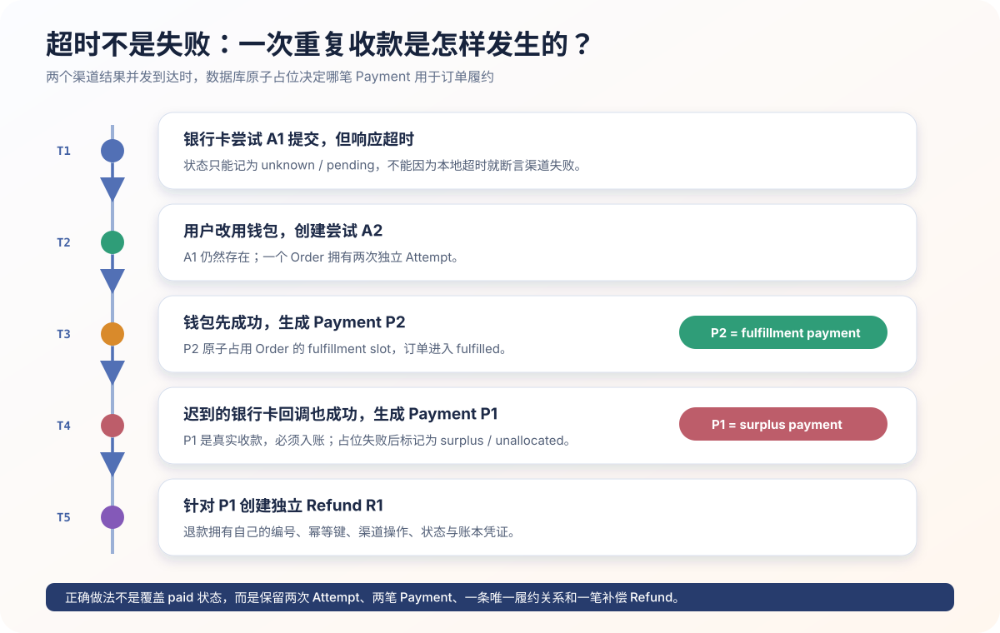
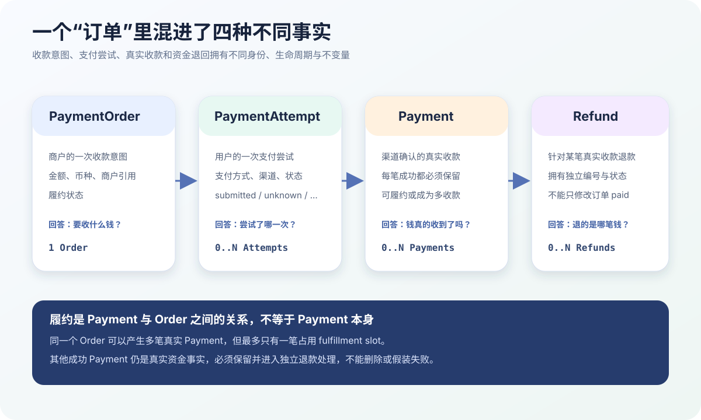

# 一次订单为什么装不下两次支付？

> “从业务变化到软件边界”系列第二篇：从银行卡超时、钱包成功、银行卡迟到成功，推演 `PaymentOrder`、`PaymentAttempt`、`Payment` 与 `Refund` 为什么必须成为不同领域对象。

如果你正在设计支付、账户、账本、渠道或风控系统，欢迎先关注本公众号。这个系列不会只给出一张最终架构图，而会持续还原模型是怎样被异常场景一步步逼出来的：哪些概念原本混在一起，为什么开始失效，又该如何用状态、不变量和事务把它们重新分开。

上一篇《为什么接口改名、增加风控、修改手续费，不应该改在同一个地方？》讨论的是：不同变化为什么应该由接入层、应用层、领域层和适配层分别承接。

这一篇进入第二阶段：

> 当用户可以对同一个订单再次支付时，原来的“订单 + paid 状态”为什么突然不够用了？

---

## 一、第一阶段为什么看起来没有问题？

最初的支付系统通常只有一个简单用例：

```text
商户创建支付订单
        ↓
用户完成一次支付
        ↓
渠道返回成功
        ↓
订单状态改为 paid
```

数据模型也很简单：

```text
payment_orders
├─ id
├─ merchant_id
├─ amount_minor
├─ currency
├─ channel_code
├─ provider_payment_id
└─ status = pending / paid / failed
```

在“一张订单只会支付一次”的假设下，这个模型能够工作：

- `channel_code` 表示使用哪个渠道；
- `provider_payment_id` 表示渠道支付编号；
- `paid` 表示已经收到钱；
- `failed` 表示没有收到钱。

问题在于，这些字段实际上把四种不同事实压进了同一个对象：

```text
商户想收多少钱
用户尝试用什么方式支付
渠道是否真的收到钱
这笔钱是否用于订单履约
```

只要世界始终按照 happy path 运行，它们看起来像一件事；一旦出现重试、超时和异步回调，四种事实就会开始分裂。

---

## 二、第二阶段的新用例：用户换一种方式再次支付

我们增加一个很普通的产品能力：

> 第一次银行卡支付迟迟没有结果，用户可以改用钱包再次支付。

正常情况下，流程可能是：

```text
银行卡支付失败
        ↓
用户选择钱包
        ↓
钱包支付成功
        ↓
订单完成
```

但支付系统不能只设计正常路径，还要追问：

> 银行卡真的是失败，还是我们暂时不知道结果？

于是出现关键异常场景：

```text
银行卡请求超时
        ↓
用户改用钱包
        ↓
钱包先成功
        ↓
银行卡迟到的异步回调也成功
```

最终事实是：

```text
订单金额：100 元
钱包实际收款：100 元
银行卡实际收款：100 元
平台总共收到：200 元
```

但订单只需要履约一次。



这时，一个简单的 `paid` 字段无法回答：

1. 用户尝试过几次？
2. 每次使用了什么支付方式？
3. 哪次尝试只是超时，哪次被渠道明确拒绝？
4. 渠道实际确认了几笔收款？
5. 哪笔钱用于订单履约？
6. 多收到的另一笔钱应该怎么办？

模型失效不是因为表字段太少，而是因为一个对象承担了太多不同事实。

---

## 三、第一条关键原则：超时不是失败

银行卡请求返回超时，只能说明：

```text
我们没有在预期时间内得到结果
```

它不能证明：

```text
渠道没有扣款
```

必须区分三种状态：

| 状态 | 含义 |
| --- | --- |
| `failed` | 渠道明确拒绝，结果已知 |
| `pending` | 渠道明确表示仍在处理中 |
| `unknown` | 本地无法确定渠道最终结果 |

错误做法是：

```text
HTTP Timeout
    ↓
status = failed
```

正确理解是：

```text
HTTP Timeout
    ↓
status = unknown
    ↓
继续查询、等待 Webhook 或对账确认
```

为什么这一步如此重要？

因为用户看到“失败”后会自然重试。如果系统把未知错误地解释为失败，就会主动制造重复支付窗口。

> `unknown` 不是含糊，而是对当前认知状态的精确表达。

---

## 四、不要急着建表，先问四个领域问题

面对这个异常场景，我们先不讨论数据库，而是逐个寻找业务事实。

### 问题一：商户的一次收款要求是否独立存在？

即使用户还没有选择支付方式，商户已经表达：

```text
向这个客户收取 100 USD
商户订单号为 merchant-order-001
```

这个事实独立存在，因此得到：

```text
PaymentOrder
```

### 问题二：用户每次点击支付是否需要独立追踪？

银行卡和钱包拥有不同：

- 支付方式；
- 渠道；
- 请求编号；
- 提交时间；
- 状态；
- 错误原因。

它们不能相互覆盖，因此得到：

```text
PaymentAttempt
```

### 问题三：渠道确认收到的钱是否应永久保留？

无论这笔钱最终是否用于订单履约，只要渠道确认收款，它就是一个真实资金事实。

因此得到：

```text
Payment
```

### 问题四：退款是否只是把订单改回未支付？

不是。退款拥有自己的：

- 退款编号；
- 原始 Payment；
- 金额；
- 渠道操作；
- 状态；
- 幂等键；
- 账本凭证。

因此得到：

```text
Refund
```

这不是为了“多建几个类”，而是把拥有不同身份、生命周期和规则的事实拆开。

---

## 五、四个对象分别代表什么？



### 1. PaymentOrder：商户的一次收款意图

它回答：

```text
谁想收钱？
向谁收？
收多少？
什么币种？
对应哪个商户业务单据？
是否已经完成履约？
```

典型字段：

```text
order_id
merchant_id
merchant_order_reference
amount_minor
currency
status
fulfillment_payment_id
created_at
```

`PaymentOrder` 不应该保存“最后一次尝试”的渠道字段来覆盖历史。

### 2. PaymentAttempt：用户的一次支付尝试

它回答：

```text
用户第几次尝试支付？
使用什么支付方式？
路由到哪个渠道？
渠道请求进行到哪一步？
结果是成功、失败、处理中还是未知？
```

典型字段：

```text
attempt_id
order_id
payment_method_type
channel_code
status
failure_reason
submitted_at
resolved_at
```

同一个订单可以拥有多次 Attempt：

```text
Order O1
├─ Attempt A1：银行卡，unknown
└─ Attempt A2：钱包，succeeded
```

### 3. Payment：渠道确认的真实收款

它回答：

```text
渠道是否真的收到了钱？
是哪次 Attempt 产生的？
渠道侧收款编号是什么？
金额与币种是什么？
这笔钱用于履约，还是成为多收款？
```

典型字段：

```text
payment_id
attempt_id
provider_payment_id
amount_minor
currency
confirmed_at
disposition
```

其中 `disposition` 可以表达：

```text
fulfillment：用于订单履约
surplus：真实收到，但未用于履约
```

不过从更严格的模型看，“履约”是 `Payment` 与 `PaymentOrder` 之间的关系，不是 Payment 自身属性。第一阶段可以在 Order 上保存 `fulfillment_payment_id`；以后支持拆分支付、部分履约时，再提炼独立的 `PaymentAllocation`。

### 4. Refund：针对一笔真实 Payment 的资金退回

它回答：

```text
退的是哪一笔真实收款？
退款金额是多少？
渠道是否接受？
最终是否成功？
发生失败或未知结果时如何恢复？
```

典型字段：

```text
refund_id
payment_id
amount_minor
currency
status
idempotency_key
provider_refund_id
created_at
```

退款必须指向 `Payment`，而不是笼统指向 `PaymentOrder`。否则当一个订单出现两笔真实收款时，系统无法知道到底退哪一笔渠道交易。

---

## 六、对象关系不是表关系，而是业务约束

第二阶段可以明确以下关系：

```text
PaymentOrder 1 ───── 0..N PaymentAttempt

PaymentAttempt 1 ─── 0..1 Payment

PaymentOrder 1 ───── 0..N Payment

PaymentOrder 1 ───── 0..1 Fulfillment Payment

Payment 1 ────────── 0..N Refund
```

为什么 `PaymentAttempt` 是 `0..1 Payment`？

在当前阶段，我们限定一次渠道尝试最多确认一笔收款。这是一个明确约束，不是永恒真理。如果未来渠道支持一次 Attempt 分多次 Capture，就需要进一步拆出 Authorization 与 Capture。

为什么 `PaymentOrder` 可以对应多笔 Payment？

因为两个渠道都可能真实成功。系统不能为了保持“一单一支付”的表面整洁而删除迟到事实。

为什么履约 Payment 最多一笔？

因为当前用例是一次性全额支付，一个订单只能完成一次履约。这同样是阶段性不变量；未来若支持分次付款，它会演进为多条 Allocation，但总分配金额不得超过订单应收金额。

---

## 七、状态机也必须分开

把所有状态都塞进 `payment_orders.status`，会产生大量含糊状态。不同对象应拥有各自生命周期。

### PaymentOrder 状态

```text
awaiting_payment
      │
      ├── fulfilled
      ├── expired
      └── cancelled
```

它只表达收款意图是否完成，不表达每次渠道请求细节。

### PaymentAttempt 状态

```text
created
   ↓
submitted
   ├── pending
   ├── unknown
   ├── succeeded
   └── failed
```

其中：

- `failed` 是渠道明确失败；
- `unknown` 是当前无法确认；
- `succeeded` 表示对应 Payment 已被确认或能够被唯一重建。

### Refund 状态

```text
requested
    ↓
submitted
    ├── pending
    ├── unknown
    ├── succeeded
    └── failed
```

退款同样可能出现超时和迟到回调，不能把调用超时直接当成退款失败。

### Payment 为什么不一定需要复杂状态？

`Payment` 是已经确认的收款事实。与其让它在 `pending/succeeded/refunded` 之间反复变化，不如把：

- 渠道处理过程放在 Attempt；
- 履约关系放在 Allocation；
- 资金退回放在 Refund。

这样 `Payment` 更接近不可变事实。

---

## 八、竞态的核心：谁先占用唯一履约位置？

钱包和银行卡回调可能几乎同时到达两个 Pod：

```text
Pod A：钱包成功
Pod B：银行卡成功
```

如果两个进程都先查询：

```sql
SELECT status
FROM payment_orders
WHERE id = 'O1';
```

两边可能同时看到：

```text
status = awaiting_payment
```

然后都把自己的 Payment 当成履约支付。这是经典的先查后改竞态。

### 错误做法

```text
查询订单未支付
        ↓
应用代码判断可以履约
        ↓
更新订单 paid
```

查询和更新之间存在竞争窗口。

### 正确做法：原子占位

可以把“只有一笔 Payment 能成为履约支付”交给数据库原子更新：

```sql
UPDATE payment_orders
SET fulfillment_payment_id = $1,
    status = 'fulfilled',
    updated_at = NOW()
WHERE id = $2
  AND status = 'awaiting_payment'
  AND fulfillment_payment_id IS NULL;
```

然后检查影响行数：

```text
affected_rows = 1
  → 当前 Payment 赢得履约位置

affected_rows = 0
  → 回查订单当前状态和 fulfillment_payment_id
      ├─ 已由当前 Payment 履约 → 幂等返回原结果
      ├─ 已由另一笔 Payment 履约 → 当前 Payment 是 surplus
      └─ 订单已取消或过期 → 按迟到成功策略退款或转人工
```

执行占位前，还要验证 Payment 与订单的归属、金额和币种一致，并在事务中检查订单是否仍满足有效期等履约条件。若更新失败后仍无法归入上述情况，应返回冲突或进入异常处理，不能直接把它当成重复支付。

如果使用独立 Allocation 表，可以建立唯一约束：

```sql
CREATE UNIQUE INDEX one_fulfillment_per_order
ON payment_allocations (payment_order_id)
WHERE allocation_type = 'fulfillment'
  AND status = 'active';
```

关键不是选择哪种表结构，而是：

> “一个订单最多一笔有效履约支付”必须由数据库唯一约束或原子条件更新最终兜底，不能只依赖进程内判断。

---

## 九、迟到成功事件应怎样处理？

以银行卡回调为例，完整事务可以是：

```text
收到 Provider Webhook
        ↓
验签与时间窗口校验
        ↓
Inbox 按 (channel_code, provider_event_id) 幂等落库
        ↓
锁定或加载 PaymentAttempt A1
        ↓
按 (channel_code, provider_payment_id) 幂等创建 Payment P1
        ↓
尝试原子占用 Order O1 的 fulfillment slot
        ├─ 首次占位成功 → P1 用于履约
        ├─ 已由 P1 履约 → 幂等返回原结果
        ├─ 已由另一笔 Payment 履约 → P1 为 surplus，幂等安排退款
        └─ 订单已取消或过期 → 按迟到成功策略退款或转人工
        ↓
需要退款时，幂等创建 RefundRequested Outbox
        ↓
提交数据库事务
```

注意：不要在数据库事务里直接调用外部退款渠道。

正确模式是：

```text
数据库事务
├─ 保存 Payment
├─ 决定 fulfillment / surplus
└─ 写入 RefundRequested Outbox
        ↓ commit
异步 Worker
        ↓
调用退款渠道
```

这样即使服务在事务提交后崩溃，Outbox Worker 仍能恢复退款操作。

---

## 十、需要哪些幂等与唯一约束？

异步支付系统不能依靠“渠道只回调一次”。每个约束都必须明确：**约束建在哪张表、使用哪些列、保护哪种事实，以及重复后如何处理。**

先把本节的五项约束对应到表：

| 约束 | 对应表 | 约束列或原子更新位置 | 保护的事实 |
| --- | --- | --- | --- |
| Provider Event 幂等 | `provider_event_inbox`，渠道事件接收表 | `UNIQUE(channel_code, provider_event_id)` | 同一渠道事件只有一条接收记录 |
| Provider Payment 幂等 | `payments`，真实收款表 | `UNIQUE(channel_code, provider_payment_id)` | 同一笔渠道收款只生成一个 Payment |
| Attempt 到 Payment 的唯一关联 | 仍然是 `payments`，不是 `payment_attempts` | `UNIQUE(payment_attempt_id)` | 当前阶段，一次 Attempt 最多对应一个 Payment |
| 唯一履约 | 当前采用 `payment_orders`；若独立建模则采用 `payment_allocations` | Order 上的原子条件更新；或 Allocation 上的部分唯一索引 | 一个订单最多有一笔有效履约 Payment |
| Refund 请求幂等 | `payment_refunds`，退款申请表 | `UNIQUE(payment_id, idempotency_key)` | 同一退款请求重试时返回同一笔 Refund |

这里使用的是本文第二阶段的建议逻辑表名，下面的 SQL 是约束设计示例，不代表现有数据库已经执行这些 DDL。`payments.payment_attempt_id` 对应前文业务模型中的 `attempt_id`，指向支付尝试表。

参与幂等唯一键的字段必须非空、不可缺失，不能让空值绕过约束。渠道编号的唯一范围也必须先确认：下文假设 `channel_code` 已确定编号命名空间；若渠道在不同商户号或环境下会复用事件号、收款号，唯一键还要加入对应的渠道账户、环境等范围字段。

### 1. Provider Event 幂等：约束在事件接收表

`provider_event_inbox` 保存渠道事件编号、事件内容指纹以及处理状态。索引建在这张表上：

```sql
CREATE UNIQUE INDEX uq_provider_event_inbox_channel_event
ON provider_event_inbox (channel_code, provider_event_id);
```

例如，同一渠道重复发送事件 `E1`，不管到达哪个 Pod，都只能保存一条对应的 Inbox 记录。

发生唯一键冲突时，应读取原事件：

- 事件内容一致且已经处理完成：幂等确认，不重新产生业务副作用。
- 事件内容一致但尚未处理完成：继续已有记录的领取、重试或恢复流程。
- 相同事件号却对应不同业务内容：记录冲突并告警，不能覆盖原事件。

内容指纹应基于规范化后的稳定业务字段，不包含每次投递会变化的签名或请求头。**“Inbox 已经存在”只说明已经接收过，不代表 Payment、退款和账本都已经处理完成。**

### 2. Provider Payment 幂等：约束在真实收款表

`payments` 保存平台确认的收款事实，索引建在这张表上：

```sql
CREATE UNIQUE INDEX uq_payments_channel_provider_payment
ON payments (channel_code, provider_payment_id);
```

为什么有了 Inbox 唯一约束还需要它？

因为同一笔渠道收款可能通过不同路径被确认：

```text
Webhook 事件 E1 ──┐
Webhook 事件 E2 ──┼─ 都指向同一笔渠道收款 provider_payment_id = P100
主动查单结果 ─────┘
```

这可能是不同事件，不应在 Inbox 中强行合并；但它们只能在 `payments` 中确认同一个 Payment。

唯一键冲突后，核对已有 Payment 的 Attempt 归属、金额和币种。一致则复用原 Payment，继续或恢复后续流程；不一致则进入异常处理，不能覆盖原收款事实。

### 3. Attempt 到 Payment：约束仍然在真实收款表

`payments` 还需要第二个唯一索引：

```sql
CREATE UNIQUE INDEX uq_payments_attempt
ON payments (payment_attempt_id);
```

注意，唯一的是 `payments.payment_attempt_id`，不是在 `payment_attempts` 上重复声明其主键唯一。

两个索引保护的是不同关系：

```text
UNIQUE(channel_code, provider_payment_id)
  → 同一笔渠道收款不能被创建成两个 Payment

UNIQUE(payment_attempt_id)
  → 同一次 Attempt 不能挂上两个不同 Payment
```

如果同一 Attempt 被报告为两个不同的渠道收款编号，这不是普通幂等重试，应保留外部证据并核查渠道事实与模型假设，不能悄悄丢掉第二笔收款。未来若支持多次 Capture，应先演进关联模型，再调整该约束。

### 4. 唯一履约：约束在订单或履约关系上

当前阶段在 `payment_orders.fulfillment_payment_id` 保存履约 Payment，通过第八节的原子条件更新抢占位置：

```text
payment_orders 中同一条订单记录
  → 仅当仍允许履约且履约位置为空时，写入 fulfillment_payment_id
  → 并发只有一笔 Payment 能成功占位
```

这里防止第二笔 Payment 履约的关键是原子条件更新，而不是简单增加一个 `UNIQUE(fulfillment_payment_id)`。后者只能限制同一 Payment 被多少订单引用，不能替代订单占位逻辑。

如果以后把履约关系独立为 `payment_allocations` 表，则约束建在该表：

```sql
CREATE UNIQUE INDEX one_fulfillment_per_order
ON payment_allocations (payment_order_id)
WHERE allocation_type = 'fulfillment'
  AND status = 'active';
```

它限制的是“同一个订单最多一条有效履约关系”，并不限制该订单只能有一个 Payment。订单归属、金额和币种校验仍要由事务内的业务逻辑保证。

两种表示方式按阶段选择；如果同时保存订单指针和 Allocation，必须在同一事务里维护一致。无论采用哪种方式，同一 Payment 再次处理时都应返回已有履约结果，不能把幂等重试误判为 surplus 并发起退款。

### 5. Refund 请求幂等：约束在退款申请表

`payment_refunds` 保存退款申请、原 Payment、金额、币种、状态、幂等键和规范化请求指纹 `request_fingerprint`：

```sql
CREATE UNIQUE INDEX uq_payment_refunds_payment_idempotency
ON payment_refunds (payment_id, idempotency_key);
```

例如，针对多收款 `P1` 自动发起退款，应用层可以使用稳定键 `surplus_refund:P1`。Worker 重启或重复处理消息时必须复用该键，不能每次生成新键。

同一个唯一键再次出现时，需要比较退款金额、币种等稳定业务参数形成的请求指纹：

```text
同一 Payment + 同一 key + 相同请求内容
  → 返回原 Refund 及其当前状态

同一 Payment + 同一 key + 不同请求内容
  → 返回幂等冲突，不覆盖原 Refund，不新增退款
```

本阶段只演示多收款的全额退款；模型为后续多次部分退款保留扩展空间，因此不能把 `payment_id` 单独设成唯一键。不同 key 代表新的退款申请，仍要在事务中检查并发退款占用及累计金额，确保不超过可退款余额；完整的部分退款状态机留给后续阶段。

这个唯一约束保护的是“同一申请只创建一笔本地 Refund”。真正调用渠道时，还要复用稳定的退款请求号或渠道操作编号，并根据渠道的幂等、查单能力处理重试；本地唯一索引不能单独保证渠道只退一次。

### 小结：幂等不是所有表共用一个字段

这五项约束分别保护事件接收、真实收款、Attempt 关联、履约关系和退款申请。唯一键冲突后，还需要判断是合法重试，还是相同编号对应不同事实；有未完成的后续步骤时，应恢复原流程。

Outbox 的工作去重和账本入账幂等也有各自的业务键，不能因为上述表已经有唯一约束，就省略它们的保护。

---

## 十一、账本如何看待两笔真实收款？

这是整个推演中最容易被忽略的一步。

两个渠道都成功，意味着平台确实产生了两笔资金事实。不能只记录用于履约的那一笔。

### 第一步：每笔确认收款先进入未分配资金

假设每笔都是 10000 分：

```text
借：渠道应收资产              10000
贷：未分配收款负债            10000
```

钱包 Payment P2 和银行卡 Payment P1 都分别生成一张收款 Journal。

### 第二步：履约 Payment 完成资金分配

假设平台手续费 200 分：

```text
借：未分配收款负债            10000
贷：商户待结算负债             9800
贷：平台手续费收入              200
```

这一步只对赢得 fulfillment slot 的 Payment 执行。

### 第三步：多收款进入退款

另一笔 surplus Payment 不产生第二次商户履约，而是针对未分配收款创建退款：

```text
借：未分配收款负债            10000
贷：渠道应收资产或退款应付款    10000
```

具体贷记哪个账户取决于渠道是否已经向平台结算，但业务含义一致：

```text
这笔钱真实收到过
        ↓
没有用于订单履约
        ↓
必须通过新的退款事实退回
```

### 为什么不能删除多余 Payment？

删除会破坏：

- 渠道对账；
- 用户资金解释；
- 退款关联；
- 审计证据；
- 借贷连续性。

退款不是删除原交易，而是新增一个方向相反的经济事实。

---

## 十二、为什么不能用 `PaymentOrder.status = paid` 代表整条支付链路完成？

先区分“字段”和“枚举值”。以最初的简化模型为例：

```text
表：payment_orders
字段：status
允许的枚举值：pending / paid / failed
某条订单的当前值：status = paid
```

**`status` 是字段，`paid` 是它的一个枚举值。这里不是说字段叫 `paid`，也不是说 `status` 只有一个取值。**

问题在于：我们把订单上的一个状态字段，当成了整条支付链路的总状态。尤其当 `paid` 被笼统解释成“所有事情都完成了”时，就混淆了至少三个问题：

```text
渠道有没有成功收钱？
订单有没有完成履约？
资金有没有最终清算？
```

如果 `paid` 被明确定义为“订单已满足收款条件”，并且只表达订单自身的结果，这个名称可以保留。本文使用 `fulfilled` 是为了强调订单的收款意图已完成；边界是否清楚，取决于状态的定义和归属，而不是必须换一个枚举名称。

在复杂支付系统中，相关事实及其生命周期应分别表达：

```text
订单状态：awaiting_payment → fulfilled

尝试状态：submitted → unknown → succeeded

收款事实：Payment 已确认

退款状态：requested → pending → succeeded

渠道结算：receivable → settled
```

同一个时刻可能出现：

```text
Order 已 fulfilled
Wallet Payment 已确认
Card Attempt 仍 unknown
Channel Receivable 尚未结算
```

仅给 `payment_orders.status` 增加几个枚举值，也不能自然解决这个问题。一个订单可以有多次 Attempt，每次 Attempt 的状态可以独立变化，退款和渠道结算也有自己的生命周期；把它们都组合到订单状态里，会让枚举不断膨胀。

因此本篇建议：`payment_orders.status` 只表达订单自身的状态；每次支付尝试、确认收款、退款和渠道结算，分别由对应对象保存和解释。**看到 `status = paid`，只能推出它在契约中明确承诺的订单结果，不能顺便推出所有 Attempt 已结束、没有退款或渠道资金已结算。**

---

## 十三、为什么仍然可以放在同一个支付模块？

增加四个领域对象，并不意味着必须增加四个微服务。

它们仍然围绕同一个业务结果协作：

```text
完成一次商户收款，并正确处理重复支付
```

它们共享：

- 统一术语；
- 强一致事务；
- 支付订单边界；
- 渠道回调处理；
- 退款补偿；
- 账本事件。

如果现在拆成多个微服务：

```text
Order Service
Attempt Service
Payment Service
Refund Service
```

原本一个数据库事务能解决的唯一履约问题，会被迫变成分布式一致性问题。

因此当前更合理的结构是一个支付模块中的多个深层对象：

```text
payment
├─ order
├─ attempt
├─ payment
├─ refund
├─ allocation
├─ application
├─ ports
└─ adapters
```

是否拆微服务，应看：

- 是否有独立业务所有者；
- 是否有独立扩缩容需求；
- 是否有清晰自治数据边界；
- 是否能接受最终一致；
- 是否有独立合规或发布节奏。

对象数量不是拆服务依据。

---

## 十四、从用例到实现的推荐节奏

第二阶段可以按以下顺序落地。

### S0：冻结原有行为

补充契约测试：

```text
一次支付成功
→ 一张 Order
→ 一次 Attempt
→ 一笔 Payment
→ 一个 fulfillment
```

### S1：引入 PaymentAttempt

先让系统能够保留：

```text
同一 Order 的银行卡 Attempt
同一 Order 的钱包 Attempt
```

暂不改变账本。

### S2：提炼 Payment

渠道成功不再直接把 Order 改为 `paid`，而是先创建不可重复的 Payment。

### S3：实现原子履约占位

两个 Payment 并发成功时，只允许一个成为 fulfillment Payment。

必须用并发测试验证：

```text
并发提交 2 个成功 Payment
        ↓
Payment 行数 = 2
Fulfillment 数量 = 1
Surplus 数量 = 1
```

### S4：实现重复支付退款

surplus Payment 自动创建 RefundRequested Outbox，由 Worker 调用渠道。

### S5：接入复式账本

验证：

```text
每笔 Payment 都有收款凭证
只有履约 Payment 形成商户应付和手续费
surplus Payment 形成退款凭证
所有 Journal 借贷平衡
```

### S6：端到端故障演练

手动演练：

- 银行卡响应超时；
- 钱包先成功；
- 银行卡迟到回调；
- 重复 Webhook；
- Refund Worker 重启；
- 渠道退款返回 unknown；
- 对账发现退款实际成功。

模型必须在这些异常下仍然能够解释每一笔钱。

---

## 十五、最重要的契约测试

### 测试一：多次尝试被完整保留

```text
Order O1
├─ Attempt A1 = card / unknown
└─ Attempt A2 = wallet / succeeded
```

不能覆盖 A1。

### 测试二：两个成功都形成 Payment

```text
Payment P1 = card / confirmed
Payment P2 = wallet / confirmed
```

不能把迟到的成功改成 failed。

### 测试三：最多一个履约 Payment

```text
并发竞争
→ fulfillment count = 1
```

测试必须使用真实数据库约束，而不只是内存 Mock。

### 测试四：surplus 必须触发退款

```text
surplus Payment
→ RefundRequested Outbox = 1
```

重复处理不能创建第二笔退款。

### 测试五：重复回调不重复入账

```text
同一个 provider_event_id 投递两次
→ Payment count 不变
→ Journal count 不变
→ Refund count 不变
```

---

## 十六、几个常见但危险的做法

### 1. 把超时直接记成失败

后果：用户重试后容易产生重复收款，而且系统无法解释迟到回调。

### 2. 用新 Attempt 覆盖旧 Attempt

后果：丢失渠道请求历史，无法对账和定位重复支付来源。

### 3. 订单 paid 后忽略迟到成功

后果：真实资金没有入账，账本与渠道余额不一致。

### 4. 删除多收到的 Payment

后果：退款、审计和资金对账全部失去来源事实。

### 5. 只在应用代码判断订单未支付

后果：多 Pod 并发下两笔 Payment 都可能履约。

### 6. 在数据库事务中调用退款渠道

后果：事务长期占锁，渠道超时导致结果未知，数据库与外部副作用难以恢复。

### 7. 因为对象增加就拆微服务

后果：把本地强一致问题提前升级成分布式一致性问题。

---

## 十七、这一阶段真正发生了什么演进？

第一阶段的模型是：

```text
PaymentOrder
├─ channel
├─ provider_payment_id
└─ status = paid
```

第二阶段演进为：

```text
PaymentOrder：收款意图
      │
      ├── PaymentAttempt A1：银行卡尝试
      │        └── Payment P1：真实银行卡收款
      │                 └── Refund R1：多收款退款
      │
      └── PaymentAttempt A2：钱包尝试
               └── Payment P2：真实钱包收款
                        └── fulfillment of Order
```

这不是单纯的表结构拆分，而是认识发生了变化：

```text
过去认为：订单成功 = 收到一笔钱

现在认识到：
订单是一种收款意图；
尝试是一段交互过程；
Payment 是真实资金事实；
履约是 Payment 与 Order 的关系；
Refund 是新的补偿事实。
```

领域建模的价值，就在于让系统能够用准确语言描述真实世界，即使真实世界出现了超时、并发和迟到事件。

---

## 十八、留给读者的三个思考题

### 问题一：如果支持部分支付呢？

订单 100 元，用户先支付 40 元，再支付 60 元。此时“一单最多一个履约 Payment”的不变量还能成立吗？

提示：可能需要独立 `PaymentAllocation`，并保证：

```text
所有有效 Allocation 金额之和 ≤ Order 应收金额
```

### 问题二：如果一次 Attempt 支持多次 Capture 呢？

先授权 100 元，随后分两次捕获 60 元和 40 元。`Attempt 0..1 Payment` 是否还成立？

提示：可能需要继续拆分 Authorization 与 Capture。

### 问题三：如果重复 Payment 已经结算给商户呢？

此时退款不能只冲减渠道应收，还可能影响商户余额、手续费和结算批次。应该由哪个模块负责追回或形成负余额？

这些问题会推动模型继续演进，但不应该在第二阶段还没有真实需求时一次性设计完所有未来。

---

## 结语：不要用一个状态覆盖多个事实

本文是“从业务变化到软件边界”系列第二篇。

我们从一个看似简单的需求开始：用户第一次支付没有结果，可以换一种方式再次支付。真正推动模型变化的，不是“支持两个支付方式”，而是一个更棘手的异常场景：

```text
钱包先成功
银行卡后来也成功
```

这个场景迫使系统承认：

```text
一个 Order 可以有多次 Attempt；
每笔真实收款都必须形成 Payment；
一个全额支付订单最多只有一笔履约 Payment；
多收款不能删除，必须通过 Refund 处理；
超时是 unknown，不是 failed；
唯一履约必须由数据库原子约束兜底。
```

增加领域对象并不是过度设计。真正的判断标准是：这些事实是否拥有独立身份、生命周期、状态和不变量。

下一篇进入第三阶段：[接入第二个支付渠道，为什么不能只加一个 Adapter？](./coach-payment-routing-channel-adapter-stage-3.md)。我们会继续推演支付、路由、渠道操作与适配器的职责边界。

在此基础上，后续文章继续讨论：

1. Outbox、Inbox、幂等、重试与 unknown outcome 如何协作；
2. Authorization、Capture 与 Settlement 为什么还要继续拆分；
3. 部分退款、多次退款与退款上限如何建模；
4. 支付、清分、结算为什么是三条不同状态线；
5. 复式账本如何解释每一笔成功、重复支付和退款。

如果你希望继续看到支付系统如何从一个 `paid` 字段，一步步演进为能够承受真实资金异常的领域模型，欢迎关注本公众号并收藏这个系列。

我们下一篇继续追问：

> 同一种支付方式可以走多个渠道时，谁决定选哪个渠道，谁负责按它的规则完成交互？
