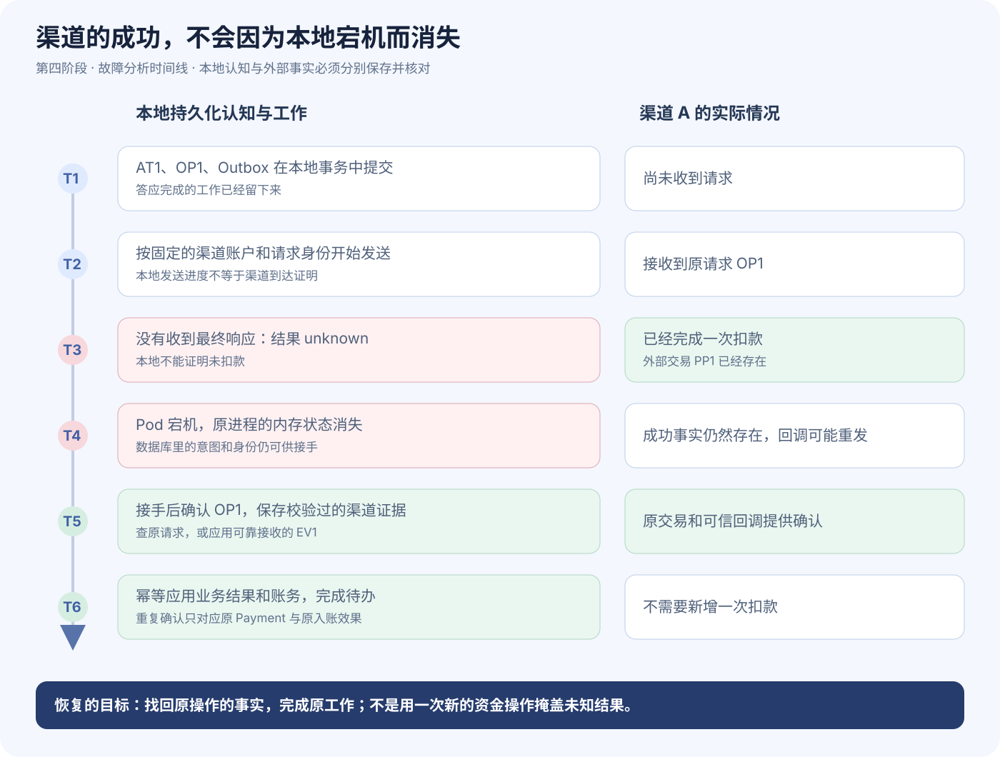
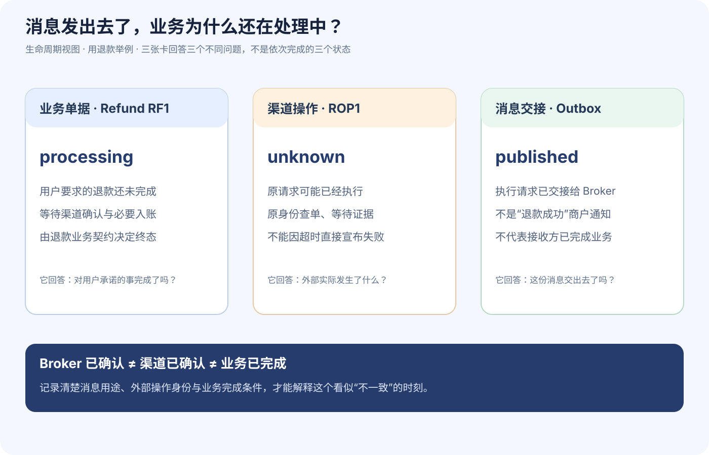
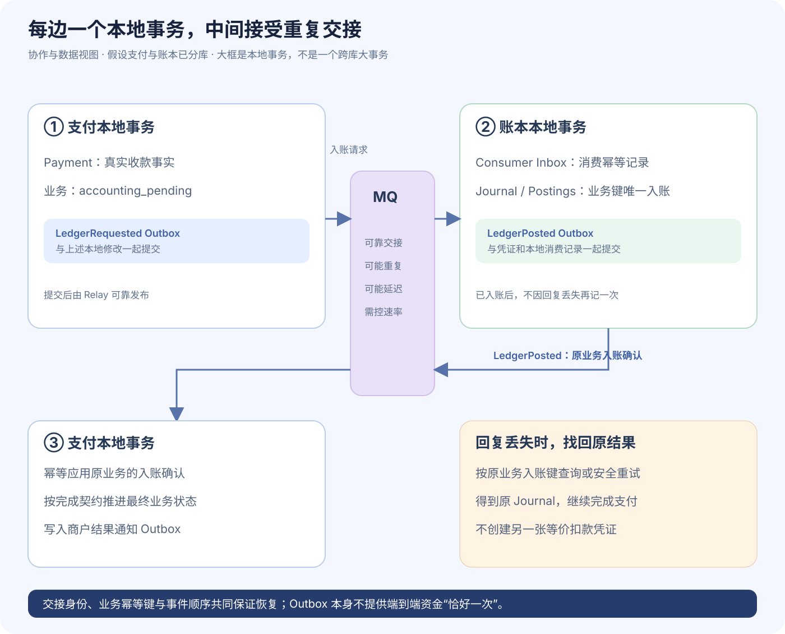
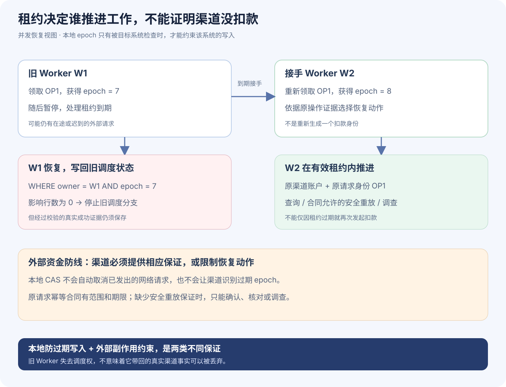

# 渠道已扣款，服务却宕机了：一个重试任务为什么还不够？

> “从业务变化到软件边界”系列第四篇：从一次渠道成功、本地超时、进程崩溃和重复回调出发，推演 ChannelOperation、Outbox、Inbox、Worker、处理租约、幂等与对账怎样共同构成可靠执行。

如果你正在设计支付、退款、提现、账户或渠道系统，欢迎先关注本公众号。“从业务变化到软件边界”系列会从具体用例和异常场景出发，持续还原架构演进的推理：旧设计为什么开始失效，需要增加哪些事实与边界，又该怎样通过代码和故障演练验证它们。

前三篇分别讨论了水平分层、订单与真实收款的区别，以及多渠道场景中的选路与适配：

1. [为什么接口改名、增加风控、修改手续费，不应该改在同一个地方？](./coach-change-driven-layered-architecture-stage-1.md)
2. [一次订单为什么装不下两次支付？](./coach-payment-order-attempt-payment-refund-stage-2.md)
3. [接入第二个支付渠道，为什么不能只加一个 Adapter？](./coach-payment-routing-channel-adapter-stage-3.md)

这一篇继续追问：

> 已经知道应该调用谁，也已经写好了 Adapter，为什么服务一重启，仍然可能丢失工作、重复扣款，或者永远不知道交易结果？

本文使用模拟渠道 A，以及下面四个教学标识。先分清它们分别代表哪个对象：

| 标识 | 对应对象 | 本例中的语义 |
| --- | --- | --- |
| `O1` | `PaymentOrder`，订单；O 来自 Order | 商户希望收取 USD 100.00 的那张支付订单，表达一次收款意图 |
| `AT1` | `PaymentAttempt`，支付尝试；AT 来自 Attempt | 用户为订单 O1 发起的一次支付尝试，本次选择渠道 A |
| `OP1` | `ChannelOperation`，渠道操作；OP 来自 Operation | 为 AT1 创建的一次逻辑收款操作，保存原渠道、请求身份、业务内容与恢复进度 |
| `EV1` | `ProviderEvent`，渠道事件；EV 来自 Event | 渠道 A 发来的一个回调事件，本例用它报告 OP1 对应收款的结果；经校验后进入 Provider Inbox |

把它们放回同一个案例：

```text
订单 O1：商户想收一笔钱
  └─ 尝试 AT1：用户选择通过渠道 A 支付
       └─ 操作 OP1：平台向 A 提交这次收款

渠道事件 EV1：报告这次收款结果，关联回 OP1、AT1 和 O1
```

数字 `1` 只是为了把案例串起来，四个标识属于不同对象。一个 O1 可以有 AT1、AT2 等多次尝试；对同一 OP1 的安全网络重试仍沿用原操作身份；同一 EV1 也可能被重复投递，而且一个操作可以收到多个不同事件。事件号不等于订单号、操作号或渠道交易号。

代码与 SQL 表达候选设计，不代表项目已经部署这些实现。练习使用模拟资金副作用；处理租约的 30 秒也是示例参数，应根据实际调用预算调整。

---

## 一、先让故障完整发生一次

商户希望收取 USD 100.00，也就是 10000 个最小货币单位。

沿用前两篇的对象：

```text
PaymentOrder O1：商户的收款意图
PaymentAttempt AT1：本次支付尝试，已选择渠道 A
ChannelOperation OP1：向 A 提交本次收款的逻辑操作
```

正常情况下，本地保存操作，调用渠道，收到确认，再推进支付与账务。

现在把故障插进去：

```text
本地调用 A
    ↓
A 已成功扣款
    ↓
响应在网络中丢失
    ↓
本地超时，随后 Pod 宕机
    ↓
新 Pod 恢复，发现 OP1 没有最终结果
    ↓
A 又发送了一次或多次成功回调
```

此时有两种不同事实：

```text
渠道事实：已经执行了资金操作
本地认知：没有拿到最终确认
```

如果把本地超时写成 failed，再重新提交一笔扣款，就可能重复收钱。

如果只依赖原进程里的重试定时器，进程消失后，后续工作也可能消失。

如果依赖回调“只到达一次”，重复事件又可能生成重复 Payment、重复凭证或重复退款。



这张时间线供故障分析使用：左右两侧分别展示本地持久化认知与渠道事实。它强调的是两者何时分离、恢复依据从哪里来，不是完整的部署拓扑。

---

## 二、先记住四个问题，再认识组件

不要从“要不要上 Kafka”开始。先回答：

```text
我们答应完成什么工作？
原请求是否可能已经被渠道执行？
渠道已经确认了什么？
还有哪些工作没有完成？
```

不同模型分别承担这些问题：

| 模型或机制 | 保存或保证什么 | 不足以单独证明什么 |
| --- | --- | --- |
| 业务单据 | 用户意图、权限、业务进度与结果 | 渠道一定已经执行 |
| ChannelOperation | 一个外部操作的身份、绑定渠道、执行与恢复进度 | 一次网络发送绝不重复 |
| Outbox | 本地提交后仍需要可靠交接的工作 | 接收方已经完成业务 |
| ProviderEvent / Inbox | 收到的外部事实及待应用事件 | 该事实已经正确入账 |
| Worker 与租约 | 当前谁有权推进工作，崩溃后谁可接手 | 旧外部请求没有副作用 |
| 查询、对账与调查 | 用独立证据继续确认和修复差异 | 每个未知结果都能立即自动解决 |

这些职责可以先放在一个应用和数据库里，不需要按名词数量拆微服务。

---

## 三、三个状态同时存在，为什么不矛盾？

先借用一个退款例子，帮助区分三条生命周期：

```text
Refund RF1：processing
ChannelOperation ROP1：可能已发送，渠道结果 unknown
RefundExecutionRequested 对应 Outbox：published
```

这完全可能成立。

Outbox 的 published 在本文只表示：发布者按选定消息系统的可靠性配置，收到 Broker 的发布确认，并在本地记录了交接结果。

它不能推出渠道已经完成退款，也不能推出账本已经入账。

这里的消息是“请求执行退款”，不是“向商户通知退款成功”。不同用途的 Outbox 事件不能共用一个含糊的“通知已完成”来解释。



回到收款主线，同样需要区分：

- 订单及尝试的业务进度；
- OP1 的外部结果与恢复工作；
- 请求执行 OP1 的消息是否已经交接。

因此，不建议让一个 `status` 同时回答所有问题。操作中的 `provider_outcome`、`work_state` 与租约字段也有不同用途：渠道结果未知，不代表本地没有下一步工作。

---

## 四、ChannelOperation：把“要做的事”从函数调用变成可恢复记录

下面这些信息，应当在第一次资金命令发出前持久化：

| 字段组 | 示例 | 为什么需要 |
| --- | --- | --- |
| 本地身份 | operation_id = OP1 | 重启后仍能找到同一个逻辑操作 |
| 业务关联 | business_type、business_id = AT1 | 知道为什么执行、由谁最终裁决 |
| 外部动作 | operation_type = submit_payment | 不混淆收款、退款、撤销和查询 |
| 原渠道绑定 | channel_code、channel_account_id | 恢复时不重新选路 |
| 请求身份 | client_request_id、request_fingerprint | 支持原请求查询、安全重放和内容冲突检查 |
| 业务内容 | amount_minor = 10000、currency = USD | 保持同一操作的金额与币种一致 |
| 能力依据 | capability_version、执行策略版本 | 解释本次允许怎样恢复 |
| 渠道认知 | provider_outcome、provider_operation_id | 保留已确认的外部结果 |
| 执行进度 | dispatch_started_at、dispatch_count | 判断是否存在已开始发送的可能 |
| 后续工作 | work_state、next_run_at、last_error | 决定何时查询、重试或调查 |
| 调度权 | lease_owner、lease_until、lease_epoch | 处理多 Worker 领取与过期接手 |

金额、币种、原渠道和请求身份属于本次操作的稳定内容。重试不能悄悄改金额、换渠道或换成另一个业务意图。

`dispatch_started_at` 只能说明本地开始了发送流程，不能证明渠道已收到请求。标记之后、真正发送之前也可能崩溃。

所以，只要曾进入可能发送的窗口，而又没有最终确认，恢复时就应考虑“也许已经执行”，不能把“缺少 sent 标记”当作无副作用证明。

请求指纹也不能代替渠道幂等保证。它只能帮助本地发现“同一个请求身份对应了不同业务内容”。

---

## 五、Outbox：本地答应了，就必须留下交接工作

先看一个不完整的写法：

```text
更新业务单据并提交数据库
    ↓
直接向 MQ 发布执行消息
```

如果数据库提交后进程崩溃，或者 MQ 写入失败，本地已经答应执行，下游却不知道这件事。

反过来先发消息，也可能出现消息已发出、本地事务却回滚。

Outbox 的做法是，把业务变更与交接意图放进同一本地事务：

```text
本地事务 T1
├─ 保存或推进 PaymentAttempt AT1
├─ 保存 ChannelOperation OP1
└─ 写入 ChannelOperationRequested Outbox
    ↓
COMMIT
    ↓
Relay 扫描已提交的 Outbox，向 MQ 发布
```

这段示例假设相关模块共享本地事务资源；拆到不同数据库后，应各自保证本地事务，并通过可靠消息或接口建立关系，不能跨库套用这张事务图。

AWS 的 Transactional Outbox 指引讨论的正是数据库与事件发布之间的双写问题，同时指出下游仍需处理重复消息。[AWS：Transactional outbox pattern](https://docs.aws.amazon.com/prescriptive-guidance/latest/cloud-design-patterns/transactional-outbox.html)。

### Outbox 是否意味着必须使用 MQ？

不意味着。早期可以由数据库 Worker 直接扫描 OP1，执行已经持久化的工作。如果没有跨边界交接需求，不必为同一件事机械复制一张 Outbox 表。

当本地状态变化需要可靠通知另一个处理者时，Outbox 才表达这份交接承诺。轮询和 CDC 都可以帮助发布，业务含义相同。

### 谁负责发布？

通常是业务服务拥有的 Outbox Relay 或相应基础设施组件。它可以独立运行，但不应该被含糊地归给“商户 Webhook 通知服务”。

内部消息交接和对外商户通知，是不同职责。

---

## 六、Outbox 不消灭重复，接收方仍要幂等

发布时还有一个无法用单个本地事务覆盖的窗口：

```text
Relay 发布成功，Broker 已确认
    ↓
Relay 宕机，还没把 Outbox 更新为 published
    ↓
恢复后再次发布同一个 event_id
```

因此，常见设计接受重复交接，再让业务效果幂等。不能先把 Outbox 标成 published，然后才尝试发送。

接收方可以采用稳定消息身份，例如：

```text
UNIQUE(consumer_name, event_id)
```

但“把消息 ID 插入一张去重表，然后在内存里开始处理”，还不够可靠。

如果后续进程崩溃，重复消息又因去重被忽略，工作仍然丢失。

需要选择完整的接收契约：

| 契约 | 什么时候可以确认 MQ 消息 |
| --- | --- |
| 消费时完成本地处理 | 业务效果与消费记录已在同一本地事务提交后 |
| 先持久接收，再异步执行 | 消息及待办工作已可靠保存，且存在可恢复扫描器之后 |

第二种模式中，received 只表示已接收，不能直接写成业务 applied。消息触发器停止后，扫描器仍应能找到这份工作。

如果使用 Kafka，还需要正确处理分区内消费位点的提交顺序，避免确认较后消息时跳过尚未可靠接收的前序消息。



这张图展示支付与账本已经分库时的一种协作契约。每个大框是一个本地事务边界，箭头代表可重复交接；它没有把两个数据库变成一个事务。

图中具体展示的是“确认收款后，交接入账，再推进业务完成”。它并没有保证交接期间所有资金都可以继续使用。退款、提现和结算付款会消耗已有资金，还必须在外部执行前建立账本预占；否则“业务库已提交、账本尚未扣减”的窗口确实可能造成多结算。第十二节会用退款与结算并发的例子补全这条约束。

---

## 七、Worker 是执行角色，定时器只是唤醒方式

Worker 可以是独立进程、独立 Deployment，也可以是应用中受控的后台工作循环。

无论部署在哪里，都需要回答：

```text
工作从哪里找？
谁有权领取？
崩溃后别人如何接手？
下一步应该提交、查询，还是交给调查？
```

一个每秒触发的定时器，只回答了“什么时候醒来”。它没有回答后面这些问题。

候选工作可以满足：

```text
尚未业务完成，也未转人工
已经到达 next_run_at
当前没有有效处理租约
```

一次扫描应有批量限制、索引、并发上限和退避。MQ 不可用或渠道故障时，持续毫无节制地扫表和重试，只会把压力转移给数据库。

---

## 八、处理租约：允许接手，而不是证明资金没有执行

假设 Worker W1 领取 OP1，获得一段有限的处理权：

```text
lease_owner = W1
lease_until = 数据库时间 + 30 秒
lease_epoch = 7
```

租约到期后，W2 可以重新领取，得到 epoch 8。

这是为了避免一个进程崩溃后，工作永远被它占住。

### 一个 PostgreSQL 领取示例

以下 SQL 是契约示意，省略完整建表、索引和事务错误重试。`work_state`、`provider_outcome`、`next_run_at` 与 `lease_epoch` 为非空字段，代次初始为 0；时间使用数据库时间，领取事务应短小：

```sql
BEGIN;

WITH picked AS (
    SELECT id
    FROM channel_operations
    WHERE work_state IN ('ready', 'waiting_confirmation')
      AND provider_outcome NOT IN ('succeeded', 'rejected')
      AND next_run_at <= NOW()
      AND (lease_until IS NULL OR lease_until <= NOW())
    ORDER BY next_run_at, id
    LIMIT 1
    FOR UPDATE SKIP LOCKED
)
UPDATE channel_operations AS o
SET lease_owner = $1,
    lease_until = NOW() + INTERVAL '30 seconds',
    lease_epoch = o.lease_epoch + 1
FROM picked AS p
WHERE o.id = p.id
RETURNING o.id, o.client_request_id, o.lease_epoch;

COMMIT;
```

PostgreSQL 文档将 `SKIP LOCKED` 的适用场景之一描述为多个消费者访问队列式表时减少锁竞争；它不是通用业务查询的一致性保证。[PostgreSQL：SELECT / Locking Clause](https://www.postgresql.org/docs/current/sql-select.html#SQL-FOR-UPDATE-SHARE)。

领取提交后，才进行外部 I/O，不要让数据库事务跨越长时间渠道调用。

这个领取示例只扫描尚待渠道确认的操作。已经取得成功或拒绝证据、但业务尚未应用的结果，应由独立的结果 Inbox 扫描器继续处理，不能因为操作已有终态就让后续待办消失。

### 旧 Worker 回来后会怎样？

W1 可能只是长时间暂停，并没有真正死亡。当它恢复时，不能覆盖 W2 已经推进的调度状态。

更新工作进度时，必须带上自己的领取代次，例如：

```sql
UPDATE channel_operations
SET work_state = 'waiting_confirmation',
    next_run_at = NOW() + INTERVAL '10 seconds',
    lease_owner = NULL,
    lease_until = NULL
WHERE id = $1
  AND lease_owner = $2
  AND lease_epoch = $3
  AND lease_until > NOW()
  AND provider_outcome NOT IN ('succeeded', 'rejected');
```

影响行数为零时，应重新读取当前事实并停止旧调度分支，不能把它记成渠道拒绝。

续期也应检查当前 owner、epoch 与有效期。已经过期的持有者不能自行复活旧租约。



---

## 九、最重要的反例：租约不能挡住已经发出的请求

即使数据库 CAS 写得正确，仍然可能发生：

```text
W1 通过本地检查
    ↓
W1 暂停，租约到期
    ↓
W2 接手
    ↓
W1 恢复，原网络请求继续执行
```

本地 epoch 只能约束接受这个条件检查的本地写入。外部渠道如果不识别并拒绝过期代次，就不会自动受它保护。

所以需要两道不同防线：

- 调度防线：租约、条件更新和领取代次，减少并发推进并拒绝过期工作写回。
- 资金防线：稳定请求身份、渠道幂等合同、查询与核对，约束外部资金副作用。

对没有安全重放能力的渠道，接手者不能因为“租约已过期”就再次提交扣款。它可能只能查询、等待回调或发起调查。

### 旧 Worker 带回了真实成功证据，要不要丢弃？

不能因为它失去租约，就删除或忽略有效的外部事实。

应把经过校验的渠道响应作为证据持久化，再由统一、幂等的结果应用路径处理。领取代次保护调度权，不能改变已经发生的真实扣款。

同样，迟到的 unknown 或 rejected 不能无条件覆盖已确认的成功。相互冲突的最终证据需要进入核对流程，保留各自来源与时间。

---

## 十、接手 OP1 之后，到底执行什么？

恢复不是统一调用一次 `Submit()`，而是根据持久化事实与渠道合同选择下一步：

| 当前事实 | 可以采取的动作 |
| --- | --- |
| 可确认尚未进入任何发送窗口 | 在当前有效领取下首次提交 |
| 可能已经发送，支持按原请求号查询 | 查询原渠道账户中的 OP1 |
| 原结果未知，合同允许安全重放 | 在有效范围和期限内保留原请求身份、原业务参数重放 |
| 已受理，明确仍在处理 | 等待确认，按合同查询，不制造新扣款 |
| 没有可用查询与安全重放保证 | 等待可信回调、对账或人工调查 |
| 已有可信成功证据，本地业务未应用 | 重试本地结果应用与入账，不再次提交扣款 |

查询暂时无记录，不自动等于从未执行。渠道可能存在可见性延迟，需要按具体合同判定何时才足以排除原操作完成的可能。

如果要改变业务内容或创建下一次支付尝试，应先解决旧操作的结果和业务授权问题，建立可追踪的新尝试，而不是偷偷为 OP1 生成新键。

幂等保证还可能有期限。Stripe 的 API v1 错误处理指引明确区分原键恢复和超出恢复窗口后的核对，不能把“带了幂等键”理解为永久重放许可。[Stripe：Advanced error handling](https://docs.stripe.com/error-low-level)。

签名时间戳与认证 Header 可以按协议刷新；金额、币种、原渠道账户和请求的业务含义不能随重试改变。

---

## 十一、ProviderEvent / Inbox：先可靠接收，再应用业务

当成功回调 EV1 到达时，需要完成两段不同的工作。

### 第一段：接收边界

```text
按渠道合同校验来源、完整性与必要的重放约束
    ↓
持久化 ProviderEvent 及待处理状态
    ↓
提交成功后，按渠道要求确认接收
```

如果无法可靠保存，又没有其他已约定的持久接收路径，就不能返回“已接收”来掩盖故障。

Adyen 的官方说明同样区分校验、保存、确认接收和后续业务处理。具体确认方式、时限和事件身份应按各渠道合同实现。[Adyen：Handle webhook events](https://docs.adyen.com/development-resources/webhooks/handle-webhook-events)。

### 第二段：业务应用边界

异步处理者将事件关联到正确的渠道账户、OP1 和 AT1，核对金额、币种与来源，再推进 Payment、订单和账务。

Provider Inbox 保存“外部告诉了我们什么”；MQ Consumer Inbox 保存“内部消息交接到了哪里”。二者可以复用基础机制，但不是同一种业务事实。

同步响应和查单结果也要可靠进入结果应用路径，保存来源类型、关联身份与待处理状态。不能只把 OP1 改成 succeeded，却没有留下任何可恢复的业务应用工作；也不必为查询响应伪造一个厂商 event_id。

### 去重也要分清身份

不能假设所有厂商都有全局唯一 event_id。要按具体渠道的标识作用域、事件类型与版本定义键。

重复事件已可靠保存，可以确认接收；是否已经应用，应以持久化处理状态判断。同一个身份下出现异常冲突内容时，应保存并调查，不能一律用 `ON CONFLICT DO NOTHING` 吞掉证据。

原始数据需要受控保留、脱敏或加密，日志使用安全标识与证据引用，不应复制完整支付凭据和密钥。

---

## 十二、什么时候才能把业务改成最终成功？

先明确本文的训练契约：外部确认收款、业务归属校验和必要入账完成后，才向商户暴露最终成功。

渠道受理、消息已消费、Worker 已运行，都不是这个完成点。

### 同库模块化单体

如果相关业务和账本模块使用同一本地事务资源，应用层可以协调：

```text
结果应用事务 T2
├─ 锁定或条件更新业务记录
├─ 按外部交易身份幂等创建 Payment
├─ 决定订单的有效支付或多收款处理
├─ 通过账本模块生成唯一的 Journal / Postings
├─ 同事务更新必要余额投影
├─ 写入后续通知或补偿 Outbox
└─ 将该结果标记为已应用
    ↓
COMMIT
```

同库不代表适配器可以随意跨模块写表。事务由应用层协调，各模块仍通过自己的接口维护规则。

如果事务失败，本地修改回滚；渠道已经发生的扣款不会回滚。因为原事件仍在 Inbox 中，处理者可以重试本地应用，不需要再次向渠道扣款。

### 支付与账本已经分库

这时不能把两边更新写成一个本地事务。可以采用前面配图中的协作：

```text
支付本地事务
  Payment 事实 + accounting_pending + LedgerRequested Outbox
    ↓
账本本地事务
  Consumer Inbox + Journal / Postings + LedgerPosted Outbox
    ↓
支付本地事务
  幂等应用 LedgerPosted + 推进最终业务状态 + 商户通知 Outbox
```

如果账本已经入账、确认回复却丢失，按同一业务入账键查询或安全重试交接，得到原凭证；不能生成另一张等价扣款凭证来“补一次”。

各环节还要明确需要的业务内顺序。Outbox 不自动解决所有乱序问题，可以结合聚合标识、业务版本、前置条件与缺口恢复，防止后续事件提前生效。

### 退款成功了，账本却没扣减，会不会多结算？

会。如果设计只有“先执行渠道退款，再异步通知账本扣减”，就可能发生：

```text
商户可结算资金为 100
    ↓
渠道已退给用户 40，业务库保存了退款结果
    ↓
账本扣减失败，结算程序仍读到可结算金额 100
    ↓
又向商户付出 100，重复使用了其中的 40
```

仅仅让 Refund 保持 `accounting_pending` 还不够：如果结算根本不读取退款库，这个状态无法约束结算付款。异步消息最终补齐账目，也不能自动追回已经多付出去的钱。

这里讨论的是已履约支付的普通退款，由商户资金承担；第二篇的 surplus 退款则应占用对应的未分配收款，不能扣到另一笔有效支付或商户无关资金上。预占前必须明确资金来源、所有者、币种及退款资格。

### 资金出口：先确认账本预占，再允许外部执行

针对本例，一条候选协作契约是：

```text
支付本地事务
  创建 Refund RF1，等待资金预占
  写 ReserveRefundRequested Outbox
    ↓
账本本地事务
  幂等校验退款可用额度与资金预算
  原子预占 40，使这 40 不再可用于结算
  保存 reservation_id，并写资金预占确认 Outbox
    ↓
支付本地事务
  幂等关联已确认的 reservation_id
  将退款渠道操作置为可执行，可靠安排执行工作
    ↓
渠道执行退款，结果可能成功、失败或 unknown
    ↓
确认成功后，账本幂等将该预占转为正式退款扣减
    ↓
支付幂等确认入账，推进最终退款状态与通知
```

**支付库写了“申请预占”，不等于账本已经预占。只有确认账本事务已提交，才能越过外部退款执行门槛。** 预占可以通过可靠消息或幂等接口建立，关键是执行前置条件，不是必须采用哪种通信方式。

预占需要真实影响账本的可用资金判定。例如通过待确认分录，或“可用资金转入退款冻结资金”的复式转账表达；不能仅在支付库、Redis 或结算报表里记一个不被其他资金操作遵守的标记。

假设原有 100 已满足结算资格，暂不考虑手续费和其他冻结，用“账面金额加预占”的口径观察：

| 时点 | 尚未最终扣减的账面金额 | 退款预占 | 可结算金额 |
| --- | ---: | ---: | ---: |
| 退款前 | 100 | 0 | 100 |
| 账本已确认预占 | 100 | 40 | 60 |
| 渠道退款成功，但最终入账暂时失败 | 100 | 40 | 60 |
| 退款正式扣减完成 | 60 | 0 | 60 |

所以，在最终扣减失败期间，结算也不能再使用那 40。恢复时把原预占转为正式扣减，不是再次扣减可用金额。如果使用独立可用、冻结子账户，应按该模型读取余额，不能又把同一预占重复扣一遍。

“先预留、后确认或撤销”的资金模型可以参考 [TigerBeetle 的两阶段转账](https://docs.tigerbeetle.com/coding/two-phase-transfers/)；它是账本内部的资金约束机制，不会把渠道操作和业务数据库自动变成跨系统原子事务。

### 结算也要原子占用同一个资金预算

结算不能先查询到 100，稍后就据此直接向银行付款。它也要在权威资金存储中，原子校验并预占本次付款所需金额，得到确认后才允许外部付款。

退款和结算应竞争同一账套、同一资金所有者、同一币种下的可用资金预算。校验余额与建立预占必须属于同一原子操作，可以使用本地事务、行锁或版本条件等机制，不能拆成互不约束的“先查、再写”。[Modern Treasury 的余额与版本锁文档](https://docs.moderntreasury.com/ledgers/docs/lock-on-account-balance-or-version)展示了把余额或版本条件纳入账本写入的设计。

因此：

- 退款先占用 40，结算只能从剩余可用资金中申请预占；本例最多为 60。
- 结算先占用 100，退款的 40 不能再从同一预算中取得。可以保存退款申请，但应等待补足资金，或进入已批准的保证金、信用额度或平台垫资流程。
- 结算清单和缓存可以用于计划与展示；实际付款许可必须以权威资金预算的原子校验和预占结果为准。

退款资格校验也要包含累计退款上限与正在处理的退款占用，不能只防止商户总余额超支，却让同一 Payment 被超额退款。

### 不同失败发生时，预占怎样处理？

| 场景 | 应有行为 |
| --- | --- |
| 账本预占不可用或明确失败 | 保留申请和原因，不发起依赖这笔资金的渠道退款 |
| 账本预占成功，但确认丢失 | 按原业务键查询或幂等重试，找回原预占；不能另占一笔，也不能猜测已占成功 |
| 渠道结果 unknown | 保留预占，查单、等待回调或调查；不能按重试次数耗尽自动释放 |
| 已确认退款未执行且不会再执行 | 按原预占身份幂等释放，恢复可用资金 |
| 渠道已成功，最终入账失败 | 保留预占和成功证据，重试本地入账或转人工，不能把资金重新开放给结算 |

资金预占不是 Worker 的 30 秒处理租约。Worker 可以失去调度权，但不能因此释放一笔可能已被渠道退款使用的资金。预占的确认与释放必须在账本事务中通过条件状态转换保证互斥；各阶段分别有幂等键，只能防止该阶段重复，不能替代跨阶段互斥。若账本产品支持自动过期，也不能把这种过期策略直接用于结果仍未知的外部资金操作。

已结算后的退款，或渠道主动扣回、拒付等无法事先拦住的外部事实，还需要独立的资金承担与风险政策。若确实发生“外部已退款、本地无预占”，应保留真实退款事实，控制受影响账户的后续付款，并恢复账务或按批准政策确认追偿、垫资关系；不能因为余额不足就丢弃真实退款，或把它伪装成失败。

### 结算前对账能不能替代这些约束？

不能。有些业务会把账单对账通过、数据完整性检查或批次截止点校验作为结算前置门槛，这有助于发现尚未入账的收款、退款与差异，但不能单独防住并发操作。

即使刚刚对账通过，下一刻仍可能发起新退款。若没有共同资金预算和原子预占，“查完没有差异，再去付款”之间仍然存在竞争窗口。

因此本例需要同时具备：付款前的资金约束、按合同要求的数据完整性或对账门禁，以及持续对账和异常恢复。收款尚未入账时，不提前开放对应结算额度；退款尚未最终入账时，已确认的退款预占继续阻止同一笔钱被结算。

---

## 十三、为什么需要多种幂等键？

“全部都用一个 UUID”会隐藏不同作用域。至少要区分：

| 边界 | 典型身份 | 保护的效果 |
| --- | --- | --- |
| 商户请求 | 商户身份 + 请求幂等键 + 内容指纹 | 不重复创建业务请求 |
| 渠道逻辑操作 | 业务关联 + 操作类型 + 操作身份 | 不重复创建同一逻辑工作 |
| 渠道提交 | 原渠道账户 + 原请求号 + 合同范围 | 渠道在保证范围内不重复执行 |
| 外部交易 | 渠道定义的账户/交易标识作用域 | 同一真实收款只创建一个 Payment |
| 外部事件 | 渠道定义的事件身份与版本 | 相同事实不重复应用 |
| 内部交接 | consumer_name + event_id | 重复消息不重复产生本地效果 |
| 资金预占与结转 | 账套 + 业务身份 + 预占/确认/释放阶段 | 不重复占用或扣减，同一预占不能既被释放又被确认 |
| 账本 | 账套 + 业务类型 + 业务身份 + 入账事件类型 | 同一经济事件只入账一次 |

每个边界都要处理“键相同、内容不同”的冲突，不能仅检查记录存在就返回成功。

如果数据库提交成功但客户端没收到响应，重试应查询并返回已有结果，而不是把通信失败当成事务一定回滚。

消息可能重复、网络调用可能重复，但相同业务效果应在自己的权威存储和合同范围内受到唯一约束与幂等保护。

---

## 十四、查单、对账、人工调查分别接住什么？

| 机制 | 主要回答 |
| --- | --- |
| 查单 | 原请求或交易目前在渠道侧是什么结果？ |
| 对账 | 一段时间内，渠道账单、交易记录与本地业务/账务哪里不一致？ |
| 人工调查 | 自动证据不足、合同含糊或终态冲突时，谁继续确认和处理？ |

对账发现“渠道成功、本地未入账”，应恢复对应事实的业务应用和账务处理，不是再次发起扣款。

发现确实多收款，再关联具体 Payment 建立退款补偿；不要删除原收款。退款本身又是一个需要可靠执行的新操作。

人工入口也应复用受控命令、权限、唯一约束和证据链。记录调查人、原因、外部依据与处理结果，不以直接修改余额作为通用恢复手段。

重试次数耗尽，只能说明自动处理预算耗尽，不能证明渠道失败：

```text
provider_outcome = unknown
work_state = manual_review
```

工作进入死信或人工队列时，必须仍然有负责人和恢复入口，不能把“转移位置”误认为业务已结束。

---

## 十五、教练式练习：按崩溃位置逐个验收

下面是演练清单，不是本文已经运行过的系统测试报告。可以使用假渠道和隔离数据库注入故障；不需要真实扣款，也不需要先部署全套中间件。

| 故障位置 | 应观察到的持久化事实 | 恢复后的验收结果 |
| --- | --- | --- |
| 本地意图事务提交前崩溃 | 没有已提交的 OP1，也未发外部命令 | 可以重试业务请求，不出现孤立扣款 |
| 本地提交后、发布前崩溃 | OP1 与 pending Outbox 都存在 | Relay 恢复交接，工作不丢失 |
| 发布确认后、标记 published 前崩溃 | Broker 可能已有消息，本地仍 pending | 重复消息使用原身份，不创建第二个逻辑操作 |
| 记录发送进度后、真实网络发送前崩溃 | 本地无法仅凭标记确认是否发出 | 按潜在未知恢复，不根据缺少结果盲目换号 |
| 渠道执行后、本地保存结果前崩溃 | 原操作身份仍在，渠道已有交易 | 查单或回调找回原交易，不新增扣款 |
| Inbox 提交并确认接收后崩溃 | EV1 为 received、尚未 applied | 扫描器恢复应用，重复回调不重复入账 |
| 租约过期后旧 Worker 恢复 | 新 owner 和更大的 epoch 已保存 | 旧调度写回被拒绝，有效外部证据仍保留 |
| 账本提交后确认丢失 | 原业务键已经对应一张 Journal | 查询或重试返回原凭证，随后完成业务 |

### 练习一：只读数据库，回答“现在该做什么”

给自己一组快照：OP1 已到调度时间、原请求号存在、进入过发送窗口、渠道结果 unknown。

先不运行 Worker，写出下一步动作和依据：查询哪个账户、使用哪个请求号、是否允许重放、什么时候升级调查。

验收点：动作能从持久化事实和能力契约推导出来，而不是依赖某个进程记忆。

### 练习二：假渠道成功后主动丢失响应

模拟渠道按 OP1 保存一次资金效果，然后让调用端得到超时并重启。

验收点：本地最终能关联到原交易；在模拟合同允许的情况下，重复 I/O 也只产生一次渠道资金效果。无重放保证的版本只允许查询或调查，不应宣称同样能自动重试。

### 练习三：让 Relay 与消费者分别崩溃

在发布确认与本地状态更新之间终止 Relay，再在消费接收与业务应用之间终止消费者。

验收点：看得见重复交接，却没有丢失待办，也没有第二笔业务效果。若提前 ACK，则必须证明待办已持久化且扫描器能恢复。

### 练习四：并发投递回调和查单结果

让查询与两份 EV1 同时到达结果应用路径。

验收点：只有一个真实 Payment、只有一套对应入账效果；乱序的处理中或未知结果不会把已确认成功覆盖掉。

### 练习五：暂停旧 Worker，等待别人接手

让 W1 获得 epoch 7 后暂停，W2 在租约到期后获得 epoch 8，再恢复 W1。

验收点：W1 无权覆盖新调度状态。若渠道不识别外部 fencing token，测试说明中不能把本地 CAS 成功解释成外部绝不会重复执行。

### 练习六：把未知结果留到自动预算之外

让查单一直无法确认，也没有可信回调。

验收点：业务不被伪造为失败，工作转入有负责人、告警和证据的调查流程，而不是换键再扣一次。

### 练习七：退款与结算争用同一笔资金

准备已具备结算资格的商户资金 100，同时发起退款 40 和结算付款 100，要求两者都先在账本预占。

验收点：不能同时取得总额 140 的付款许可；退款先预占时，原结算 100 请求不能成功，若调整为 60 则可继续；结算先预占全部资金时，退款不能直接调用渠道。再让已预占的退款在渠道成功后遭遇最终入账故障，验证其 40 仍不可被结算，恢复后只完成一次原预占的扣减。

---

## 十六、上线后，如何发现“系统还活着，业务却停了”？

只看 Pod 是否 Running，无法知道 OP1 是否已经停了两个小时。

至少观察以下业务工作指标：

- Outbox 待发布数量、最老消息年龄、发布速率与重试率；
- Inbox 已收到但未应用的数量与最老年龄；
- OP1 这类 unknown / waiting_confirmation 操作的数量与持续时间；
- 租约接管频率、过期代次写回被拒绝的次数；
- accounting_pending、对账差异和人工调查的数量与年龄。

MQ Lag 只能反映 Broker 中某部分交接积压，看不到尚未发布的 Outbox，也看不到已经 ACK、但业务仍未完成的数据库待办。

恢复后还要控制速度：限制发布批量、消费者并发、渠道请求速率和数据库事务并发，按原业务需要保持顺序。队列提供缓冲，但消费能力依然受数据库和渠道容量约束。

日志和查询入口应能沿着以下标识找到证据：

```text
Order → Attempt → Operation → Client Request
                     ↓
              Provider Transaction / Event
                     ↓
                Payment → Journal
                     ↓
              Notification / Refund
```

---

## 十七、把这一阶段放回架构演进中

第四阶段新增的不是一套名词，而是几种独立责任：

| 责任 | 归属 |
| --- | --- |
| 业务允许什么、何时完成 | 支付或退款领域，由应用层协调完成 |
| 原渠道请求怎样继续 | 渠道操作执行策略 |
| 谁领取、何时恢复、怎样退避 | Worker 与可靠执行基础能力 |
| 工作怎样跨边界交接 | Outbox Relay、MQ 与接收方 Inbox |
| 外部协议怎样翻译 | Provider Adapter |
| 外部与本地事实不一致怎样修复 | 查询、对账与受控异常处理 |

仍然可以先使用模块化单体和数据库 Worker。独立服务与 MQ 能改变运行和交接方式，但不会替代这些责任。

建议按以下节奏逐步实现：

```text
S0 明确业务完成条件与不变量
S1 持久化操作身份、业务内容与原渠道绑定
S2 建立结果应用的幂等与本地事务边界
S3 加入短事务领取、租约、代次检查和恢复扫描
S4 在需要的交接边界加入 Outbox / Inbox
S5 执行故障矩阵，补齐查询、对账、告警和调查入口
```

每一步都用一条故障场景证明它解决的问题。不是先把所有机制堆起来，最后才发现没有任何地方明确“什么时候算完成”。

---

## 官方资料与阅读方法

1. [AWS：Transactional outbox pattern](https://docs.aws.amazon.com/prescriptive-guidance/latest/cloud-design-patterns/transactional-outbox.html)——理解双写窗口、本地事务与重复交接。
2. [PostgreSQL：SELECT / Locking Clause](https://www.postgresql.org/docs/current/sql-select.html#SQL-FOR-UPDATE-SHARE)——理解行锁、SKIP LOCKED 和队列式领取的适用范围。
3. [Stripe：Advanced error handling](https://docs.stripe.com/error-low-level)——核对网络未知、幂等恢复的接口版本与时间边界。
4. [Adyen：Handle webhook events](https://docs.adyen.com/development-resources/webhooks/handle-webhook-events)——核对外部事件的校验、持久保存、确认接收与业务处理。
5. [TigerBeetle：Two-Phase Transfers](https://docs.tigerbeetle.com/coding/two-phase-transfers/)——理解资金预留、确认与撤销，以及可用资金约束。
6. [Modern Treasury：Lock on Account Balance or Version](https://docs.moderntreasury.com/ledgers/docs/lock-on-account-balance-or-version)——理解余额校验与账本写入为何要构成同一个原子操作。

资料核对日期：2026-11-22。本文的结构与恢复方案是教学推演，厂商文档用于核对相应技术或渠道合同边界，不能据此推断所有支付系统都具有相同行为。

---

如果你希望持续看到支付、账户、账本、风控和渠道系统如何从“业务问题”一步步推演到“可运行代码”，欢迎关注本公众号，并收藏“从业务变化到软件边界”系列。后续我们会继续结合代码、数据库记录和故障演练，把架构边界变成能够验证的工程设计。

下一篇，我们继续追问：

> 交易已经成功，为什么商户还不能结算？账户、账本、清分与结算分别应该记录什么？

继续阅读第五篇：[支付记录都在，为什么商户余额还是说不清？](./coach-payment-account-ledger-balance-stage-5.md)。
