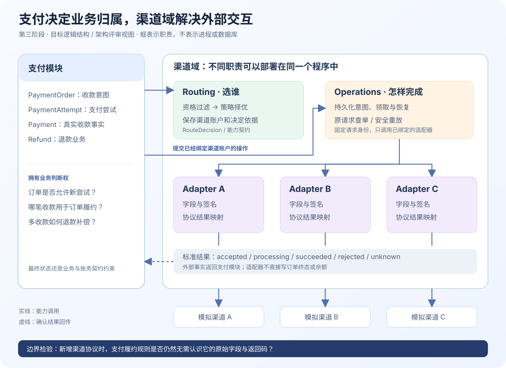
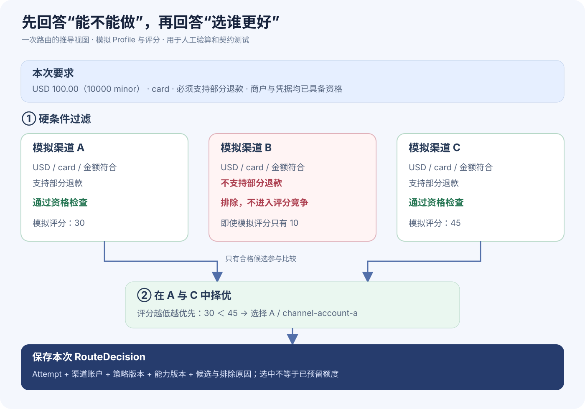
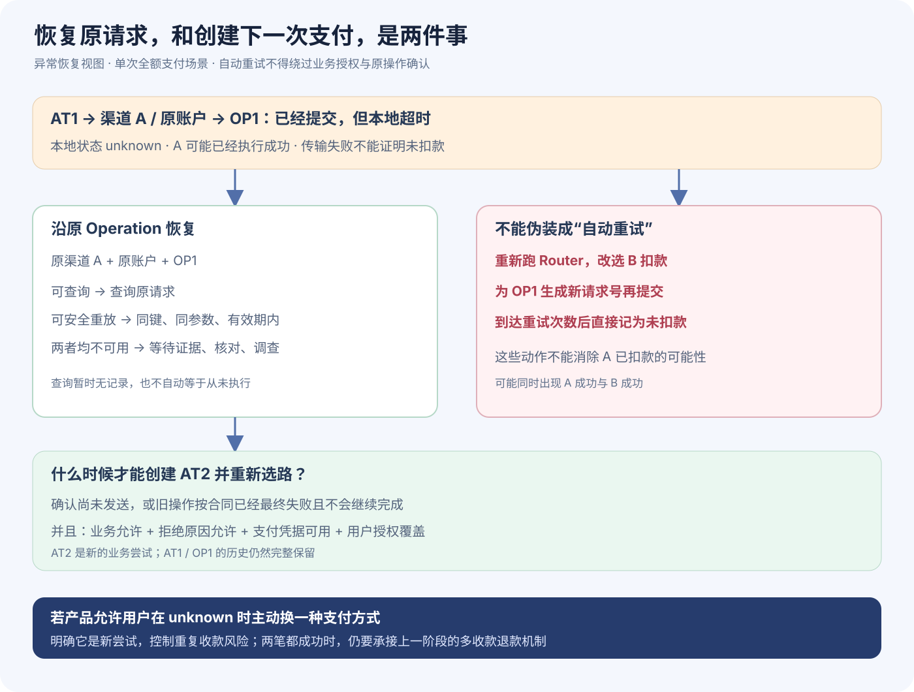

# 接入第二个支付渠道，为什么不能只加一个 Adapter？

> “从业务变化到软件边界”系列第三篇：从三个模拟支付渠道出发，推演支付、路由、渠道操作与协议适配的职责边界，并通过路由选择、超时恢复和原路退款检验这些边界。

如果你正在设计支付、渠道、账户或风控系统，欢迎先关注本公众号。“从业务变化到软件边界”系列会从一个个具体用例出发，持续还原架构演进背后的推理：原来的模型为什么开始不够用、职责应该怎样划分，以及如何用代码和异常场景验证这些边界。

前两篇分别讨论了两个问题：

- [第一篇：为什么接口改名、增加风控、修改手续费，不应该改在同一个地方？](./coach-change-driven-layered-architecture-stage-1.md)——从变化原因推导水平分层。
- [第二篇：一次订单为什么装不下两次支付？](./coach-payment-order-attempt-payment-refund-stage-2.md)——从超时和重复收款推导 Order、Attempt、Payment 与 Refund。

这一篇继续增加一个现实需求：

> 同一种支付方式，可以通过多个渠道完成。平台需要选择渠道，也需要在各渠道不同的能力与确认机制下正确处理交易。

阅读时，可以把本文当作一次架构推演练习：先读新增用例，自己想一想旧设计会在哪里失效，再对照后面的边界与契约。

本文的 A、B、C 都是教学用模拟渠道。能力、金额范围与评分均为演练设定；代码片段表达职责和契约，不代表仓库已有这些生产实现。真实银行卡号、CVV 和渠道密钥不参与本文练习。

---

## 一、从“只有一个渠道”开始

最初，平台只对接渠道 A：

```text
创建支付尝试
    ↓
调用渠道 A
    ↓
等待或查询结果
    ↓
支付模块决定如何归属订单
```

此时，一个 `ChannelAdapter` 看起来已经足够：支付模块提交内部请求，适配器负责 HTTP、签名和字段转换。

后来业务接入渠道 B，希望降低成本；又接入渠道 C，希望扩大覆盖范围、改善可用性。

代码逐渐变成：

```go
if channel == "A" {
    // 拼 A 的请求，解释 A 的状态，处理 A 的重试
} else if channel == "B" {
    // 拼 B 的请求，解释 B 的状态，处理 B 的重试
} else if channel == "C" {
    // 继续增加特殊分支
}
```

但问题不只是 `if/else` 多了，而是三种不同判断混在了一起：

```text
这笔业务允许怎样支付？
当前应该选哪个渠道？
选定之后怎样与它交互？
```

把条件分支挪进三个类，只解决了代码摆放；如果选择逻辑、重试规则和订单状态仍然相互渗透，边界并没有建立。

---

## 二、先明确用例，再比较渠道

我们限定本轮场景：单币种 USD、全额收款、一次 Attempt 最多确认一笔 Payment。授权与捕获分离、分次捕获和跨币种结算留到后续。

这里的“收款成功”指模拟渠道按约定确认了本次收款结果，不表示渠道已经向平台结算。真实渠道的 `authorized` 也不能直接套用这个含义。

新增四个用例：

| 用例 | 使用者希望得到什么 |
| --- | --- |
| UC-01 首次选路 | 为一次支付尝试选择符合要求的渠道及渠道账户 |
| UC-02 处理渠道结果 | 无论渠道返回什么格式，平台都能准确理解其含义 |
| UC-03 恢复未知结果 | 请求超时后，继续确认原操作，避免再次扣款 |
| UC-04 退款 | 找到原收款交易，并按原渠道合同退回资金 |

再增加一个变化场景：接入渠道 D 时，支付模块不应因 D 的签名方式、JSON 字段和原始错误码而修改。

注意这个变化场景的边界：如果 D 引入了现有系统没有表达过的“先授权、后多次捕获”，领域模型仍然需要演进。适配器能够隔离协议差异，不能消除真实业务语义差异。

### 三个模拟渠道

假设三个渠道账户都已为商户开通，并支持本次凭据使用方式，当前也都处于可接单状态：

| 维度 | 渠道 A | 渠道 B | 渠道 C |
| --- | --- | --- | --- |
| 支付方式 | card | card | card |
| 收款币种 | USD | USD | USD |
| 单笔金额范围，最小货币单位 | 100～1000000 | 100～1000000 | 100～1000000 |
| 全额退款 | 支持 | 支持 | 支持 |
| 部分退款 | 支持 | 不支持 | 支持 |
| 收款提交支持请求幂等 | 支持，有约定范围与期限 | 不支持 | 不支持 |
| 可按本地请求号查询收款 | 支持 | 不支持 | 支持 |
| 创建接口的典型结果 | 已受理，稍后确认 | 按合同返回最终结果或传输未知 | 已受理，稍后确认 |
| 模拟成本评分，越低越优先 | 30 | 10 | 45 |

这张表已经说明：相同支付方式，不代表渠道可以无条件互换。

---

## 三、从三个问题，推导三个职责

| 职责 | 主要判断 | 拥有的结果 |
| --- | --- | --- |
| 支付 | 订单是否允许新尝试？真实收款是否用于本订单？ | Order、Attempt、Payment、Refund 的业务结果 |
| 路由 | 哪些渠道账户符合当前要求？本次选择谁？ | 选路决定及解释 |
| 渠道集成 | 原操作在渠道侧发生了什么？如何按合同继续交互？ | 渠道操作进度、原始证据、标准化结果 |

第三项还可以继续分工：

```text
渠道操作编排：持久化意图、领取工作、恢复、查单、安排安全重试
渠道适配器：请求映射、签名、网络调用、结果解析与分类
```

应用层协调这些参与者；它们各自的规则仍由对应模块负责。

### 路由可以放在渠道层吗？

可以。本轮就把路由、渠道操作编排和适配器放在同一个渠道域中，作为不同逻辑模块：

```text
channel
├─ routing       选择符合业务要求的渠道账户
├─ operations    执行与恢复已经选定的操作
├─ capabilities  描述各操作的渠道能力
└─ adapters      处理具体外部协议
```

这并不要求部署成四个微服务。它们可以与支付模块一起运行在模块化单体中。

这里的“路由”指交易选路，和 Kubernetes、网关或负载均衡器进行的网络路由不是一回事。



这张图供架构评审使用，展示本阶段的目标逻辑结构。框表示职责，实线表示能力调用，虚线表示确认结果回传；它不规定进程、数据库或部署数量。

---

## 四、路由的第一步，不是挑便宜的，而是排除不能做的

商户提出要求：

```text
金额：10000，即 USD 100.00
支付方式：card
收款币种：USD
业务要求：本次交易必须具备后续部分退款能力
```

支付侧先确定这项业务要求，路由侧再进行能力匹配。不能因为 B 不支持部分退款，就偷偷替业务取消这项要求。

路由分成两步：

```text
第一步：硬条件过滤，得到可以选择的集合
第二步：在合格集合中，根据策略择优
```

### 第一步：资格检查

至少检查：

- 商户是否已开通对应渠道账户，账户是否可用；
- 支付方式、收款币种、金额是否支持；
- 本次业务明确要求的退款、确认和恢复能力是否满足；
- 支付凭据能否用于这个渠道账户，必要的用户授权或认证是否覆盖；
- 当前是否处于熔断、限额或容量拒绝状态。

凭据兼容性尤其容易被忽略：某渠道或某商户账户生成的 Token，不一定能交给另一个渠道使用。“支持 card”不代表“能使用所有 card token”。

本例得到：

```text
A：通过
B：排除，原因 partial_refund_not_supported
C：通过
```

### 第二步：在 A 与 C 之间择优

为便于手工验算，本轮只使用模拟成本评分：

```text
A = 30
C = 45
选择 A
```

B 的评分为 10，依然不能参与竞争，因为它没有通过资格检查。



这张图解释一次选择的推导过程，不表示每笔支付都要扫描全部渠道。真实系统可以预编译规则、建立候选索引，但必须保持同样的资格约束。

### 没有候选渠道时怎么办？

返回明确的 `no_eligible_channel`，并保存排除原因。不能为“提高成功率”而随机选一个不符合要求的渠道。

健康状态和容量是动态快照。选中 A 不代表已经原子占用了 A 的额度或并发名额；若需要强保证，还要在提交前通过相应限额或预留机制校验。重新选择只能发生在确定尚未产生外部资金副作用的前提下。

---

## 五、能力模型必须保留会影响行为的差异

最危险的抽象之一，是把所有渠道能力压缩为：

```go
type Channel interface {
    Pay(ctx context.Context, amount int64) error
}
```

它没有告诉调用者：

```text
nil 是已受理，还是确认收款？
error 是明确拒绝，还是结果未知？
超时后能不能重发？
重发要用哪个请求号？
尚未拿到渠道交易号时，能不能查单？
```

这些信息直接影响资金安全，应进入明确契约。

下面是模拟渠道 A 的一段能力配置。它只是教学格式，字段应由经过确认的渠道合同和接口证据维护：

```yaml
profile_id: channel-a-card-usd
version: cap-v3
channel_code: channel-a
channel_account_id: channel-account-a
payment:
  methods: [card]
  currencies: [USD]
  min_amount_minor: 100
  max_amount_minor: 1000000
  submit_idempotency:
    supported: true
    scope: account_and_operation_type_and_request_id
    retention_seconds: 7200
    same_parameters_required: true
  query_by_client_request_id: true
refund:
  full: true
  partial: true
  requires_original_transaction: true
```

其中 7200 秒是模拟合同，不是任何真实厂商的通用保证。退款提交是否支持幂等，还应在退款操作自己的能力契约中定义，不能从收款提交能力推断。

因此，一个笼统的 `supports_idempotency = true` 往往不够。还需要知道：哪类操作、哪个账户范围、哪些参数、保留多久，以及并发和失败响应怎样处理。

例如 Stripe 官方对 API v1 明确说明了参数一致性和幂等记录的保留行为，不能将其扩大理解为所有渠道、所有 API 版本都具有相同保证。[Stripe：Idempotent requests](https://docs.stripe.com/api/idempotent_requests)。

能力模型的目标，是给路由和执行提供必要信息。真实接入时，还应能追溯到具体文档、接口版本和验证案例。

---

## 六、选路结果必须留下来，不能每次调用重新计算

假设第一次调用选中了 A。服务重启后，B 的评分变低了。

如果重试时重新跑一次 Router，就可能把同一个业务操作发送到 B。这不是恢复原请求，而是制造另一笔外部收款。

所以，选路结果需要作为本次尝试的绑定记录保存：

```go
type RouteDecision struct {
    ID                   string
    AttemptID            string
    ChannelCode          string
    ChannelAccountID     string
    RoutingPolicyVersion string
    CapabilityVersion    string
    DecisionEvidenceRef  string
}
```

`DecisionEvidenceRef` 对应当时的业务要求、候选渠道、排除原因、评分及动态状态快照。保存的是决定依据，不是渠道密钥或完整卡数据。

接着在本地事务中完成必要绑定：

```text
PaymentAttempt AT1
    ├─ RouteDecision RD1：A / channel-account-a
    └─ ChannelOperation OP1
         ├─ operation_type = submit_payment
         └─ client_request_id = OP1
```

提交事务后再调用外部渠道。若支付与渠道操作已拆到不同数据库，就需要通过可靠交接和幂等接收建立这个关系，不能假装仍是一个本地事务。

这里有三种不同身份：

| 身份 | 含义 |
| --- | --- |
| Attempt ID | 用户的一次支付尝试 |
| Operation ID / Client Request ID | 本次尝试中的一个逻辑渠道操作 |
| Dispatch Attempt | 为完成同一操作进行的一次实际网络调用 |

同一 Operation 的安全网络重试保留原请求身份。查单是确认原操作，不是重新生成一个收款意图。

固定渠道账户也不意味着永久使用旧密钥。身份绑定与密钥轮换是两件事，认证材料由适配层通过受控配置获取。

---

## 七、适配器负责翻译协议，不负责决定订单归属

应用侧需要一个稳定的提交请求，例如：

```go
type SubmitPaymentRequest struct {
    OperationID          string
    ClientRequestID      string
    ChannelAccountID     string
    AmountMinor          int64
    Currency             string
    PaymentCredentialRef string
}

type PaymentSubmitter interface {
    SubmitPayment(
        ctx context.Context,
        req SubmitPaymentRequest,
    ) (ProviderResult, error)
}
```

查询可以是另一个窄接口；不支持查询的渠道不能用一个空实现伪装支持：

```go
type PaymentQuerier interface {
    QueryPayment(
        ctx context.Context,
        channelAccountID string,
        clientRequestID string,
    ) (ProviderResult, error)
}
```

具体适配器负责：

```text
内部请求 → 渠道字段
凭据引用 → 受控获取所需渠道凭据
签名规则 → 渠道要求的 Header 或签名体
响应与回调 → 标准化渠道结果
原始错误 → 可解释的分类和证据引用
```

它不应直接写订单 `paid`，不应直接改账户余额，也不应自行选择另一个渠道补发扣款。

某些渠道确实有独特调用顺序、并发限制或恢复步骤。这些可以由渠道域中的专门执行策略负责，不必强行塞进通用基类，也不能散落进支付履约规则。

这一分工也采用了“渠道操作编排”的原则：适配器返回外部事实，可靠执行模块决定怎样继续工作，业务模块决定怎样完成业务。

---

## 八、标准化的是含义，不是把所有结果改成 success

可以为本轮模拟操作定义：

```go
type ProviderOutcome string

const (
    Accepted       ProviderOutcome = "accepted"
    Processing     ProviderOutcome = "processing"
    RequiresAction ProviderOutcome = "requires_action"
    Succeeded      ProviderOutcome = "succeeded"
    Rejected       ProviderOutcome = "rejected"
    Unknown        ProviderOutcome = "unknown"
)

type ProviderResult struct {
    Outcome             ProviderOutcome
    ProviderOperationID string
    AmountMinor         int64
    Currency            string
    ReasonCode          string
    EvidenceRef         string
}
```

这些值描述的是具体渠道操作，不是整个订单的最终状态：

| 渠道现象 | 标准含义 | 可以宣布订单支付完成吗？ |
| --- | --- | --- |
| HTTP 200，响应说请求已入队 | accepted | 不可以 |
| 需要用户进一步认证 | requires_action | 不可以，继续交互 |
| 渠道明确仍在处理 | processing | 不可以 |
| 网络超时，无法确定是否执行 | unknown | 不可以，也不能据此宣布未扣款 |
| 合同定义的确认收款结果 | succeeded | 先校验、关联并处理真实 Payment；业务完成还受订单与账务契约约束 |
| 渠道明确最终拒绝本次操作 | rejected | 按原因处理本次尝试，不自动跨渠道再扣款 |

`error != nil` 同样不等于最终拒绝。执行层需要保存已经获得的证据；对可能已经发出的资金命令，无法确定结果时按 unknown 恢复。

对未知响应码、缺少必要字段或无法识别的状态，不能猜成成功。应保留异常证据并查询、核对或人工处理。

如果真实渠道的“成功”仅表示授权，模型就要继续区分授权和捕获。不要把 `authorized` 映射成本文含义下的“确认收款”。

---

## 九、超时之后，应该恢复原操作，还是重新选路？

现在演练最重要的异常：

```text
AT1 选择 A
OP1 已经提交
本地没有收到响应
```

先问：A 是否可能已经执行？

只要答案仍然是“可能”，就不能把“调用 B”当作 OP1 的普通重试。



### 情况一：支持按本地请求号查询

使用原渠道账户和 OP1 查询。这个能力很重要，因为响应丢失时，本地可能还没有渠道交易号。

查询可能得到成功、拒绝、处理中，也可能仍然无法确认。查不到并不天然证明没执行：渠道可能存在入库延迟，需要结合其查单一致性与终态保证判断。

### 情况二：支持有明确保证的幂等重放

在合同允许的操作、账户范围和有效期内，以原请求号、原业务参数重放，可以作为恢复手段。是否优先查询、何时重放，由渠道执行策略决定。

不能因为进程重启就生成新键，也不能在未知结果下修改金额后复用旧键。

“原参数”指同一操作的业务内容与幂等约束；签名时间戳、认证 Header 等传输材料仍应按渠道协议重新生成，不能直接重放已经过期的签名。

Stripe 的 API v1 错误处理文档明确区分网络未知、同键重放与超出窗口后的核对处理。这说明重试策略必须依赖具体合同，而不是只判断一个 HTTP 状态码。[Stripe：Advanced error handling](https://docs.stripe.com/error-low-level)。

### 情况三：既没有可用查询，又没有安全重放保证

保留 unknown，等待可信回调、渠道账单核对或人工调查。达到调查时限，应升级异常处理，不能用“默认失败”来释放再次扣款的权限。

### 什么时候可以创建新的尝试？

确定尚未发送，或者旧操作按合同已经最终失败且不会再完成后，可以在业务允许、拒绝原因允许、凭据可用且用户授权覆盖的前提下创建新 Attempt，再进行新选路。

“明确拒绝”也不代表应该无限遍历渠道。涉及用户取消、身份认证、风险拦截或支付工具限制的原因，需要按业务规则停止或重新取得授权。

如果产品允许用户在旧结果未知时主动选择另一种支付方式，应明确展示和控制这个新尝试，并继续承接第二篇的重复收款补偿机制。它不属于对原 Operation 的无感重试。

---

## 十、退款为什么不能再走一次“最低成本路由”？

假设 Payment P1 来自：

```text
渠道 A
渠道账户 channel-account-a
渠道原交易 provider-payment-001
```

退款需要关联这些身份：

```text
Refund RF1 → Payment P1
    ↓
退款操作 ROP1
    ├─ 原渠道 A
    ├─ 原渠道账户 channel-account-a
    └─ 原渠道交易 provider-payment-001
```

不能因为 C 的退款接口更快，就把 A 的原交易号交给 C。

这里的“按原渠道退款”指通过原交易所属渠道及正确的账户路由提交，并遵守其退款规则。具体收款工具退回路径、币种与时限仍由原交易合同约束。

退款前，支付模块校验权限、可退金额与业务规则；渠道模块再校验原交易的退款能力并执行。退款成功后，业务与账务按各自契约幂等推进。

如果原渠道不支持部分退款，平台应明确拒绝或按另一个已批准的业务流程处理。另行付款不是原支付的退款，必须有独立授权、单据和账务语义。

---

## 十一、回调不应绕过渠道语义，直接覆盖订单状态

多个渠道意味着多套回调格式、验签方式和事件身份规则。建议分成以下职责：

```text
收到渠道请求
    ↓
完成该渠道要求的来源与完整性校验
    ↓
持久保存可恢复处理的事件，并进行必要去重
    ↓
按渠道合同确认接收
    ↓
异步解析、关联并转换为标准结果
    ↓
支付模块执行订单归属与状态机规则
```

如果在确认接收前无法可靠保存事件，就应按渠道重试契约返回失败响应或采用已约定的恢复方式，不能假装已经收到。

Adyen 的官方处理指引同样区分校验、保存、确认接收和业务处理。这是一种可以参考的接收职责划分；各渠道的确认方式和时限仍需要逐项验证。[Adyen：Handle webhook events](https://docs.adyen.com/development-resources/webhooks/handle-webhook-events)。

事件唯一性也不能想当然。有些标识只在特定渠道账户内唯一，有些要组合交易号、事件类型或版本。应根据实际合同定义去重键，不能假设所有渠道都有相同的全局 event_id。

标准结果交给支付模块时，至少要校验本地关联关系、渠道账户、金额、币种和结果证据。订单已关闭或已有另一笔有效 Payment，也不能抹掉新确认的真实收款。

账本记录资金事实，渠道记录外部事实，支付决定业务归属。适配器返回 succeeded，并不意味着它有权替这三个模块一起完成决策。

---

## 十二、水平分层与垂直模块怎样同时存在？

前一篇讨论水平分层，这一篇讨论业务与渠道的垂直边界。两者可以组合：

| 水平层次 | 支付模块 | 渠道域 |
| --- | --- | --- |
| 接入 | 商户创建、查询、退款的协议转换 | 渠道回调接收与协议校验 |
| 应用协调 | 创建尝试、确认收款、重复支付补偿 | 协调选路、执行、查询与恢复 |
| 领域 | Order、Attempt、Payment、Refund、不变量 | 路由规则、能力匹配、操作生命周期 |
| 适配 | 仓储、消息等端口实现 | 渠道 SDK、签名、字段映射、操作存储 |

所以，“渠道层”不是简单等同于一个底部 HTTP 客户端。渠道域也有自己的应用协调和需要维护的事实，而具体 Adapter 才主要承担技术协议翻译。

可以有针对某渠道的适配代码，也可以有针对真实差异的执行策略。应避免的是：支付履约逻辑必须知道每个渠道的签名、返回码和查单细节。

---

## 十三、教练式练习：用五个场景验收设计

这些练习可以先用纸笔、表格或模拟适配器完成，不需要真实扣款。

### 练习一：给一次选择写出完整解释

输入 USD 100.00、card、要求部分退款。写下：

```text
候选：A、B、C
排除：B，partial_refund_not_supported
评分：A=30，C=45
选择：A / channel-account-a
保存：业务要求、能力版本、策略版本、选择依据
```

验收点：B 再便宜也不能越过硬条件；同分时有稳定规则，或者将随机选择结果持久化以供解释。

### 练习二：模拟提交之后丢失响应

让 A 的模拟实现先保存成功结果，再向本地模拟超时。恢复程序必须从持久化的 OP1 找回 A 和原请求号。

验收点：恢复时不重新调用 Router，不向 B 或 C 创建新收款；查询或安全重放最后关联回同一个逻辑操作。

### 练习三：移除查询与幂等能力

模拟 B 的请求结果未知，而且没有回调到达。

验收点：不能通过重试次数耗尽把资金结果改为 failed；应保留 unknown，并产生可追踪的核对或调查工作。

### 练习四：对 P1 申请退款

P1 来自 A，即使后续路由配置把 A 从新交易候选中移除，退款仍按原交易关系查找 A 的退款执行路径。停用新交易和关闭存量服务不能混为一件事。

验收点：退款绑定 A 的正确账户与原交易；如果 A 暂时不可用，则等待恢复或调查，而不是换 C 冒充原路退款。

### 练习五：新增渠道 D

若 D 的业务语义符合现有契约，应主要新增能力资料、适配实现、必要执行策略和契约测试；支付履约逻辑不需要认识 D 的原始返回码。

如果 D 只能完成授权，必须先承认能力缺口：要么暂不进入当前“确认收款”候选集合，要么正式扩展授权与捕获模型。不能通过映射一个 success 让测试表面通过。

---

## 十四、从练习走向实现，应怎样安排节奏？

| 步骤 | 本轮交付物 | 主要验证 |
| --- | --- | --- |
| S0 冻结现有支付语义 | 标准结果与关键不变量的契约测试 | 已受理不等于已收款，重复成功不丢失 |
| S1 建立渠道能力资料 | 三个模拟 Profile 与匹配规则 | 硬条件先于评分，无候选时明确拒绝 |
| S2 提炼路由结果 | RouteDecision 与业务解释 | 决定可追溯，绑定渠道账户而非只有厂商名 |
| S3 提炼窄适配接口 | 提交、查询等按能力提供的端口 | 相同含义一致表达，未知响应保留异常 |
| S4 持久化操作并恢复 | Operation、请求身份、执行进度 | 进程重启后仍能确认原请求 |
| S5 验证存量退款与回调 | 原交易关联、可信接收、幂等推进 | 新选路配置不改变旧交易身份 |

测试分为四类：路由规则测试、适配契约测试、操作恢复集成测试、支付端到端异常测试。并发领取、本地事务和唯一约束需要用真实存储验证，不能只靠内存 Mock。

本阶段无需先引入一个通用工作流平台。下一阶段再深入 Outbox、Inbox、处理租约、查单、重放与对账之间的恢复关系。

---

## 十五、回看：这一轮究竟增加了什么架构？

变化开始时，我们只说了一句“再接两个渠道”。推演之后得到的却是几种明确不同的结果：

```text
支付：这笔业务能不能做，真实收款怎样归属订单？
路由：满足要求的渠道账户有哪些，本次选谁，为什么？
渠道操作：原请求已经走到哪里，怎样安全确认结果？
渠道适配：怎样把内部请求与具体外部协议互相翻译？
```

它们可以先运行在同一个程序中。划分职责的第一收益，是每种变化有清楚的承接位置：

```text
新增业务限制 → 支付规则与明确的路由要求
调整选路偏好 → 路由策略
渠道签名或字段升级 → 适配器
确认机制与重试保证变化 → 能力契约与执行策略
```

判断抽象是否成功，可以继续追问：新渠道是否能正确进入候选集合？旧操作能否在重启后恢复？未知结果是否仍然可解释？退款能否找到原交易？

如果这些问题都有明确负责人，接入第二个渠道才真正推动了架构演进。

---

## 官方资料与阅读方法

以下资料用于核对渠道合同的具体边界，不能用单个厂商的行为代替所有渠道的能力模型：

1. [Stripe：Idempotent requests](https://docs.stripe.com/api/idempotent_requests)——重点阅读 API 版本、请求参数、作用范围和记录保留行为。
2. [Stripe：Advanced error handling](https://docs.stripe.com/error-low-level)——重点阅读网络未知、错误类别及原请求身份的恢复要求。
3. [Adyen：Handle webhook events](https://docs.adyen.com/development-resources/webhooks/handle-webhook-events)——重点阅读校验、持久化、确认接收、异步业务处理与重复事件。

资料核对日期：2026-11-22。阅读真实渠道文档时，建议把结论记录成“能力、证据位置、适用接口版本、验证案例”，再据此编写适配契约。

---

如果你希望持续看到支付、账户、账本、风控和渠道系统如何从“业务问题”一步步推演到“可运行代码”，欢迎关注本公众号，并收藏“从业务变化到软件边界”系列。后续文章会继续结合用例、代码与故障演练，拆解状态机、事务、幂等和恢复机制为什么要这样设计。

下一篇，我们继续追问：

> 服务在调用渠道之后宕机，为什么一个定时重试任务，还不足以保证资金操作可靠？

继续阅读：[第四篇：渠道已扣款，服务却宕机了：一个重试任务为什么还不够？](./coach-payment-reliable-operations-outbox-inbox-stage-4.md)
