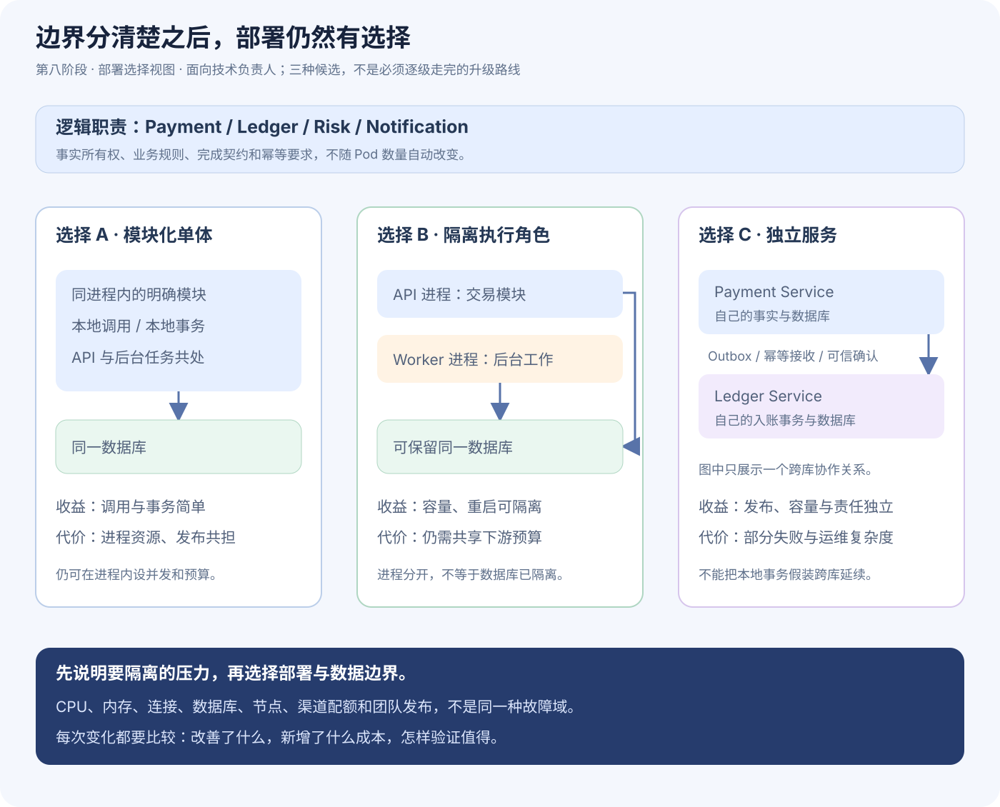
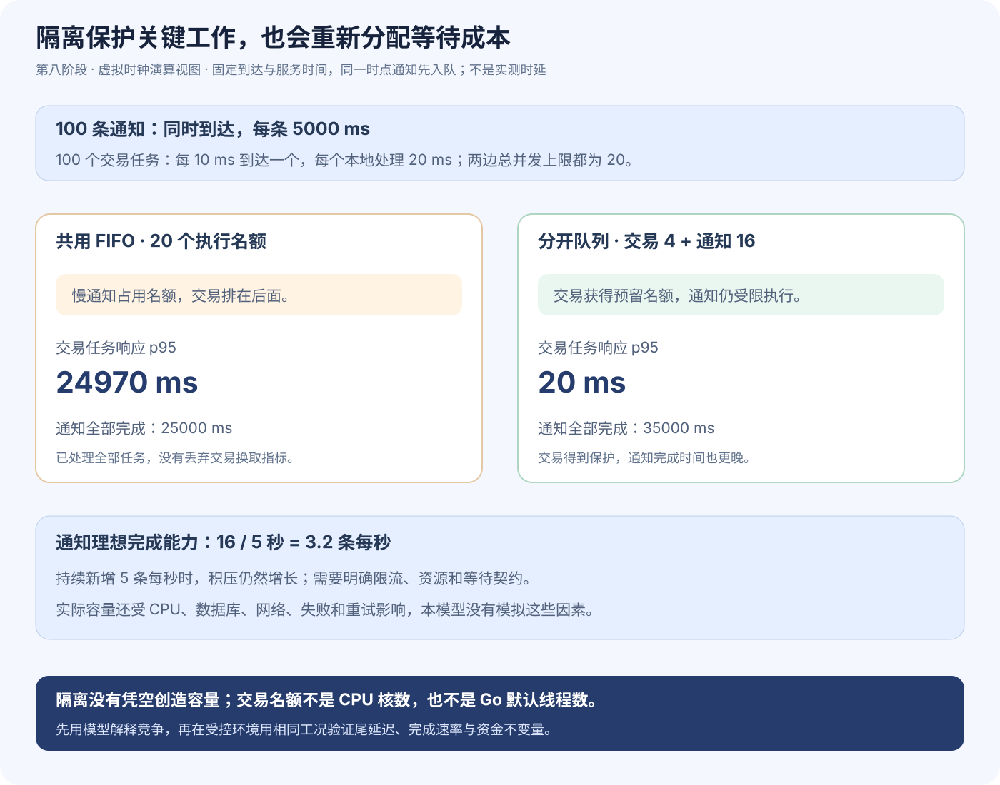
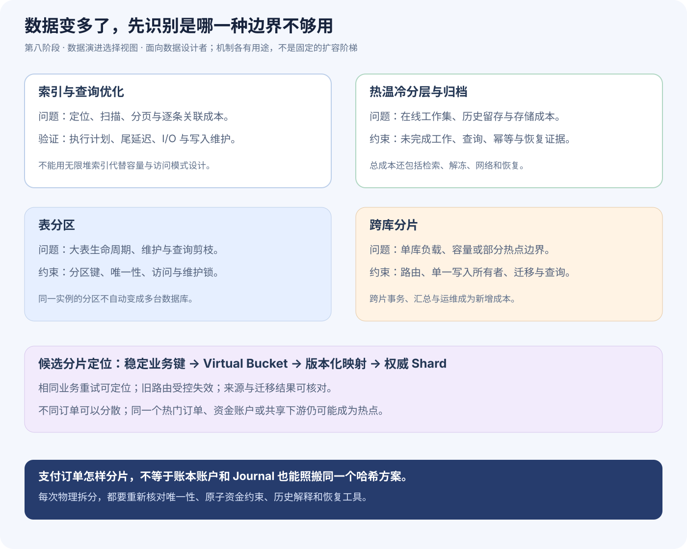
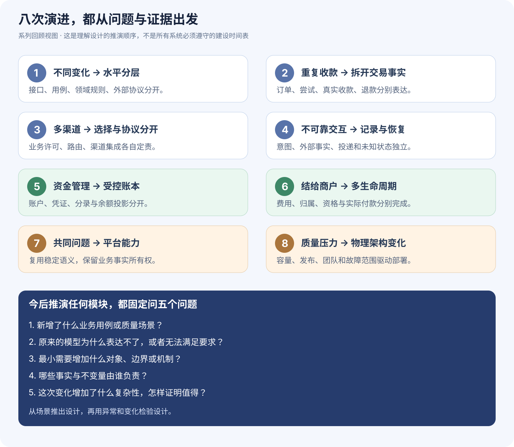

# 模块已经分清楚了，什么时候才值得拆成微服务？

> “从业务变化到软件边界”系列第八篇，也是本轮架构演进的收束篇：从容量、故障影响、数据增长和团队协作出发，推演逻辑模块怎样映射为进程、Worker、服务与存储，并回顾八个阶段背后的共同方法。

如果你正在设计支付、账户、账本、清结算或风控系统，欢迎先关注本公众号。这个系列从具体问题出发，持续追问：原来的设计为什么开始不够用，最小需要增加什么，代价是什么，以及怎样用证据验证它。

[第七篇](./coach-payment-shared-risk-notification-authorization-stage-7.md)中，我们把共用能力和业务事实分开：风控、通知与权限可以复用，支付、提现、卡授权仍然拥有各自的业务状态和资金约束。

现在，逻辑上的模块已经比较清楚了。

但这些模块仍然可能运行在一个应用里，共用同一套数据库。

这是不是说明架构还没做完，必须继续拆服务？

先增加几个具体场景：查询量突然增加，商户通知变慢，某个渠道持续超时，历史数据越来越多，一个团队需要每周发布，另一个团队希望保持稳定。

这时，物理架构变化才开始有了可讨论的理由。

**本篇要回答的是：哪一项压力需要哪一种隔离，哪一个收益足以承担新的分布式成本。**

文中的容量、时延和资源数字都是教学设定。随文脚本采用虚拟时钟做确定性演算，不是本地集群压测，也不是生产容量承诺。

---

## 一、先把“系统有点慢”改成可验证的质量场景

“高并发、高可用、可扩展”无法直接告诉团队该改哪里。

可以先把问题写成：

```text
谁在什么条件下，触发了什么压力？
系统应该怎样响应？
用什么指标证明达到了要求？
```

例如：

| 压力场景 | 希望得到的结果 | 需要观察的证据 |
| --- | --- | --- |
| 商户查询增多 | 创建交易不被查询拖慢 | 各接口时延、慢 SQL、连接等待、数据库 I/O |
| 通知目标持续超时 | 交易入口仍可处理，通知有界积压 | 交易尾延迟、通知并发、队列最老年龄 |
| 渠道 A 不可用 | 符合条件的新交易仍可使用 B | 各渠道连接、并发、超时与路由结果 |
| 新版本部署 | 未完成资金操作可以恢复 | 排空结果、未完成操作身份、幂等与恢复记录 |
| 历史数据增长 | 在线查询和写入保持约定性能 | 索引大小、查询计划、存储与维护时间 |
| 服务宕机后恢复 | 能知道停在哪一步并安全接手 | Inbox、Outbox、渠道操作、账务关联与对账差异 |

质量场景不只有性能，还包括正确性、可用性、恢复能力、安全、发布和成本。

架构变化应当回应其中某个具体场景，而不是只让服务数量增加。

---

## 二、逻辑模块和物理部署，回答的是两个问题

逻辑模块回答：

```text
谁拥有事实和规则？谁有权宣布结果成立？
```

物理部署回答：

```text
代码在哪里运行？资源怎样分配？故障和发布会影响谁？
```

因此，同一套逻辑模块可以对应不同的部署方式。



这是一张部署选择视图，供技术负责人比较隔离收益与一致性成本；三个方案是候选，不是所有团队都必须逐级走完的路线。

| 选择 | 能解决什么 | 仍然需要面对什么 |
| --- | --- | --- |
| 同应用、同进程、同库 | 统一发布、本地调用和本地事务，维护简单 | CPU、内存、连接与发布相互影响 |
| 同一应用拆 API / Worker 进程 | 后台任务可以独立限流、扩容和重启 | 可能仍共享数据库、节点和故障域 |
| 独立服务与独立数据所有权 | 独立容量、发布节奏和团队责任 | 网络部分失败、可靠交接、版本兼容和运维 |

本篇所说的独立 Worker 是独立进程或部署角色，不只是给同一进程加一个 goroutine。进程内信号量也有价值，但不能隔离整个进程的内存耗尽、崩溃或 CPU 争抢。

同样，分成两个 Pod，也不自动隔离它们共享的数据库、节点、出口网络或渠道配额。

**先说清要隔离哪种资源，再决定隔离到哪一层。**

---

## 三、查询多了，先问读路径缺少什么

商户详情页、订单列表、对账报表和资金执行查询，不应不加区分地挤在同一条读取路径上。

可以按问题依次检查：

1. 查询条件是否稳定，是否有匹配的索引？
2. 是否读取了不需要的大字段，或发生大量逐条关联查询？
3. 大列表是否需要基于稳定游标分页？
4. 报表能否使用独立查询投影，避免反复扫描交易明细？
5. 哪些结果允许缓存、允许多长时间的延迟？
6. 是否需要独立读连接预算、只读副本或查询服务？

例如按商户订单号定位订单，可以围绕以下业务键设计索引和唯一性：

```text
(merchant_id, merchant_order_no)
```

索引也有空间和写入维护成本，不能把每种可能组合都建一遍。应结合查询计划和实际负载验证。

### 读副本和缓存为什么不能接管资金许可？

商户查询页面可以展示带明确时间语义的投影，但退款、提现和结算预占必须使用权威资金约束。

否则两个请求可能各自读到旧余额，重复使用同一笔钱。

同样，“刚创建完订单，立即去副本查询”也可能暂时查不到。[PostgreSQL 的复制文档](https://www.postgresql.org/docs/current/warm-standby.html)说明了异步复制和读己之写的边界；真实实现需要按部署版本决定回主读取、版本屏障或其他一致性策略。

查询隔离的目的，是让允许延迟的读取承担合适的成本，同时保留资金判断的正确性。

缓存故障时也要控制回源并发。把全部缓存未命中同时打回主库，只是把一次缓存故障放大成数据库故障。

---

## 四、慢通知挤占交易资源，是否必须先拆业务服务？

考虑一个教学场景：某段旧实现让交易处理和通知投递共用 20 个执行名额。

```text
100 条通知同时进入队列，每条外部调用耗时 5 秒。
随后有 100 个交易请求，每 10 毫秒到一个，本地处理耗时 20 毫秒。
```

如果共用 FIFO，交易请求会排在大批慢通知后面。

最小变化可以先是：

```text
交易保留 4 个执行名额
通知最多占用 16 个执行名额
总上限仍然是 20
```



这张图解释随文虚拟时钟模型的结果。名额代表被建模的执行并发，不代表 CPU 核数、物理线程或 Go HTTP 服务默认只有这么多 goroutine。

演算得到：

| 模型 | 交易响应 p95 | 最后一条通知完成时间 |
| --- | ---: | ---: |
| 共用 20 个名额 | 24970 ms | 25000 ms |
| 交易 4 + 通知 16 | 20 ms | 35000 ms |

这里的交易响应只表示被建模的本地任务完成，不代表一次银行支付已经最终完成。

数字来自固定到达序列和服务时间，没有模拟 CPU、数据库锁、网络抖动或真实失败，因此不能拿它当容量评测。

但它揭示了一个明确问题：

**预留资源可以保护关键工作，代价是其他工作可能更晚完成。隔离没有凭空创造容量。**

### 队列也不能无限增长

本例通知单项耗时 5 秒、并发 16，理想完成能力为：

```text
16 / 5 = 3.2 条每秒
```

如果持续到达 5 条每秒，积压仍然增长。还要考虑重试放大、目标商户配额、最老等待时间、磁盘和保留策略。

新请求超过承载能力时，应按入口契约限流、拒绝或排队。已经持久化接收的渠道事实和业务工作，不能因为内存队列满了就悄悄丢弃。

[Google SRE 的过载处理章节](https://sre.google/sre-book/handling-overload/)也强调，容量不能只用一个 QPS 数字概括，不同请求的资源成本可能差异很大。

---

## 五、独立 Worker 之后，还要守住数据库总预算

API 和 Worker 可以独立部署，但它们可能仍然连接同一个数据库。

假设教学环境给数据库设置以下预算：

| 角色 | 副本数 | 每副本连接上限 | 最大连接数 |
| --- | ---: | ---: | ---: |
| 交易 API | 4 | 10 | 40 |
| 查询 API | 3 | 10 | 30 |
| 回调接收 | 2 | 5 | 10 |
| 后台 Worker | 2 | 5 | 10 |
| 应用合计 | | | 90 |
| 系统预留 | | | 20 |
| 总预算 | | | 110 |

数据库上限为 120，剩余预算只有 10。

此时交易 API 从 4 个 Pod 扩到 6 个：

```text
60 + 30 + 10 + 10 + 20 = 130 > 120
```

应用副本变多，数据库反而可能更容易拒绝连接。

这个预算是规划上限，不是数据库实际处理能力的证明。还需要观察连接持有时间、活跃查询、锁、CPU、I/O 与连接池等待；使用连接代理时，也要区分客户端连接和真正数据库会话。

[Kubernetes HPA](https://kubernetes.io/docs/concepts/workloads/autoscaling/horizontal-pod-autoscale/)根据指标周期性调整副本，并不会替应用核对这些下游约束。扩容上限应和数据库、渠道、消息消费及集群剩余资源一起计算。

也不要在等待几秒渠道响应时，一直持有数据库事务和锁。应先提交操作意图与领取结果，在外部调用后再用短事务应用事实；资金幂等与恢复条件沿用第四、第五篇的设计。

---

## 六、一个渠道出问题，怎样不把其他渠道一起拖住？

常见故障链是：

```text
渠道 A 变慢
  → 请求占用连接和执行名额更久
  → 排队增加
  → 上层超时并重试
  → 更多请求压向 A 与本地系统
```

可按渠道或能力范围设置：

- 独立的连接与并发上限；
- 连接、请求、排队及总调用期限；
- 重试预算、退避和抖动；
- 熔断、探测与恢复速率；
- 符合条件的新交易路由降级。

### 为什么“超时了就切 B”仍然不安全？

如果 A 已经扣款但响应未知，再到 B 发起同一笔收款，仍然可能重复收款。

路由可以为尚未发送、且符合能力条件的新尝试选择其他渠道；对已经发送的未知操作，仍需按原操作身份查证或按明确幂等合同恢复。

同样，熔断也不能把所有旧操作改成 failed，或者自动释放它们已经预占的资金。

[AWS 关于超时与重试的说明](https://aws.amazon.com/builders-library/timeouts-retries-and-backoff-with-jitter/)指出，超时不证明副作用没有发生，重试也可能放大过载。对资金系统，重试条件必须同时满足业务与渠道契约。

隔离新的发送流量和恢复旧操作的流量，也有助于避免“渠道刚恢复，几小时的积压瞬间冲上去”。

---

## 七、数据越来越多，为什么不能一上来就分库分表？

先区分四个问题：

| 机制 | 主要解决什么 | 不自动解决什么 |
| --- | --- | --- |
| 查询与索引优化 | 单次读取和定位成本 | 无限写入容量 |
| 热温冷分层、归档 | 在线工作集、留存与存储成本 | 未完成业务的恢复和在线唯一性 |
| 表分区 | 大表维护、剪枝和数据生命周期 | 多台独立数据库的计算容量 |
| 跨库分片 | 将负载与容量分布到多个所有者 | 跨片原子性、全局唯一和迁移 |



这张图帮助数据设计者选择针对当前瓶颈的机制；表分区和跨库分片没有被画成同一种能力。

例如可以考虑：

```text
热层：当前订单、未完成操作、待处理退款、最近核对
温层：近期终态记录，仍支持商户查询
冷层：满足保留与审计要求的对象存储或分析数据
```

冷层的单位存储成本可能更低，但总成本还包括检索、网络、解冻、计算、恢复和运维。不能只比较每 GB 的标价。

### 归档不能只判断“创建时间很早”

一笔几个月前创建、仍处于 unknown 的渠道操作，可能比昨天的终态订单更需要留在可恢复工作集中。

归档前应考虑未完成工作、退款和争议关联、查询要求、幂等保留与可恢复性。数据从交易主库搬走后，原来的重复请求仍然需要被正确识别。

账本历史可以做物理归档和查询分层，但不能因此删除解释当前余额所需的证据，或随意修改已入账分录。

### 时间分区不等于全局幂等已经成立

按时间组织数据有利于维护，但跨月份的同一商户订单号如何保证唯一，需要额外设计。

以 PostgreSQL 声明式分区为例，分区表的唯一约束有分区键相关限制，不能直接把普通表上的业务唯一性想当然地搬过来。[PostgreSQL 分区文档](https://www.postgresql.org/docs/current/ddl-partitioning.html)对相关限制与维护行为有专门说明；实际方案需结合所用数据库版本核对。

---

## 八、确实需要分片时，先回答“谁是这笔业务的写入所有者”

对于支付订单，一种候选思路是：

```text
稳定业务键：merchant_id + merchant_order_no
    ↓ 固定算法与虚拟桶数量
Virtual Bucket
    ↓ 版本化映射
权威 Shard
```

虚拟桶让逻辑定位与实际数据库分离，未来可以迁移部分桶；但这只是路由的起点。

还要补齐：

- 同一业务键的重复请求始终找到同一权威所有者。
- 回调只有渠道操作号时，能通过稳定关联找到所属订单。
- 映射变更有版本，旧路由不能在迁移后继续写旧片。
- 搬迁有数据边界、校验、写入所有权切换和恢复方案。
- 商户级汇总、查询和运营工具知道怎样跨片工作。

只按 merchant_id 路由，超大商户仍可能集中在一个片；使用稳定订单键可以拆散不同订单，但同一热门订单或同一资金账户上的串行竞争，不会因此消失。

**支付订单分片和账本分片也不是同一个方案。** 一张 Journal 可能影响多个账户，必须重新审查其原子入账、余额校验与重建边界，不能照搬订单哈希就宣称资金事务仍然成立。

这里不给出“数据到多少行必须分片”的固定答案。应先证明当前瓶颈、验证更小的优化，并评估迁移后的正确性与运维成本。

---

## 九、什么时候拆成独立服务，收益才足够具体？

可以为候选模块写一张决策卡：

| 问题 | 需要的回答 |
| --- | --- |
| 独立边界清楚吗？ | 事实、规则、完成点、接口与负责人已明确 |
| 为什么要单独部署？ | 有实际的容量、发布、团队或故障隔离压力 |
| 更小的变化能解决吗？ | 进程隔离、连接预算、查询优化等已被比较 |
| 独立以后数据由谁写？ | 有单一权威所有者，不靠绕过接口共享写库 |
| 会增加什么成本？ | 网络失败、交接、兼容、监控、值班与测试 |
| 怎样证明值得？ | 有拆前基线、验收目标和持续维护成本 |

比如通知需要频繁调整投递策略，而交易模块需要较稳定的发布节奏，同时通知目标故障经常占用后台资源，那么独立通知执行服务就有明确收益。

但如果调用方仍然必须联动修改并同时发布所有服务，或者多个服务任意写同一组交易表，预期的独立性可能尚未形成。

团队边界也不是把一个包分给一个人。需要明确谁维护契约、处理告警、解释失败、执行恢复，以及变更如何影响上下游。

---

## 十、拆服务会改变一致性条件，不能只把本地调用改成 RPC

原来同一本地事务中完成的行为，跨数据库后不再天然原子。

可以逐项比较：

| 同库条件 | 分库后必须补上的契约 |
| --- | --- |
| Payment 与待处理工作同事务提交 | 业务本地 Outbox、可靠交接与重放 |
| Ledger 幂等入账并更新投影 | 稳定业务入账键、可信确认与查证 |
| 业务直接看到入账结果 | accounting_pending、确认应用与超时恢复 |
| 同库资金预占后执行 | 执行前等待权威预占确认 |
| 本地类型与字段一起修改 | Schema / 接口版本与滚动兼容 |

第五、第六篇已经说明：退款、提现和结算必须先取得相应资金许可，再执行对外资金出口。

分库不能把这个顺序反过来，变成“先付款，稍后有空再冻结余额”。

如果接收方已经执行，但回复丢失，仍然按原操作身份恢复。独立服务增加了部分失败的场景，不会消除它们。

消息和状态也不能混成一个 completed：业务完成、渠道执行、消息投递和账本确认各有自己的证据。

---

## 十一、发布和迁移，怎样避免出现两个执行所有者？

可以采用受控的演进节奏：

```text
明确模块接口和数据所有者
  → 新实现先做无副作用 Shadow 对比
  → 核对历史数据、增量交接和版本兼容
  → 按稳定业务范围切换执行所有权
  → 排空旧执行器，观察积压与差异
  → 满足验收条件后扩大范围
```

### 几个必须保留的约束

1. **Shadow 不重复执行资金或通知副作用。** 对比结果不代表允许两个实现各付一次钱。
2. **配置切换不等于旧 Worker 已失去写入权。** 必要时要在数据库状态条件、领取版本或围栏校验中拒绝过期执行器，并保留业务幂等保护。
3. **停机应停止接收新工作，并处理或交回正在执行的工作。** 外部结果 unknown 的操作保留身份和预占，不能随着进程退出被当成失败。
4. **回滚流量不等于回滚已经发生的资金事实。** 旧版本也必须能理解已经写入的数据；否则需要兼容修复或向前恢复。
5. **数据库变更要考虑滚动发布期。** 先兼容扩展、迁移与校验，确认旧读写方退出后再收紧，避免发布一半就删掉对方仍依赖的字段。

新旧消费者、重试任务、人工恢复和回调，都可能同时触碰同一笔业务。迁移验收要覆盖这些竞争，而不只是验证“新 Pod 可以启动”。

---

## 十二、故障后不知道处理到哪一步，先补什么？

不能只说“已经接了日志和 Trace”。

需要能从业务身份连续查到：

```text
商户订单
  → PaymentAttempt / Payment
  → ChannelOperation / ProviderEvent
  → Refund / Settlement / Payout
  → Outbox / Inbox
  → Journal / Postings
  → 对账差异与恢复记录
```

Trace ID 帮助观察一次调用，稳定业务 ID 和持久化状态帮助跨重试、跨天、跨进程恢复；两者不能互相替代。

可将指标按用途拆开：

| 目标 | 观察什么 |
| --- | --- |
| 接口是否可用 | 成功率、错误分类、尾延迟、请求与连接等待 |
| 工作是否积压 | 待处理量、最老年龄、到达速率、成功完成速率 |
| 外部结果是否未知 | 按渠道统计 unknown 数量、年龄与查证进度 |
| 资金是否完整 | 长时间 accounting_pending、入账差异、余额重建差异 |
| 恢复是否安全 | 原操作重试、重复事实去重、异常关闭证据 |
| 资源是否接近边界 | CPU、内存、连接、锁、I/O、磁盘与 WAL |

不要只看 MQ 消费延迟：还没有从业务 Outbox 投出去的工作，不一定出现在 MQ Lag 中。

### 恢复速度也需要预算

假设有 10000 项积压，每秒新增 3 项，系统在安全限速下每秒真正完成 50 项：

```text
净消化速度 = 50 - 3 = 47 项每秒
理想清空时间 = ceil(10000 / 47) = 213 秒
```

如果完成速度不高于新增速度，就不会自然清空。真实时间还受失败、重试、依赖和长尾任务影响；不能把一次发送尝试算成一次成功完成。

恢复时应保护账本、数据库和渠道。消费者可以控制拉取，但无界并发、批次和连接池仍然可能让它超过下游能力。

同时要定义恢复目标：哪些已确认数据必须保住，恢复到哪个业务时间点，何时可以重新接单。备份、数据库复制、存储故障域和恢复演练共同决定这些能力，不是多部署几个应用副本就完成了。

---

## 十三、教练式实践：先用模型找边界，再设计实机验收

随文提供：

- [容量与隔离场景夹具](./examples/architecture-stage-8-capacity.json)
- [虚拟时钟及预算检查脚本](./examples/verify-architecture-stage-8-capacity.mjs)

在仓库根目录运行：

```bash
node docs/payment-architecture-evolution/examples/verify-architecture-stage-8-capacity.mjs
```

脚本不 sleep，不访问网络、数据库或集群，不修改文件；它只比较给定假设下的调度、连接预算与恢复数学。结果不是容灾、并发事务或生产性能的证明。

### 练习一：先预测慢通知会阻塞谁

打开夹具，先读任务数量、到达时间、服务时间和执行名额。

预测两种模型中的交易 p95，再看脚本输出。确认总并发上限同为 20，差别来自资源预留与队列隔离。

### 练习二：保护交易，为什么通知反而更晚完成？

核对通知最后完成时间从 25000 ms 变为 35000 ms。

如果业务要求通知更快，需要重新安排资源、降低单项成本或调整契约；不能只把隔离带来的收益记在交易侧，忽略其他工作承担的代价。

再看每秒 3.2 项的理想能力，思考持续新增 5 项每秒时应怎样限流和扩容。

### 练习三：为什么这次 HPA 扩容申请应该被拦住？

核对基线连接预算为 110，交易 API 扩到 6 个副本后为 130，超过上限 120。

脚本只计算候选方案，没有修改真实 Deployment。实际设计还需要核对连接代理、活跃查询与数据库容量。

### 练习四：恢复 10000 项积压，要多久？

先手算净消化速度和理想清空时间，再核对 213 秒。

脚本也检查完成速度等于新增速度的情况，确认它不会给出一个虚假的有限恢复时间。

### 练习五：为一次服务拆分写决策卡

选择通知 Worker 或查询模块，写清：压力证据、最小隔离方案、数据所有者、完成契约、兼容与回滚方法，以及预期改善和新增成本。

如果回答只有“服务更独立、更灵活”，就继续追问：哪个场景会改善，用什么指标确认？

### 练习六：把教学假设升级为隔离环境验收

在后续受控测试中验证：

- 通知目标变慢时，交易尾延迟、数据库等待和队列年龄怎样变化；
- 单渠道故障时，其他渠道是否有可用预算，旧 unknown 是否仍被保留；
- 重启 Worker、重复交付、回复丢失后，业务和账本是否只完成一次；
- 增加副本时，数据库、CPU、内存和出口资源是否同时满足预算；
- 从备份、持久化任务与外部事实恢复后，能否解释未完成业务。

这些实机与资金一致性验收没有由本地脚本代做，也不需要为了阅读文章直接压测正在运行的实验集群。

---

## 十四、八篇文章回到同一条推理链



这是一张系列回顾图，表达每个场景怎样推动概念和边界演进，不表示所有支付系统都必须按相同时间顺序建设。

| 阶段 | 新问题推动了什么区分 | 文章 |
| --- | --- | --- |
| 一 | 接口、用例、业务规则和外部协议面对不同变化 | [从变化推导水平分层](./coach-change-driven-layered-architecture-stage-1.md) |
| 二 | 商业订单、尝试、真实收款与退款各有事实 | [一次订单为什么装不下两次支付](./coach-payment-order-attempt-payment-refund-stage-2.md) |
| 三 | 业务许可、渠道选择和协议适配各有职责 | [为什么不能只加一个 Adapter](./coach-payment-routing-channel-adapter-stage-3.md) |
| 四 | 意图、外部事实、消息状态和恢复进度分别表达 | [外部已扣款，本地却宕机](./coach-payment-reliable-operations-outbox-inbox-stage-4.md) |
| 五 | 交易事实与资金记录分开，余额可解释和重建 | [支付记录为什么代替不了账本](./coach-payment-account-ledger-balance-stage-5.md) |
| 六 | 费用、归属、资格和实际付款拥有独立生命周期 | [用户已付，商户为什么还没收到](./coach-payment-fee-clearing-settlement-payout-stage-6.md) |
| 七 | 共用执行机制，保留业务事实和状态所有权 | [什么值得提炼为平台能力](./coach-payment-shared-risk-notification-authorization-stage-7.md) |
| 八 | 容量、发布、团队和故障范围推动部署变化 | 本篇 |

如果首版就管理余额、冻结或真实结算资金，相关账本和资金约束应从首版具备。这里的阶段是帮助理解的推演顺序，不是先忽略正确性、以后再补的建设许可。

同样，业务若从开始就存在明确的独立发布和故障隔离要求，也可以更早采用独立服务；关键是讲得清场景、契约和成本，而不是遵守某条固定升级路线。

---

## 官方资料与阅读方法

1. [Google SRE：Handling Overload](https://sre.google/sre-book/handling-overload/)——理解过载、资源成本和受控降级。
2. [AWS：Timeouts, retries, and backoff with jitter](https://aws.amazon.com/builders-library/timeouts-retries-and-backoff-with-jitter/)——理解超时、重试副作用与故障放大。
3. [PostgreSQL：Table Partitioning](https://www.postgresql.org/docs/current/ddl-partitioning.html)——核对分区、维护及唯一性约束，按实际数据库版本使用。
4. [PostgreSQL：Standby and replication](https://www.postgresql.org/docs/current/warm-standby.html)——理解复制延迟、一致性和恢复边界。
5. [Kubernetes：Horizontal Pod Autoscaling](https://kubernetes.io/docs/concepts/workloads/autoscaling/horizontal-pod-autoscale/)——理解副本调整机制，继续核对应用自己的下游预算。

资料核对日期：2026-11-22。图中的部署是候选设计，脚本数字是教学输入；本文没有执行集群扩容、数据迁移、故障注入或真实资金操作。

---

## 全系列总结：从场景推出设计，再用异常和变化检验设计

回头看，整个演进过程其实是不断发现原先被合并的概念：

```text
订单 ≠ 支付尝试 ≠ 真实收款
业务意图 ≠ 渠道执行结果
操作完成 ≠ 消息投递完成
支付成功 ≠ 已入账 ≠ 已结算 ≠ 已付款
逻辑模块独立 ≠ 必须独立部署
```

每一次区分，都会让新的职责边界显露出来；每一种新增机制，都应对应一个可验证的场景。

今后我们推演任何模块，都可以固定问五个问题：

1. 新增了什么业务用例或质量场景？
2. 原来的模型为什么表达不了，或者无法满足要求？
3. 最小需要增加什么对象、边界或机制？
4. 哪些事实与不变量由谁负责？
5. 这次变化增加了什么复杂性，怎样证明值得？

这也能把架构面试中的回答讲得更扎实：从场景推出设计，再用异常和变化检验设计。

如果这个系列对你有帮助，欢迎关注本公众号，并收藏、转发“从业务变化到软件边界”系列。后续我们继续从真实问题出发，用业务用例、数据证据和故障演练，把架构设计讲清楚、做扎实。
