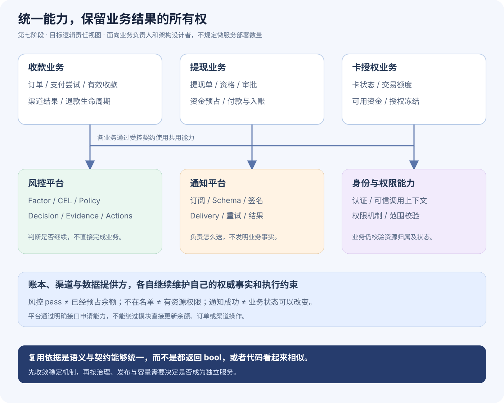
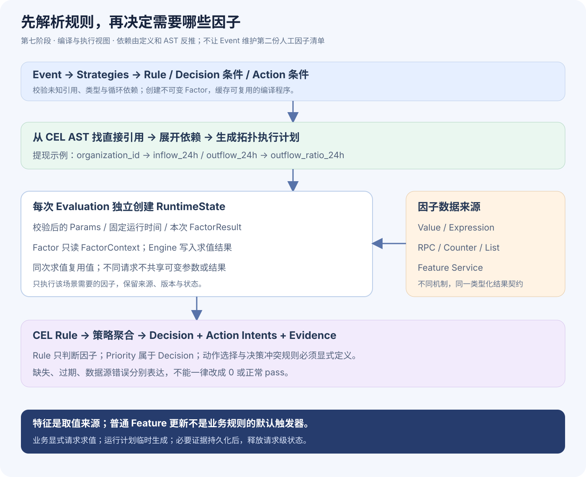
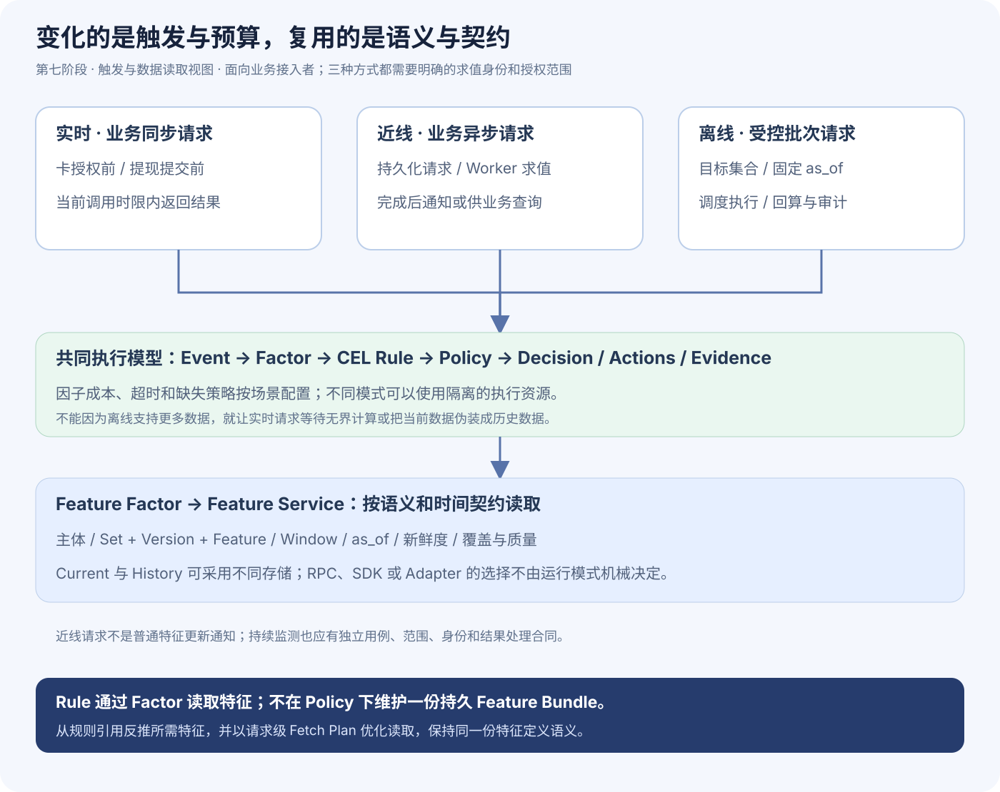
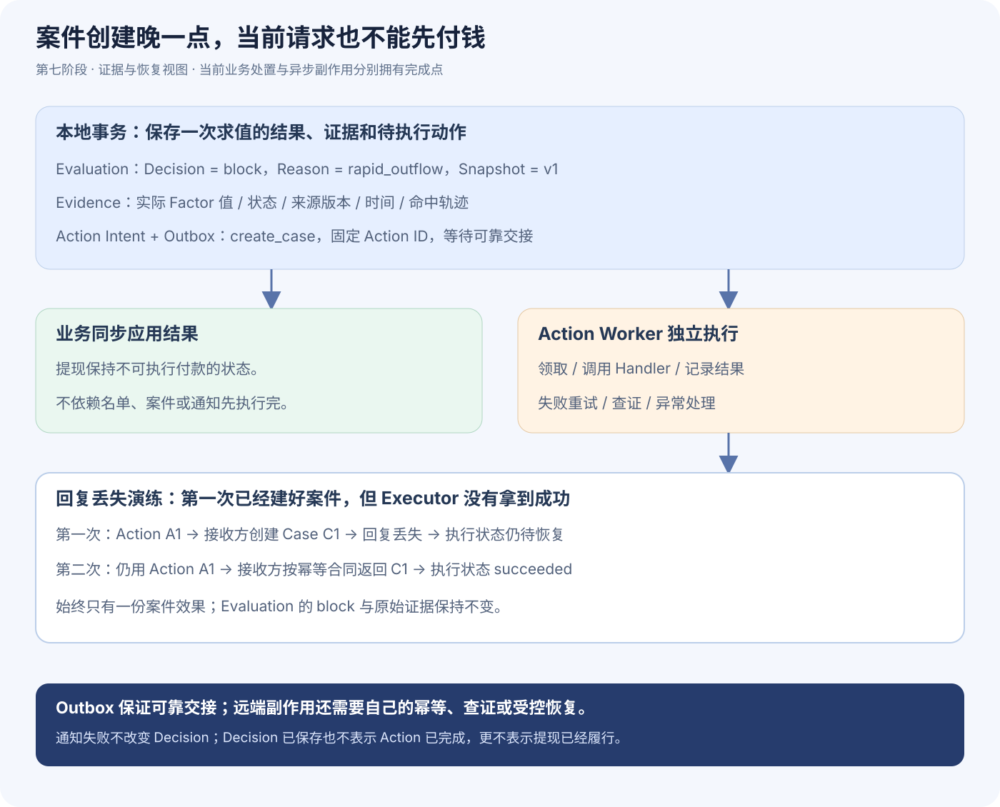

# 收款、提现、卡交易都有风控，为什么不能直接合成一个大服务？

> “从业务变化到软件边界”系列第七篇：从多个业务反复出现的风险判断、商户通知和权限校验出发，推演平台能力怎样形成，以及复用之后业务仍然必须负责什么。

如果你正在设计支付、账户、账本、清结算或风控系统，欢迎先关注本公众号。“从业务变化到软件边界”系列会从具体用例出发，讲清模型为什么演进、职责怎样划分，以及如何用代码、数据和异常场景验证这些边界。

[第六篇](./coach-payment-fee-clearing-settlement-payout-stage-6.md)中，我们把计费、清分、结算和付款拆开：付款超时，不会让原收款变成失败；一张结算单，也可以对应多笔付款。

这一篇继续增加一个变化：

> 收款、提现和卡授权都需要风控；支付、退款和结算都要通知商户；多个业务入口都需要身份和权限校验。

团队开始想：“这些代码都差不多，是不是可以做一个平台？”

可以，但先要回答：**我们准备统一的是哪一种语义、哪一份契约，还是只是几段长得相似的代码？**

本文的场景、阈值与接口是教学设计。随文 Go 样例真实运行 CEL，数据提供方与动作接收方使用本地替身；不连接真实业务、Redis、Kafka、数据库或支付渠道。

---

## 一、先别看重复代码，先看三个业务到底要完成什么

把需求分别交给三个业务负责人：

| 业务场景 | 想识别的风险 | 风控之外必须完成的业务工作 |
| --- | --- | --- |
| 创建收款尝试 | 商户是否在限制名单、交易金额是否异常 | 订单资格、支付尝试、路由、渠道操作 |
| 提交提现 | 收款人是否受限、是否频繁操作、近期资金是否异常流出 | 提现资格、资金预占、审批、付款与账务确认 |
| 卡消费授权 | 持卡人是否受限、短时行为是否异常 | 卡状态、交易限额、可用资金、授权冻结 |

三个业务都需要“判断能不能继续”，但后续状态完全不同。

```text
收款：可以创建支付尝试
提现：可以继续审核、预占与付款流程
卡授权：可以继续检查额度并尝试冻结资金
```

因此，真正能够统一的是风险判断的输入、执行与输出契约。

不能顺手把 `PaymentOrder`、`WithdrawalOrder` 和 `CardAuthorization` 变成一个大而全的 `BusinessOrder`，再让风控平台维护全部状态。

**共用判断能力，不等于交出业务事实的所有权。**

---

## 二、平台化需要通过三道检验

看到第二份相似代码时，先问三个问题：

### 1. 它们是在解决同一种问题吗？

“卡是否被冻结”和“商户是否在风险名单”都返回 bool，但含义不同：前者可能是卡业务状态，后者是风险数据。

返回类型一样，不足以证明应该合成同一业务接口。

但“根据定义取得一个类型化因子值”，确实可以同时服务这两个场景。

### 2. 调用方能不能用同一套契约正确使用它？

契约不只是函数名，还包括：

```text
输入来自谁？如何校验？
结果表示什么，什么不表示？
缺失、超时、过期怎样表达？
是否有副作用？能否重试？
谁记录证据，谁负责恢复？
```

如果每接一个业务，都需要给平台增加几十个专用参数和状态分支，说明抽象层次可能还没有选对。

### 3. 独立维护能不能真正减少调用方的复杂度？

如果删除一个“平台接口”后，调用方只是少写一次转发，它的价值有限。

如果删除它后，各业务都必须重新实现类型检查、依赖解析、规则求值、证据记录和动作恢复，它就承担了稳定的共性。

平台能力可以先是一个库或应用内模块。只有需要独立治理、发布、扩容或数据访问控制时，再评估独立服务。

---

## 三、先画责任图：什么向平台收敛，什么留在业务里？



这是一张目标逻辑责任视图，供业务负责人和架构设计者确认所有权；方框不是部署清单，箭头表示使用契约。

我们暂时提炼三类能力：

| 能力 | 平台负责的共性 | 业务继续负责的内容 |
| --- | --- | --- |
| 风控 | 因子取值、规则求值、决策解释、证据和动作交接 | 业务资格、资金约束、业务状态机与最终履行 |
| 通知 | 投递协议、签名、重试、结果和订阅配置 | 什么业务事实值得通知、事实内容和通知时机 |
| 身份与权限 | 身份验证、可信调用上下文、共用权限检查机制 | 资源归属、具体操作许可与资金业务约束 |

账本仍然维护入账与资金约束，渠道仍然解释外部协议；风控平台不因此获得直接修改它们数据库的权限。

下面先把最容易抽象过度的风控讲清楚，再回到通知与权限。

---

## 四、输入无法统一成一个大 Context，为什么仍然可以统一执行？

收款请求里有 merchant_id，提现请求里有 beneficiary_id，卡授权里有 cardholder_id。

不要为了统一风控，要求每个业务都填一份包含全部业务字段的结构体。

可以让入口采用：

```go
type EvaluateRequest struct {
    EventCode string
    EventID   string
    Params    map[string]any
}
```

例如：

```json
{
  "event_code": "withdrawal.submit",
  "event_id": "withdrawal-demo-001",
  "params": {
    "organization_id": "org-demo-01",
    "beneficiary_id": "beneficiary-demo-01",
    "amount_minor": 50000
  }
}
```

这里的 EventCode 是业务场景分类及配置入口，不是每次请求的唯一编号，也不是事实数仓里所有事件的通用 Schema。

EventID 关联这次业务操作。在本文演练中，同一调用方、同一 EventCode、同一 EventID 标识同一次求值请求；内容冲突拒绝。主动重评要使用明确的新求值身份，并保留与原业务操作的关联。

Params 由业务定义，但不等于“任何用户传来的 JSON 都可以信任”：

- 先验证调用方有权使用这个 Event，再按该场景参数契约检查类型、必填项与范围。
- 主体 ID 必须受可信调用身份、授权关系及资源归属约束，不能只相信客户端填了谁。
- 金额按整数类型归一化，避免 JSON 默认解码为浮点数后破坏因子契约。
- `as_of`、执行模式和追踪信息属于受控运行元数据；它们不要求统一所有业务对象。

平台统一的是“如何理解这个请求并执行对应配置”，不是统一每个业务的所有字段。

---

## 五、Factor：统一取值方式，不统一业务含义

在三个场景中，会反复出现六种取值问题：

| 因子类型 | 解决的问题 | 示例 | 主要依赖 |
| --- | --- | --- | --- |
| Value | 这次请求提供了什么？ | amount_minor、merchant_id | 校验后的 Params |
| Expression | 已知因子还能算出什么？ | 近 24h 出金金额 / 入金金额 | 依赖因子与纯计算 |
| RPC | 当前权威业务状态是什么？ | 账户是否被限制 | 已注册的服务与方法 |
| Counter | 短时间发生了多少次？ | 5 分钟提现尝试次数 | Redis 等在线聚合状态 |
| List | 这个主体是否属于某个集合？ | 收款人是否在限制名单 | 名单权威数据与在线索引 |
| Feature | 历史行为和复杂聚合是什么？ | 24h 资金活动、30 天设备画像 | 特征平台 |

“新设备”“异常国家”“疑似撞库”是业务信号，不天然对应某一个类型。

同一个信号，可以由请求值、RPC、计数器或特征平台提供。类型描述取值机制；定义描述具体数据和解释方式。

### Definition 用于创建，Factor 用于执行

沿用已有设计，可以保留最小接口：

```go
type FactorDefinition struct {
    Code      FactorCode
    Type      FactorType
    ValueType ValueType
    Config    json.RawMessage
}

type FactorProvider interface {
    Type() FactorType
    NewFactor(definition FactorDefinition) (Factor, error)
}

type Factor interface {
    Code() FactorCode
    DependentFactorCodes() []FactorCode
    Fetch(ctx context.Context, runtime FactorContext) FactorResult
}
```

不要再设计一个含有 Value、RPC、Feature 等大量互斥可选字段的通用 Resolver 结构体。

每种 Provider 解析自己的配置，完成类型检查、依赖提取及必要编译，创建不可变的 Factor。Definition 不必在每次 Fetch 时重新传入。

Expression 从表达式引用解析依赖，RPC 从请求参数绑定解析依赖，List 从主体因子引用解析依赖；依赖列表是编译结果，不是另一份需要人工同步的配置。

### 三个特别容易放错的行为

**Counter Fetch 只读，不偷偷增加计数。**

业务事件通过独立且可去重的写入路径更新统计。否则同一请求重试或重新求值，就会把“发生过一次”变成“发生过三次”。

**RPC Factor 调用受控能力，不执行任意地址。**

配置标识已注册的 Service + Method，绑定请求因子，并按经过类型校验的映射解析响应；返回值也可以是注册过 Schema 的结构体。规则作者不能借此任意访问内网或调用资金修改接口。

**Feature Factor 引用特征语义，不引用物理表。**

```text
Set Key  = subject_fund_activity
Version  = 2
Feature  = outflow_minor
Window   = rolling_24h
Subject  = 本次主体因子
```

还要明确点时读取方式、新鲜度、覆盖范围和质量要求。不要让规则写 ClickHouse 表名、SQL 或 Redis Key。

---

## 六、先从规则找因子，再执行需要的那部分

不能收到 Event 后，先把平台里所有因子执行一遍。

正确的推导方向是：

```text
EventCode
  → 该场景的已发布 Strategies / Rules
  → 从表达式 AST 找到直接引用的 Factor Codes
  → 递归展开因子依赖
  → 检查未知引用、类型和循环依赖
  → 得到本场景需要的执行计划
```

如果 Decision 分支或 Action 条件还引用其他因子，也要包含在根引用集合中。



这张图回答执行器“先做什么、为什么只取这些数”。计划是编译产物，不是策略里额外挂一份人工维护的 Factor 列表。

一次求值创建一份 `EvaluationRuntimeState`，因子通过窄接口读取它：

```text
Engine 拥有 EvaluationRuntimeState
  ├─ 校验并冻结本次参数与运行时间
  ├─ 读取 / 记录 FactorResult
  ├─ 记录规则命中和最终输出
  └─ 向 Factor 暴露只读 FactorContext
```

多个规则使用同一个因子时，在这次求值里复用已经取得的结果。

它是请求级执行状态，不是把所有主体特征长期搬进风控进程。需要保存的证据在完成点持久化，临时运行状态随后释放。

不可变 Factor、编译后的 CEL Program 可以按版本复用；不同 Evaluation 的参数和值不能共用一份可变 Map。

---

## 七、Rule、Strategy、Decision 和 Action，分别负责什么？

Rule 负责布尔判断：

```cel
amount_minor >= 50000 &&
inflow_24h >= 50000 &&
outflow_ratio_24h >= 0.90
```

这段表达式只引用因子，不访问原始 Params，也不直接调用网络、Redis 或数据库。

Expression Factor 和 Rule 都可以使用 CEL，但职责不同：前者产出可复用数据，后者判断某个业务条件是否命中。

Policy 的组织可以由多个 Strategy 构成，每个 Strategy 内聚：

```text
Strategy: block_rapid_outflow
├─ Rule: rapid_outflow
├─ Decision
│  ├─ Code: block
│  ├─ Priority: 80
│  └─ ReasonCodes: [rapid_outflow]
└─ Actions
   └─ create_case
```

Rule 不携带资金修改动作。命中后怎样形成处置结论和附加动作，由 Policy / Strategy 的配置及聚合契约决定。

`Priority` 属于被比较的 Decision，不属于 Rule。多个策略命中时，还要明确：优先级怎样比较、相同优先级怎样处理、哪些动作保留。

随文样例固定采用：

```text
Decision：优先级数值高者胜出；相同优先级按 Strategy Code 排序
Actions：只选择胜出 Strategy 的动作
Default：所有必要取值和规则都正常、且没有命中时，才返回 pass
```

这只是可验证的一种政策，不是所有风控平台都必须选相同算法。也可以收集全部命中动作，但要明确冲突、权限与去重规则。

### Decision 和 Action 不要混用

```text
Decision = 当前操作是否允许继续：pass / block
Action   = 另行执行的副作用：入名单、创建案件、通知等
```

人工审核、二次验证、延后处理，可以作为 block 后的处置路径解释，不必塞成第三、第四种通用 Decision。

[CEL 官方概述](https://cel.dev/overview/cel-overview/)说明了环境声明、类型检查与编译后重复求值的方式。我们选择 CEL 来承载受控判断，不是让 Rule 变成一段拥有任意 I/O 权限的小程序；仍需限制输入规模、求值成本和宿主扩展函数。

---

## 八、三个业务用同一个引擎，结果仍然各归各管

现在依次走过三个用例。

### 用例一：收款前拦截限制商户

```text
Payment 准备创建一次收款尝试
  → 调用 acquiring.payment.submit
  → Value 解析 merchant_id
  → List 查询商户限制名单
  → Rule 命中，Decision = block
  → Payment 不创建本次渠道收款操作
```

风控平台不负责把支付订单改成 closed，也不直接向用户退款。

如果业务已经观察到真实收款，风控也不能把外部资金事实改成“没收到”。此时可能需要阻断可用入账、保持待核验状态等同步业务处置，由权威业务模块执行并记账；不能等一个异步通知或案件创建成功后才阻断资金使用。

### 用例二：提现前识别快速资金流出

```text
Withdrawal 持久化申请
  → 调用 withdrawal.submit
  → Value / RPC / Counter / Feature / Expression 取得必要输入
  → Rule 命中 rapid_outflow
  → Decision = block，产生 create_case 意图
  → Withdrawal 保持不可执行付款的业务状态
```

创建案件可能稍后成功，但当前提现已经由业务同步拦截。

不能把“限制本次提现”实现为必须等待 Action Worker 写完名单，否则 Worker 停机期间就出现资金窗口。

### 用例三：卡授权风控通过，资金检查失败

```text
Card Authorization
  → Decision = pass
  → 检查卡状态、额度和资金约束
  → 可用金额 2500，小于本次请求 3000
  → 授权拒绝：insufficient_funds
```

两个结果都正确：风险判断通过，业务授权失败。

`pass` 是继续执行业务检查的必要条件之一，不是余额预占、银行卡授权或外部付款许可的替代品。

如果后续动作发现持续风险，平台可以通过受控命令申请限制某项能力；限制从何时生效、对已经执行的操作怎样处理，仍需明确的业务契约。

---

## 九、实时、近线、离线可以复用什么？

三种模式首先是触发、响应期限和工作范围不同：

| 模式 | 谁触发 | 怎样取得结果 | 典型工作 |
| --- | --- | --- | --- |
| 实时 | 业务请求 | 在当前调用时限内返回 | 卡授权前、提现提交前判断 |
| 近线 | 业务提交的异步请求 | 持久化请求，完成后通知或供业务查询 | 允许稍长计算时间的业务审核 |
| 离线 | 调度任务或受控批次请求 | 按目标集合、时间点生成结果 | 长窗口扫描、历史回算 |



近线仍然需要明确的业务求值请求。普通 Feature 更新不是默认的业务规则触发器；如果需要持续监测，应把监测任务本身设计成有范围、身份和权限的用例。

三种模式都可以通过特征平台读取数据。是否使用同一个 RPC、SDK 或不同存储适配，取决于点时能力、延迟和成本，不是由“近线”两个字机械决定。

较耗时的因子可以被限制在近线或离线执行，但 Factor、Rule 与 Evidence 的语义应尽量一致。

两个时间约束尤其重要：

- 当前判断需要合格且足够新的数据；缺失、过期、质量不合格不能一律变成 0。
- 历史回算必须固定 `as_of`，必要时还要区分当时发生与当时已知的数据。无法提供历史点时结果的 RPC 或 Counter，要明确标记不支持，不能拿当前值冒充过去。

[Feast 的特征读取文档](https://docs.feast.dev/getting-started/concepts/feature-retrieval)可以用来学习在线和历史读取的区别。本文采用已有的 Feature Factor 边界，不建立 Policy 到 Feature Bundle 的持久绑定；需要哪些特征，应从规则引用的因子反推。

---

## 十、Evidence：记录这次判断实际使用了什么

Rule 命中了，不等于调查人员就能解释这次决策。

至少需要记录：

```text
Evaluation ID / 请求身份 / 场景 / Snapshot 版本 / as_of
  ├─ 本次必要的参数快照或受控引用
  ├─ 实际使用的 Factor 值、类型、状态与来源
  ├─ 观察时间、取得时间、数据版本和质量信息
  ├─ Rule 命中轨迹与候选 Decision
  └─ 最终 Decision、Reason Codes 与 Action 意图
```

不要把四个概念混在一起：

| 概念 | 表达什么 |
| --- | --- |
| Fact | 实际发生或被观察到的业务事实，例如一次提现申请 |
| Feature | 对事实按定义计算的特征，例如某主体 24h 出金金额 |
| Factor Value | 这次求值通过某因子取得的类型化输入 |
| Evidence | 本次求值实际使用了哪些值和来源，以及怎样产生结果 |

Evidence 不是重新建设一套事实数仓，也不是保存所有 RPC 完整响应。

应保留足够解释和回放的数据，同时按权限、敏感级别与保留规则保存或引用；密码、密钥、完整认证令牌不应进入证据。

仅保存一个 Hash 可以检测内容是否改变，但如果原快照已经不可访问，它本身不能重建历史输入。

本次 EventID 重试时，可以按幂等契约返回原 Evaluation；重评应形成新证据，不覆盖旧决策。

---

## 十一、Action 为什么要独立执行？

创建案件、加入名单和通知服务的耗时与可用性，不应反向决定 CEL 是否命中。



这张图供运行与恢复设计使用：上半部分保存已经成立的求值结果，下半部分推进独立的动作执行状态。

本地持久化可以采用：

```text
同一个数据库事务
├─ Evaluation 完成结果
├─ Factor / Rule Evidence
└─ Action Intents + 待交接 Outbox
```

Worker 领取动作，调用受控 Handler，再记录结果、重试或异常；Outbox 解决数据库变更与交接之间的双写窗口。关于重复交付及消费者幂等，可参考 [AWS Transactional Outbox 说明](https://docs.aws.amazon.com/prescriptive-guidance/latest/cloud-design-patterns/transactional-outbox.html)。

但 Outbox 不自动保证远端副作用只发生一次。

例如案件已经创建、成功回复丢失，Executor 再次执行时，接收方应根据稳定 Action ID 返回原结果。若远端没有幂等或查单能力，要设计其他确认和人工恢复路径，不能无条件重复处罚。

还要区分三种状态：

```text
Decision：block，已保存
Action Intent：create_case，已保存
Action Execution：等待重试
```

通知失败不能把 Decision 改回 pass；反过来，Decision 返回成功，也不能把 Action 标记为已经执行。

对持续性名单或限制的撤销，还需明确原始来源、有效期及多条限制并存的规则。撤销一个案件产生的限制，不应顺带解除另一个独立风险来源的限制。

---

## 十二、通知和权限，也要按同样的方法提炼

风控之外，再检验两类共性。

### 商户通知：统一投递机制，不统一业务事实

支付、退款和结算模块分别判断自己的结果何时成立，并在本地事务中保存通知意图。

通知平台负责：

```text
接收已提交的通知意图
  → 解析订阅与目标地址
  → 按已约定 Schema 组织负载并签名
  → 限速、重试、保存 Delivery 与异常
```

它不负责通过查询几个业务表，猜测商户“现在大概应该收到什么通知”。

同一业务事实、订阅和通知用途应有稳定意图身份；每次网络投递有自己的 Delivery 记录。重复交付需要商户按事件身份去重；不能把“平台发出一次”承诺为“商户只收到一次”。

通知失败不撤销已经完成的支付或结算。不同服务可以复用可靠交接机制，但它们的业务 Outbox 仍应与各自本地事实同事务提交，不必搬进一个全局共享写表。

### 身份与权限：统一可信身份，不跳过资源归属

可以共享认证、调用上下文解析与权限判断基础能力，但仍需回答：

```text
这是哪个可信调用方和用户？
他是否有权访问这个业务操作？
这张订单、这个账户是否属于其可操作范围？
当前状态、风控和资金约束是否允许执行？
```

最后两项通常需要业务的权威数据。

“具有管理员角色”不自动等于可以操作所有商户账户；“不在黑名单”也不等于有资源访问权。

认证上下文与客户端业务 Params 的信任级别不能混用。需要跨 RPC 透传时，应校验来源、完整性、范围与有效期；权限机制通过了，也不代表资金预占已经成功。

---

## 十三、平台变成共用依赖之后，失败契约反而更重要

| 故障 | 平台表达 | 业务应怎样处理 |
| --- | --- | --- |
| RPC 因子超时 | Factor error + 可追踪原因 | 按该 Event 合同阻断、挂起或受控降级，不伪造正常 pass |
| Feature 过期 | Factor stale + 观察时间 | 根据新鲜度门槛处理，不能当作没有风险 |
| 规则配置错误 | 编译 / 发布拒绝 | 保持可用旧快照或明确不可用，不能带错误配置上线 |
| 求值成功但响应丢失 | 原请求可关联原 Evaluation | 按原身份查询或重试，不重复生成业务副作用 |
| 案件或通知服务故障 | 已保存的动作等待恢复 | 保持原决策及同步业务阻断 |
| 某业务提交大量请求 | 可观测的限额与资源使用 | 按调用方、场景和成本隔离，避免拖垮卡授权等关键链路 |

技术错误和正常 block 应分开记录。否则运营会把“特征服务宕机”误认为“全体用户突然都变危险”。

一次求值完成所需的延迟预算，应分配给取值、求值和结果持久化；低延迟规则计算不能抵消无界 RPC 等待。

先为不同场景建立明确的超时、成本和降级契约，再逐步增加能力。不要因为“平台化”，就强迫卡授权和离线批处理共用同一组不限量 Worker。

---

## 十四、教练式实践：用同一个执行模型跑三个业务

随文提供独立的 [Go / CEL 演练目录](./examples/risk-stage-7/)。它不修改现有风控服务，也不启动集群。

在仓库根目录运行：

```bash
cd docs/payment-architecture-evolution/examples/risk-stage-7
GOWORK=off go test -count=1 -v ./...
```

样例锁定 Go 1.26 与 `cel.dev/cel-go v0.33.2`；首次运行需要获取公开 Go 依赖。它使用真实 CEL 编译、AST 引用解析和求值，远端数据与存储以本地替身提供；内存记录不代表生产持久化或数据库并发保证。Feature 替身只校验固定夹具快照的时间与新鲜度，未实现历史查询；RPC 替身也不是真实泛化传输客户端。

### 练习一：先预测三个业务的结果

打开 [场景夹具](./examples/risk-stage-7/scenario.json)，先写下预测，再运行 `TestThreeBusinessEvents`。

```text
限制商户收款请求 → block
快速资金流出提现 → block + create_case
正常持卡人请求   → pass
```

继续核对卡业务独立的金额检查：可用 2500、请求 3000，最终授权仍然拒绝。它没有推翻风险 pass。

### 练习二：看规则怎样决定执行哪些因子

测试输出每个场景的拓扑计划与实际取值顺序。

收款不会为了“统一平台”去读取提现账户画像，卡授权也不会遍历所有资金特征。一个 Evaluation 中，被多个规则共享的因子只取一次；下一次独立求值重新取得本次输入。

### 练习三：证明编译失败与数据错误是两种问题

`TestInvalidConfiguration` 验证未知因子、返回非 bool 的 Rule、类型不匹配及因子循环依赖被拒绝。

`TestFactorFailureIsNotPass` 则让特征过期、数据源错误或值缺失，验证没有正常 pass，也不会产生伪造的规则命中动作。

### 练习四：区分计数读取与计数事件

重复求值并比较 Counter 的本地源数据，验证 Fetch 没有把次数加一。

真实 Redis 还需要独立验证事件去重、原子更新、时间桶及过期策略。样例没有把内存 Map 当作 Redis 的并发证明。

### 练习五：制造动作“已创建案件，回复却丢了”

`TestActionAcknowledgementLoss` 中，接收方第一次已经创建案件，但返回失败。相同 Action ID 重试后，只有一份案件效果，执行记录最终成功。

同时核对原 Evaluation 的 Decision 始终为 block；变化的是动作执行状态。

### 练习六：写出接入一个新业务最少需要补什么

以“新增退款审核”为例，先列出：

```text
业务触发点与 Event 参数契约
需要的数据及已有因子是否可复用
新增 Factor Definition 或 Provider 的理由
Rule、Decision 聚合、Action 与错误处理政策
业务怎样同步应用结果，以及保留哪些证据
```

如果只是引用已有取值机制、写新定义和规则，不必修改通用 Engine。只有出现新的稳定取值语义，才需要考虑增加 Provider；不要按每个业务名称增加一种 Factor Type。

---

## 十五、从重复能力演进成平台，实施节奏应该怎样安排？

```text
S0 用至少两个真实场景核对语义，明确业务与平台所有权
S1 先统一调用契约、类型和错误语义，保留业务独立状态机
S2 提炼 Provider / Factor / CEL / Policy 运行模型
S3 接入求值证据与可靠动作，验证幂等和恢复
S4 逐个业务做 Shadow 对比，再按受控范围启用
S5 按容量、发布、数据治理需要决定部署与资源隔离
```

Shadow 阶段只比较结果，不自动执行处罚、名单修改或资金动作；即使使用相同规则，也要保存输入时点、版本和差异，避免把取数差异误判为引擎差异。

这里不追求一开始就建设完整的通用流程引擎。

我们先把稳定共性收进有清晰契约的能力，让不同业务少维护一套重复机制；同时保留事实所有权、资金约束、业务状态和失败后的收敛路径。

**平台化的结果，应该是业务更容易接入、规则更容易解释、失败更容易恢复，而不是所有团队都必须理解一份更大的共享状态机。**

---

## 官方资料与阅读方法

1. [CEL：语言与执行模型](https://cel.dev/overview/cel-overview/)——学习环境声明、类型检查和编译后求值。
2. [CEL Go：官方实现](https://github.com/cel-expr/cel-go)——阅读 Go 接入、类型与运行保护；本文使用当前项目已采用的锁定版本。
3. [Feast：Feature retrieval](https://docs.feast.dev/getting-started/concepts/feature-retrieval)——理解当前和历史特征读取；它是设计参照，不要求把本例替换成 Feast。
4. [AWS：Transactional outbox pattern](https://docs.aws.amazon.com/prescriptive-guidance/latest/cloud-design-patterns/transactional-outbox.html)——理解本地事务交接、重复交付与消费者幂等。

资料核对日期：2026-11-22。本文描述的公共能力与案例是架构演进教学，不据此宣称已具备生产容量、完整策略治理或真实处罚执行能力。

---

下一篇，我们继续追问：

> 共用平台成为关键依赖以后，怎样设计容量隔离、超时与降级，避免一个局部故障影响所有业务？

继续阅读第八篇（系列收束篇）：[模块已经分清楚了，什么时候才值得拆成微服务？](./coach-payment-scale-isolation-service-evolution-stage-8.md)。

如果你希望持续看到支付、账户、风控和数据系统如何从具体问题一步步演进，欢迎关注本公众号，并收藏“从业务变化到软件边界”系列。后续我们继续用代码、证据和故障演练，检验每一次抽象是否真正让系统更容易理解和维护。
