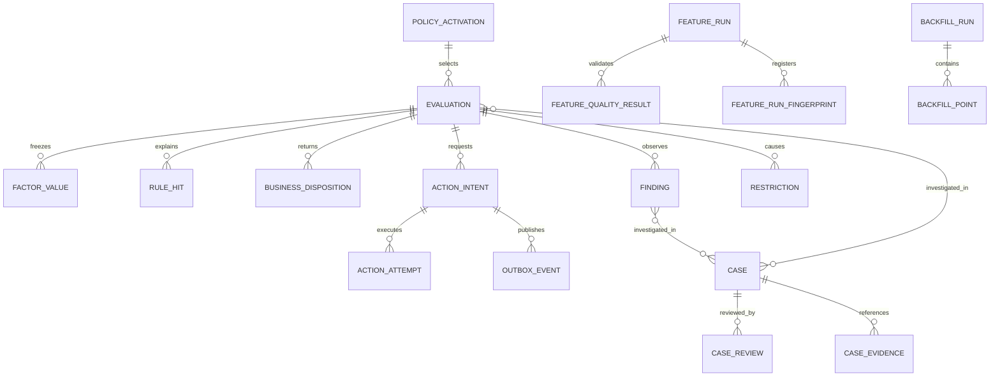

# 风险控制平台数据面数据库设计

> 状态：S0 数据契约与首版 DDL
>
> 日期：2026-11-08
>
> 范围：PostgreSQL 事务事实、ClickHouse 分析事实、对象存储原始证据
> 发布方式：V2 Shadow 写入；不修改现有 `public.risk_*` 运行路径

## 1. 本阶段解决什么问题

当前实验表由实时、近线、离线和数仓实践逐步增加，已经证明了 CEL、Evaluation、Action、Restriction、Feature、Backfill 和血缘等能力，但不适合直接扩展为统一生产模型：

- 同一概念存在 `risk_evaluations`、`risk_realtime_evaluations`、`risk_offline_evaluations`、`risk_warehouse_evaluations` 多种结构；
- 旧 Decision 同时出现 `allow/review/deny` 与 `pass/block`；
- Action 只有简化状态，无法表达租约、未知结果、对账和补偿；
- Evaluation、Action 和消息发布之间没有统一 Outbox 原子边界；
- 业务时间、观察时间、决策时间和数据截止时间尚未统一；
- ClickHouse History、Current 和 PostgreSQL Run 注册虽然已有纵向实践，但尚未形成全平台数据契约。

首版目标不是立即迁移所有代码，而是建立可并行验证的新写模型：

```text
现有 public.risk_* 表 ───────→ 现有实验服务继续运行

相同业务输入
      └─ Shadow Writer ──────→ risk_control.*
                                  ↓
                             Reconciliation
                                  ↓
                     用例级灰度切换与旧表只读
```

## 2. 三类存储的职责

| 存储 | 保存内容 | 不保存什么 |
|---|---|---|
| PostgreSQL `risk_control` | 策略激活、Evaluation 证据、Action/Outbox、Finding、Restriction、Case、名单、Feature Run 注册与质量结果 | 大体积原文、长周期逐笔分析事实 |
| ClickHouse `risk_warehouse` | DWD 逐笔规范事实、DWS/Feature History、Current Projection、流批对账分析数据 | 需要强唯一约束的幂等注册、Action 权威状态 |
| 对象存储 | 原始事件字节、渠道回调、批次文件、证据附件、Reject Manifest | 可直接驱动线上决策的可变状态 |

关键边界：PostgreSQL 决定“这次评估和动作是否唯一、是否已提交”；ClickHouse 回答“历史上发生了什么、窗口特征是什么”；对象存储提供可重新解析的原始证据。

## 3. 数据建模不变量

1. Evaluation 及其 Factor Values、Rule Hits、Business Dispositions 一旦写入不可更新或删除。
2. Evaluation、Action Intents 和逐 Action Outbox 必须在一个 PostgreSQL 事务内提交。
3. 同一 `(environment, scene_key, request_id)` 只能对应一个请求指纹；相同指纹重放，不同指纹冲突。
4. Action 的 `succeeded` 只表示目标系统返回权威回执，不代表原业务已经最终完成。
5. Action 租约过期进入 `unknown_result`；新 Worker 必须先查询目标事实，再决定重试。
6. 同一主体、能力、范围只有一个当前有效 Restriction 代次。
7. 旧 Evaluation、迟到事件和历史 Backfill 不能覆盖更新版本的 Restriction 或业务事实。
8. Feature History 不覆盖；Current 只是可重建投影。
9. 同一 `source_run_id` 相同指纹允许重放，不同指纹在 PostgreSQL 注册阶段拒绝。
10. 业务原文、证件、完整账户和渠道敏感响应不进入通用 JSONB；只保存分类、摘要、引用和哈希。

## 4. PostgreSQL 聚合关系



关系说明：Case 可以聚合多个 Evaluation/Finding；Finding 不是 Restriction；Restriction 必须引用产生它的 Evaluation 或人工 Review；Action Intent 与执行 Attempt 分离。

## 5. PostgreSQL 表设计

### 5.1 策略激活

#### `risk_control.policy_activations`

保存某租户、环境、场景和灰度 cohort 当前应使用的不可变 Policy Snapshot。

| 设计项 | 内容 |
|---|---|
| 主键 | `activation_id` |
| 历史唯一键 | `(environment, scene_key, rollout_cohort, generation)` |
| 当前唯一键 | 相同 environment、scene、cohort 只能有一条 `active` 记录 |
| 并发 | `version` CAS；`generation` 单调递增 |
| 回滚 | 新 generation 指向旧 snapshot，不降低 generation |
| 主要索引 | 当前状态、snapshot fingerprint |

### 5.2 Evaluation 不可变证据

#### `risk_control.evaluations`

保存一次实时、近线或离线求值的统一头记录。

核心字段分组：

- 身份与幂等：environment、scene、request ID、request fingerprint；
- 主体与业务对象：subject、capability、business object ID/version；
- 策略：policy key/version、snapshot fingerprint、activation generation；
- 运行：execution mode、evaluation status、decision、disposition、risk level、machine label；
- 点时语义：event time、observed time、input cutoff、decision time；
- 血缘：source run、correlation、causation、trace；
- 隐私：trusted context fingerprint、input snapshot reference、data classification。

`evaluation_status=failed` 时 Decision 必须为空；`completed` 必须有 `pass/block`。`degraded` 是否可以产生 Decision 由场景降级契约决定，行内必须记录 `decision_source` 和 degraded factors。

#### `risk_control.evaluation_factor_values`

按 `evaluation_id + factor_key + factor_version` 保存类型、规范化值、来源、有效时间、新鲜度、错误和敏感数据引用。使用分列值而不是一个无界 JSON：`value_bool/value_int/value_double/value_text/value_json` 只能有与 `value_type` 对应的一列非默认值。

#### `risk_control.evaluation_rule_hits`

保存每条规则是否命中、表达式指纹、求值耗时和 Trace 引用。Rule Hit 只解释判断，不包含副作用。

#### `risk_control.evaluation_business_dispositions`

保存需要事实所有者同步落实的类型化业务去向，例如：

```text
disposition_type = credit_state
value_type       = string
value_text       = pending_credit
owner_module     = inbound_funds
schema_version   = 1
```

业务模块不得根据 Risk Level 或 `pass/block` 猜测资金状态。

### 5.3 Action 与可靠投递

#### `risk_control.action_intents`

保存 Evaluation 产生的异步副作用意图。稳定唯一键是 `(action_type, effect_idempotency_key)`。

状态机：

```text
pending -> running -> succeeded
                  -> retryable_failed -> running
                  -> unknown_result -> reconciling -> succeeded | running | terminal_failed
                  -> terminal_failed
pending -> cancelled
succeeded -> compensated
```

Action 保存目标对象版本、Restriction 预期代次、lease owner/epoch/until、attempt、next retry、业务回执引用和乐观锁版本。

#### `risk_control.action_attempts`

每次外部调用或对账查询一行。保存 request fingerprint、开始/结束时间、结果类型、错误分类、是否可重试和回执引用，不保存完整敏感响应。

#### `risk_control.outbox_events`

每个 Action Intent 在同一事务生成一条 `risk.action.requested`；Evaluation 同时生成一条 `risk.evaluation.created`。

Relay 通过 lease epoch 和 version CAS 领取。Broker 确认后标记 published；“已发布但尚未标记”允许重复投递，不允许丢失。Consumer 使用 `event_id/action_id` 做消息幂等，使用 effect key 做业务幂等。

### 5.4 Finding、Restriction 与名单

#### `risk_control.findings`

保存需要调查的风险观察。Fingerprint 防止同一 Evaluation 重复创建同一 Finding。Finding 可被解决或取代，但原始证据不可删除。

#### `risk_control.restrictions`

保存主体能力限制及其 generation。部分唯一索引保证同一 subject、capability、scope 只有一条 `active` 记录。激活、解除、到期和取代均保存独立 Evaluation/Review/Action 引用。

#### `risk_control.list_entries`

保存名单条目的范围、来源、有效期、状态、理由和审批引用。名单是 Factor 来源，不是隐式 Action；命中后仍由 Policy 决定业务效果。

### 5.5 Case 与人工审核

#### `risk_control.cases`

保存案件类型、严重度、队列、状态、负责人、SLA、版本和最后活动时间。状态更新使用 CAS。

#### `risk_control.case_object_links`

用类型化链接把 Case 关联到 Subject、Evaluation、Finding、业务对象和外部证据，不反向修改这些对象。

#### `risk_control.case_evidence`

保存证据类型、对象存储引用、SHA-256、数据分类和创建者。敏感正文不进入表内。

#### `risk_control.case_reviews`

保存人工结论、原因码、客户可见原因、reviewer、maker-checker 审批与所依据的对象版本。Review 只产生新命令或 Action Intent，不直接修改资金/权限表。

### 5.6 Feature Run、质量和回算

#### `risk_control.feature_runs`

记录固定 `as_of` 的一次 Feature 生产：Feature Set/Version、输入截止、分区、execution mode、状态、计数和内容指纹。

#### `risk_control.feature_run_fingerprints`

以 `source_run_id` 为主键原子注册内容指纹。它是 ClickHouse 写入前的强唯一门禁。

#### `risk_control.feature_quality_results`

按质量规则保存 passed/failed、实际值、阈值、样本引用和原因。任一 required Gate 失败阻断 Policy Evaluation。

#### `risk_control.feature_reconciliations`

保存流式与批量快照的比较键、双方指纹、差值、阈值、可比状态和告警状态。

#### `risk_control.backfill_runs` / `backfill_points`

父 Run 保存区间、步长、execution mode、审批和计数；子 Point 保存每个 `as_of` 的状态、尝试、租约、错误和 child run ID。`simulation/shadow/backfill/live_detection` 不直接执行高影响 Action；只有独立 Remediation Campaign 可以发布批量 Action。

### 5.7 原始证据索引

#### `risk_control.raw_archive_objects`

保存对象键、内容哈希、大小、事件时间范围、Schema ID、数据分类、保留策略和写入状态。原始对象不可覆盖；相同 object key 不同 hash 必须冲突。

## 6. PostgreSQL 索引与保留策略

| 查询 | 索引 |
|---|---|
| Evaluation 幂等查询 | environment + scene + request ID 唯一 |
| 主体风险时间线 | subject type + subject ID + decision time DESC |
| 业务对象反查 | business object type + ID + version |
| 待执行 Action | state + next retry + created time；仅 pending/retryable/reconciling |
| 租约回收 | state + lease until；仅 running |
| 当前 Restriction | subject + capability + scope；仅 active 且唯一 |
| Case 队列/SLA | queue + status + SLA；subject + updated time |
| Outbox Relay | state + next retry + created time；仅 pending/retryable |
| Feature Run 血缘 | feature set/version + as_of；source run ID |

第一阶段不对 PostgreSQL 表做物理月分区，避免分区键破坏全局幂等唯一约束。达到容量门槛后，将不可变 Evaluation 证据归档到对象存储/分析层并按 `decision_time` 分区；Action、Restriction、Case 和 Outbox 继续保留在事务表。

## 7. ClickHouse 表设计

### 7.1 DWD 与 DWS 的分表口径

Raw 可以使用统一事件信封接住不同业务模块的原始事件，但 DWD 不建设一张包含所有业务的万能事件表。DWD 按“稳定业务事实的语义和粒度”拆分：只有生命周期、主键粒度、时间语义和修正方式一致的事实才进入同一张表。

例如，入金到账、提现完成、收单结算入账和卡清算扣账都可以规范化为已经确认的资金移动；支付单创建、卡授权批准、客户认证状态变化则分别进入支付尝试、卡授权和客户认证 DWD，不能因为来源模块不同或字段相似就混入资金移动表。

```text
Raw Event Envelope
      │
      ├─ withdrawal.completed ───────→ dwd_withdrawal_orders
      │                                      └─→ dwd_fund_movements
      ├─ card.authorization.created ─→ dwd_card_authorizations
      ├─ card.settlement.completed ──→ dwd_card_settlements
      │                                      └─→ dwd_fund_movements
      └─ customer.verification.changed
                                      └─→ dwd_customer_verification_events
```

DWS 按“分析主体 + 风险主题 + 窗口族 + 行粒度”拆分，不按单个 Factor 拆表，也不让所有主题共用一张宽表。相同主体、相同主题、相同粒度下经常一起计算和读取的指标可以放在同一逻辑 DWS 中。例如 inflow、outflow、ratio、笔数和对手方数量可以共同属于主体资金活动 DWS，并由多个 Factor Definition 分别读取。

逻辑模型与物理表是两层概念：一个逻辑 DWS 通常至少可以有 History 和 Current 两种物理用途。

```text
逻辑 DWS：subject_fund_activity
       │
       ├─ History：每个 source_run_id 的不可变计算证据
       └─ Current：同一业务键与 as_of 的最新可重建投影
```

分表决策规则：

| 问题 | 相同则可以考虑同表 | 不同则应拆表 |
|---|---|---|
| 主体 | 都是 organization 或 merchant | 一个是主体、一个是渠道或设备 |
| 风险主题 | 都是资金活动 | 资金活动与账户安全 |
| 行粒度 | 每个主体、币种、as_of 一行 | 一张是主体汇总，一张是逐笔授权 |
| 时间语义 | 都使用固定 as_of 与相同窗口定义 | 一个是事件时间窗口，一个是当前状态 |
| 生命周期 | 都可由相同输入重算 | 一个不可变历史，一个有独立业务状态机 |
| 查询与保留 | 经常一起读取且保留周期一致 | 热点、权限或保留周期明显不同 |

第一阶段规划的逻辑 DWS 主题如下；只有明确用例进入实施阶段时才创建对应物理表，不一次性空建全部表：

| 逻辑 DWS | 主体与用途 | 代表性指标 |
|---|---|---|
| `subject_fund_activity` | 企业或用户资金活动 | inflow、outflow、ratio、笔数、对手方数 |
| `merchant_acquiring_activity` | 商户收单行为 | 支付成功率、退款率、拒付率、客单价 |
| `subject_card_activity` | 企业或持卡人卡行为 | 授权、拒绝、清算、国家和商户分布 |
| `subject_withdrawal_activity` | 企业或用户提现行为 | 提现次数、金额、新收款方、失败率 |
| `subject_security_activity` | 账户安全主体 | 新设备、失败登录、密码与 2FA 变化 |
| `subject_profile_risk` | 客户资料与认证 | 认证状态、失败次数、资料变更、一致性 |
| `subject_relationship_risk` | 主体关联网络 | 共享设备、IP、账户和高风险关联数 |
| `provider_channel_quality` | 渠道与 Provider | 成功率、延迟、重复回调、对账差异 |

窗口处理首阶段采用“一类主题一个逻辑模型，窗口通过 `window_type/window_start/window_end/as_of` 明确表达”。只有热点查询、保留策略或计算方式出现实质差异时，才进一步拆成 `_1h`、`_24h`、`_30d` 等物理表。当前 24 小时资金活动表是首条纵向样板，不代表完整平台只有这一张 DWS。

#### 7.1.1 多窗口、窗口实例与取值契约

`window_type` 是稳定的窗口定义，例如 `rolling_5m`、`rolling_1h`、`rolling_24h`、`calendar_day`；`window_start/window_end` 是该定义在某个 `as_of` 下形成的具体窗口实例。同一主体、同一 `window_type` 会随着 `as_of` 推进产生多个窗口实例：它们不是新的 Feature Set，也不需要按 `_5m`、`_1h`、`_24h` 分表。

```text
subject_fund_activity / organization-001 / rolling_24h
    ├─ as_of=12:00，窗口=(昨日12:00, 今日12:00]
    ├─ as_of=12:05，窗口=(昨日12:05, 今日12:05]
    └─ as_of=12:10，窗口=(昨日12:10, 今日12:10]
```

只有以下条件均相同时，不同窗口才放在同一逻辑 DWS：主体和行粒度相同、指标字段相同、业务语义相同、生命周期兼容。指标结构、主体粒度或风险语义不同仍须拆成新的 Feature Set。

在线取值不得使用精确 `window_start/window_end` 查找，也不能只凭 `window_type` 信任任意旧值。统一取值契约是：

```text
Feature Set + Version + Subject + Currency + Window Type
    ↓
选择 max(as_of)，且 as_of <= evaluation_as_of
    ↓
校验 evaluation_as_of - snapshot.as_of <= max_age
    ↓
校验 window_start/window_end 符合窗口定义
    ↓
返回 Factor Value；否则返回 missing/stale/error
```

例如 `rolling_24h` 因子在 12:10:30 求值时，可以读取 12:10:00 的快照；若最新快照仍停留在 10:00，则必须按配置返回 `stale_feature`，不能因为表中存在旧行就继续使用。

#### 7.1.2 History、Snapshot Current 与 Latest

同一逻辑 Feature 建议区分三种物理用途：

| 用途 | 逻辑身份 | 同一对象、同一窗口保留方式 | 主要消费者 |
|---|---|---|---|
| History | subject + window + as_of + source_run_id | 每次 Run 一条 | 审计、回放、流批对账 |
| Snapshot Current | subject + window + as_of | 每个 as_of 的当前有效版本 | 近线分析、时间序列查询 |
| Latest / Online Store | subject + window | 只保留最新值 | 实时 Factor 读取 |

当前 `_current_` ClickHouse 表的排序键仍包含 `as_of`，准确语义是“每个时间点的当前有效版本”，不是“每个主体永远只有一行”。实时高并发读取应增加不含 `as_of` 的 Latest Projection，或由 Flink 将最新值写入 Redis 等 Online Feature Store。Latest 必须携带 `as_of`、窗口边界、版本和来源 Run，供读取方执行时效校验。

#### 7.1.3 快照频率与生命周期

Flink 状态可以随每个事件实时更新，但不能把每次状态变化永久保存为 ClickHouse Snapshot。生产目标采用分层生命周期：

```text
Flink State：事件级实时更新
    ↓
Redis Latest：每个主体、窗口仅最新一条
    ↓ 每分钟或每五分钟，仅活跃主体
ClickHouse Minute Snapshot：短期保留
    ↓ Airflow 降采样
ClickHouse Hourly / Daily Snapshot：中长期保留
    ↓
Decision Evidence：真正参与决策的 Factor Values 长期审计
```

建议初始策略如下，最终值必须通过容量、合规和查询需求评审确定：

| 数据 | 初始保留建议 |
|---|---|
| Redis Latest | 持续覆盖，每个对象、窗口一条 |
| 分钟级 Snapshot | 7 天 TTL |
| 小时级 Snapshot | 30～90 天 TTL |
| 每日 Snapshot | 1～3 年或归档对象存储 |
| 实际决策证据 | 按风险审计与合规要求长期保留 |

ClickHouse 表继续按 `as_of` 月份分区，并为不同采样层配置独立 TTL。超过热数据周期后通过 Airflow 降采样或归档，不能依赖人工逐行删除。

### 7.2 `risk_warehouse.dwd_fund_movements_v2`

首个 DWD 表保留 source domain、event/schema/aggregate 版本、主体、方向、币种、金额、业务时间、观察时间、对象存储引用和 SHA-256。当前平台是单平台多业务域，不使用 `tenant_id`；收单、卡、出入金等来源由 `source_domain` 和类型化业务事实表表达。使用 `ReplacingMergeTree(ingested_at_millis)` 提供事件 ID 的逻辑最新投影，但 Parquet/Raw 仍是可回放证据。

### 7.3 `risk_warehouse.feature_snapshot_history_v2`

通用 Feature Manifest，按 Feature Set、Version、Subject、`as_of`、`source_run_id` 保存不可变历史、内容指纹、质量状态和值 JSON。它用于血缘与回放，不承担高频因子查询。

### 7.4 `dws_subject_fund_activity_history_v2`

首个类型化 Feature 表，保存 inflow、outflow、ratio、事件数、窗口、as_of、run 和 fingerprint。类型化列用于规则输入和流批对账。

### 7.5 `dws_subject_fund_activity_current_v2`

Current Projection 以 Feature Set/Version/Subject/Currency/As-of 为排序键，通过 `ReplacingMergeTree(computed_at)` 提供快速读取。它可以删除并从 History 重建，因此不是审计源。

ClickHouse 没有关系数据库式唯一约束；任何 History 写入前必须先注册 PostgreSQL `feature_run_fingerprints`。

### 7.6 Warehouse Feature Factor 抽象

Feature Set 的数据结构可以不同，但不为每种业务主题创建新的 Factor Type。Factor Type 表达取值机制，统一使用 `warehouse_feature`；Feature Set 的结构差异由内部 Adapter 隔离。

```text
Factor Engine
    ↓ warehouse_feature
WarehouseFeatureFactorProvider
    ↓
FeatureSetAdapterRegistry
    ├─ FundActivityAdapter
    ├─ MerchantAcquiringAdapter
    ├─ CardActivityAdapter
    └─ WithdrawalActivityAdapter
```

一张 Feature Snapshot 可以产出多个标量 Factor。例如 `merchant_acquiring_activity` 同时产出 `total_attempts`、`success_rate` 和 `unique_payers`。一次 Evaluation 应按 Feature Set/Version/Subject/Currency/Window Type/As-of 加载并缓存整张快照，再从中提取多个 Factor，禁止每个字段分别查询一次 ClickHouse。

Factor 引用必须显式包含：Feature Set Key、Feature Set Version、Field、Window Type 和 Max Age。窗口不再编码进 Feature Set 名称；例如使用 `subject_fund_activity + rolling_24h + outflow_ratio`，而不是把 `subject_fund_activity_24h` 当成新的 Feature Set。

当前代码已经存在 `FactorTypeWarehouseFeature`，但 Reader 和 Adapter 仍绑定 `SubjectFundActivitySnapshot`，属于首条纵向样板。接入收单、企业卡和提现 DWS 前，需要将其重构为统一 Provider + 每 Feature Set 一个类型化 Adapter，并补齐同一 Evaluation 的 Snapshot Cache、时效检查和多表契约测试。

## 8. 事务写入顺序

### 8.1 实时/近线 Evaluation

```text
BEGIN SERIALIZABLE
  1. 以 environment + scene + request ID 取得 advisory lock
  2. 查询已有 Evaluation：同指纹重放，不同指纹冲突
  3. 插入 Evaluation
  4. 插入 Factor Values / Rule Hits / Business Dispositions
  5. 插入 Action Intents
  6. 为 Evaluation 和每个 Action 插入 Outbox
COMMIT
返回 Decision 及 Evaluation ID
```

提交失败时不能返回 Decision。

### 8.2 Action Worker

```text
1. CAS 领取 Action，递增 lease_epoch，并固定本次 attempt_no
2. 调用目标业务命令
3. 在一个事务中追加完整且不可变的 Action Attempt，并更新 Action 当前状态
4. 已知成功：保存权威回执并 succeeded
5. 已知暂时失败：retryable_failed
6. 超时/Worker 崩溃/结果未知：unknown_result；若崩溃发生在 Attempt 落库前，由租约回收流程补写未知结果或对账 Attempt
7. 新 Worker 接管后先查询目标事实，再决定 succeeded 或同 effect key 重试
```

旧 Worker 的所有回写必须同时匹配 action ID、version、lease owner 和 lease epoch。

## 9. 迁移与切换

| 阶段 | 行为 | 完成门槛 |
|---|---|---|
| DB-S0 | 创建 `risk_control` 与 V2 ClickHouse 表 | DDL 可重复执行；约束负例通过；现有测试不变 |
| DB-S1 | 实时 Evaluation Shadow 双写 | 同输入的决策、原因、Factor 和 Action Intent 可核对 |
| DB-S2 | Action/Outbox Shadow，不执行 V2 副作用 | 重放、Relay 崩溃、租约接管证据通过 |
| DB-S3 | 单一低风险 Action 灰度切换 | V2 成为唯一执行者；旧路径只读；可回退 |
| DB-S4 | Case/Restriction/名单迁移 | 当前状态、代次和历史因果链核对通过 |
| DB-S5 | Feature Run/ClickHouse V2 切换 | 固定 as_of、历史不可变、流批对账通过 |
| DB-S6 | 旧表归档 | 无读写依赖；保留/删除经批准 |

禁止把“新表已创建”当成迁移完成。每个用例必须分别证明：旧/新结果一致、只有一个副作用执行者、回滚不会丢失新证据。

## 10. 本轮交付与明确排除

本轮交付：

- PostgreSQL V2 首版 DDL；
- ClickHouse V2 首版 DDL；
- 术语与 ADR；
- 可重复执行、约束、不可变性和事务回滚验证。

本轮不包含：

- 修改现有 Handler/Store 使用 V2 表；
- 真实业务双写和数据回填；
- 删除或改名旧表；
- 生产容量分区与高可用拓扑；
- 未经批准的自动限制或批量补救。

## 11. 当前进度

| Step | 状态 | 交付物 | 验证 | 阻塞 |
|---|---|---|---|---|
| DB-S0a 数据模型 | Completed | 本文、Glossary、ADR | 文档、术语与命名检查通过 | 无 |
| DB-S0b PostgreSQL DDL | Completed | `migrations/postgres/001_risk_control_v2.sql`、回滚式验证 SQL | Kind 连续执行迁移两次；22 张表、约束负例与不可变触发器通过 | 无 |
| DB-S0c ClickHouse DDL | Completed | `migrations/clickhouse/001_risk_warehouse_v2.sql`、`002_risk_domain_tables.sql` | 临时库从零创建成功；8 张 DWD、16 张 DWS 和 1 张 Feature Manifest 表可查询 | 无 |
| DB-S0d 跨域数据演练 | Completed | DWD Seed、DWS Build、数据断言、8 个 Feature Run 注册 | 完整重放两次；DWD/DWS 指标与血缘断言通过 | 无 |
| DB-S1 Shadow Writer | Not started | Store/Repository | 集成与对账测试 | 需先完成 DB-S0 |

DB-S0 已完成，但没有修改运行时读写路径。下一步只选择实时 Evaluation 作为第一条 Shadow Writer，不同时迁移 Action、Case 和 Warehouse。

本轮 Kind 验收证据：

- PostgreSQL 迁移重复执行成功；`risk_control` 下存在 22 张表；
- 回滚事务验证了 Action effect key 冲突、Evaluation 封存、Factor 证据不可修改、封存后不可追加证据、同一范围只能存在一条 active Restriction；
- 验证事务最终执行 `ROLLBACK`，没有残留演练业务数据；
- ClickHouse 临时库从零创建成功，当前风险数据面包含 8 张类型化 DWD、8 组 History/Current DWS 和 1 张通用 Feature Manifest，共 25 张表；
- PostgreSQL 已注册 8 个 Feature Run 及其内容指纹；ClickHouse 的每组 DWS 通过独立 `source_run_id` 回指对应 Run；
- 固定演练数据覆盖资金、收单、卡、提现、账户安全、客户认证、主体关联和渠道质量，并通过 `INSERT ... SELECT` 从 DWD 计算 DWS；
- Seed、聚合和验证完整重放后，`FINAL` 逻辑行数及所有指标保持不变；
- 现有 `public.risk_*` 与旧 ClickHouse 表未删除、未改名，服务仍使用原有链路。
