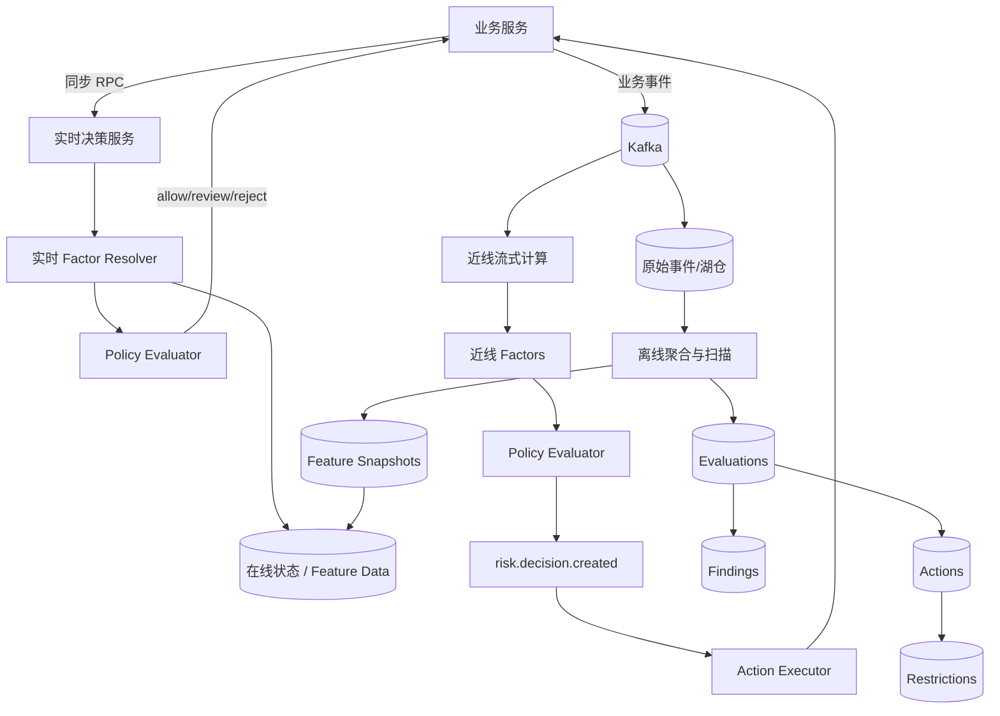
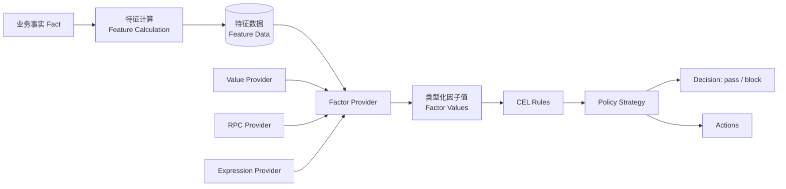
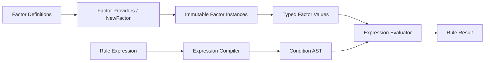
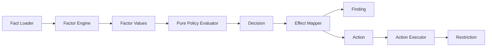
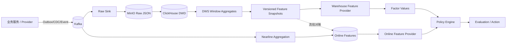
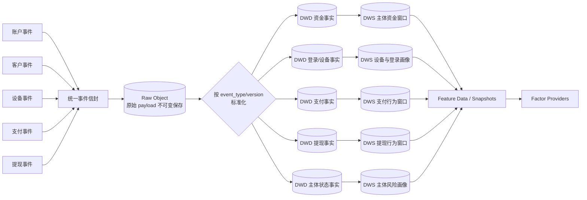
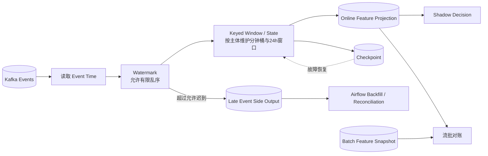
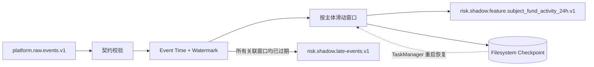
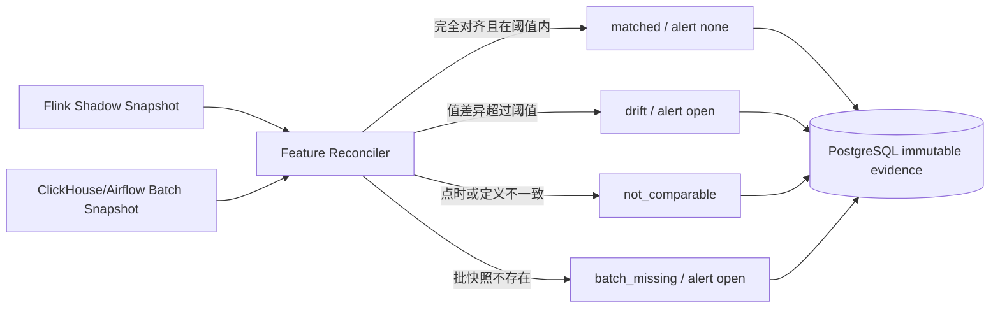
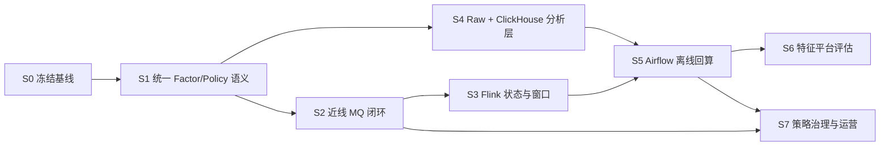

# 统一风控平台技术方案与分阶段实施路线

> 状态：实施中
> 最后更新：2026-11-01
> 适用范围：`local-platform-lab` 本地 Kind 实验
> 目标：在不复制任何生产系统代码或配置的前提下，逐步实现实时、近线、离线三类风控链路及其数据基础设施。

## 1. 背景与结论

本方案不建设三套互相独立的“风控引擎”，而是建设一套共享领域语义、按照时效分层执行的统一风控平台：

- **实时风控**：业务同步等待，使用 RPC/HTTP 直接返回 `allow/review/reject`；
- **近线风控**：消费业务事件，经过秒级到分钟级计算，通过 MQ 异步通知业务方；
- **离线风控**：扫描更长时间范围和更完整的数据，产出特征、评估、风险发现、限制、名单或模型。

三条链路共享主体标识、Factor 定义、Policy 版本、Decision 记录和执行效果，但拥有不同的延迟预算、数据来源、故障处理和业务交付方式。



## 2. 术语和语义

| 术语 | 定义 | 示例 |
|---|---|---|
| Fact | 来自可信来源、尚未为某条规则加工的事实 | 一笔入金事件、当前设备 ID |
| Factor | 定义如何取得或计算规则输入 | SQL 聚合、Redis 查询、RPC、表达式、模型调用 |
| Factor Value | 某次求值时 Factor 得到的值 | `outflow_ratio_24h = 0.95` |
| Condition | Factor、运算符和期望值组成的比较 | `outflow_ratio_24h >= 0.90` |
| Rule | Conditions 的 AND/OR/NOT 组合 | 入金额达标且流出比例过高 |
| Strategy | Policy 内将 Rule 与优先级、Decision、Reason Codes、Actions 绑定 | 命中快进快出 Rule 后限制提现 |
| Policy | Strategies 的版本化编排和默认决策 | 快进快出策略 v3 |
| Evaluation | 一次不可变的求值记录 | 哪个策略版本基于哪些值作出何种结论 |
| Decision | 只表示是否允许当前业务继续 | `pass/block` |
| Finding | 可调查、可处置的持久化风险发现 | 疑似资金快进快出 |
| Action | 需要执行的操作 | 创建案件、发送事件、激活限制 |
| Restriction | Action 执行后形成的持续能力限制 | 禁止提现 |

### 2.1 Feature 与 Factor 的统一口径

`Feature` 和 `Factor` 不作为两套并列的决策概念：`Feature` 属于数仓与特征工程，强调数据如何从事实中计算、聚合和版本化；`Factor` 属于决策引擎，强调规则输入如何定义、取值和求值。数仓 Feature 是 Factor 的一种数据来源，但固定值、可信请求上下文、状态查询、RPC 和表达式同样可以提供 Factor。

统一链路如下：



术语使用约束：

- 数仓内部使用 `Feature`：Feature Calculation、Feature Data、Feature Snapshot、Feature Version；
- 决策引擎统一使用 `Factor`：Factor Definition、Factor Provider、Factor Instance、Factor Value；
- Factor Provider 负责把某种可信来源转换为类型化 Factor Value；数仓 Feature Provider 只是其中一种 Provider；
- Rule 只读取 Factor Values 并返回是否命中，不负责取数，也不直接产生副作用；
- Policy Strategy 根据 Rule 命中结果和优先级生成 `pass/block` Decision、Reason Codes 与 Action 描述；
- Action Executor 在引擎之外执行加入名单、限制提现、创建案件或通知等副作用。

例如，数仓产出的 `outflow_ratio_24h = 0.95` 在数仓中是一条 Feature Data；被 Warehouse Feature Provider 读取并送入 CEL 环境后，它是本次 Evaluation 的 Factor Value。两者可以具有相同的 Key 和数值，但所属阶段、治理元数据和责任边界不同。

### 2.2 Factor 类型

| 类型 | 数据来源 | 适用时效 |
|---|---|---|
| Context Factor | 当前请求和可信上下文 | 实时 |
| State Factor | Redis/PostgreSQL 中的状态、名单、Restriction | 实时、近线 |
| Feature Factor | 已聚合的窗口统计或画像 | 三种时效 |
| RPC Factor | 其他服务同步返回的事实 | 实时，必须有超时预算 |
| Query Factor | SQL/OLAP 查询 | 近线、离线 |
| Expression Factor | 对其他 Factor 做计算 | 三种时效 |
| Model Factor | 模型推理分数或类别 | 三种时效 |

Rule 不直接知道 Redis、RPC、SQL 或 Flink；它只能引用 Factor Key，并统一交给受控表达式引擎执行。Factor Resolver 先完成取数并生成类型化 Factor Values，表达式引擎再把这些值作为只读变量环境求值。这样同一条业务规则才能在实时求值、历史回放和离线模拟中保持一致。

### 2.3 Rule 表达式模型

Rule 的规范形式是“只引用 Factor 的表达式”，例如：

```text
inflow_minor_24h >= 50000 && outflow_ratio_24h >= 0.90
```

严禁在 Rule 表达式中直接执行：

```text
rpc(...)
sql(...)
redis(...)
http(...)
```

统一执行过程是：



Condition Tree 是表达式编译后的 AST，也是规则编辑器可使用的结构化展示/编辑模型；它不作为另一套与表达式引擎并行的执行语义。文本表达式与结构化 AST 必须编译到同一个求值内核，并产生相同结果。

Rule 只负责返回是否命中，不携带 Decision 或 Action。Strategy 是 Policy 内部的应用关系：引用 Rule，并声明优先级、命中后的 Decision、Reason Codes 和 Action 描述。决策引擎只返回 Action 描述，不直接执行副作用；Effect Mapper 或 Action Executor 负责把 Action 转换为 Finding、Restriction、事件或案件。

```text
Policy
├─ Default Decision
└─ Strategies
   └─ Strategy
      ├─ Rule             -> bool
      ├─ Priority
      └─ Effect
         ├─ Decision
         ├─ Reason Codes
         └─ Actions       -> 描述，不在引擎内执行
```

## 3. 时效分层

| 维度 | 实时 | 近线 | 离线 |
|---|---|---|---|
| 业务等待 | 同步阻塞 | 异步通知 | 不阻塞当前业务 |
| 目标延迟 | 10～300ms | 秒～分钟 | 小时～天 |
| 典型范围 | 当前请求和短窗口 | 跨事件窗口、关系变化 | 30/90/180 天及全量历史 |
| 入口 | RPC/HTTP | Kafka 事件 | 调度、回算、批任务 |
| 交付 | 直接返回 Decision | Risk Decision Event | Finding/Restriction/Feature/Model |
| 失败处理 | 明确 fail-open/fail-closed | 重试、DLQ、幂等 | 重跑、断点、回算 |

“近线”在本方案中专指异步决策链路，不把同步 RPC 因为响应较慢就称为近线。

## 4. 现状分析

### 4.1 已有能力

当前 `risk-control-service` 已具备：

- 主体 Fact 与版本化准入 Policy；
- 不可变 Evaluation 和 Action；
- `allow/review/deny` 同步准入决策；
- 离线资金事件、24 小时聚合、Finding 和 Restriction 的实验代码；
- 提现 Restriction 同步检查接口；
- Offline Run 幂等键、命令指纹和 PostgreSQL 事务；
- 单元测试和可选 PostgreSQL 集成测试。

### 4.2 当前差距

- `OfflineScanner` 已把 Factor 计算和规则求值迁移到 `CompiledPolicySnapshot`，但仍承担事件聚合与 Effect Mapping；
- 旧离线策略存储结构仍绑定 `MinInflow` 和 `OutflowRatio`，当前通过兼容 Adapter 编译成 Factor/CEL Rule，尚未迁移成通用策略表；
- 实时准入 `Evaluate` 与离线求值使用不同模型和不同 Decision 词汇；
- 近线 MQ 已有最小 Kafka Consumer 闭环，但尚无业务 Outbox、DLQ、乱序/迟到治理和决策结果事件；
- 没有 Factor 注册表、数据来源、类型、时效和血缘；
- 没有 Policy 发布审批、Shadow、灰度、回滚和冲突治理；
- 没有原始事件湖仓、OLAP、回算编排及流批一致性校验；
- 实时 API、Action Worker 与近线 Worker 已通过 GitOps 部署并完成 Kind 人工验收；本轮 S3 Shadow 与流批对账作为独立收口提交交付。

## 5. 核心用例契约

### UC-RT-01 同步能力检查

| 契约项 | 内容 |
|---|---|
| Actor/触发 | 提现等业务服务在执行关键操作前发起检查 |
| 输入 | `subject_type`、`subject_id`、`capability`、可信请求上下文 |
| 输出 | Decision、Reason Codes、Policy Version、Evaluation ID |
| Owner | `risk-control-service` 实时决策入口 |
| 规则 | 只读取已发布策略；Factor 超时按策略声明降级；客户端不得指定需要执行的权限/规则 |
| 副作用 | 保存 Evaluation；不得在同步求值器内直接修改业务数据库 |
| 安全边界 | 请求幂等、总超时预算、依赖超时、审计 |
| 验证 | 正常、Restriction 命中、Factor 超时、未知策略、精确重放和冲突重用 |

### UC-NL-01 异步风险决策

| 契约项 | 内容 |
|---|---|
| Actor/触发 | 业务服务发送已提交的领域事件 |
| 输入 | 带 `event_id`、subject、event time、schema version 的事件 |
| 输出 | `risk.decision.created`，随后产生 Action Execution Result |
| Owner | Nearline Worker/Flink 负责计算；Risk Engine 负责求值；Action Executor 负责执行 |
| 规则 | 消费至少一次，决策和 Action 必须幂等；迟到事件按 Watermark/回算策略处理 |
| 副作用 | Feature 更新、Evaluation、Finding、Action、Restriction、业务通知 |
| 安全边界 | Inbox/幂等键、Outbox、重试、DLQ；流任务不得直接改业务表 |
| 验证 | 重复事件、乱序、迟到、消费者重启、Action 失败和恢复 |

### UC-OFF-01 周期离线扫描

| 契约项 | 内容 |
|---|---|
| Actor/触发 | CronJob/Airflow 按 `as_of` 和 Policy Version 发起 |
| 输入 | 不可变原始事件、窗口、Factor Definitions、已发布 Policy |
| 输出 | Feature Snapshot、Evaluation、Finding 和后续 Action |
| Owner | Offline Orchestrator 负责编排；Factor Calculator 和 Policy Evaluator 保持纯计算 |
| 规则 | 固定 `as_of`；可重复回放；迟到数据产生新 Run，不覆盖旧 Evaluation |
| 副作用 | 通过 Effect Mapper 产生 Finding/Action；Restriction 由 Action Executor 激活 |
| 安全边界 | Run 幂等、命令指纹、事务、分区回算、审计 |
| 验证 | 精确重放、冲突重用、无命中、命中、多币种、迟到回算和并发 Run |

## 6. 模块设计



### 6.1 Factor Registry

本方案对齐 `wilebeast/decision-engine` 的生命周期：`FactorDefinition` 只在策略编译阶段交给 `Provider.NewFactor`；创建出的不可变 `Factor` 随策略快照发布，运行时仅通过 `Fetch(ctx, runtime)` 读取单次评估上下文，不再携带或重新解释 Definition。

```text
FactorDefinition
        ↓ compile time only
FactorRegistry.NewFactor
        ↓ route by FactorType
FactorProvider.NewFactor
        ↓
Immutable Factor
        ↓ runtime
Factor.Fetch(ctx, FactorRuntime)
        ↓
FactorResult
```

核心接口：

```go
type Factor interface {
    Key() string
    DependentFactorKeys() []string
    Fetch(context.Context, FactorRuntime) FactorResult
}

type FactorProvider interface {
    Type() FactorType
    NewFactor(FactorDefinition) (Factor, error)
}
```

Factor Definition 至少包含：

```yaml
key: outflow_ratio_24h
version: 1
value_type: decimal
type: expression
dependencies:
  - inflow_minor_24h
  - outflow_minor_24h
freshness: 5m
timeout: 20ms
missing_value_behavior: error
owner: risk-platform
```

数据库中保存定义与治理元数据；Provider 在发布阶段校验类型专属字段并创建运行时 Factor。第一阶段不允许在数据库中保存任意可执行代码。

首批 Provider：

| Provider | 创建阶段 | 运行阶段 |
|---|---|---|
| ValueFactorProvider | 固化 `param_key` 与输出类型 | 从可信 `FactorRuntime.ParamValue` 读取 |
| ExpressionFactorProvider | 解析依赖并预编译 CEL Program | 从 Runtime 读取依赖值并执行 Program |
| RPCFactorProvider | 根据 `resolver_key` 绑定代码注册的 RPC Adapter | 在超时预算内调用已绑定 Adapter |

RPC Adapter 使用统一接口，但每个业务调用独立实现。`resolver_key`（例如 `customer-service/GetCustomerStatus`）只允许引用代码中已注册的 Adapter；不提供可由数据库任意指定服务地址、方法和请求体的万能 RPC Client。

```text
RPCFactorProvider
        ↓ resolver_key lookup at creation
RPCFactorAdapterRegistry
        ├── customer-service/GetCustomerStatus
        ├── account-service/GetAccountAge
        └── device-service/GetDeviceRisk
        ↓ bind once
RPCFactor.Fetch(ctx, runtime)
```

这一扩展与通用决策引擎保持相同的 Factor 生命周期，但有意突破其“引擎不主动获取外部事实”的纯内核边界。因此 RPC Provider 属于风险平台的受控扩展模块，不进入 CEL，也不改变 Rule 的纯函数属性。

### 6.2 Rule Expression Engine 与 Policy Evaluator

Rule Expression Engine 是无数据库、无网络副作用的纯函数。Rule 只能读取传入环境中的 Factor Values：

```text
EvaluateRule(compiledExpression, factorValues) -> RuleResult
EvaluatePolicy(policy, ruleResults, evaluationContext) -> Decision
```

表达式支持的第一批操作符限定为：

- 数值：`eq/ne/gt/gte/lt/lte`；
- 集合：`in/not_in/contains`；
- 存在性：`exists/not_exists`；
- 逻辑：`all/any/not`。

策略发布前必须完成语法编译、Factor 引用校验、类型校验、复杂度限制和测试样例校验。表达式运行环境不暴露网络、文件、数据库、循环或动态代码执行能力。

#### 表达式引擎选型结论：采用 CEL

Rule Expression Engine 正式选择 CEL，Go 实现使用规范模块路径 `cel.dev/cel-go`。不采用 Expr 作为正式引擎，也不再维护 CEL/Expr 双引擎运行时。

选型依据：

| 维度 | CEL | Expr | 本方案判断 |
|---|---|---|---|
| 动态 Factor 注册 | 可按 Factor Registry 动态声明变量与类型 | 更偏向 Go struct/map 环境 | CEL 更符合动态 Factor 模型 |
| 发布前校验 | Parse、Check、AST/Program 分层清晰 | 支持静态类型与 `AsBool` | 均可，CEL 控制面模型更契合 |
| Program 复用 | 已检查 Program 可缓存、并发执行 | 字节码 Program 可复用 | 均满足 |
| 跨语言与标准化 | 有独立语言规范和多语言实现 | 主要面向 Go | CEL 更利于长期平台化 |
| JSON/Protobuf | 原生模型支持较好 | 更贴近 Go 类型 | CEL 更适合服务契约和策略控制面 |
| 成本治理 | 可使用 CEL Cost 模型限制复杂度 | 支持最大节点数 | CEL 治理能力更完整 |
| Go 接入复杂度 | 需要显式 Environment/Activation | 可直接复用 Go struct | Expr 更简单，但不是首要目标 |

CEL 的边界约束：

- Rule 只能引用 Factor Registry 中已注册的变量；
- CEL Environment 只暴露批准的变量、运算符和纯函数；
- 不暴露 RPC、SQL、Redis、HTTP、文件或动态代码执行函数；
- Rule 发布时完成解析、类型检查、Boolean 返回值检查、Factor 引用检查和复杂度检查；
- 执行时只向已编译 Program 传入本次 Factor Values；
- Program 按 `policy/rule/version + factor-schema-version` 缓存；
- 实时、近线、离线和历史回放使用相同 Rule Expression 与 Factor 类型环境。

Expr 未被选择不是因为缺乏安全性或性能，而是它更适合固定 Go 环境中的嵌入式动态配置；本方案的核心变化轴是独立 Factor Registry、策略控制面和多执行时效。若未来 CEL 出现经过证据确认的阻塞，再通过 ADR 重新选型，不在业务代码中静默引入第二引擎。

当前自研 Condition Tree 仅作为目标语义测试夹具、规则编辑器结构化模型和 CEL AST 对照，不作为第二套生产执行引擎。

### 6.3 Effect Mapper 与 Action Executor

Decision 只描述判断；Effect Mapper 将判断映射为业务效果；Action Executor 才执行有副作用的操作。

```text
Decision(block)
  ├─ create_finding
  ├─ activate_restriction(withdrawal)
  └─ publish_event(risk.decision.created)
```

执行结果需记录 `pending/running/succeeded/failed/dead_letter`，不能把“规则命中”等同于“限制已生效”。

## 7. 数据平台设计

### 7.1 分层模型

| 层 | 主要数据 | 存储建议 |
|---|---|---|
| Raw/ODS | 不可变业务事件、CDC、外部信号 | Kafka + MinIO/Iceberg（后续阶段） |
| Facts/DWD | 规范化资金、登录、设备、主体事实 | ClickHouse/Iceberg |
| Aggregates/DWS | 主体窗口聚合、关系聚合 | Flink + ClickHouse |
| Feature | 数仓计算得到的 Feature Data、窗口、版本、来源 | Redis/PostgreSQL/ClickHouse |
| Risk | Evaluation、Finding、Action、Restriction、Case | PostgreSQL |

每条事实至少保留 `event_time`、`ingested_at`、`processed_at`；每次结果保留 `as_of`、Policy Version、Factor Definition Version 和 Factor Snapshot。

数仓不是规则引擎的附属数据库，而是 Feature Data 的计算与时间语义底座。建设顺序固定为：先保存不可变事实，再标准化，再聚合，再形成可版本化、可回放的 Feature Data，最后由 Feature Provider 将其转换为决策引擎所需的 Factor Values。禁止直接从业务库临时拼接一条“离线规则 SQL”后把结果冒充可治理特征。



### 7.2 原始事件契约与 Raw/ODS

Raw 层第一阶段使用普通 JSON 对象，不直接使用 Parquet 或 Iceberg。理由是 Raw 的首要目标是按收到的字节保存、去重和回放；Parquet 是后续压缩与分析格式，不应替代原始事实。完成 Raw 闭环后，再由独立 Compaction Job 生成 Parquet。

```json
{
  "event_id": "evt_001",
  "event_type": "funds.movement.recorded",
  "event_version": 1,
  "occurred_at": "2026-11-01T10:00:00Z",
  "produced_at": "2026-11-01T10:00:01Z",
  "subject_type": "organization",
  "subject_id": "org_001",
  "payload": {}
}
```

对象键由可信字段确定：

```text
raw/v1/
  event_type=funds.movement.recorded/
  event_date=2026-11-01/
  event_id=evt_001.json
```

约束如下：

- `event_id` 是全局稳定幂等键；同 ID、相同内容视为重放成功，同 ID、不同内容必须冲突；
- `occurred_at` 表示业务发生时间，`produced_at` 表示生产者发出时间，MinIO 元数据记录接收时间；
- Raw Object 不允许覆盖或原地修改；纠错通过新事件完成；
- 对象保留原始 JSON 字节和内容 SHA-256，不在 Raw Sink 中执行业务字段转换；
- Payload 不得包含密码、Token、私钥、完整卡号或未批准的身份敏感明文；
- Kafka Offset 只能在对象持久化或幂等重放确认后提交。

#### 7.2.1 全业务接入的数据模型边界

接入账户、客户、设备、支付、提现等真实业务时，不采用“所有字段塞进一张万能表”的模型，也不为每条业务规则临时新建一套 Raw 表。统一的是事件信封、时间语义、幂等和血缘，不统一各领域的业务事实结构。



各层采用以下混合模型：

| 层 | 统一内容 | 分域内容 | 建表原则 |
|---|---|---|---|
| Raw/ODS | `event_id`、`event_type`、版本、主体、业务时间、生产时间、接收时间、内容摘要 | 原始 `payload` | 对象存储按事件类型和日期分区；不为规则修改 Raw 结构 |
| DWD | 事件来源、标准时间、主体引用、币种/单位约束、血缘字段 | 资金、登录、设备、支付、提现、主体状态等事实字段 | 按稳定业务事实族建表；语义不同不强行合表 |
| DWS | `subject + window + as_of + source_run_id` | 各领域聚合指标 | 按可复用分析主题建表，而非按某条 Rule 建表 |
| Feature | Key、类型、版本、窗口、时效、来源和指纹 | 具体 Feature Value | 可以采用统一注册元数据；高频宽表/类型化表按读取模式物化 |
| Factor | Key、类型、Provider、缺失与降级语义 | Value/RPC/Expression/Warehouse 等取值方式 | 不直接复制所有 Feature 表；通过受控 Provider 转换 |

因此，全面接入必然会增加若干分域 DWD 和 DWS 表，但增长单位应是“稳定事实族/可复用主题”，而不是“接口数量”或“规则数量”。例如 `payment.succeeded` 和 `payment.refunded` 可以进入同一支付事实族；登录设备事实与资金流水则不应为了少建表而混在一起。

新增业务域必须先完成：事件契约与 Schema 兼容策略、敏感字段分级、DWD 事实定义、可复用 DWS/Feature 用例、点时语义及流批对账样例。没有两个以上明确消费者时，不提前建设通用大宽表。

### 7.3 DWD、DWS 与 Feature Snapshot

| 层 | 解决的问题 | 第一批产物 |
|---|---|---|
| DWD | 不同服务字段和事件语义不一致 | `fact_fund_movements` |
| DWS | 从离散事件构造主体时间轨迹 | `subject_fund_activity_24h` |
| Feature | 形成可被 Factor Provider 读取的稳定、版本化、可回放数据 | `inflow_minor_24h`、`outflow_minor_24h`、`outflow_ratio_24h` |

DWD 只保存标准事实，不出现“高风险”“可疑”等策略结论。Feature Snapshot 至少保存主体、Feature Key/Version、Value、Window Start/End、`as_of`、`computed_at` 和 Source Run ID。Feature Provider 读取 Snapshot 后，按照 Factor Definition 校验类型、时效和缺失值语义，再生成本次 Evaluation 的 Factor Value。

S4c 已实现第一张主体聚合表 `subject_fund_activity_24h`。独立 CronJob 从 ClickHouse DWD 按半开窗口 `(as_of-24h, as_of]` 读取事实，按 `subject_type + subject_id + currency` 聚合入金、出金、比例和来源事件数，并以 `feature_set_key + version + subject + currency + as_of` 作为逻辑快照键。固定 `as_of=2026-11-01T12:00:00Z` 的教练样例得到 `inflow_minor=100000`、`outflow_minor=95000`、`outflow_ratio=0.95`；相同 `as_of` 重跑后仍只有一条物理行。

比例同时保存 `outflow_ratio_defined`。当入金为零时，比例标记为未定义，而不是把数值零解释成低风险；后续 Feature Provider 必须根据 Policy 声明选择缺失处理、降级或阻断，Rule 不得自行猜测。

S4d 已将这张 Feature Snapshot 接入统一 Factor Engine。`WarehouseFeatureFactorProvider` 在创建 Factor 时只消费已发布的 Factor Definition；运行时由受控 Reader 按 `feature_set_key + version + subject + currency + as_of` 做点时读取，再由独立 Adapter 将列值转换为严格类型的 Factor Value。每个 Feature Adapter 独立注册，避免用一个包含所有字段和分支的“大而全”解析器。

```text
ClickHouse Feature Snapshot
  -> WarehouseFeatureReader（点时读取）
  -> FeatureAdapter（列值与类型语义）
  -> Factor Value（int / double）
  -> Factor Engine
  -> CEL Rule
  -> Policy Strategy
  -> Decision + Actions
```

边界保持不变：CEL 只能看到 Factor，不能访问 ClickHouse；数据库保存声明式 Policy、Factor Definition 和 CEL 表达式，不保存进程内编译后的 CEL Program。运行时显式拒绝未来、过期、缺失和语义未定义的 Feature。Kind 成功样例把 `inflow_minor_24h=100000` 与 `outflow_ratio_24h=0.95` 送入同一条 CEL Rule，得到 `decision=block`、原因码 `rapid_outflow` 和动作 `activate_restriction(capability=withdrawal)`；把 `as_of` 推后两小时后，同一快照以 `stale_feature` 被拒绝，而不是继续参与决策。

三个时间必须分开：

```text
window_end  = 特征统计窗口截止时间
as_of       = 本次计算允许看到的最晚事实时间
computed_at = 系统真正完成计算的时间
```

历史回放按 `as_of` 做 Point-in-time Join，禁止使用当时尚未产生的未来事实。

### 7.4 流批一致

同一个 Factor 可以有流式和批式实现，但必须共享：

- 业务定义、值类型、币种和单位；
- 窗口开闭区间和时区；
- 缺失值与除零语义；
- 迟到数据处理；
- 一致性对账样例。

离线训练和回放必须做 Point-in-time Join，不能让未来事实穿越到历史判断。

#### 7.4.1 Flink Shadow 的运行原理

Flink 用于持续维护近线窗口和状态，不替代 Raw 历史、离线回算或 Airflow。第一阶段只做 Shadow 计算，不产生业务限制。



关键语义如下：

- **Event Time**：窗口按业务发生时间计算，而不是按 Kafka 消费到达时间计算；
- **Watermark**：声明事件时间大致推进到哪里，并允许配置范围内的乱序事件继续修正窗口；
- **Late Event**：超过 Watermark 容忍范围的事件进入独立输出，不能静默丢弃；后续由补算和对账修复；
- **Checkpoint**：周期性保存 Kafka 位点、窗口状态和算子状态；Pod 故障后从一致检查点恢复，避免只恢复 Offset 却丢失累计状态；
- **流式窗口**：按主体维护有限状态，例如分钟桶或滑动 24 小时窗口，而不是每次扫描全部 DWD；
- **流批对账**：相同 `subject + as_of + definition_version` 下，将 Flink 在线结果与 ClickHouse/Airflow 批结果比较，差异超过阈值时只报警或回退，不直接放大错误决策。

Flink 不能完全替代离线批处理：流式链路追求新鲜度，离线链路保留完整事实、历史重算、迟到修正和权威审计。二者共享 Feature Definition 和点时语义，但拥有独立实现，通过持续对账建立信任。

#### 7.4.2 S3a Kind 验收结果（2026-11-01）

首轮只实现 `subject_fund_activity_24h`，保持 Shadow 输出，不接入 Strategy、Decision 或 Action。运行链路为：



Kind 验收使用 1 小时窗口、1 分钟步长、2 秒 Watermark 和 3 秒允许迟到，以便在短时间内观察完整行为；正式 GitOps 配置使用 24 小时窗口、1 分钟步长、120 秒 Watermark 和 300 秒允许迟到。两者使用相同代码和事件契约。

本轮已经验证：

- 合法事件必须满足 `funds.movement.recorded`、`event_version=1`、ISO-8601 `occurred_at` 和类型化 `payload`；不符合契约的扁平消息不会进入窗口；
- `100000` 入金和 `95000` 出金按 Event Time 聚合，Shadow 输出得到 `outflow_ratio=0.95`；
- 迟于当前 Watermark、但仍属于未关闭滑动窗口的事件仍可被接纳；只有所有关联窗口都超过 `allowed lateness` 后，事件才进入 Late Event Side Output；
- 作业连续完成 Checkpoint；重启 TaskManager 后从 `chk-31` 恢复 Kafka 位点和窗口状态，Job ID 保持不变；
- 恢复后新主体继续得到 `200000 / 180000 = 0.9` 的窗口结果。

本阶段尚未宣称完成流批一致性切换。下一子阶段 S3b 需要把同一 `subject + as_of + feature_set_version` 的 Flink 结果与 ClickHouse/Airflow Snapshot 对齐比较，并记录差异率、迟到修正和回退结论。在差异门槛持续通过之前，Shadow 结果不得驱动 Action。

#### 7.4.3 S3b 流批对账（2026-11-01）

S3b 增加独立 `risk-feature-reconciler`，消费 Shadow Feature Topic，并读取不晚于流快照 `as_of` 的 ClickHouse 批快照。对账键必须同时满足：

```text
feature_set_key + feature_set_version
+ subject_type + subject_id + currency
+ window_start + window_end/as_of
```

不能用“最新可见批快照”代替“同一点时批快照”。键或时间窗口不一致时结果为 `not_comparable`，不会伪造成金额差异；完全找不到批快照时记录 `batch_missing` 并打开数据质量告警。



首轮阈值为金额绝对差 `0` minor unit、比例绝对差 `0.000001`；来源事件数和 `ratio_defined` 必须精确相同。阈值是运行配置并随每条比较记录持久化，避免后续修改阈值后无法解释历史结论。

`risk_feature_reconciliations` 保存两侧原始 Snapshot、差值、阈值、状态、原因和告警状态。`comparison_id` 是两侧 Snapshot 与阈值的规范化 SHA-256 指纹，因此 Kafka 至少一次重放只返回 `replay=true`，而同一 `as_of` 因迟到修正产生的新内容会形成新的不可变比较证据。ClickHouse `FixedString(64)` 的空值会带 NUL padding；写 PostgreSQL JSONB 前必须规范化，否则 PostgreSQL 会拒绝 `\\u0000`。

Kind 验收得到：没有批快照的 50 个快速演练窗口均记录为 `batch_missing/open`；一条与真实 ClickHouse 批快照完全一致的对照消息得到 `matched/none`；将出金从 `95000` 改为 `96000` 后得到 `drift/open`、`outflow_delta_minor=1000`；重复发送匹配消息后仍只有一行并记录 `replay=true`。

这仍是 Shadow 数据质量告警，不是业务风控 Action。进入在线切换前还需要持续运行期指标、告警投递与关闭生命周期、Schema Registry、正式 24 小时 Flink 作业的容量验证，以及一段可接受的连续匹配率证据。

### 7.5 数据平台实施节奏

| 子阶段 | 结果 | 明确不包含 | 完成门槛 |
|---|---|---|---|
| S4a | Kafka → Raw Sink → MinIO JSON | ClickHouse、Parquet、Flink | 原始字节可读回；重复不新增；冲突不覆盖；可回放 |
| S4b | Raw Compaction 与 ClickHouse DWD | 风控策略求值 | 标准资金事实与业务账本逐笔/汇总对账 |
| S4c | 24h DWS 与 Feature Snapshot | 在线特征 | 固定 `as_of` 重跑一致，人工样例得到 0.95 |
| S4d | 离线 Feature Provider 接入 CEL | Flink | 同一 Rule 使用离线 Snapshot 得到可解释 Evaluation |
| S5a | Airflow DAG、重跑和 Backfill | 流计算替换 | 分区依赖、失败恢复、回算审计通过 |
| S3 | Flink 窗口与在线物化 | 直接取代离线真相 | Watermark、Checkpoint、迟到数据及流批差异验收通过 |

## 8. 非功能要求

- **延迟**：实时决策定义端到端 P95/P99；每类 Factor 单独分配预算；
- **可用性**：每条 Policy 明确依赖失败时 fail-open、fail-review 或 fail-closed；
- **幂等**：Event、Run、Evaluation、Action 分别拥有稳定幂等键；
- **审计**：保存输入摘要、Factor Snapshot、Policy Version、原因码和执行结果；
- **安全**：策略发布 RBAC、双人审批、敏感 Factor 脱敏、最小权限；
- **可观测性**：决策量、命中率、Factor 延迟/缺失率、事件 Lag、Action 失败率、Restriction 数量；
- **治理**：Shadow、百分比灰度、Champion/Challenger、快速回滚；
- **数据质量**：完整性、唯一性、及时性、分布漂移和流批差异监控。

## 9. 实施依赖图



## 10. 分阶段实施计划

| 阶段 | 结果 | 依赖 | 风险 | 可独立部署 | 完成门槛 |
|---|---|---|---|---|---|
| S0 | 冻结现有同步与离线行为 | 无 | 低 | 不改变行为 | 全量测试通过，契约与现状文档完成 |
| S1 | Factor 注册与 CEL Rule 表达式引擎 | S0 | 中 | 是，旧入口适配 | CEL Factor 环境、编译/类型校验、Program 缓存、纯函数测试和旧行为回归通过 |
| S2 | Kafka 近线决策与 Action 闭环 | S1 | 高 | 是，独立 Topic/Worker | 重复、乱序、重启、Action 重试验收通过 |
| S3 | Flink 窗口/状态/迟到事件 | S2 | 高 | Shadow 模式 | Window、Watermark、Checkpoint、Replay 验收通过 |
| S4 | MinIO Raw 与 ClickHouse 分析层 | S1 | 中 | 是 | 原始事件可回放，聚合可对账，不含敏感明文 |
| S5 | Airflow 离线扫描、回算与血缘审计 | S4；流批对账部分依赖 S3 | 高 | 是 | 固定 as_of 重跑一致，失败可恢复，Decision 可追溯到不可变 Feature Run |
| S6 | Feast/Chronon 技术选型验证 | S5 | 中 | PoC | 证明至少两个共享 Factor 的点时正确性和在线物化 |
| S7 | Policy 治理与运营 | S2/S5 | 高 | 分功能发布 | 审批、Shadow、灰度、回滚、指标和审计验收通过 |

### S0：基线冻结

- 固化当前 `Evaluate`、Offline Run、Finding、Restriction、Withdrawal Check 行为；
- 记录未提交文件和既有测试；
- 不增加表、不改变接口、不部署新组件；
- 完成门槛：`go test ./...` 通过，PostgreSQL 集成测试具备独立执行入口。

### S1：统一 Factor 与 Rule 表达式语义

- 引入类型化 Factor Value、Factor Definition 和 Rule Expression；
- Rule 只能引用 Factor Key，统一由表达式引擎编译和求值；
- Condition Tree 仅作为表达式 AST/可视化编辑模型，不建立并行执行语义；
- 将 `OfflineScanner` 拆为聚合/Factor 解析、Rule 表达式求值、Policy 编排和 Effect Mapping；
- 用适配器保持现有接口响应兼容；
- 暂不支持任意脚本、表达式内取数、模型调用和策略管理 UI；RPC Factor 仅允许绑定代码注册的 Adapter，当前尚未接入真实业务 RPC。

### S2：近线最小纵向闭环

- 事件：`funds.movement.recorded`；
- 输出：`risk.decision.created` 和 `risk.action.result`；
- 普通 Go Worker 首先跑通 Inbox/Outbox、幂等和重试；
- 本阶段不使用 Flink，避免同时验证业务语义和流计算框架。

### S3：Flink 替换近线聚合

- 只实现 `subject_fund_activity_24h` 一个窗口场景；
- Worker 保留为回退实现；
- Flink 先 Shadow 计算，不立即执行 Restriction；
- 通过流批和双跑差异对账后再切换。

### S4～S6：数据平台渐进建设

- S4 先解决不可变事实、回放和 OLAP；
- S5 再解决调度、历史回算和迟到数据；
- 只有出现真实线上/离线特征复用需求后才进入 S6；
- 不以“组件 Pod 已启动”作为阶段完成依据。

#### S5a：Airflow 的业务职责与边界

Airflow 编排的是“从完整事实到可信离线决策”的数据生产流程，不编排用户正在等待的支付、退款、出金等在线业务状态机，也不负责执行 CEL Rule。第一条 DAG 固定传递一个业务 `as_of`，依次生成 Feature Snapshot、通过质量门禁并执行版本化 Policy；实际执行晚于 `as_of` 时仍不得改用系统当前时间。

```text
Airflow DAG Run（run_id / as_of / trigger_type）
  -> 检查上游事实是否就绪
  -> Raw Compaction / DWD Load
  -> Feature Snapshot
  -> Data Quality Gate
  -> Warehouse Feature Provider
  -> Factor Engine + CEL
  -> Decision + Actions
```

业务上必须满足：上游失败时下游不执行；同一 `as_of + definition_version` 重跑结果一致；Backfill 明确记录历史区间、Feature Version、Policy Version 和触发原因；每个 Decision 能反查产生它的 DAG Run。Airflow 只负责依赖、调度、重试、失败传播和回算审计，Go 程序继续负责数据处理，ClickHouse 负责事实与聚合，风控引擎负责决策语义。

S5a 第一条纵向切片只包含 `build_feature_snapshot -> evaluate_risk_policy`，两项任务在 Kubernetes 中运行现有 Go 镜像并共享同一个模板化 `FEATURE_AS_OF`。质量门禁第一阶段由 Feature Provider 对缺失、未来、过期、类型错误和未定义值的拒绝行为承担；后续再增加独立的分区完整性、行数漂移和流批差异检查任务。

2026-11-01 Kind 验收使用官方 Helm Chart `1.22.0` 与 Airflow `3.2.2`。第一次运行发现手动 DAG Run 没有 `data_interval_end`，因此删除隐式默认值并把契约收紧为必须由 `dag_run.conf.as_of` 显式提供；缺少 `as_of` 时任务应失败，禁止回退为当前时间。修复后以 `as_of=2026-11-01T12:00:00Z` 运行，`build_feature_snapshot` 与 `evaluate_risk_policy` 依次成功，最终读取 `100000 / 0.95` 两个 Factor，得到 `block + rapid_outflow + activate_restriction(withdrawal)`。不传 `as_of` 的负向运行中，第一个任务为 `failed`，第二个任务为 `upstream_failed`，没有执行下游风险评估。首次部署还暴露了官方 Chart 默认日志卷和 Scheduler容量不适合本地 Kind，已改为临时日志卷并将 Scheduler上限调整为 1Gi；这些属于实验配置，不代表生产容量基线。

#### S5b：Feature Snapshot 数据质量闸门

独立质量任务位于 Feature 生产和 Policy Evaluation 之间。它不产生风险结论，只回答“这批 Feature 是否满足已发布的数据契约”。第一阶段校验精确 `as_of`、24 小时窗口、非负金额、Ratio 是否有定义及 Ratio 是否与原始金额一致。任何一项失败，进程以非零状态退出，Airflow 将 Evaluation 标记为 `upstream_failed`。

```text
build_feature_snapshot
        |
        v
validate_feature_snapshot
  - exact as_of
  - 24h window
  - non-negative amounts
  - ratio definition and value
        |
        +-- failed --> stop, no Decision
        |
        v
evaluate_risk_policy
```

2026-11-01 Kind 正向运行 `manual_quality_success_1793513144` 使用 `as_of=2026-11-01T12:00:00Z`，三个任务均为 `success`，validator 输出 `quality_gate=passed`。负向运行 `manual_quality_missing_1793513207` 使用没有事实数据的历史时间点：Feature 构建任务成功但产出零行，validator 以 `feature_snapshot_missing` 失败，Policy Evaluation 成为 `upstream_failed`。这证明“任务执行成功”不等于“数据可用于决策”，必须由独立质量契约阻断静默空数据。

#### S5c：Backfill、失败恢复与运行血缘

Airflow 元数据库负责记录 Task Instance 的排队、运行、重试和失败状态；风险业务库另存决策血缘，用于回答“哪次业务回算、哪版 Feature 和哪版 Policy 产生了这个 Decision”。两者不能混用，也不需要复制彼此的全部字段。

```text
Airflow DAG Run
  dag_run_id / trigger_type / reason
             |
             v
Feature Run
  feature_run_id / feature_set / version / as_of / window
             |
             v
Policy Evaluation
  policy_key / version / matched rule / decision / reasons / actions
```

`feature_run_id` 由 `dag_run_id + feature_set_key + feature_set_version` 稳定派生。Evaluator 只接受本次 DAG Run 生成的精确 Feature Run，不能因 `as_of` 相同就读取旧回算结果。成功记录使用 `dag_run_id + subject + currency` 生成稳定 Evaluation ID，并保存命令指纹：完全相同的 Task 重试返回 replay；同一 ID 对应不同结果时必须冲突失败。

2026-11-01 Kind Backfill `backfill_2026_11_01_1200_1793513690` 显式传入 `as_of=2026-11-01T12:00:00Z`、`trigger_type=backfill` 和原因 `coach lineage exercise`。三项任务成功后，`risk_warehouse_evaluations` 记录 Feature Run `backfill_2026_11_01_1200_1793513690:subject_fund_activity_24h:v1`、Feature v1、Policy `warehouse_rapid_outflow` v1、Decision `block`、Reason `rapid_outflow` 和 Action `activate_restriction(withdrawal)`。随后使用相同输入单独重跑 Evaluator，返回 `replay=true`，数据库仍只有一行，证明故障恢复不会重复写入业务决策。

## 11. 提交边界

| Commit | 必须包含 | 不得包含 |
|---|---|---|
| C01/S0 | 技术方案、契约基线、现状测试证据 | 新基础设施和行为改变 |
| C02/S1a | 类型化 Factor、CEL Rule Engine、引用/类型校验及测试 | Kafka、数据库迁移、Expr 运行时 |
| C03/S1b | Policy 编排、旧 Offline Policy 适配和回归测试 | Flink、ClickHouse |
| C04/S1c | 通用 Policy 持久化、Published Snapshot Loader 和发布 Gate | 策略管理 UI、近线 Worker |
| C05/S2a | 事件契约、Inbox/Outbox 和测试 | Flink 实现 |
| C06/S2b | Nearline Worker、Action Executor、Kind 配置 | 数据湖组件 |
| 后续 | 每阶段独立提交代码、配置、测试和生成物 | 无关领域改动 |

## 12. 进度表

| 阶段 | 状态 | Commit/PR | 验证证据 | 阻塞项 |
|---|---|---|---|---|
| S0 | 已完成 | 应用基线 `c1565fa` | 2026-10-31 全量 Go 测试与 PostgreSQL 幂等集成测试通过 | 无 |
| S1 | 本地纵向切片完成，生产接入未完成 | 应用基线 `c1565fa` | CEL 发布 Gate；Value/Expression/RPC Provider；FactorEngine；Strategy/Action Policy Snapshot；Offline Scanner 回归；PostgreSQL Published Policy 加载、原子发布、数据库不可变保护、运行时 CAS 热切换、HTTP 决策与幂等 Evaluation/Action Job 通过 | 真实业务 RPC Adapter；多 Pod 发布一致性 |
| S2 | 进行中（最小 Kafka 输入、决策与 Action 闭环已完成） | 应用基线 `c1565fa`；GitOps `9567c43` | Kafka Consumer Group；类型安全 JSON 解码；共享 Policy Snapshot；Evaluation/Action/Restriction 幂等；重复投递 replay；LAG 归零；Kind 提现限制生效 | 业务 Outbox、DLQ、乱序/迟到、决策结果事件、名单/案件/通知 Effect |
| S3 | S3a/S3b 本地 Shadow 与流批对账纵向切片完成，尚未达到在线切换门槛 | 2026-11-01 收口提交与 `closure1` 镜像 | Event Time 窗口得到 0.95；Late Side Output；Checkpoint 恢复；`batch_missing/open`、`matched/none`、`drift/open` 与 Kafka 幂等重放通过 | 连续匹配率、告警投递/关闭、Schema Registry、HA JobManager、正式 24h 容量与状态后端 |
| S4 | 已完成本地纵向切片（S4a Raw、S4b DWD、S4c Feature Snapshot、S4d Feature Provider → CEL） | 应用基线 `c1565fa`；GitOps `602566a` | Raw 摘要校验；确定性 Parquet；固定 `as_of` 得到 100000/95000/0.95；Factor 类型转换；CEL 得到 block + Action；过期快照以 `stale_feature` 拒绝 | 生产级批量读取、缓存、HA 与容量治理 |
| S5 | 本地纵向切片完成（S5a 编排、S5b 质量闸门、S5c Run/Backfill/血缘/不可变历史/指纹注册） | 应用基线 `c1565fa`；既有 GitOps 基线已部署 | 显式 `as_of`；空快照阻断；Run 状态；区间 Backfill 断点恢复；多 Evaluation 血缘审计；History/Current 分离；PostgreSQL 原子 Run 指纹注册；并发 `1 success + 1 conflict` | 大规模并行、租约/取消、分布漂移、生产容量治理 |
| S6 | 未开始 | - | - | 依赖 S5 的真实复用证据 |
| S7 | 未开始 | - | - | 依赖 S2/S5 |

### 当前执行项

当前执行主线已经完成 **S5c 本地纵向闭环**：失败状态业务化、区间 Backfill、失败点恢复、多主体血缘审计、不可变 Feature History、Current Projection、内容指纹冲突保护和 PostgreSQL 原子注册均已有源码与 Kind 实验证据。S4 的数据链路已经从不可变 Raw 事实贯通到 DWD、DWS/Feature Snapshot、Factor、CEL Rule 与 Policy Decision；Airflow 将 Snapshot、Quality Gate、Evaluation 和 Backfill 组织成有依赖、可观察、可恢复的 DAG。

当前已经完成 **S3a/S3b 本地纵向闭环**：`subject_fund_activity_24h` 已验证 Event Time、Watermark、Late Event、Checkpoint、TaskManager 恢复，以及同点时流批比较、阈值、不可变证据和告警状态。下一固定执行项不是直接切流，而是持续运行 Shadow：补齐对账指标、告警投递/关闭和正式 24 小时窗口容量验证，形成连续匹配率证据后再评审在线 Factor 来源切换。Action 扩展和策略发布治理继续保持为独立阶段，不与 S3 首个提交混合。

此前完成的 S1/S2 纵向切片仍作为统一 Factor、Policy 和近线执行基线，下面保留其实现与验证记录。

2026-10-31 已完成第一条 CEL 纵向切片：

```text
Factor Definitions
  inflow_minor_24h: int
  outflow_ratio_24h: double
        ↓
CEL Environment + Compile
        ↓
inflow_minor_24h >= 50000 && outflow_ratio_24h >= 0.90
        ↓
同一 Program:
  {100000, 0.95} → true
  {100000, 0.50} → false
```

当前实现使用规范依赖路径 `cel.dev/cel-go`，没有引入 Expr。此证据代表 CEL 内核与 Offline Scanner 兼容迁移已完成源码测试，不代表镜像已构建或 Kind 已部署。

2026-11-01 已将 Factor 生命周期对齐 `wilebeast/decision-engine`：

```text
FactorDefinition
  -> FactorProvider.NewFactor（创建期消费 Definition）
  -> immutable Factor（随快照复用）
  -> Fetch(ctx, FactorRuntime)（单次评估）
```

已实现 Value、Expression 和 RPC 三类 Provider。Expression Provider 在创建期完成 CEL 编译和直接依赖提取；RPC Provider 在创建期绑定代码注册的 Adapter，运行时不再读取 Definition 或动态解析 Service/Method。当前只提供通用 RPC Adapter seam 和测试桩，尚未连接真实微服务。

2026-11-01 已继续实现 Event 内可复用的 `FactorEngine` 和单次评估私有的 RuntimeState：

```text
[]Factor（调用方顺序不可信）
        ↓ NewFactorEngine
校验 Key 唯一、依赖存在、依赖无环
        ↓ 拓扑排序并固化执行计划
immutable FactorEngine
        ↓ Evaluate(ctx, params)
new RuntimeState per request
        ↓ 按依赖顺序 Fetch，每个 Factor 一次
FactorSnapshot
        ↓ Values()
CompiledCELRule.Evaluate
```

`FactorSnapshot` 对外返回 Map 副本，调用方不能修改内部结果；两次 Evaluate 不共享参数或 FactorResult。缺失依赖和依赖环在 FactorEngine 创建阶段拒绝，避免问题进入请求运行期。当前 FactorEngine 已与 CEL Rule 及 Offline Scanner 通过纵向测试闭环，但尚未装配到生产 Handler。

2026-11-01 已实现第一版不可变 `CompiledPolicySnapshot`，将 Factor 创建、依赖调度、CEL Rule 和 Policy 决策收敛到统一入口：

```text
CompilePolicySnapshot
  -> 创建 Value / Expression / RPC Factors
  -> 创建 FactorEngine
  -> 按 priority 降序编译 Strategies 内引用的 Rules
  -> 发布 immutable Policy Snapshot

PolicySnapshot.Evaluate(ctx, params)
  -> FactorSnapshot
  -> 依 priority 执行 Strategy 的 CEL Rule
  -> 第一条命中返回 Decision / Reasons / Action 描述
  -> 全部不命中则返回 default decision
  -> 同时返回 Factor 与 Strategy Trace
```

当前已验证高优先级 `block`、低优先级 `block + Action` 与默认 `pass` 三条路径。`pass/block` 是执行内核唯一合法的 Decision；名单、处罚、限制、案件和通知等业务处置全部由 Actions 表达。旧 `ConditionNode` 执行器仍保留为迁移期语义夹具，但不再作为正式规则运行方向。

2026-11-01 已完成 Offline Scanner 兼容迁移：

```text
ActivityEvent
  -> OfflineScanner 聚合 inflow/outflow
  -> Value Factors
  -> Expression Factor 计算 outflow_ratio_24h
  -> CompiledPolicySnapshot 执行 CEL Rule
  -> Strategy 返回 Decision + Reason + activate_restriction Action
  -> Effect Mapping 消费 Action，创建 Finding / Restriction
```

旧 `MinInflow` 与 `OutflowRatio` 会在运行开始时被编译成版本化 CEL Rule；扫描循环中不再存在硬编码阈值判断。回归测试证明 100000 入金、95000 出金得到 `ratio=0.95`，Strategy `block_rapid_fund_movement` 的 Rule `rapid_fund_movement` 命中并产生 `block` Decision 与 `activate_restriction` Action；不命中时返回 `pass`。PostgreSQL 集成测试进一步证明 Run 精确重放、冲突复用拒绝及 Restriction 去重保持不变；规范化 Evaluation 表新增可空的 `matched_strategy_key` 与 `matched_rule_key`，分别审计效果绑定和判断来源。下一步是设计通用策略持久化与生产 Handler 接入。

2026-11-01 已完成 S1c 第一条 PostgreSQL 纵向切片。通用策略定义拆分为：

```text
risk_decision_policy_versions
  ├─ default_decision
  └─ default_reason_codes

risk_decision_factor_definitions
risk_decision_rules
risk_decision_strategies
risk_decision_strategy_actions
```

`PolicySnapshotLoader.LoadPublished(policy_key, version)` 通过 Repository seam 读取已发布定义，组装 `ExecutablePolicyDefinition + []FactorDefinition`，再调用统一发布 Gate 生成不可变 `CompiledPolicySnapshot`。数据库只保存声明式定义，不保存 CEL Program。Kind PostgreSQL 独立 schema 测试已验证 `withdrawal_risk:v1` 可加载并得到 `block + activate_restriction(withdrawal)`。

随后完成 `PolicyPublisher.Publish(policy_key, version)`：

```text
Serializable Transaction
  -> SELECT Policy Version FOR UPDATE
  -> 只允许 draft
  -> 同一事务加载 Factors / Rules / Strategies / Actions
  -> 创建 Factors 并编译 CEL Rules
  -> 构建不可变 CompiledPolicySnapshot
  -> 对完整声明式定义计算 SHA-256 content_fingerprint
  -> status = published + published_at
  -> COMMIT
```

任意 Factor 创建或 CEL 编译失败都会回滚，策略仍保持 `draft`，不会出现“数据库显示已发布、执行面却无法加载”的半发布状态。发布成功后，数据库触发器禁止对该版本的 Factor、Rule、Strategy 和 Action 进行 INSERT、UPDATE 或 DELETE；修订规则必须创建新版本。Kind PostgreSQL 测试已覆盖合法草稿原子发布、非法 CEL 回滚以及绕过业务代码直接修改已发布 Rule 被拒绝。发布审批和灰度治理仍属于后续阶段。

执行面通过 `PolicySnapshotRuntime` 持有一个 Policy 当前生效的不可变快照：

```text
请求 A 进入
  -> atomic.Load(v1)
  -> 使用 v1 计算 Factor / Rule / Strategy

控制面加载并激活 v2
  -> LoadPublished(v2)
  -> 完整编译成功
  -> 校验 policy_key 相同、version 单调递增
  -> CompareAndSwap(v1, v2)

请求 B 进入
  -> atomic.Load(v2)

请求 A 完成
  -> 仍返回 v1 的完整结果，不混用 v2
```

加载或编译 v2 失败时不会触碰当前指针，后续请求继续使用 v1。并发激活 v2/v3 时，CAS 循环和版本单调检查保证最终保留最高版本，旧版本不能在竞态中覆盖新版本。Race Detector 测试覆盖了原子切换、失败保留、跨 Policy 拒绝、版本回退拒绝、在途请求版本一致性和并发激活。这里的“原子”是单进程内快照指针的原子替换；多 Pod 环境仍需发布通知、每 Pod ACK、版本观测与灰度编排，这属于后续治理阶段。

实时 HTTP 纵向链路通过 `POST /api/v1/policy-decisions` 暴露。客户端只提交 Factor 参数，不得指定 Rule、Strategy、Decision 或 Action：

```text
POST /api/v1/policy-decisions
  {"evaluation_id":"decision-1",
   "subject_type":"organization",
   "subject_id":"org-risky",
   "params":{"inflow_minor_24h":100000,"outflow_minor_24h":95000}}
        |
        v
PolicySnapshotRuntime.Evaluate
  -> FactorEngine
  -> CEL Rules
  -> Strategy
  -> Decision(pass/block) + ReasonCodes + Action descriptions
```

进程配置 `RISK_POLICY_KEY` 与 `RISK_POLICY_VERSION` 后，会在开始提供服务前通过 `PolicySnapshotLoader` 从 PostgreSQL 加载并编译指定的已发布版本；两个配置必须同时存在，版本必须是正整数，加载失败时进程拒绝启动。HTTP JSON 使用 `json.Number` 保留数字，再由 Factor Definition 按 `int` 或 `double` 严格转换，避免默认 `float64` 破坏类型化 Factor。

`/policy-decisions` 当前通过 `RealtimeDecisionService` 形成幂等事务边界。`evaluation_id` 是业务幂等键；同 ID、同请求返回原结果并标记 replay，同 ID、不同请求返回冲突。Evaluation 与 Action Jobs 在同一 PostgreSQL 事务内写入：

```text
HTTP Command
  -> command fingerprint
  -> PolicySnapshotRuntime.Evaluate
  -> INSERT immutable Evaluation
       policy/version
       factor snapshot
       strategy/rule trace
       decision/reason codes
  -> INSERT pending Action Jobs
  -> COMMIT
  -> HTTP 200
```

独立 `/risk-action-worker` 进程通过 `FOR UPDATE SKIP LOCKED` 竞争领取任务，避免多个 Worker 同时处理同一个 Action。失败任务进入 `retryable`，超过最大次数进入 `dead_letter`；Worker 在领取后崩溃时，超过一分钟的 `processing` 租约可被再次领取，因此每个 Effect 必须按 `action_id` 实现幂等。

第一种已实现 Effect 是 `activate_restriction`：它按 `subject_type + subject_id + capability` 加事务锁，复用活动限制唯一约束，激活后现有 withdrawal check 立即返回拒绝。Action Worker 已部署进 Kind；当前尚未实现 `add_to_blocklist`、`create_case`、`apply_penalty` 和通知 Effect。

2026-11-01 已完成 S2 第一条近线 Kafka 纵向切片：

```text
risk.decision.requested.v1
  -> risk-nearline-worker
  -> Decode JSON with UseNumber
  -> NearlineProcessor
  -> RealtimeDecisionService
  -> immutable Evaluation + pending Action Job
  -> risk-action-worker
  -> active Restriction
  -> withdrawal-check = deny
```

事件只携带 `event_id`、`occurred_at`、`evaluation_id`、主体和可信参数，不允许调用方选择 Rule 或 Action。消费者复用实时链路的 `evaluation_id` 幂等事务：重复投递同一事件时日志记录 `replay=true`，数据库仍只有一条 Evaluation、一条 Action Job 和一条 Restriction。Kind 验收时消费者组 `CURRENT-OFFSET=3`、`LOG-END-OFFSET=3`、`LAG=0`。

首次 Kind 验收暴露了一个真实适配器问题：普通 `json.Unmarshal` 会把整数解码成 `float64`，导致 `int` Factor 不可用。现已使用 `json.Decoder.UseNumber`，并增加契约测试固定整数 Factor 的类型语义。这说明近线链路不能只验证“Kafka 收到了消息”，还必须验证事件反序列化后的类型契约。

2026-11-01 已完成 S4a Raw/ODS 第一条纵向切片。`risk-raw-sink` 消费 `platform.raw.events.v1`，使用条件写入将原始 JSON 保存到 MinIO `risk-raw-events` Bucket。对象键由事件类型、UTC 事件日期和事件 ID 确定；对象元数据保存事件版本和 SHA-256。

Kind 验收结果：源消息和对象 SHA-256 均为 `d3b45ef8...43d83`；完全重复事件返回 `replay=true` 且对象数量保持 1；同 ID、不同金额的事件被判定为冲突，原对象金额仍为 `100000`；非法路径型 ID 被丢弃且不写对象；最终 Consumer Group `CURRENT-OFFSET=4`、`LOG-END-OFFSET=4`、`LAG=0`。MinIO 使用 2Gi PVC，凭证仅保存在 Kubernetes Secret 中。

S4a 完成时尚未包含业务 Outbox、DLQ、对象生命周期、跨 Bucket 复制、Parquet/Iceberg 或 ClickHouse；其中 Parquet 与 ClickHouse 已由后续 S4b 补齐。冲突和非法消息当前通过日志审计并提交 Offset；正式进入生产前必须落入可查询 DLQ，而不能只依赖 Pod 日志。

2026-11-01 已完成 S4b Raw Compaction 与 ClickHouse DWD 纵向切片：

```text
MinIO Raw JSON
  -> event_date 分区列举
  -> 原始内容 SHA-256 与对象元数据校验
  -> funds.movement.recorded 语义标准化
  -> 按 event_id 稳定排序
  -> 确定性 Parquet
  -> 内容寻址不可变 Batch + Reject Manifest
  -> ClickHouse fact_fund_movements
```

Parquet 对象键使用 `event_date + content_sha256`，Reject Manifest 使用独立的 `manifest_sha256`。完全相同的输入得到完全相同的 Parquet 字节、SHA 和对象键；迟到有效事实会形成新的不可变 Parquet，只有拒绝集合变化时则形成新的 Manifest，不会覆盖已经形成的历史证据。ClickHouse 第一阶段使用 `ReplacingMergeTree(ingested_at_millis)` 并在每次装载后执行 Final Merge，以 `event_id` 提供逻辑唯一事实；Parquet 仍是可回放的批次证据。

Kind 验收样例 `org_warehouse_coach` 包含入金 `100000` 和出金 `95000`。DWD 查询得到两行事实，逐行保留方向、币种、金额、Raw Object Key 与 Source SHA-256；汇总查询得到入金 `100000`、出金 `95000` 和人工观察比值 `0.95`。相同分区第二次运行返回 `replay=true`，ClickHouse `physical_rows=2`、`unique_events=2`，没有重复入账。一个缺少 `direction` 的旧 Raw 实验事件进入 Reject Manifest，未污染 DWD。

S4b 尚未包含业务账本自动对账源、Schema Registry、DLQ 查询界面、迟到数据水位、对象生命周期、分布式并发装载或 ClickHouse 高可用。当前 Kind 节点磁盘曾因历史实验镜像和 ext4 root 保留空间耗尽；本次只清理未被 Pod 使用的镜像并将实验盘保留比例调低到 1%。这不是生产容量方案，进入 S4c 前仍需保持磁盘水位监控。

随后完成的发布 Gate 和 Program Registry 保证：

```text
未知 Factor       → 编译期拒绝
Factor 类型错误   → 编译期拒绝
Rule 非 bool 输出 → 编译期拒绝
相同 Rule/Schema  → 精确重放，复用同一 Program
同版本不同内容    → 冲突拒绝，不静默覆盖
```

Program Cache Key 为 `rule_key + rule_version + factor_schema_version`，内容指纹覆盖 Rule Expression 与规范化 Factor Definitions。Registry 使用读写锁保护发布过程，已通过 Go Race Detector 基线验证。

### S5c Run 级审计与失败时间点恢复

2026-11-01 完成 S5c 第二阶段的第一条纵向切片。Airflow 每次执行先登记一条 `risk_warehouse_runs`，业务任务结束后再由互斥的成功/失败终结器收敛状态：

```text
register Run(running)
        |
        v
build snapshot -> quality gate -> policy evaluation
        |                              |
        +---- 任一任务失败 ------------+----> failure finalizer
        |                                      status=failed
        |                                      failure_count=1
        |
        +---- 全部成功 ---------------------> success finalizer
                                               status=succeeded
                                               snapshot_count=1
                                               decision_count=1
```

同一个 `dag_run_id` 只能重放完全相同的 `as_of + Feature 版本 + Policy 版本`；不同命令复用 Run ID 会因指纹冲突被拒绝。失败 Run 可以使用相同业务时间点发起 `recovery` Run，不必重算其他已成功时间点。

Kind 正向证据：`run_tracking_success_1793514667` 从 `running` 收敛为 `succeeded`，统计 `snapshot_count=1`、`decision_count=1`、`failure_count=0`。负向证据：`run_tracking_failure_1793514745` 在 `as_of=2000-01-01T00:00:00Z` 缺少有效事实，Quality Gate 失败、Evaluation 未执行，最终记录 `failed / 0 / 0 / 1`，Airflow DAG 同样保持失败。补齐该窗口的两条测试事实后，只针对同一 `as_of` 发起 `run_tracking_recovery_1793514836`，结果为 `succeeded / 1 / 1 / 0`，Decision 为 `block`、Reason 为 `rapid_outflow`。

本轮还暴露了两个生产边界。第一，Airflow 3 的安全模板上下文不能调用 `dag_run.get_task_instance()`，因此不能在 Jinja 中查询 ORM 状态；当前使用成功与失败两个显式终结分支。第二，Airflow 组件滚动升级期间曾出现 Scheduler 与 API Server Token 不一致，留下悬挂 `running` Run；本次已人工收敛为失败，生产版必须增加超时 Watchdog 和心跳，自动回收超过租约的 Run。

随后完成 S5c 区间 Backfill 第一版。区间采用闭区间和固定步长，Planner 必须生成稳定、有序、无重复的 `as_of`；父 Run 保存区间指纹和总体计数，子点保存独立 `child_run_id`、状态、尝试次数与错误。协调器严格串行推进，遇到首个失败立即停止；再次使用相同 `backfill_id` 和相同区间恢复时，跳过已成功点，从首个失败点继续。

```text
父 Backfill Run
  |
  +-- 2000-01-01  succeeded  attempt=1
  +-- 2000-01-03  failed     attempt=1  <- 第一轮在此停止
  +-- 2000-01-05  pending    attempt=0

补齐 2000-01-03 的事实后，以相同 backfill_id 恢复
  |
  +-- 2000-01-01  succeeded  attempt=1  <- 跳过，不重算
  +-- 2000-01-03  succeeded  attempt=2  <- 从失败点恢复
  +-- 2000-01-05  succeeded  attempt=1  <- 首次执行
```

Kind 实战父 Run 为 `backfill_interval_coach_1793527862`。第一轮状态为 `failed`，计数为 `1 succeeded / 1 failed / 1 pending`；补数后第二轮父 `attempt_count=2`，最终为 `3 succeeded / 0 failed / 0 pending`。三个子 Run 均保留独立 Feature Run、Policy v1、Decision `block` 和 Reason `rapid_outflow`，证明断点恢复没有丢失逐点血缘。

随后增加了跨存储血缘审计器。它不是仅检查“字段是否非空”，而是沿真实引用逐段验证：

```text
PostgreSQL Warehouse Run
          |
          | dag_run_id（数据库外键）
          v
PostgreSQL Evaluation
          |
          | feature_run_id（精确来源标识）
          v
ClickHouse Feature Snapshot
```

`risk_warehouse_evaluations.dag_run_id` 使用外键引用 `risk_warehouse_runs.dag_run_id`，因此不存在 Run 的 Evaluation 无法写入。升级前发现一条早期实验 Evaluation 没有对应 Run；迁移没有删除这条证据，而是补建一条标记为 `legacy-lineage-migration` 的成功 Run，再验证外键。`risk_warehouse_lineage_audits` 则故意不引用 Run 外键，因为审计日志本身必须能够保存 `warehouse_run_missing` 这种异常。

Backfill Point 的 `child_run_id` 当前表示计划产生的 Run ID，Point 创建时实际 Run 尚不存在，因此不能错误地增加普通外键。生产模型应明确拆成 `planned_child_run_id` 与可空的 `actual_run_id`：前者用于稳定计划和幂等，后者只在子 Run 真正登记后写入并建立引用。

Kind 正向审计 `backfill_interval_coach_1793527862:947030400` 返回 `healthy`，且精确找到 Feature Run `backfill_interval_coach_1793527862:947030400:subject_fund_activity_24h:v1`。受控反例 `lineage_broken_coach_1793529000` 虽然 Run 和 Evaluation 都存在，但其 Feature Run `missing-feature-run-coach-1793529000` 不存在于 ClickHouse，因此返回 `broken / feature_snapshot_missing`。两次结果均写入审计表；另一次直接插入孤立 Evaluation 的尝试被 PostgreSQL 外键拒绝。

多主体审计和快照历史随后完成。审计器按 `subject_type + subject_id + currency + evaluated_at` 遍历一个 Run 的全部 Evaluation，聚合 `evaluation_count` 与 `feature_run_ids`；任意 Feature Run 缺失都会使整个 Run 为 `broken`，Issue 同时保留具体缺失的 `feature_run_id`。Kind 反例 `lineage_multi_coach_1793530000` 包含两条 Evaluation：`feature-history-coach-a` 存在，`feature-history-coach-missing-c` 不存在，最终审计 `evaluation_count=2`，且只把第二条标记为 `feature_snapshot_missing`，证明不会因首条健康而提前返回。

ClickHouse 现分成两种用途不同的表：

```text
subject_fund_activity_24h_history
  ORDER BY (..., as_of, source_run_id)
  以 Run 为审计粒度保留每次回算

subject_fund_activity_24h
  ORDER BY (..., as_of)
  同一业务键只提供最新 Current Projection
```

写入器对两张表双写；升级时先把既有 Current 数据幂等回填到 History。Kind 在同一个 `as_of=2026-11-01T12:00:00Z` 连续执行 `feature-history-coach-a` 与 `feature-history-coach-b`：History 各保留两条主体快照，而 Current 只保留 B 的两条快照。审计器改为查询 History，因此旧 Evaluation 不会因 Current 被新 Run 替换而断链。

History 使用 `ReplacingMergeTree`，业务键包含 `source_run_id`，能够在重试时合并同一 Run 并保留不同 Run。写入器现为一个 Run 的全部主体快照生成统一 SHA-256 内容指纹：快照先按主体和币种稳定排序，指纹覆盖业务窗口、金额、比例、来源事件数和 Run ID，但排除 `computed_at_millis`，避免仅因重试时间不同产生假冲突。写入前按 `source_run_id` 查询 History：没有记录时首次写入；指纹相同时允许幂等重放；指纹不同时在写 History 和 Current 之前返回 `source_run_id conflict`。

Kind 使用 `feature-fingerprint-coach-v1` 完成三段式验证。首次计算两条事实，保存 `inflow=100000 / outflow=95000` 及指纹 `53457926…9568b7`；原样重跑成功，History `FINAL` 仍只有一条。随后在同一窗口增加一条 1000 入金事实，DWD 已变为 `3 facts / inflow=101000 / outflow=95000`，但复用原 Run ID 重算被拒绝。拒绝后 History 与 Current 均仍为一条，且继续保存原金额和原指纹，证明冲突请求没有污染已发布快照。

ClickHouse 本身不提供关系数据库式唯一约束，因此最终增加 PostgreSQL 控制面表 `risk_warehouse_feature_run_fingerprints(source_run_id PRIMARY KEY, content_fingerprint)`。`FundActivitySnapshotPublisher` 先计算规范化指纹，再通过 `PostgresFeatureRunRegistry` 执行 `INSERT ... ON CONFLICT DO NOTHING` 并回读主键对应的获胜指纹；只有完全一致才允许进入 ClickHouse Sink。两个不同内容并发注册同一 Run ID 时，唯一约束确保只有一个内容获胜，另一方在写 ClickHouse 前得到类型化冲突。

```text
Feature Snapshots
       |
       v
规范化 SHA-256
       |
       v
PostgreSQL 原子注册 source_run_id
       | 同指纹                  | 异指纹
       v                         v
ClickHouse History + Current    conflict，禁止写入
```

真实 PostgreSQL 并发测试使用两个 goroutine 同时提交 `fingerprint-a` 与 `fingerprint-b`，结果严格为 `1 success + 1 conflict`；获胜内容再次注册成功。Kind 端到端 Run `feature-registry-coach-v2` 首次计算与原样重放成功，注册表只有一行，指纹为 `c896e27e…0c75726`。随后 DWD 从 `3 facts / outflow=95000` 增加为 `4 facts / outflow=95500`，复用原 Run ID 被 PostgreSQL 注册阶段拒绝；注册表、History 和 Current 仍保持一行及旧的 `outflow=95000`，证明冲突没有进入 ClickHouse。

升级时，有非空历史指纹的 Run 按原值回填注册表；更早、没有指纹的实验 Run 使用 64 位 legacy 保留值占位，从而禁止旧 Run ID 被新内容复用。若 PostgreSQL 注册成功后 ClickHouse 临时失败，相同内容可以安全重试；修正业务内容必须使用新的 Run ID，不能覆盖已注册事实。

当前实现由 Airflow 启动一个持久化 Backfill Coordinator Pod，Coordinator 在同一 Pod 中按顺序执行三个已有二进制任务。它适合证明状态模型和断点语义，但还不是大规模生产调度器：暂未支持多个区间并发、租约与抢占、跨 Pod 子 Job、取消、动态限流、失败策略配置和批量 UI。生产演进应让每个时间点成为独立 Kubernetes Job 或子 DAG，同时继续以 PostgreSQL 父/子记录作为权威恢复游标。

现有自研原型已经验证数字、字符串、布尔、集合、存在性以及 `all/any/not` 的目标语义，但它只作为 Condition AST 和兼容性测试夹具。正式 Rule 执行统一收敛到 CEL，避免长期维护两套执行语义。

### S0 验证证据

2026-10-31 已执行：

```text
GOCACHE=/tmp/local-platform-go-cache go test ./...
PASS

TEST_POSTGRES_DSN=<本地端口转发 DSN> \
GOCACHE=/tmp/local-platform-go-cache \
go test ./internal/risk \
  -run TestOfflineScannerPersistsOneIdempotentRun \
  -count=1 -v
PASS
```

2026-11-01 在 Kind PostgreSQL 上再次通过独立临时 schema 集成测试，验证：精确重放返回原 Run、相同 `run_id` 的不同命令被拒绝、重复扫描不创建第二条能力 Restriction、不同 Run 保留独立 Finding，并且 `risk_offline_evaluations` 可直接读回 `matched_strategy_key=block_rapid_fund_movement` 与 `matched_rule_key=rapid_fund_movement`。测试未输出或写入真实 Secret，临时 schema 在测试结束后删除。

该阶段 Kind 中运行 `risk-control-service`、`risk-action-worker`、`risk-nearline-worker` 和周期性 Offline Scan。验收时 Argo CD 状态为 `Synced/Healthy`，GitOps revision 为 `9567c43`，镜像标签为 `20261101104041`。这证明当时的工作区源码对应镜像已部署并完成纵向验收；后续收口以 S3 Shadow 和流批对账的正式提交、镜像及最终验收为准，且不代表已达到生产可用标准。

## 13. 2026-11-01 阶段收口证据与恢复手册

本阶段以 Flink Shadow 流批对账闭环为边界完成收口。应用源码提交为 `3a443b8`，GitOps 提交与 Argo CD 实际 revision 为 `06d2600a0286e77b431114ed7b16763b22d3004b`。部署使用以下不可变版本：

```text
risk-control-service:20261101-closure1
sha256:2b369d4a0b261bef7aa791b8aee92655e91638bfba54cf55b93731b8c12ddf97

risk-flink-shadow:20261101-closure1
sha256:b9eccb8306d34e4ad6f11a2787328d07b49148fb2a4aa41e96c5933cf08f9bd8
```

最终验收结果：

- Go 全量测试、静态检查、Race 检查及 Kind PostgreSQL 集成测试通过；
- Flink 模块 6 个测试通过，Job 状态为 `RUNNING`，2/2 Tasks 运行；
- Argo CD 为 `Synced / Healthy`；
- `risk-feature-reconciler-v1` 的 Kafka `CURRENT-OFFSET=111`、`LOG-END-OFFSET=111`、`LAG=0`；
- 重放同一份 matched Shadow Snapshot 后，Worker 记录 `replay=true`，PostgreSQL 仍只有同一 `comparison_id` 的一行，证明消费重试不会重复产生对账事实；
- 敏感信息扫描未发现私钥、云访问密钥、GitHub/Slack Token 等凭证模式。

Shadow 链路不会驱动生产 Decision 或 Actions。发生异常时按以下顺序恢复：

1. 先暂停 `risk-feature-reconciler`，保留 Kafka 消息、PostgreSQL 对账记录与告警证据；
2. 若异常来自 Flink 计算，停止 Shadow Job，在线 Factor 继续使用既有权威来源；
3. 通过 Git revert 将 GitOps 镜像恢复到上一个已验收版本，由 Argo CD 同步，禁止直接修改集群制造未审计漂移；
4. 恢复后检查 Flink Job/Task 状态、Kafka LAG、对账状态分布和最新错误日志；
5. 重新投递相同 Snapshot 验证 `replay=true` 与数据库单行幂等，再恢复持续消费；
6. 不删除历史快照、Comparison 或开放告警；错误事实通过新 Run 或补偿记录修复。

本次“收口”表示本地 MVP 阶段具有可复现的构建、部署、对账和恢复证据，不表示已达到生产可用。Schema Registry、HA JobManager、24 小时容量验证、持续匹配率门禁、告警生命周期、真实业务接入和完整策略治理仍属于后续阶段。

## 14. 参考实现与资料

- Uber Mastermind：实时特征聚合、模型分数、规则与 Action；
- Grab Griffin：Data Orchestration 与 Rule Engine 分离、Shadow、灰度和审批；
- Stripe Radar：低延迟特征、模型、规则和人工审核结合；
- Airbnb Chronon、Feast：在线/离线特征、点时正确性和物化；
- Apache Flink：Event Time、Watermark、状态、Checkpoint；
- Apache Airflow：离线 DAG、重试与 Backfill；
- GoRules Zen、Drools DMN：决策表、表达式和 Policy 求值参考。

这些资料用于提炼设计原则，不代表本实验必须完整复制其技术栈。

## 15. 尚未阻塞 S0 的开放问题

1. 第一批 Actions 中，哪些允许自动执行，哪些必须人工审批；
2. 第一批远程 RPC Factor 的超时和降级策略；
3. 数据湖第一阶段采用普通 Parquet 还是直接使用 Iceberg；
4. ClickHouse 与离线湖仓中敏感字段的最小化、加密和保留周期。

这些问题将在对应阶段开始前决策，不提前扩大 S0/S1 范围。
