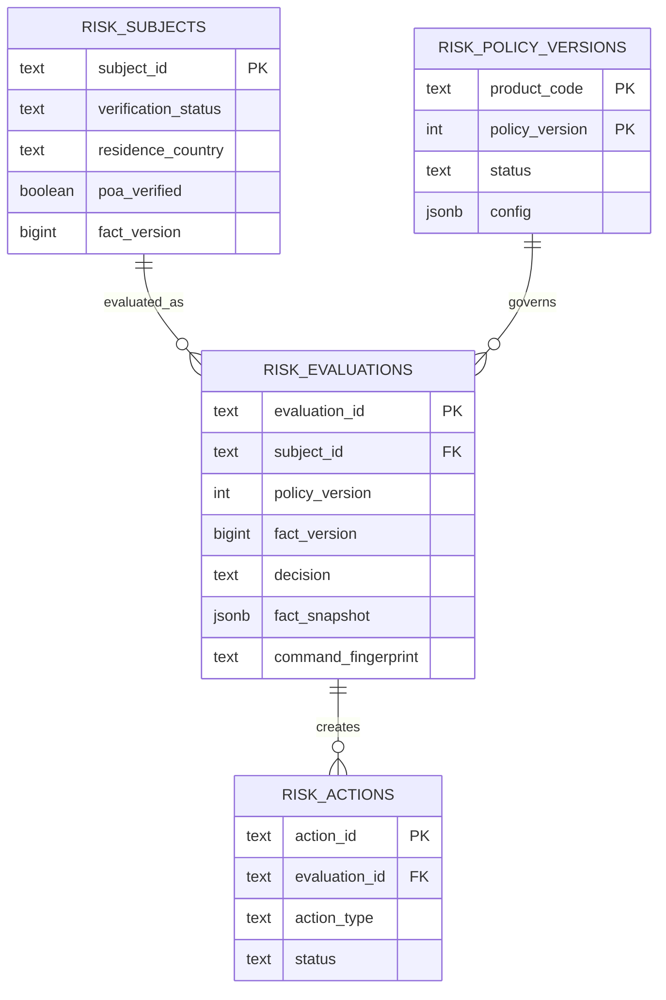

# 受评主体 + 能力准入统一风控实验方案

## 1. 结论

现有主体资料域与能力准入域不是两套互相竞争的风控系统，而是同一条决策链的两端：

- 受评主体域管理主体、事实、材料和验证结果；
- 能力准入域针对某项能力，在指定策略版本和事实版本上做一次决策；
- Action/Case 把不能立即放行或拒绝的问题变成可完成的补件或人工任务；
- Evaluation 保存不可变快照，回答“当时为什么得到这个结论”。

统一模型为：

```text
Subject Facts → Versioned Policy → Evaluation Snapshot → Decision
                                              ├── allow
                                              ├── review → Action/Case
                                              └── deny
```

## 2. 源码事实与设计推导

### 已由现有实现确认

- 登录身份、资金账户、组织和受评主体是不同概念；受评主体表示接受合规判断的自然人或法人。
- 受评主体域保存核验结果、身份证明、主体材料和地址等受信事实。
- 能力准入域以服务端可信身份和主体事实快照评估能力准入。
- 当前风险引擎输入由 factors、events、strategies、rules 组成，输出 pass/continue/block 与 actions。
- 补件、问卷和继续验证属于 Action，不应伪装成最终拒绝。
- 主体核验通过不等于能力已开通；准入通过也不等于外部渠道已经处理成功。

### 统一方案的推导

统一风控系统应有四个稳定模块：

1. `Subject Fact Store`：事实、证据、来源、有效期、事实版本；
2. `Policy Registry`：产品、场景、版本、发布时间和规则配置；
3. `Decision Engine`：纯计算，输出 decision、reason codes 和 action types；
4. `Case Orchestrator`：持久化待办、补件、人工审核和复评入口。

外部身份核验、企业主体核验、制裁筛查、设备风险和交易风险等都只负责贡献事实或信号，不直接偷偷修改能力状态。

## 3. 本地实验边界

实验服务是通用实现，没有复制任何来源系统的代码、表结构、模板、品牌或生产配置。

### 决策语义

| 决策 | 含义 | 是否创建 Action |
|---|---|---|
| `allow` | 当前事实满足当前策略 | 否 |
| `review` | 有机会补齐或需人工判断 | 是 |
| `deny` | 命中不可补救的硬拒绝 | 否 |

### 第一版策略

产品 `business_card` 的策略版本 1：

- verification 必须为 `approved`；
- POA 必须已验证；
- 居住国家在 `KP`、`IR` 中时直接拒绝；
- 缺少 verification 或 POA 时进入 review，并生成相应 Action。

国家代码仅用于本地规则分支演示，不代表真实业务政策。

## 4. 数据模型



## 5. 不变量

- 历史 Evaluation 的 fact snapshot、policy version 和 decision 不可被事实更新覆盖；
- 相同 `evaluation_id + command fingerprint` 返回原结果；
- 相同 evaluation_id 对应不同命令必须返回冲突；
- deny 优先于可补救 Action；
- 完成 Action 只更新事实并递增 fact_version，必须显式发起新 Evaluation 才能得到新决定；
- HTTP 返回、Evaluation 落库、Action 落库必须分别验收。

## 6. 实验结果（2026-10-25）

Kind 上实际观察到：

| 事实版本 | 关键事实 | 决策 | 原因/Action |
|---:|---|---|---|
| 1 | SG、verification approved、POA=false | review | poa_required / provide_poa |
| 2 | SG、verification approved、POA=true | allow | policy_satisfied |
| 3 | KP、verification approved、POA=true | deny | residence_country_denied |

精确重放版本 3 的 evaluation_id 时返回 `Idempotent-Replay: true`；PostgreSQL 中仍只有同一条评估。

## 7. 生产化差距

- Subject Fact 需要字段级来源、证据引用、有效期、置信度和访问控制；
- Policy 发布需要 maker-checker、灰度、回滚和模拟回放；
- 决策引擎需要超时、依赖不可用语义和 fail-open/fail-closed 分类；
- Case 需要 SLA、分派、备注、附件、四眼原则和审计；
- 需要 Outbox、事件流、指标、告警、PII 加密和数据保留策略；
- 需要把自动决策、平台合规结论、产品准入和外部渠道结果保持为不同状态机。
