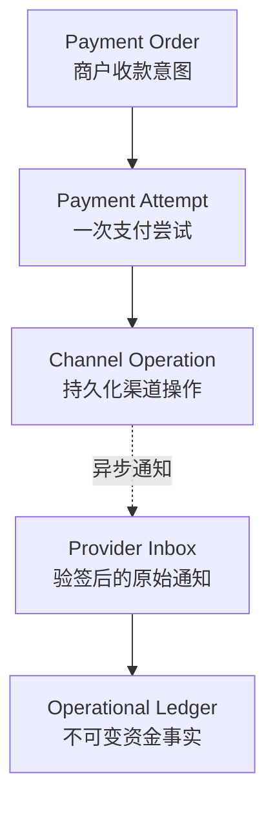
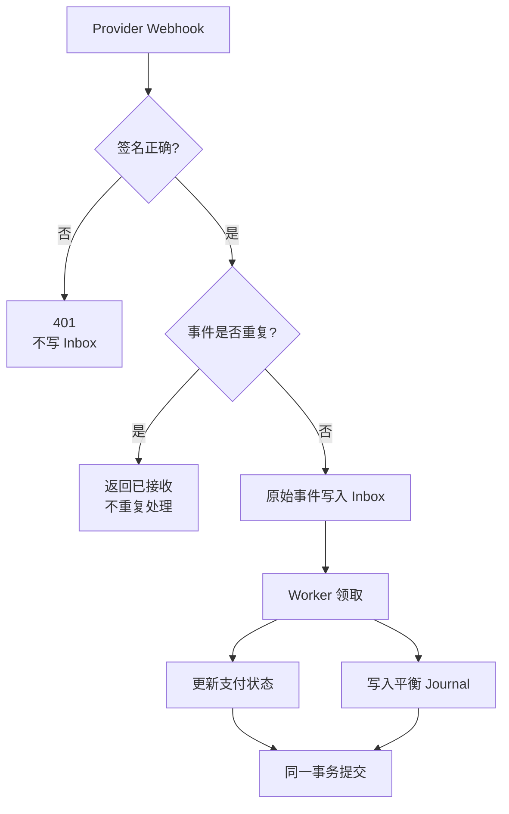
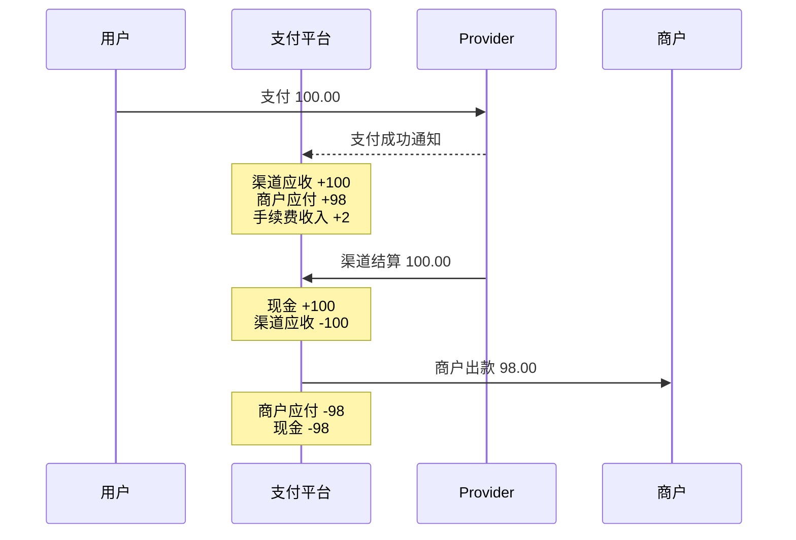
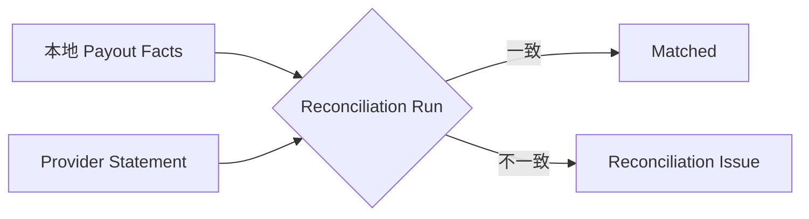
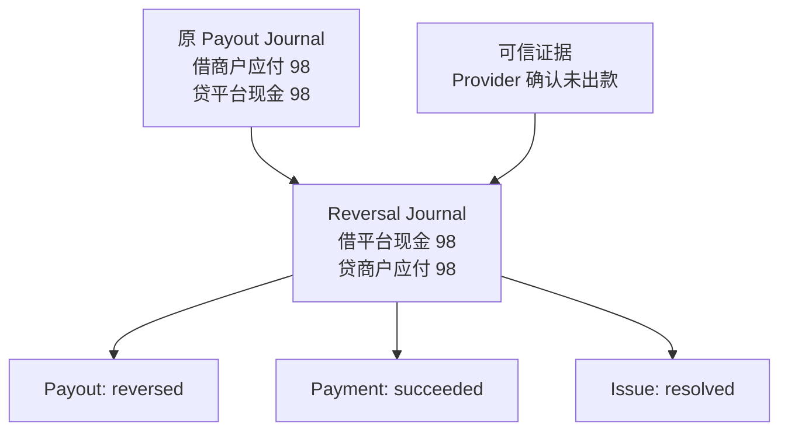
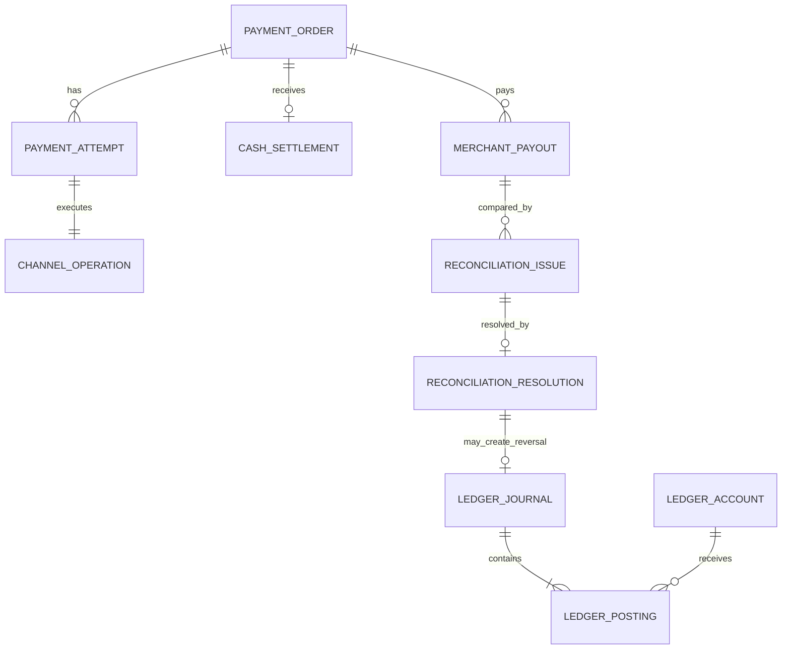
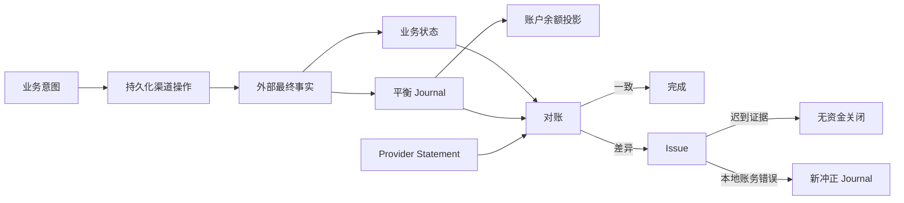

# 一笔支付之后，钱到底去了哪里：从渠道入金、商户出金到对账冲正的完整实战

> 这是一篇面向工程师的教练式实践文章。我们不连接真实支付渠道，不处理真实银行卡数据，只在本地 Kind 集群中，用合成数据走完支付成功、渠道入金、商户出金、对账、差异关闭与账务冲正。

很多支付系统在第一版中只有一个 `status=success`。

用户付款成功，它是 success；渠道说交易成功，它是 success；平台收到渠道资金，它还是 success；商户收到结算款，它仍然是 success。

这种设计看起来简单，却回答不了几个最基本的问题：

1. 用户支付成功时，平台是否已经收到现金？
2. 平台已经收到钱，是否代表商户也收到钱？
3. 渠道回调重复十次，会不会重复入账？
4. 平台记录“已出款”，但 Provider 对账单里没有，应该改数据库还是记一张新账？
5. 网络超时后，系统应该重试转账，还是查询原请求？

这次实践的目标，就是把这些容易混在一起的事实逐层拆开，并用数据库、API 和复式账本逐项验收。

---

## 一、先做一道判断题：支付成功，等于平台收到钱了吗？

答案是：**不一定。**

在典型收单链路中，至少存在四个不同的完成点：


为了避免歧义，本文统一使用以下术语：

| 术语 | 本文中的含义 | 不代表什么 |
|---|---|---|
| Payment Success | Provider 确认用户支付成功 | 平台已经收到现金 |
| Channel Receivable | 渠道尚欠平台的资金 | 平台银行账户余额 |
| Channel Cash Settlement | 渠道资金真正进入平台 | 商户已经收到钱 |
| Merchant Payable | 平台欠商户的净额 | 商户银行账户现金 |
| Merchant Payout | 平台确认向商户的转账已完成 | 仅仅创建了转账请求 |

最重要的原则是：

```text
支付状态、渠道状态、资金状态、商户出款状态
是四条有关联、但不能合并的状态线。
```

---

## 二、先认清五类事实，而不是先建一张大表

教练建议你在设计前，先问一句：**这条事实究竟由谁负责？**

本地实验中，我们把事实分为五类：



它们分别解决不同问题：

- `PaymentOrder`：商户想收多少钱，商户订单号是什么；
- `PaymentAttempt`：本次选择哪种支付方式、路由到哪个 Provider；
- `ChannelOperation`：请求有没有发出、结果是否未知、应该查询还是重试；
- `ProviderInbox`：原始通知是否验签、是否重复、是否已经处理；
- `Journal/Postings`：资金为什么发生变化、借贷是否平衡、能否审计重建。

不要把 Provider 的订单号当作本地支付单主键，也不要让回调直接修改余额字段。

---

## 三、贯穿全文的例子：用户支付 100 元

为了让每一步都能手工核对，我们固定一个例子：

```text
用户支付金额：100.00
平台手续费：  2.00
商户净额：   98.00
币种：USD（实验统一使用最小货币单位存储）
```

换成最小货币单位：

```text
amount_minor       = 10000
fee_minor          =   200
merchant_net_minor =  9800
```

数据库必须保存整数，不能用浮点数表示货币。

---

## 四、第一关：创建支付单，但此时一分钱都不能入账

创建支付单时，系统会在同一事务中写入：

```text
PaymentOrder      created
PaymentAttempt    provider_pending
ChannelOperation  pending
```

此时我们只拥有“收款意图”和“准备调用渠道”的事实，没有 Provider 成功证据，所以不能生成资金 Journal。

这一关重点验证幂等：

```text
相同幂等键 + 相同业务参数
→ 返回原 PaymentOrder

相同幂等键 + 不同金额或订单参数
→ 409 Conflict
```

幂等不是简单地“编号相同就成功”，而是需要保存请求指纹：

```text
business identity + normalized command fingerprint
```

这样才能区分“网络重试”和“错误地复用了同一个业务编号”。

---

## 五、第二关：Provider 回调成功，才形成第一张资金凭证

Provider 通知支付成功时，请求先经过安全与可靠性闸门：



支付 100 元、手续费 2 元时，平台视角的分录是：

```text
借：渠道应收资产       100.00
贷：商户应付负债        98.00
贷：平台手续费收入       2.00
```

为什么不是“借现金 100”？

因为 Provider 只确认用户支付成功，此时平台拥有的是对渠道的收款权利，即渠道应收，而不一定已经收到银行现金。

借贷检查：

```text
借方合计 = 100.00
贷方合计 = 98.00 + 2.00 = 100.00
```

如果 Worker 在状态更新和 Journal 提交之间崩溃，两者必须一起回滚，不能出现“订单成功但没有账”或“有账但订单仍处理中”。

---

## 六、第三关：渠道入金，把应收变成现金

当渠道真正向平台结算 100 元时，资金形态发生变化：

```text
借：平台现金资产       100.00
贷：渠道应收资产       100.00
```

注意，这一步没有创造新收入。手续费收入已经在支付成功时确认；渠道入金只是把一种资产——渠道应收，转换成另一种资产——平台现金。


验收后应看到：

```text
渠道应收 = 0
平台现金 = 100.00
商户应付 = 98.00
手续费收入 = 2.00
```

这里也存在另一条路径：如果支付后来退款，渠道可能把“应付给平台的钱”和“平台应退给渠道的钱”直接轧差。那是 Channel Net Settlement，不应虚构两次现金流。

---

## 七、第四关：商户出金，清偿平台负债

平台确认已经把 98 元转给商户后，分录是：

```text
借：商户应付负债        98.00
贷：平台现金资产        98.00
```

完成后：

```text
平台现金 = 2.00
商户应付 = 0
手续费收入 = 2.00
渠道应收 = 0
```

这 2 元正是平台保留的手续费。

完整资金链可以画成：



### 一个必须强调的生产边界

本地实验的出款接口模拟“外部转账已经最终成功”。正式系统不能收到 API 请求就直接记 `paid`，而应持久化出款操作：

```text
persist payout intent
        ↓
send provider request with stable request_id
        ↓
success / explicit failure / unknown
        ↓
unknown 必须查询原请求，禁止盲目重发
        ↓
最终成功后才记 Payout Journal
```

转账超时不等于失败。盲目使用新请求号重试，可能真的给商户转两次钱。

---

## 八、第五关：退款为什么不是“把余额加回来”

如果支付成功后、商户出款前发生全额退款，系统不能直接修改原 Journal，也不能只减一个余额字段。

新的退款事实对应新的 Journal：

```text
借：商户应付负债        98.00
借：平台手续费收入       2.00
贷：Provider 退款应付   100.00
```

它表达三件事：

1. 平台不再欠商户 98 元；
2. 平台退回原先确认的 2 元手续费收入；
3. 平台现在欠 Provider 100 元退款资金。

如果 Provider 后续采用轧差结算：

```text
借：Provider 退款应付   100.00
贷：渠道应收资产        100.00
```

退款、出款和渠道结算不是几个随意排列的 CRUD 操作，而是一组有前置条件的资金状态机。

---

## 九、第六关：对账只负责发现差异，不自动改账

系统内显示商户已经出款，不代表 Provider 报表一定包含这笔出款。

我们让系统比较两组事实：



实验中，Provider Statement 没有出现本地一笔 98 元 Payout，于是产生：

```text
issue_type = missing_provider_payout
expected_amount = 98.00
status = open
```

此时系统没有修改 Payment、Payout、Journal 或余额。

这是一个非常重要的边界：

```text
发现差异 ≠ 已经知道谁错了
发现差异 ≠ 获得修改账本的权限
```

---

## 十、第七关：两种证据，两条完全不同的处理路径

调查后可能得到两种结论。

### 情况 A：Provider 只是晚到了

如果可信证据证明出款确实完成，只是对账单延迟：

```text
open Issue
   ↓ 保存 evidence reference
resolved Issue
```

此时不应新增任何 Journal，因为原资金事实是正确的。

实验验收结果：

```text
首次关闭           → 201
相同请求重试       → 200，replayed=true
同一幂等键换证据   → 409
Journal 数量        → 不变
Payment/Payout      → 不变
```

### 情况 B：本地记了出款，但 Provider 证明钱没有发出

这时原资金效果确实错误，但仍然不能修改或删除原 Journal。

正确做法是新增一张冲正 Journal：



新 Journal 使用 `reversal_of` 指向旧 Journal：

```text
原 Journal：保持 posted，永不修改
新 Journal：posted，reversal_of = 原 Journal ID
```

修正完成后的余额回到出款前：

```text
平台现金 = 100.00
商户应付 = 98.00
手续费收入 = 2.00
```

随后使用新的业务身份重新出款，最终再次变成：

```text
平台现金 = 2.00
商户应付 = 0
手续费收入 = 2.00
```

整个历史链是完整的：

```text
第一次出款 Journal
        ↓ 被证据证明错误
冲正 Journal
        ↓ 使用新请求重新执行
第二次出款 Journal
```

审计人员可以看到发生过什么，而不是只看到一份被改写后的“完美结果”。

---

## 十一、数据库如何把业务事实和资金事实串起来

本地实验的核心关系如下：



你可以把它理解成三条互相引用的证据链：

```text
业务链：Payment → Payout
外部证据链：Statement → Issue → Resolution
资金链：Journal → Postings → Accounts → Balances
```

任何一个用户可见终态，都应该能沿着这三条链解释清楚。

---

## 十二、为什么接口不能让运营人员直接提交借贷分录

一个看似灵活的设计是：

```json
{
  "debit_account": "...",
  "credit_account": "...",
  "amount": 9800
}
```

但这相当于把总账写权限直接暴露给调用方。一旦权限、参数校验或操作流程出错，就可能形成任意调账后门。

本次实验采用业务级命令：

```text
CorrectMissingProviderPayout(issue_id, evidence_reference)
```

服务端自己完成：

1. 锁定 open Issue；
2. 确认类型是 `missing_provider_payout`；
3. 确认关联 Payout 当前是 `paid`；
4. 读取原 Payout Journal；
5. 自动翻转原 Posting 方向；
6. 写入唯一的 Reversal Journal；
7. 更新 Payout、Payment、Issue；
8. 在同一数据库事务提交。

调用方只能表达业务事实，不能自行决定会计分录。

---

## 十三、我们实际验收了什么

这次不是“接口返回 200 就算成功”，而是逐层检查。

### 1. 幂等

```text
首次执行                     → 创建一组事实
原请求精确重放               → 返回原结果
相同幂等键、不同业务参数     → 409
```

### 2. Webhook 安全

```text
正确签名     → Inbox 有一条记录
重复通知     → Inbox 仍只有一条
篡改正文     → 401，Inbox 没有记录
```

### 3. 账本平衡

每张 Journal 都检查：

```text
Posting 数量 >= 2
借方合计 = 贷方合计
币种一致
金额为正整数
```

### 4. 不可变历史

```text
已入账 Journal 不能修改
已入账 Posting 不能删除
错误只能通过新 Reversal Journal 修复
一张原 Journal 最多被冲正一次
```

### 5. 原子性

冲正路径中以下内容必须一起成功或一起失败：

```text
Resolution
Reversal Journal + Postings
Balance projection
Payout status
Payment status
Issue status
```

### 6. 部署证据

我们分别验证了：

- 单元与 PostgreSQL 集成测试；
- 多轮竞态测试；
- 静态检查；
- 镜像构建与本地 Registry；
- GitOps revision；
- Argo CD `Synced / Healthy`；
- 通过网关执行真实 API；
- 最终数据库事实和余额。

代码完成、测试通过、配置提交、集群部署和公众号发布是五种不同状态，不能互相推断。

---

## 十四、故障发生时，系统应该怎么想

| 故障点 | 错误做法 | 正确方向 |
|---|---|---|
| 创建支付接口超时 | 换新订单号再创建 | 使用原幂等键查询或重试 |
| Provider 请求超时 | 直接认定失败 | 标记 unknown，查询原 request ID |
| Webhook 重复 | 每次都更新状态和入账 | Inbox 唯一约束和幂等 Worker |
| 回调验签失败 | 先落库再说 | 在 Inbox 之前拒绝 |
| 对账不一致 | 自动修改余额 | 先创建 Issue，调查证据 |
| 出款确实未发生 | 删除原 Journal | 创建链接原 Journal 的冲正凭证 |
| 冲正后重新出款 | 复用旧请求身份 | 新业务身份、新请求 ID |

---

## 十五、本地实验与正式系统之间还有多远

本地实验已经验证了核心不变量，但生产环境至少还需要：

1. **真实出款编排**：持久化 Operation、固定 Provider Request ID、查询优先、退避和死信；
2. **证据真实性**：对账文件签名、文件摘要、Provider 查询结果、对象存储引用；
3. **权限与双人复核**：资金修正不能由普通运营单人执行；
4. **账期与批次**：按 Provider、币种、结算周期管理 Statement；
5. **部分退款与部分出款**：本地第一阶段只覆盖完整金额；
6. **多币种与汇兑**：一个 Journal 保持单币种，FX 使用成组凭证；
7. **拒付与争议**：Chargeback 不是普通退款，需要独立状态机；
8. **对账运营台**：Issue 分派、证据附件、审批、处理时限和审计日志；
9. **观测与告警**：unknown 操作、Inbox 积压、未平差项、余额异常；
10. **灾难恢复**：从不可变事实重建余额投影，并与外部 Statement 复核。

---

## 十六、最后总结：真正可靠的出入金系统，靠的不是一个余额字段

这次实践最值得带走的，不是某个表名或接口，而是六条设计原则：

1. **区分支付成功、渠道入金和商户出金。**
2. **先保存业务意图，再执行外部资金操作。**
3. **外部结果未知时查询优先，不能盲目重发。**
4. **所有资金变化都形成平衡、不可变的 Journal。**
5. **对账先发现问题，证据决定如何处理。**
6. **账务错误通过新凭证冲正，永远不改写历史。**

可以把整套系统浓缩成下面这张图：



当系统能够回答“谁说这笔钱成功了、什么时候算最终完成、为什么是这个余额、重复请求会怎样、出错后如何留下证据地恢复”，它才真正从一组支付接口，成长为一套可信的资金系统。

---

> 本文所有名称、编号、金额和 Provider 都是本地实验数据，不对应任何真实用户、商户、渠道或生产系统。示例用于讲解系统设计与验证方法，不构成会计、合规或支付牌照建议。
