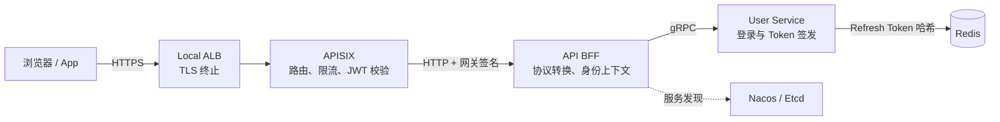
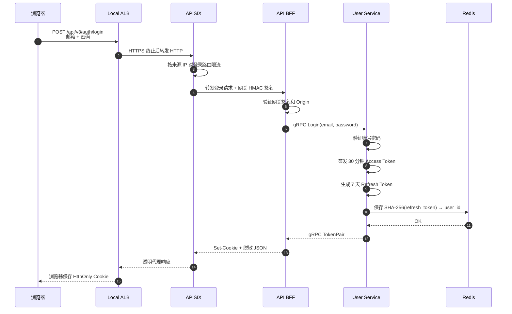
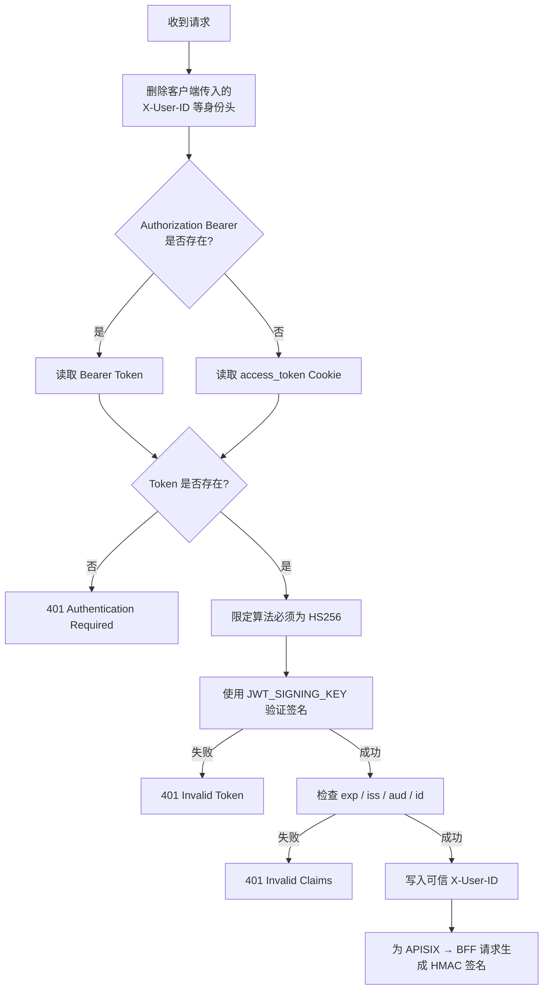
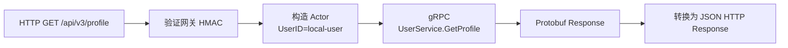
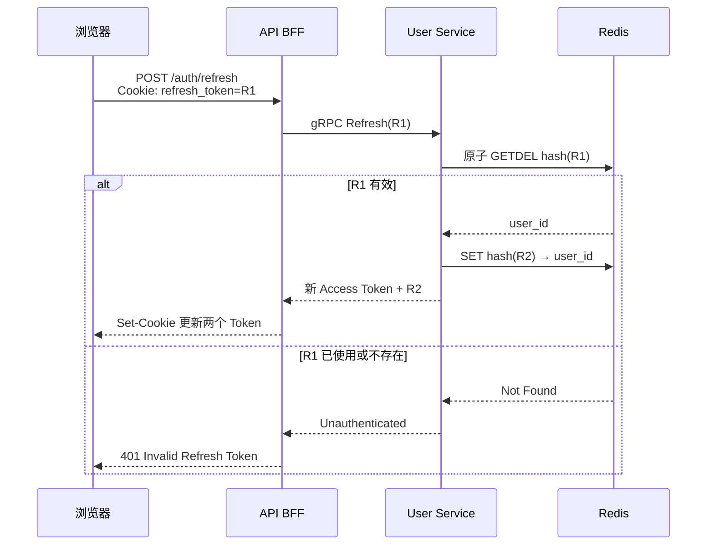
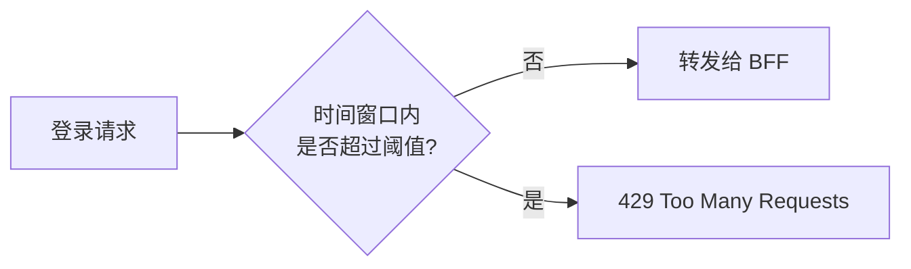
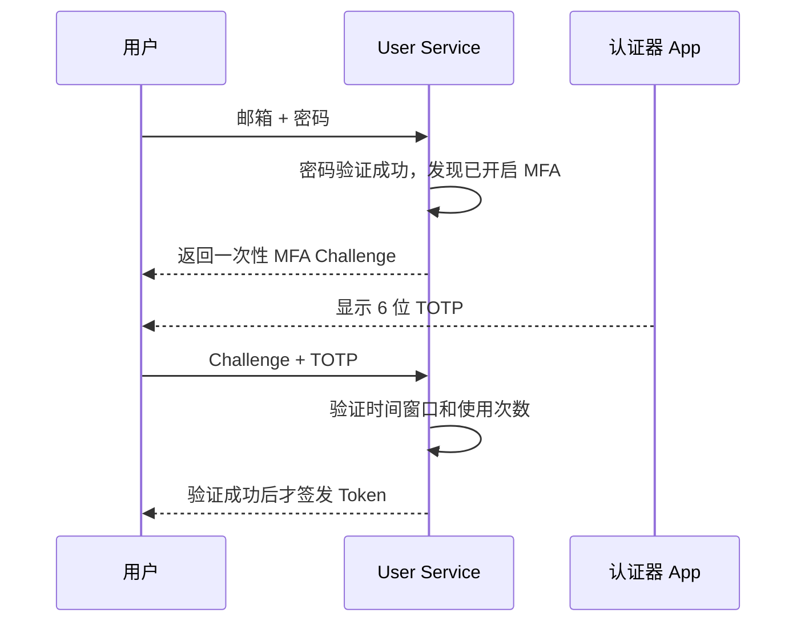
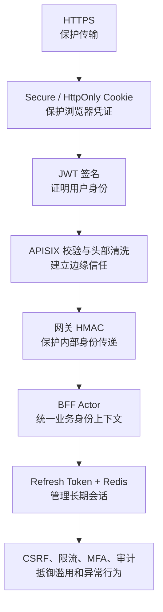

# 从一次登录开始，讲清 JWT、Cookie、Refresh Token 与 API 网关安全

很多系统的登录功能看起来只有一个表单：输入账号和密码，点击登录，然后进入首页。

但在一个由 API 网关、BFF 和微服务组成的系统里，这个简单动作背后至少包含六个问题：

1. 谁负责验证密码？
2. 登录成功后，如何证明用户身份？
3. 网关如何验证身份凭证没有被篡改？
4. BFF 为什么敢相信网关注入的用户 ID？
5. Access Token 过期后，怎样在不重新输入密码的情况下续期？
6. Cookie、CSRF、HTTPS 和限流分别在防什么？

本文从一套可在本地 Kubernetes 中运行的微服务登录系统出发，完整拆解这条认证链路。你不需要预先理解 JWT、gRPC 或密码学，读完就能知道每一层为什么存在，以及它们组合起来如何形成纵深防御。

---

## 一、先看全局：每个组件只负责一件事

这套系统包含以下组件：

- Local ALB：模拟云负载均衡器，并终止 HTTPS。
- APISIX：API 网关，负责路由、JWT 验证、身份请求头清洗和登录限流。
- API BFF：把浏览器 HTTP 请求转换为内部 gRPC 调用，并验证请求确实来自可信网关。
- User Service：验证账号密码，签发 Access Token 和 Refresh Token。
- Redis：保存 Refresh Token 的哈希，使长期会话可以撤销和轮换。
- Nacos/Etcd：服务注册与发现，不直接参与用户认证。

整体结构如下：



这里最重要的设计原则是：认证不是一个组件包办所有工作，而是把不同信任责任分开。

| 组件 | 信任责任 |
|---|---|
| User Service | 证明“这个用户是谁” |
| APISIX | 证明“这个用户凭证有效” |
| API BFF | 证明“这份身份信息确实来自可信网关” |
| Redis | 证明“这个长期会话仍然有效且未被使用” |

---

## 二、一次登录到底发生了什么

用户提交邮箱和密码后，请求依次经过 ALB、APISIX 和 BFF，最终由 User Service 验证密码并签发 Token。



登录请求示例：

```http
POST /api/v3/auth/login HTTP/1.1
Host: localhost:18443
Origin: https://localhost:18443
Content-Type: application/json

{
  "email": "demo@local.test",
  "password": "local-demo-password"
}
```

登录成功后的响应示例：

```http
HTTP/1.1 200 OK
Content-Type: application/json
Set-Cookie: access_token=<JWT>; Path=/; Max-Age=1800; Secure; HttpOnly; SameSite=Strict
Set-Cookie: refresh_token=<OPAQUE_TOKEN>; Path=/api/v3/auth; Max-Age=604800; Secure; HttpOnly; SameSite=Strict
Set-Cookie: csrf_token=<RANDOM_TOKEN>; Path=/api/v3/auth; Max-Age=604800; Secure; SameSite=Strict

{
  "authenticated": true,
  "expiresIn": 1800,
  "tokenType": "Bearer"
}
```

注意响应 JSON 中没有 Access Token 和 Refresh Token。浏览器只通过 `Set-Cookie` 接收它们，前端 JavaScript 不需要、也不应该读取登录凭证。

---

## 三、Access Token：一张带防伪签名的短期身份证

Access Token 使用 JWT。一个 JWT 由三部分组成：

```text
Base64URL(Header).Base64URL(Payload).Signature
```

Header 描述签名算法：

```json
{
  "alg": "HS256",
  "typ": "JWT"
}
```

Payload 保存身份声明：

```json
{
  "id": "local-user",
  "entity_id": "local-user",
  "account_type": "personal",
  "iss": "local-platform-lab",
  "aud": "api-bff",
  "iat": 1792300000,
  "exp": 1792301800
}
```

签名计算可以简化为：

```text
signature = HMAC-SHA256(
  base64url(header) + "." + base64url(payload),
  JWT_SIGNING_KEY
)
```

JWT 的 Payload 只是编码，不是加密。任何拿到 Token 的人都能解码并看到 Claims，所以 JWT 中不能存密码、银行卡号或其他秘密。

JWT 的安全性来自签名。如果攻击者把用户 ID 改成管理员，Payload 就会变化，原签名随即失效。攻击者没有签名密钥，无法生成新的合法签名。

### 为什么 Access Token 要短期有效

Access Token 是无状态凭证。APISIX 只需验证签名和过期时间，不必每次查询数据库或 Redis，因此速度很快。

代价是：Token 一旦签发，在有效期内很难立即撤销。将有效期控制在 15～30 分钟，可以限制 Token 泄漏后的攻击窗口。

---

## 四、APISIX 如何验证 JWT

浏览器通过 Cookie 携带 Access Token：

```http
GET /api/v3/profile HTTP/1.1
Host: localhost:18443
Cookie: access_token=<JWT>
```

App 或命令行也可以使用 Bearer Token：

```http
GET /api/v3/profile HTTP/1.1
Authorization: Bearer <JWT>
```

APISIX 的验证流程如下：



为什么第一步必须删除 `X-User-ID`？因为请求头是客户端可以随意填写的：

```http
X-User-ID: admin
```

如果后端直接相信这个值，攻击者就能冒充任何用户。正确做法是 APISIX 先删除所有外部身份头，再根据验证通过的 JWT 重新生成可信身份。

---

## 五、为什么 JWT 验证通过后还要做网关签名

APISIX 会把验证后的用户身份写进内部请求头：

```http
X-Authenticated: true
X-Auth-Method: jwt
X-User-ID: local-user
```

但 BFF 还需要回答一个问题：这些请求头真的是 APISIX 写的吗？

如果攻击者绕过 APISIX，直接访问 BFF，也可以伪造相同请求头。因此 APISIX 使用另一套独立密钥，为发往 BFF 的请求生成 HMAC 签名。

签名原文包括：

```text
HTTP Method
Request URI
Timestamp
User ID
```

内部请求示例：

```http
GET /api/v3/profile HTTP/1.1
Host: api-bff.api-bff.svc.cluster.local
X-Authenticated: true
X-Auth-Method: jwt
X-User-ID: local-user
X-Gateway: apisix
X-Gateway-Timestamp: 1792300000
X-Gateway-Signature: <HMAC_SIGNATURE>
```

BFF 使用 `GATEWAY_SIGNATURE_KEY` 重新计算签名，只有以下条件全部成立才接受身份：

- `X-Gateway` 明确标识为 APISIX；
- HMAC 签名完全一致；
- 时间戳在允许窗口内；
- 请求方法、URI 和用户 ID 没被修改。

这里必须使用两套不同密钥：

| 密钥 | 持有方 | 证明什么 |
|---|---|---|
| `JWT_SIGNING_KEY` | User Service、APISIX | 用户凭证由身份服务签发 |
| `GATEWAY_SIGNATURE_KEY` | APISIX、API BFF | 内部身份请求头来自可信网关 |

密钥分离意味着其中一层泄漏时，不会自动击穿另一层。

---

## 六、BFF 如何把 HTTP 变成 gRPC

BFF 验证网关签名后，将用户身份放入当前请求的 Context，然后调用 User Service：



内部 gRPC 请求在逻辑上相当于：

```protobuf
GetProfileRequest {
  user_id: "local-user"
}
```

gRPC 回包：

```protobuf
GetProfileResponse {
  user_id: "local-user"
  verification_status: "not_started"
}
```

BFF 转换后的 HTTP 回包：

```http
HTTP/1.1 200 OK
Content-Type: application/json

{
  "userId": "local-user",
  "verificationStatus": "not_started",
  "source": "user-service-grpc"
}
```

BFF 不再从客户端原始请求中读取 `X-User-ID`，只使用经过网关验证后写入 Context 的 Actor。

---

## 七、Refresh Token：让短期 Token 可以安全续期

如果 Access Token 只有 30 分钟，用户是否每半小时就要重新输入密码？

不需要。系统使用一个有效期更长的 Refresh Token 换取新的 Token。

Access Token 和 Refresh Token 的本质不同：

| 对比 | Access Token | Refresh Token |
|---|---|---|
| 形式 | 带签名的 JWT | 密码学安全随机字符串 |
| 有效期 | 短，例如 30 分钟 | 长，例如 7 天 |
| 主要用途 | 访问业务接口 | 换取新 Token |
| 验证方 | APISIX | User Service + Redis |
| 服务端存储 | 通常不保存 | 只保存哈希 |

Refresh Token 的生成方式是：

```text
crypto/rand 生成 32 字节随机数
        ↓
Base64URL 编码
        ↓
返回浏览器原文
        ↓
SHA-256 哈希后存入 Redis
```

Redis 中保存的是：

```text
auth:refresh:<SHA256(token)> → user_id
```

即使 Redis 数据泄漏，攻击者拿到的也是哈希，不能直接把它作为 Refresh Token 使用。

---

## 八、一次性轮换如何防止 Refresh Token 重放

Refresh Token 不能无限重复使用。每次刷新都要消费旧 Token，并生成新 Token。



`GETDEL` 是关键：读取和删除必须是一个原子操作。否则两个并发刷新请求可能同时读到旧 Token，造成一个 Refresh Token 被成功使用两次。

---

## 九、Cookie 和 Authorization 到底是什么关系

JWT 是身份凭证；Cookie 和 Authorization 是携带凭证的两种信封。

浏览器 Web 更适合 Cookie：

```http
Cookie: access_token=<JWT>
```

手机 App、命令行和开放 API 更适合 Authorization：

```http
Authorization: Bearer <JWT>
```

| 对比 | Cookie | Authorization |
|---|---|---|
| 谁添加 | 浏览器自动携带 | 前端或客户端主动添加 |
| JavaScript 是否必须持有 Token | HttpOnly 时不需要 | 通常需要 |
| 主要风险 | CSRF | XSS、日志或本地存储泄漏 |
| 常见场景 | 浏览器登录 | App、CLI、开放 API |

当两者同时存在时，系统必须规定固定优先级。本系统优先使用 Authorization；如果 Header 中的 Token 无效，直接拒绝，不再偷偷回退到 Cookie，避免身份混淆。

---

## 十、Cookie 的三个重要安全属性

### 1. HttpOnly

前端 JavaScript 无法通过 `document.cookie` 读取 Token，降低 XSS 直接窃取凭证的风险。

### 2. Secure

浏览器只会通过 HTTPS 发送 Cookie，防止 Token 经明文 HTTP 传输。

### 3. SameSite=Strict

浏览器不会在大多数跨站请求中自动携带 Cookie，降低 CSRF 风险。

Refresh Token 还设置了更窄的 Path：

```text
Path=/api/v3/auth
```

这意味着访问普通业务接口时，浏览器不会发送 Refresh Token，从而减少长期凭证的暴露面。

---

## 十一、为什么有 SameSite 还需要 CSRF Token

Cookie 的特点是浏览器自动携带。攻击者可以诱导已经登录的用户访问恶意网站，由恶意网站发起请求：

```html
<form action="https://api.example.com/api/v3/auth/logout" method="POST">
</form>
```

这类攻击叫 CSRF，即跨站请求伪造。

系统采用两层校验：

1. `Origin` 必须等于允许的前端地址；
2. 请求头 `X-CSRF-Token` 必须和 `csrf_token` Cookie 完全一致。

合法刷新请求示例：

```http
POST /api/v3/auth/refresh HTTP/1.1
Origin: https://localhost:18443
Cookie: refresh_token=<TOKEN>; csrf_token=<CSRF_TOKEN>
X-CSRF-Token: <CSRF_TOKEN>
```

攻击者的网站可能诱导浏览器携带 Cookie，却无法读取受同源策略保护的 CSRF Cookie，也无法构造匹配的自定义请求头。

失败示例：

```http
HTTP/1.1 403 Forbidden
Content-Type: application/json

{"error":"invalid csrf token"}
```

---

## 十二、HTTPS 在保护什么

没有 HTTPS 时，同一网络中的攻击者可能读取或修改：

- 登录密码；
- Access Token 和 Refresh Token；
- CSRF Token；
- 接口请求和业务数据。

HTTPS 提供三项核心保证：

- 机密性：第三方无法读取传输内容；
- 完整性：数据在传输中无法被悄悄修改；
- 服务端身份：证书证明客户端连接的是目标服务。

本地环境可以使用自签名证书演练 TLS、Secure Cookie 和证书挂载。生产环境则应使用正式域名和受信任 CA 签发的证书。

---

## 十三、登录限流为什么放在 API 网关

密码接口最常见的攻击是暴力破解和撞库。如果每个恶意请求都进入 BFF 和 User Service，会浪费大量资源。

APISIX 在最前端按来源 IP 对登录路由限流：



超限响应示例：

```http
HTTP/1.1 429 Too Many Requests
Content-Type: application/json

{"error":"too many authentication requests"}
```

生产环境通常还会组合多种维度：来源 IP、账号、设备标识、ASN、国家地区和失败次数。单纯按 IP 限流只是第一层，因为攻击者可能使用代理池分散请求。

---

## 十四、MFA 与 TOTP：密码泄漏后的第二道门

密码属于“你知道的信息”。MFA 要求用户再提供另一种不同类型的因素，例如“你拥有的设备”。

TOTP 是最常见的 MFA 方式之一。认证器 App 与服务端共享一个随机 Secret，并根据当前时间窗口独立计算 6 位验证码：

```text
TOTP = Truncate(HMAC-SHA1(secret, floor(timestamp / 30)))
```

典型流程如下：



注意：密码验证成功后不能立即签发正式 Token，只能返回短期、单用途的 Challenge。否则攻击者可以绕过第二步。

TOTP 能抵御“只有密码泄漏”的攻击，但无法完全抵御实时钓鱼。更强的方案是 Passkey/WebAuthn，因为它会验证网站域名，并使用设备中的私钥完成签名。

---

## 十五、这套设计分别抵御哪些攻击

| 攻击方式 | 防护机制 |
|---|---|
| 修改 JWT 中的用户 ID | JWT 签名校验 |
| 使用过期 Token | `exp` 校验 |
| 使用其他系统签发的 Token | `iss`、`aud` 校验 |
| JWT 算法降级 | 只允许指定算法 |
| 伪造 `X-User-ID` | APISIX 先清除再重建 |
| 绕过网关直接调用 BFF | 网关 HMAC 签名 |
| Redis 数据泄漏后直接刷新 | 只存 Refresh Token 哈希 |
| 重复使用旧 Refresh Token | 原子消费与轮换 |
| 跨站刷新或退出 | Origin + CSRF Token |
| JavaScript 读取登录凭证 | HttpOnly Cookie |
| 明文网络窃听 | HTTPS + Secure Cookie |
| 密码暴力破解 | APISIX 登录限流 |

这就是纵深防御：安全性不是来自“用了 JWT”这一个事实，而是不同层分别守住不同边界。

---

## 十六、仍需继续建设的生产能力

本地环境已经可以验证认证架构，但生产系统仍应继续补充：

1. 使用 Argon2id 或 bcrypt 哈希真实密码；
2. 将 HS256 升级为 RS256/ES256，让网关只持有公钥；
3. 使用 `kid` 和 JWKS 完成无感密钥轮换；
4. Refresh Token 重放后撤销整个 Token Family；
5. 记录登录、刷新、退出、失败原因和设备信息；
6. 为高风险操作增加 MFA 或重新验证密码；
7. 使用 KMS、Vault 或 Secrets Manager 托管生产密钥；
8. 对内部 gRPC 启用 mTLS；
9. 建立异常登录检测、告警和应急会话撤销流程。

本地应该完成安全机制和自动化测试，预发布环境完成基础设施集成与压力测试，生产环境只注入正式域名、密钥、外部服务商和监控策略。

---

## 十七、总结：安全登录是一条信任链

回到开头，一个登录表单背后真正建立的是一条信任链：



可以把它记成一句话：

> User Service 签发身份，APISIX 验证身份，BFF 消费可信身份，Redis 管理长期会话，HTTPS 和浏览器安全策略保护整条传输链路。

当每个组件只承担清晰、最小的安全责任时，系统不仅更安全，也更容易测试、演进和排查问题。
