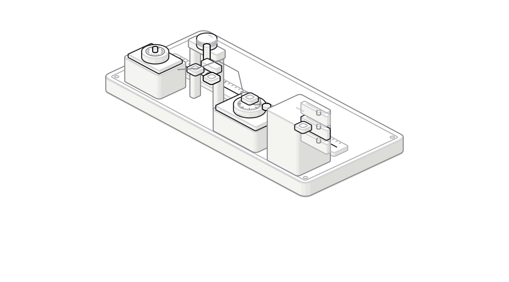

# 从 JWT 到可撤销会话：我们在本地 Kubernetes 集群落地 BFF 认证治理

很多系统把“JWT 验签通过”当作认证的终点。真正开始处理退出登录、设备管理、账号封禁、Token 泄露和多端登录后，很快就会发现：一个完全无状态的 JWT，很难承担完整的会话治理。

这次我们没有停留在架构图上，而是在本地 Kind Kubernetes 集群里搭建并手工验证了一套完整链路：

- user-service 使用 Ed25519 私钥签发 Access Token；
- BFF 通过 JWKS 获取公钥并验证 JWT；
- Redis 保存设备会话、Refresh Token 和用户认证版本；
- APISIX 清理客户端伪造的身份头，并用 HMAC 证明请求来自可信网关；
- Cookie、CSRF、Refresh Token 轮换共同保护浏览器登录；
- `sid` 实现单设备下线，`ver` 实现全账号凭证换代；
- 通过一次真实的安全测试，发现并修复了“直连 BFF 绕过网关”的问题。

本文会讲清楚每个字段为什么存在、每层在防什么，以及我们是如何一步步手工验收的。



## 一、先明确边界：四个组件各自负责什么

本地链路可以概括为：

```text
浏览器
  │ HTTPS + Cookie + CSRF
  ▼
本地 ALB（TLS 终止）
  │ HTTP
  ▼
APISIX
  ├─ 路由、限流
  ├─ 删除客户端传入的 X-User-* 等身份头
  └─ 对发往 BFF 的请求生成 HMAC 网关签名
  │ HTTP + X-Gateway-*
  ▼
API BFF
  ├─ 强制验证网关 HMAC
  ├─ 从 Cookie 读取 Access Token
  ├─ 使用 JWKS 公钥验证 JWT
  ├─ 检查 sid、ver 和 Session 状态
  └─ 把可信用户身份传给下游
  │ gRPC
  ▼
user-service
  ├─ 验证账号、密码或其他登录因子
  ├─ 持有 Ed25519 私钥并签发 JWT
  ├─ 生成并轮换 Refresh Token
  └─ 维护 Redis 中的认证状态
```

这里有一个重要选择：JWT 验证放在 BFF，而不是只交给 APISIX。

原因是签名正确只回答“这个 Token 是否由可信签发方生成、内容是否被篡改”；BFF 还要结合 Redis 回答以下业务问题：

- 这个设备会话是否已经退出或被管理员撤销？
- 用户是否刚修改密码，需要让所有旧 Token 失效？
- 这个 Refresh Token 是否已经被使用过？
- 当前接口是否需要更强的认证方式，例如 TOTP 或 Passkey？

APISIX 继续负责统一入口和网络边界，BFF 负责认证语义与会话策略，二者不是重复劳动。

## 二、系统里其实有两套签名

讨论认证时，最容易混淆的是 JWT 签名和网关 HMAC。它们解决的是两个不同问题。

| 机制 | 算法与密钥 | 谁生成 | 谁验证 | 解决的问题 |
|---|---|---|---|---|
| JWT 签名 | EdDSA + Ed25519 私钥/公钥 | user-service | BFF | Token 是否由可信认证服务签发、内容是否被修改 |
| 网关签名 | HMAC-SHA256 + 共享密钥 | APISIX | BFF | 当前 HTTP 请求是否经过可信网关、身份头是否可信 |

### 1. JWT 为什么用 Ed25519

user-service 独占私钥，BFF 只得到公钥。即使 BFF 被入侵，攻击者也只能验证已有 Token，不能伪造新 Token。

JWKS 暴露的是公开信息：

```json
{
  "keys": [
    {
      "alg": "EdDSA",
      "crv": "Ed25519",
      "kid": "local-auth-1",
      "kty": "OKP",
      "use": "sig",
      "x": "<base64url-public-key>"
    }
  ]
}
```

`kid` 是密钥编号，不是公钥本身；`x` 才是公钥材料。JWKS 中没有私钥参数，私钥只存在于 user-service 可读取的 Kubernetes Secret 中。

### 2. HMAC 为什么仍然需要

JWT 能证明用户身份，却不能证明请求一定经过 APISIX。如果 BFF Service 被错误暴露，客户端可能绕过网关，直接提交伪造的 `X-User-ID`。

因此 APISIX 使用独立共享密钥，对请求的关键字段计算 HMAC，并在 Header 中发送签名、时间戳等信息。BFF 必须先验证这些字段，才接受网关提供的上下文。

```http
X-Gateway: apisix
X-Gateway-Timestamp: 1792553176
X-Gateway-Signature: <hmac-sha256>
```

HMAC 不是加密，不能隐藏请求内容；它提供的是完整性和来源证明。APISIX 和 BFF 必须持有同一份 HMAC 共享密钥。

## 三、登录完成后，浏览器到底拿到了什么

登录请求通过 HTTPS 发送：

```http
POST /api/v3/auth/login HTTP/1.1
Host: localhost:18443
Origin: https://localhost:18443
Content-Type: application/json

{
  "email": "demo@local.test",
  "password": "<redacted>"
}
```

响应正文刻意不返回 Token：

```http
HTTP/1.1 200 OK
Set-Cookie: access_token=<jwt>; HttpOnly; Secure; SameSite=Strict; Path=/
Set-Cookie: refresh_token=<opaque-random-token>; HttpOnly; Secure; SameSite=Strict; Path=/api/v3/auth
Set-Cookie: csrf_token=<random-token>; Secure; SameSite=Strict; Path=/
Content-Type: application/json

{
  "authenticated": true,
  "expiresIn": 1800,
  "tokenType": "Bearer"
}
```

Access Token 和 Refresh Token 是 `HttpOnly` Cookie，浏览器脚本无法直接读取，减少 XSS 窃取 Token 的风险。CSRF Token 需要被前端读取并放进 `X-CSRF-Token`，所以不能设置 `HttpOnly`。

`Secure` 表示只通过 HTTPS 携带；`SameSite=Strict` 限制跨站自动携带；服务端还会校验 `Origin` 和双提交 CSRF Token。它们是叠加关系，而不是三选一。

## 四、Access Token 中的字段分别做什么

我们手工解码过一个 Access Token。脱敏后的 Payload 如下：

```json
{
  "iss": "local-platform-lab",
  "aud": "api-bff",
  "sub": "local-user",
  "sid": "device-session-example",
  "jti": "access-token-example",
  "ver": 1,
  "amr": ["pwd"],
  "auth_time": 1792553176,
  "iat": 1792553176,
  "exp": 1792554976
}
```

这些字段可以分成四组：

- `iss`、`aud`：限制谁签发、给谁使用，避免 Token 被另一个系统误接受；
- `sub`：用户唯一标识；
- `sid`：设备会话标识，一次登录产生一个 Session；
- `jti`：单枚 Access Token 的唯一编号，每次刷新都会改变；
- `ver`：用户级认证版本，用来让全账号旧凭证一起失效；
- `amr`：本次登录完成了哪些认证方式，例如 `pwd`、`totp`、`passkey`；
- `auth_time`：用户真正完成认证的时间，刷新 Token 时不应冒充为重新登录；
- `iat`、`exp`：当前 Access Token 的签发时间和过期时间，单位为秒级 UNIX 时间戳。

JWT 的 Header 与 Payload 只是 Base64URL 编码，不是加密。前端和任何拿到 Token 的人都能解码，所以里面不能存密码、私钥、TOTP Secret 等秘密。安全性来自签名不可伪造，而不是内容不可见。

## 五、Redis 把“无状态 JWT”升级成可治理会话

### 1. 设备会话

`sid` 对应 Redis Key：

```text
auth:session:{sid}
```

值是会话状态：

```json
{
  "ID": "device-session-example",
  "UserID": "local-user",
  "UserVersion": 1,
  "AuthMethods": ["pwd"],
  "AuthenticatedAt": 1792553176,
  "Status": "active"
}
```

Access Token 有效期是 30 分钟，当前设备会话 TTL 接近 7 天。Session 不是每次刷新都重新延长 7 天，而是固定窗口。这样即使用户持续刷新，也不能无限续期。

当 `Status` 从 `active` 变为 `revoked`，同一个 `sid` 下尚未过期的所有 Access Token 都会立即失效。这就是“退出某台设备”或“管理员踢下线”的基础。

### 2. 用户全局认证版本

```text
auth:user-version:{userID} -> 1
```

BFF 会同时比较：

```text
JWT.ver == Session.UserVersion == Redis 中的用户全局版本
```

修改密码、账号发生高风险事件或管理员执行“全部设备退出”时，只需要将全局版本从 1 增加到 2。所有仍携带 `ver=1` 的旧 Token 和旧 Session 都会被拒绝，新登录签发 `ver=2`。

因此 `ver` 不是某台设备独有的运营字段。Session 中保存一份版本快照，而真正的全局开关是 `auth:user-version:{userID}`。

### 3. Refresh Token

Refresh Token 本身是高熵随机字符串，不是 JWT。Redis 不保存明文，只保存它的 SHA-256：

```text
auth:refresh:{sha256(refreshToken)} -> userID|sid
```

即使 Redis 数据被读到，攻击者也不能直接拿哈希值作为 Refresh Token 使用。Key 自身有 TTL，过期后不能再刷新。

### 4. jti 为什么没有单独的 Redis Key

当前实现中，`jti` 只存在于 JWT 和日志/审计上下文中，没有为每枚 Access Token 建立 Redis 记录。正常验证依赖 `exp + sid + ver`。

如果未来需要只撤销某一枚 Access Token，可以增加：

```text
auth:revoked-jti:{jti} -> 1
TTL = 这枚 Access Token 的剩余寿命
```

这是一种按需黑名单，不应无期限保存所有 `jti`。

## 六、一次完整请求如何被验证

普通接口的校验顺序如下：

```text
请求到达 BFF
  │
  ├─ 1. 是否存在完整的 X-Gateway-* Header？
  ├─ 2. HMAC 是否匹配，时间戳是否在允许窗口内？
  ├─ 3. Access Token 结构、alg、kid 是否符合预期？
  ├─ 4. 使用 JWKS 中对应公钥验证 Ed25519 签名
  ├─ 5. iss、aud、iat、exp 是否有效？
  ├─ 6. auth:session:{sid} 是否存在且 Status=active？
  ├─ 7. Session.UserID 是否等于 JWT.sub？
  ├─ 8. JWT.ver、Session.UserVersion、全局 ver 是否一致？
  └─ 9. 生成内部可信认证上下文，调用下游 gRPC 服务
```

任一步失败，都不能把客户端提供的用户 ID 当成可信身份。

这也解释了为什么即使客户端发送：

```http
X-User-ID: administrator
```

服务仍然返回 JWT 中的 `sub=local-user`。APISIX 会删除外部身份头，BFF 又从已经验签并完成会话校验的 Token 重建身份。

## 七、Refresh Token 轮换和重放防护

刷新请求需要 Cookie、可信 Origin 和 CSRF Header：

```http
POST /api/v3/auth/refresh HTTP/1.1
Origin: https://localhost:18443
Cookie: refresh_token=<opaque>; csrf_token=<csrf>
X-CSRF-Token: <csrf>
```

user-service 使用 Redis `GETDEL` 原子消费旧 Refresh Token：

```text
读取并删除旧 Refresh Token Hash
  ├─ 不存在：返回 401
  └─ 存在：检查 sid、ver 和 Session 状态
             ↓
          签发新 Access Token
             +
          生成新 Refresh Token
```

我们的实测结果是：

- Access Token 已轮换；
- Refresh Token 已轮换；
- `sid` 保持不变；
- `jti`、`iat`、`exp` 改变；
- Session TTL 没有重置回 7 天；
- Redis 中旧 Refresh Token Hash 不存在，新 Hash 存在；
- 再次提交旧 Refresh Token，返回 HTTP 401。

示例响应：

```json
{
  "authenticated": true,
  "expiresIn": 1800,
  "tokenType": "Bearer"
}
```

旧 Token 重放：

```http
HTTP/1.1 401 Unauthorized
Content-Type: application/json

{
  "error": "invalid refresh token"
}
```

需要诚实说明：当前是“一次性轮换”，还不是完整的 Token Family 重用检测。如果攻击者先于用户使用了被窃取的 Refresh Token，攻击者会拿到新 Token，随后用户只会看到旧 Token 失效。生产方案还应为同一次登录建立 Refresh Token Family；任何已消费 Token 再次出现时，撤销整个 Family 和对应 Session，并触发安全告警。

## 八、我们如何手工验证单设备与全账号失效

### 实验一：撤销一个 Session

我们把指定 Session 的状态改成 `revoked`，保留原 TTL，再用原来的合法 JWT 请求：

```text
修改前：Status=active  -> GET /api/v3/profile -> 200
修改后：Status=revoked -> GET /api/v3/profile -> 401
```

JWT 本身没有变化、签名也仍然正确，但 BFF 结合服务端 Session 状态立即拒绝。这说明 `sid` 能撤销某个设备上的全部 Access Token。

### 实验二：递增用户全局 ver

我们让同一个用户在设备 A、设备 B 登录，两份 Token 都是 `ver=1`，请求均返回 200。随后将：

```text
auth:user-version:local-user
```

从 1 原子递增到 2。

结果是设备 A 和设备 B 都立即返回 401；新登录的设备 C 获得 `ver=2`，请求恢复为 200。

这验证了两种不同粒度：

| 操作 | 影响范围 | 典型用途 |
|---|---|---|
| `Session.Status=revoked` | 一个 `sid` 下的全部 Token | 单设备退出、可疑设备下线 |
| 全局 `ver + 1` | 用户所有旧版本 Token 和 Session | 修改密码、账号接管处置、全部设备退出 |
| `revoked-jti`（可选） | 一枚 Access Token | 精确撤销、调查期间临时封禁 |

## 九、一次真实安全问题：BFF 竟然可以被直连

最有价值的部分不是所有测试都通过，而是我们真的发现了一个边界漏洞。

最初的代码逻辑是：只有请求带了 `X-Gateway` 时才验证 HMAC。这意味着：

```text
经过 APISIX，带网关头 -> 验证 HMAC
直连 BFF，不带网关头 -> 跳过验证
```

手工直连 BFF 后，请求竟然返回 200。伪造的 `X-User-ID` 没有生效，因为身份仍由 JWT 决定；但“只能经过 APISIX”这个安全边界确实被绕过了。

我们采用测试驱动方式修复：

1. 先增加“缺少网关签名必须拒绝”的测试；
2. 运行测试，确认旧实现会失败；
3. 将逻辑改成所有受保护接口都必须验证完整 HMAC；
4. 运行 BFF 全量测试与静态检查；
5. 重新部署并等待 Argo CD 变为 Synced / Healthy；
6. 直连 BFF 再测，得到 401 `untrusted gateway request`；
7. 通过 APISIX 请求，仍然返回 200。

修复后的判定必须是：

```text
缺少网关头       -> 401
签名错误         -> 401
时间戳不合法     -> 401
签名正确且未过期 -> 继续验证 JWT、sid、ver
```

这次实验也提醒我们：NetworkPolicy 和 HMAC 是互补关系。NetworkPolicy 从网络层限制“谁能连接 BFF”，HMAC 从应用层证明“这次请求是谁生成的”。不能只依赖其中一层。

## 十、安全性究竟达到了什么程度

当前本地实践已经覆盖：

- 非对称 JWT 签名，验证方不能伪造 Token；
- `kid + JWKS`，为密钥轮换保留入口；
- 短期 Access Token；
- HttpOnly、Secure、SameSite Cookie；
- Origin 与 CSRF 双提交校验；
- 一次性 Refresh Token 轮换；
- `sid` 设备级撤销；
- `ver` 用户级全局失效；
- APISIX 到 BFF 的强制 HMAC；
- 客户端身份头清理；
- 登录与入口限流；
- TOTP 能力与恢复码演练；
- GitOps 部署和可重复的手工验收。

这已经是一套结构合理的本地安全基线，但还不能仅凭这些就宣称达到生产级。上线前至少还应补齐：

1. Refresh Token Family 与重用检测；
2. Session 空闲超时和绝对最长寿命；
3. HMAC 签名串纳入 Method、Path、Query、Body Hash、Timestamp、Nonce；
4. Nonce 原子防重放；
5. Kubernetes NetworkPolicy，必要时增加 mTLS；
6. KMS/Vault 托管私钥和共享密钥，完成轮换演练；
7. 登录、刷新、撤销、全局版本变化的审计与告警；
8. 高风险操作的 Step-up Authentication，例如要求 TOTP 或 Passkey；
9. 账号状态、风控策略和管理员操作权限控制。

这些加固项已经进入项目 TODO，后续可以继续用“先复现风险、再写失败测试、修复、重新部署、手工复验”的方式完成。

## 十一、这套设计最值得记住的五句话

第一，JWT 签名正确，不等于当前会话仍然有效。

第二，`sid` 管一台设备，`ver` 管整个用户，`jti` 标识一枚 Token。

第三，Access Token 适合短期无感访问，Refresh Token 必须服务端可控、一次性使用并可追踪家族关系。

第四，JWT 的 Ed25519 签名证明“用户 Token 来自认证服务”；网关 HMAC 证明“本次请求来自 APISIX”。两套签名不能相互替代。

第五，安全架构必须能够被手工验收。只有真的做过旧 Refresh Token 重放、Session 撤销、全局版本递增和直连 BFF，才能知道设计是否落实到了代码与部署边界。

我们下一阶段会继续验证 HMAC 时间戳防重放，加入 Nonce、Body Hash 和 Kubernetes NetworkPolicy；随后再把 Passkey 接入同一套 `sid + ver + Refresh Token` 会话骨架。这样无论用户通过密码、TOTP 还是 Passkey 登录，下游服务看到的都是一致、可撤销、可审计的认证上下文。
