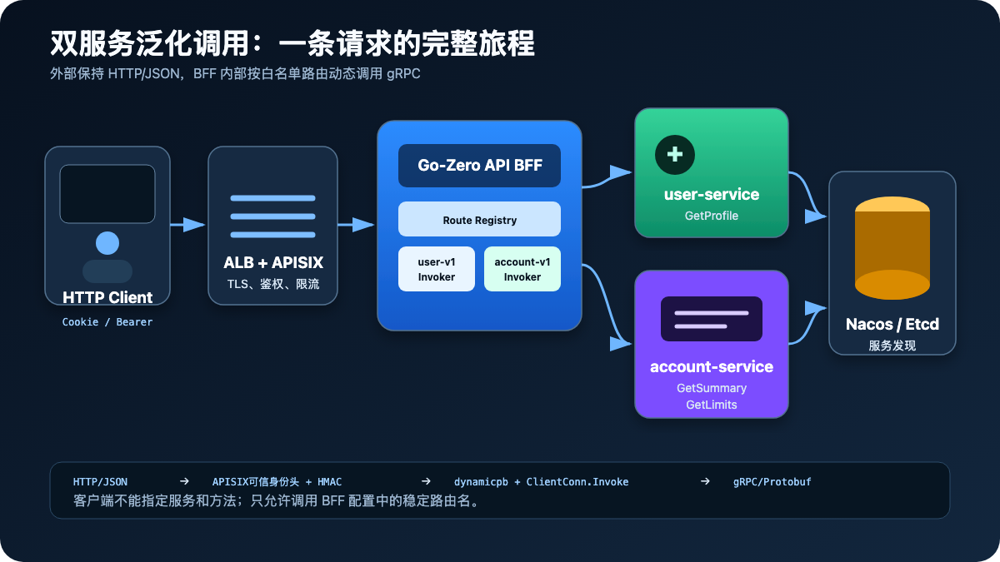
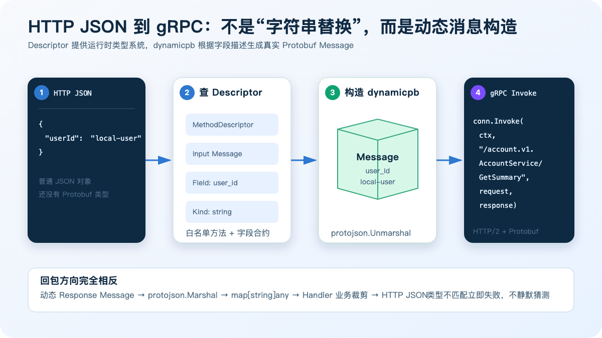
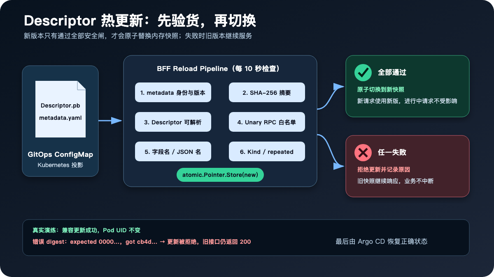

# 我们把 Go 微服务的 gRPC 调用“配置化”了：从 JSON 到 Protobuf、热更新与失败回退

很多团队拆分微服务后，很快会遇到一个问题：

前端继续使用 HTTP 和 JSON，内部服务逐步切换为 gRPC。每增加一个接口，BFF 都要引入新的生成代码、创建强类型 Client、写一遍请求转换和响应转换，然后重新构建、发布。

接口少时，这套方式清晰可靠；服务和接口越来越多后，BFF 却容易变成一个高频修改、强依赖所有下游协议的“总线”。

这次我们在一套本地 Kubernetes + Argo CD 环境中，完成了一个可运行的泛化调用方案：

- 外部仍然使用 HTTP/JSON；
- BFF 根据配置选择服务和 RPC 方法；
- 运行时读取 Protobuf Descriptor；
- 使用 `dynamicpb` 构造请求和响应；
- 通过 `grpc.ClientConn.Invoke` 发起真正的 gRPC 调用；
- Descriptor 可以在不重启 BFF Pod 的情况下热更新；
- 新版本不兼容或摘要错误时，继续使用上一份有效快照。

最终，我们用两个真实 gRPC 服务验证了完整链路，而不只是写了一个概念 Demo。



## 一、我们究竟想解决什么问题

原本，一个典型的 BFF 调用会这样写：

```go
client := userv1.NewUserServiceClient(conn)

response, err := client.GetProfile(ctx, &userv1.GetProfileRequest{
    UserId: userID,
})
```

这叫强类型调用。它的优点非常明显：编译器能够检查类型，IDE 可以跳转，代码可读性也很好。

但它也意味着：BFF 在编译期就必须依赖 `user.proto` 生成出来的 Go 代码。每接入一个新服务，通常要重复以下工作：

1. 引入该服务生成的 Go 包；
2. 初始化专用 gRPC Client；
3. 在 ServiceContext 中保存 Client；
4. 写 HTTP 请求到 Protobuf Request 的转换；
5. 调用具体方法；
6. 把 Protobuf Response 转成 HTTP JSON；
7. 重新构建并发布 BFF。

我们并不打算消灭强类型调用。登录、刷新 Token、退出登录等安全敏感接口，仍然保留强类型 Client。

泛化调用解决的是另一类问题：数量多、结构简单、边界明确的 Unary 查询或编排接口。它把“调用哪个服务、哪个方法、允许哪些字段”从 Go 代码中抽出来，形成受控配置。

这里有一个重要边界：

> 泛化调用不是让客户端任意指定服务名和 RPC 方法，而是让 BFF 在预先审核的白名单中动态执行。

## 二、这次实际搭建了什么

本次本地系统中有两个真实 gRPC 服务。

第一个是 `user-service`：

```protobuf
service UserService {
  rpc GetProfile(GetProfileRequest) returns (GetProfileResponse);
  rpc Login(LoginRequest) returns (TokenPair);
  rpc Refresh(RefreshRequest) returns (TokenPair);
  rpc Logout(LogoutRequest) returns (LogoutResponse);
}
```

其中 `GetProfile` 使用泛化调用，登录、刷新和退出仍使用强类型调用。

第二个是新增加的 `account-service`：

```protobuf
service AccountService {
  rpc GetSummary(GetSummaryRequest) returns (GetSummaryResponse);
  rpc GetLimits(GetLimitsRequest) returns (GetLimitsResponse);
}
```

BFF 对外提供三个受保护的 HTTP 接口：

```text
GET /api/v3/profile
GET /api/v3/account/summary
GET /api/v3/account/limits
```

它们分别被配置为：

```yaml
GenericRPC:
  Schemas:
    - Name: user-v1
      Service: user-service
      Schema: user.v1.UserService
      DescriptorPath: /etc/api-bff/schemas/user-service-v1.pb

    - Name: account-v1
      Service: account-service
      Schema: account.v1.AccountService
      DescriptorPath: /etc/api-bff/schemas/account-service-v1.pb

  Routes:
    - Name: get-profile
      SchemaRef: user-v1
      Method: /user.v1.UserService/GetProfile

    - Name: get-account-summary
      SchemaRef: account-v1
      Method: /account.v1.AccountService/GetSummary

    - Name: get-account-limits
      SchemaRef: account-v1
      Method: /account.v1.AccountService/GetLimits
```

`Schemas[]` 描述“有哪些协议和服务”，`Routes[]` 描述“BFF 允许调用哪些方法”。

每个 Schema 都拥有自己的：

- Descriptor 文件；
- metadata 文件；
- gRPC 连接；
- 服务发现 Resolver；
- 当前有效快照；
- 热更新检查循环。

## 三、HTTP 是怎么变成 gRPC 的

最容易产生的误解是：泛化调用是不是“把 JSON 转成 PB”就结束了？

答案是：方向没错，但中间缺少最关键的一层——运行时类型信息。

JSON 本身只是一组键值。下面这段 JSON：

```json
{
  "userId": "local-user"
}
```

无法告诉程序：

- 它对应哪个 Protobuf Message；
- `userId` 的 Proto 字段名是不是 `user_id`；
- 字段类型是 string、int64 还是 enum；
- 字段是否 repeated；
- 应该调用哪个 service 和 method；
- Response 应该按什么结构解析。

这些信息来自 Protobuf Descriptor。



### 1. Descriptor 是什么

`.proto` 是给人和代码生成器看的源文件，Descriptor Set 则是它编译后的“协议说明书”。

我们通过 `protoc` 生成：

```bash
protoc \
  --include_imports \
  --descriptor_set_out=account-service-v1.pb \
  account.proto
```

这个二进制文件中包含：

- package；
- service；
- method；
- 输入和输出 Message；
- 字段编号；
- Proto 字段名与 JSON 字段名；
- 字段类型；
- repeated、map 等结构信息。

因此，BFF 即使没有编译进 `accountv1.AccountServiceClient`，也能在运行时理解这个协议。

### 2. 找到 MethodDescriptor

路由配置指定了完整方法名：

```text
/account.v1.AccountService/GetSummary
```

BFF 从当前 Descriptor 快照中查找对应的 `MethodDescriptor`，并拒绝以下情况：

- 方法不存在；
- Client Streaming；
- Server Streaming；
- 方法不在配置白名单中。

当前实现只允许 Unary RPC，这是刻意收紧的边界。

### 3. 使用 dynamicpb 创建消息

有了输入 Message Descriptor 后，可以创建一个运行时消息：

```go
requestMessage := dynamicpb.NewMessage(method.Input())
```

随后使用 `protojson.Unmarshal`，按照 Descriptor 中的字段定义将 JSON 填入这个消息：

```go
requestJSON, _ := json.Marshal(request)

err := protojson.UnmarshalOptions{
    DiscardUnknown: false,
}.Unmarshal(requestJSON, requestMessage)
```

这里特意设置 `DiscardUnknown: false`。客户端或 Handler 如果传入 Descriptor 中不存在的字段，请求会直接失败，而不是被悄悄忽略。

### 4. 调用 ClientConn.Invoke

强类型 Stub 最终也会走到 gRPC ClientConn。泛化调用直接使用底层统一入口：

```go
responseMessage := dynamicpb.NewMessage(method.Output())

err := conn.Invoke(
    ctx,
    "/account.v1.AccountService/GetSummary",
    requestMessage,
    responseMessage,
)
```

到了这一层，请求已经不是 JSON，而是真正的 Protobuf Message。gRPC 会使用 HTTP/2 将其发送给 account-service。

### 5. 回包转换

下游返回的也是动态 Protobuf Message。BFF 再执行反向转换：

```text
dynamic Response
    → protojson.Marshal
    → map[string]any
    → Handler 选择业务字段
    → HTTP JSON
```

为什么还要经过 Handler，而不是把下游响应原样透传？

因为 BFF 仍然承担对外契约、安全裁剪和聚合职责。泛化的是内部 RPC 执行机制，不是放弃 API 边界。

## 四、Route Registry 如何管理多个服务

BFF 内部增加了一层 Route Registry。

它在启动时完成绑定：

```text
get-profile
  → user-v1 Invoker
  → /user.v1.UserService/GetProfile

get-account-summary
  → account-v1 Invoker
  → /account.v1.AccountService/GetSummary

get-account-limits
  → account-v1 Invoker
  → /account.v1.AccountService/GetLimits
```

Handler 只使用稳定路由名：

```go
result, err := genericRPC.CallRoute(
    ctx,
    "get-account-summary",
    map[string]any{"userId": actor.UserID},
)
```

Handler 不需要知道连接来自 Nacos、Etcd 还是 Kubernetes DNS，也不需要直接管理 Descriptor。

Registry 同时校验：

- Schema 名不能重复；
- Route 名不能重复；
- Route 引用的 Schema 必须存在；
- gRPC Method 不能为空；
- 每条 Route 可以配置独立超时。

这使“调用路由”和“协议加载”变成两个相对独立的模块。

## 五、服务发现是怎么接进来的

泛化调用解决的是“怎么构造和执行 RPC”，并不等于服务发现。

本次环境同时部署了 Nacos 和 Etcd。user-service、account-service 启动后都会注册自己的 Pod IP 和 gRPC 端口。

BFF 为每个 Schema 创建独立 Resolver：

```text
Schema.Service
    → Nacos（默认）
    → Etcd（可切换）
    → Kubernetes DNS（应急路径）
```

例如 account-service 的 DNS 后备地址为：

```text
account-service.account-service.svc.cluster.local:9002
```

所以，这套体系中各组件的职责是：

- Descriptor：告诉 BFF“协议长什么样”；
- Route Registry：告诉 BFF“允许调用什么”；
- Resolver：告诉 BFF“实例在哪里”；
- gRPC ClientConn：管理连接与负载均衡；
- Argo CD：确保配置和工作负载与 Git 一致。

## 六、为什么 Descriptor 不能拿来就用

如果 BFF 发现文件变化后直接加载，风险非常高。

可能出现：

- 发布错了服务的 Descriptor；
- metadata 与二进制文件不匹配；
- 需要的 RPC 被删除；
- Unary RPC 被改成 Streaming；
- `user_id` 从 string 改成 int64；
- JSON 名称发生变化；
- repeated 属性变化；
- 文件只写入一半就被读取。

因此我们给每个 Route 定义了一份 BFF 真正依赖的最小合约：

```yaml
InputFields:
  - ProtoName: user_id
    JSONName: userId
    Kind: string
    Repeated: false

OutputFields:
  - ProtoName: account_id
    JSONName: accountId
    Kind: string
    Repeated: false
```

加载新 Descriptor 前，系统会依次验证：

1. metadata 中的 service；
2. schema 全限定名；
3. version；
4. Descriptor SHA-256；
5. 文件能否完整解析；
6. 必需 RPC 是否存在；
7. RPC 是否仍为 Unary；
8. 必需输入输出字段是否存在；
9. ProtoName、JSONName、Kind、Repeated 是否一致。

只有全部通过，才允许进入内存。

## 七、不重启 BFF，怎么安全热更新

Descriptor 和 metadata 位于独立 GitOps 仓库，通过固定名称的 Kubernetes ConfigMap 挂载到 BFF：

```text
/etc/api-bff/schemas/account-service-v1.pb
/etc/api-bff/schemas/account-service-v1.yaml
```

metadata 记录身份、版本和摘要：

```yaml
service: account-service
schema: account.v1.AccountService
version: 1.0.0
digest: sha256:cb4db4967febb44c...
```

BFF 每 10 秒检查 metadata。当 digest 与当前快照不同时，才进入重新加载流程。



### 为什么使用原子快照

解析和验证都在一份新的临时快照上完成，不修改正在使用的对象。

全部成功后执行一次原子替换：

```go
current.Store(newSnapshot)
```

因此：

- 新请求立即读取新快照；
- 已经开始的请求仍持有旧快照；
- 不需要全局锁住所有请求；
- 验证失败时根本不会触碰当前快照。

## 八、我们实际做了两次热更新演练

### 演练一：兼容更新

我们给 `GetSummaryResponse` 增加了一个可选字段：

```protobuf
message GetSummaryResponse {
  string account_id = 1;
  string status = 2;
  string display_name = 3;
}
```

重新生成 Descriptor 并提交 GitOps 后，BFF 日志出现：

```text
generic gRPC descriptor reloaded:
schema=account-v1
digest=cb4db4967febb44c...
```

更新前后，BFF Pod UID 都是：

```text
36f979d3-7d25-491a-9400-72f95212f8b4
```

这证明更新发生在同一个进程内，没有通过重启 Pod“伪装”成热更新。

### 演练二：错误摘要

随后，我们故意把 metadata 中的 digest 改为全 0：

```text
expected 0000000000000000...
got      cb4db4967febb44c...
```

BFF 日志明确记录：

```text
generic gRPC descriptor reload failed:
schema=account-v1
error=descriptor SHA-256 mismatch
```

但同一时刻继续请求：

```http
GET /api/v3/account/summary
```

仍然得到 200：

```json
{
  "accountId": "account-local-user",
  "status": "active",
  "source": "account-service-generic-grpc"
}
```

说明错误版本没有污染正在工作的快照。最后，Argo CD 将 ConfigMap 恢复为 Git 中的正确版本，应用重新回到 `Synced / Healthy`。

## 九、真实请求和回包

客户端先登录：

```http
POST /api/v3/auth/login HTTP/1.1
Host: localhost:18443
Origin: https://localhost:18443
Content-Type: application/json

{
  "email": "demo@local.test",
  "password": "local-demo-password"
}
```

登录响应不直接返回 Token，只设置 Secure、HttpOnly Cookie：

```json
{
  "authenticated": true,
  "expiresIn": 1800,
  "tokenType": "Bearer"
}
```

然后访问账户摘要：

```http
GET /api/v3/account/summary HTTP/1.1
Cookie: access_token=...
```

APISIX 完成 JWT 验证，删除客户端伪造的身份头，再注入可信身份和网关签名。

BFF 不从查询参数接受 userId，而是读取经过网关验证的认证上下文：

```go
map[string]any{
    "userId": actor.UserID,
}
```

最终响应：

```json
{
  "accountId": "account-local-user",
  "status": "active",
  "source": "account-service-generic-grpc"
}
```

限额接口返回：

```json
{
  "dailyLimitCents": 100000,
  "currency": "USD",
  "source": "account-service-generic-grpc"
}
```

这里还暴露了一个容易忽略的 Protobuf 细节：`int64` 在 Proto JSON 中默认表示为字符串，以避免 JavaScript 精度丢失。因此 BFF 的对外 Handler 会显式解析并决定最终 HTTP JSON 是数字还是字符串，而不是盲目透传。

## 十、安全边界：泛化不等于开放

一个危险的设计是让客户端发送：

```json
{
  "service": "xxx.AdminService",
  "method": "DeleteEverything"
}
```

然后网关照着调用。那不是泛化调用，而是在暴露内部 RPC 控制面。

本次实现坚持以下边界：

### 客户端不能选择 RPC

客户端只能访问已注册的 HTTP 路由。具体 SchemaRef 和 Method 来自服务端配置。

### Descriptor 不是权限系统

Descriptor 只描述协议，不表达“谁有权调用”。鉴权、角色、租户、数据权限仍由 APISIX、BFF 和业务服务共同负责。

### 身份不从请求参数获取

`/profile`、`/account/summary` 和 `/account/limits` 都从认证上下文获取用户 ID，客户端伪造 `X-User-ID` 会先被 APISIX 清除。

### 只允许已验证字段

BFF 保存所依赖字段的最小合约。下游可以兼容地新增字段，但不能偷偷改变 BFF 正在使用的字段类型。

### Streaming 暂不支持

Unary 调用的生命周期、超时和响应模型最适合当前 HTTP BFF。流式 RPC 需要独立设计背压、连接关闭、重试和网关协议，不应复用这条简单路径。

## 十一、泛化调用带来了什么，也没有带来什么

它带来的收益包括：

- 多服务共享一套调用引擎；
- Descriptor 与应用镜像可以分离发布；
- 简单 Unary RPC 不再要求泛化模块增加新的 Client 接口；
- 可以统一执行超时、字段合约和版本准入；
- 可以灰度或热更新协议描述；
- 更适合做内部 API 编排平台。

但它没有消除以下工作：

- 对外 HTTP API 仍需要明确设计；
- 复杂参数来源和响应聚合仍需业务代码；
- 权限判断仍属于业务边界；
- `.proto` 的兼容性规则仍必须遵守；
- 登录、支付、资金操作等关键路径未必适合泛化；
- 可观测性、审计和容量治理仍需要建设。

换句话说：

> 泛化调用减少的是重复的 RPC 胶水代码，不是业务语义，也不是安全责任。

## 十二、什么时候值得使用

比较适合：

- 内部 BFF 聚合大量查询型 RPC；
- 多个服务拥有相似的 Unary 接入模式；
- 希望协议描述独立发布；
- 需要建设统一接口编排或低代码网关；
- 团队能够维护严格的 Schema 准入和监控。

不太适合：

- 只有少量稳定 RPC；
- 极度强调编译期类型安全；
- 复杂双向流；
- 超低延迟且每次动态转换成本都敏感；
- 资金、权限变更等需要显式代码评审的关键命令；
- 没有版本治理和故障回退能力。

## 十三、下一步还能怎么演进

当前方案使用 GitOps 仓库保存 Descriptor 和 metadata，已经足够支持本地演练及中小规模服务。

服务继续增加后，可以逐步演进：

1. 建设 Schema Registry，保存 Descriptor、版本、摘要和兼容性结果；
2. 使用 ETag 或版本事件替代固定轮询；
3. 增加 Descriptor 签名，而不只是 SHA-256 完整性校验；
4. 为每个 Route 增加权限、超时、重试和熔断策略；
5. 暴露当前加载版本、最后成功时间和失败次数等指标；
6. 建立 Proto breaking-change CI；
7. 对兼容更新做灰度快照，而不是一次切换全部实例；
8. 为简单 HTTP 路由增加受限的参数绑定配置，进一步减少重复 Handler。

但不建议一开始就搭建一个庞大的接口平台。先用两个真实服务，把加载、调用、更新、拒绝和回退闭环跑通，通常比先画一张宏大的平台架构图更有价值。

## 结语

泛化调用最有价值的部分，不是 `ClientConn.Invoke` 这一行代码。

真正决定它能否用于实际系统的，是周围这一整圈约束：

- Descriptor 从哪里来；
- 如何确认身份和版本；
- 如何验证摘要；
- 如何约束允许的方法；
- 如何验证字段合约；
- 如何发现服务实例；
- 如何原子切换；
- 如何在失败时继续使用旧版本；
- 如何保证客户端不能把它变成任意 RPC 代理。

当这些问题都有明确答案后，JSON 到 Protobuf 的动态转换才不再只是一个 Demo，而会成为一项可以被治理、验证和演进的工程能力。

这次双服务实战最终验证的是：

```text
HTTP/JSON
  → APISIX 鉴权与可信身份
  → BFF Route Registry
  → Descriptor + dynamicpb
  → gRPC ClientConn.Invoke
  → Nacos / Etcd 服务发现
  → user-service / account-service
  → 原子热更新与失败回退
```

它不会替代所有强类型调用，但为大量边界清晰的内部 Unary RPC，提供了一条更轻、更统一、也更可控的接入路径。
