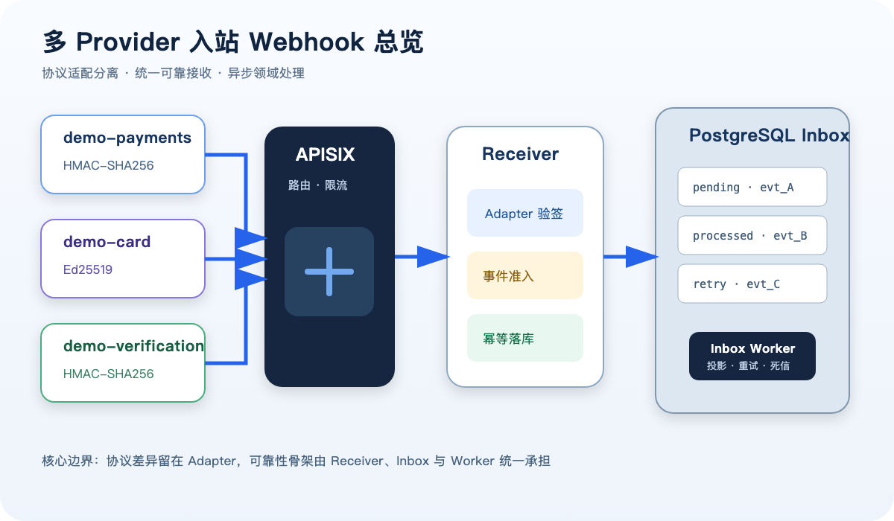
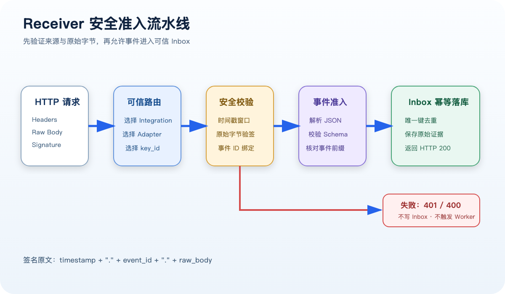
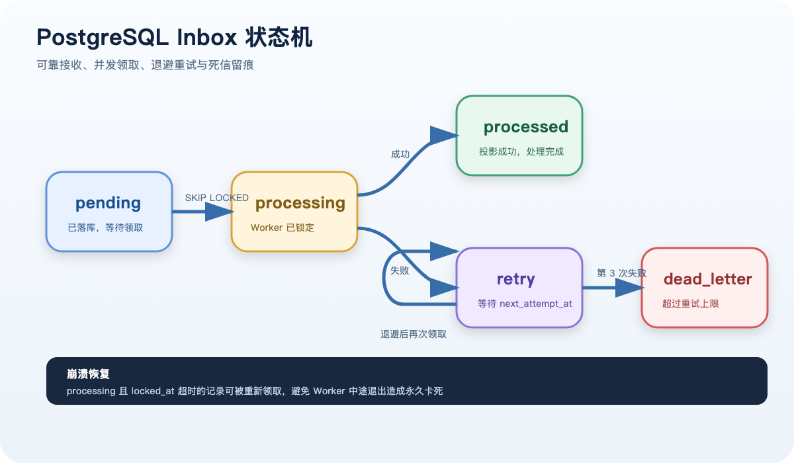
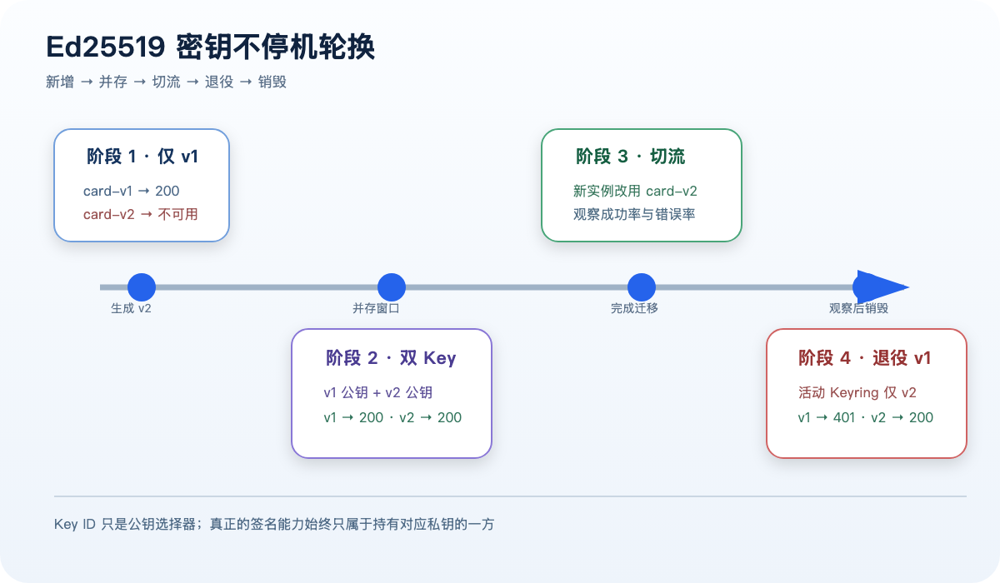

# 外部系统回调，不只是一个 HTTP 接口：多 Provider 入站 Webhook 原理与实战

> 支付渠道通知交易完成、卡服务通知授权结果、身份验证服务通知审核通过——这些看起来都是“外部系统 POST 一段 JSON 给我们”。
>
> 真正进入生产环境后，我们还要回答：每家 Provider 的签名算法不同怎么办？重复通知会不会重复入账？业务服务暂时故障会不会丢事件？旧事件能否覆盖新状态？密钥如何不停机轮换？
>
> 这篇文章采用教练式视角，带你在本地 Kind 集群中，亲手验证一套多 Provider 入站 Webhook 架构。我们不绑定任何真实渠道，而是使用三个通用模拟 Provider，分别覆盖 HMAC-SHA256 和 Ed25519。



---

## 一、先划清边界：本文讲的是“入站 Webhook”

Webhook 有两个方向：

```text
出站 Webhook：我们的平台 → 商户系统
入站 Webhook：外部 Provider → 我们的平台
```

本文讨论第二种。典型场景包括：

- 支付 Provider 通知支付、退款或转账结果；
- 卡 Provider 通知授权、清算或卡状态变化；
- 身份验证 Provider 通知审核状态变化。

本地实验使用三个不包含真实业务信息的模拟 Integration：

| Integration | 事件域 | 签名算法 |
|---|---|---|
| `demo-payments` | payment | HMAC-SHA256 |
| `demo-card` | card | Ed25519 |
| `demo-verification` | verification | HMAC-SHA256 |

它们共享 Receiver、Inbox 和 Worker，但保留各自独立的协议适配器。

这是一条非常重要的设计原则：

```text
统一接收与处理骨架
≠
强迫所有 Provider 使用同一种签名协议
```

---

## 二、总体架构：Adapter + Inbox + Worker

完整链路如下：

```text
Provider
  → APISIX
  → HTTP Receiver
  → Provider Adapter 验签
  → PostgreSQL Inbox
  → Inbox Worker
  → 业务投影
```

每一层只承担有限职责：

| 组件 | 职责 |
|---|---|
| APISIX | 入口路由、请求大小限制、基础限流 |
| Provider Adapter | 适配 Provider 的签名算法与凭证格式 |
| Receiver | 选择可信 Integration、验签、校验事件元数据、幂等落库 |
| PostgreSQL Inbox | 保存已经认证的原始事件和处理状态 |
| Worker | 异步领取事件、重试、死信、调用领域处理器 |
| Projection | 保存本实验中可观察的业务处理结果 |

为什么不让 Receiver 验签后直接修改业务表？

因为 HTTP 回调具有很强的不确定性：Provider 有超时限制，业务数据库可能短暂故障，内部服务也可能正在发布。如果把所有业务处理都放在请求线程中，一次内部抖动就会变成外部回调失败。

Inbox 把两个承诺拆开：

```text
HTTP 200：事件已经认证并可靠保存
processed：事件已经完成内部业务处理
```

---

## 三、第一道闸：为什么必须对原始 Body 验签

本实验定义统一签名原文：

```text
timestamp + "." + event_id + "." + raw_body
```

例如：

```text
1792815649.evt_payment_coach_1792815649.{"id":"evt_payment_coach_...","status":"settled"}
```

Receiver 的验证顺序如下：



必须先用收到的原始字节验签，再解析 JSON。不能先解析成对象，再重新序列化后验签，因为以下变化都会改变字节序列：

- JSON 字段顺序；
- 空格和换行；
- 数字格式；
- 转义方式。

### 时间戳解决什么问题

签名正确只说明请求由持有密钥的一方生成，不代表它是刚刚生成的。攻击者可能截获完整请求并原样重放。

Receiver 因此要求请求时间戳落在允许窗口内，例如五分钟：

```text
abs(server_time - request_timestamp) <= 5 minutes
```

### Event ID 解决什么问题

时间窗口不能阻止窗口内重放。Event ID 提供稳定事件身份，数据库以：

```text
(integration_code, external_event_id)
```

建立唯一约束。

---

## 四、HMAC 与 Ed25519 到底有什么区别

### HMAC-SHA256

HMAC 使用对称密钥：

```text
Provider 持有 Shared Secret
平台也持有同一个 Shared Secret
```

Provider 使用 Secret 生成签名，平台使用同一 Secret 重新计算并进行常量时间比较。

它的优点是简单、成熟、广泛支持。限制是平台为了验签也必须持有 Secret；一旦平台侧 Secret 泄露，攻击者就可能生成有效签名。

### Ed25519

Ed25519 使用非对称密钥：

```text
Provider：持有私钥，负责签名
平台：持有公钥，只负责验签
```

公钥泄露不会赋予攻击者签名能力。我们在实验中验证了：

1. 本机私钥推导出的公钥指纹与集群公钥指纹一致；
2. 正确私钥签名返回 `200`；
3. 临时生成另一把 Ed25519 私钥进行伪造，返回 `401`；
4. 伪造事件没有进入 Inbox。

需要注意：HTTPS 仍然必不可少。签名保证真实性和完整性，不负责隐藏 JSON 内容。

---

## 五、第二道闸：Inbox 为什么既是队列又不是队列

Inbox 的核心字段包括：

```text
integration_code
external_event_id
event_type
event_version
credential_key_id
raw_headers
raw_body
body_sha256
processing_status
attempt_count
next_attempt_at
last_error
received_at
processed_at
```

状态机如下：



Worker 使用类似下面的方式领取事件：

```sql
SELECT id
FROM provider_webhook_inbox
WHERE processing_status IN ('pending', 'retry')
  AND next_attempt_at <= NOW()
ORDER BY id
FOR UPDATE SKIP LOCKED
LIMIT 1;
```

`SKIP LOCKED` 允许多个 Worker 并行工作：一个 Worker 锁住某条记录时，其他 Worker 会跳过它领取下一条，而不是互相等待。

它和 Kafka 的区别是：

- Kafka 是独立的高吞吐消息平台；
- PostgreSQL Inbox 依赖数据库行和索引；
- Inbox 更容易与关系数据、审计和事务边界结合；
- 当规模和吞吐继续增长时，可以把 Inbox 事件再发布到 Kafka。

本实验选择 Inbox，是为了先把可靠接收、幂等和失败治理观察清楚。

---

## 六、教练实战一：亲手观察 pending 变成 processed

正常情况下 Worker 几百毫秒就能完成处理，很难用肉眼看见中间状态。我们主动暂停 Worker：

```text
APISIX      正常
Receiver    正常
PostgreSQL  正常
Worker      停止
```

然后发送一个签名正确的支付事件。Receiver 返回：

```json
{"received":true,"duplicate":false}
```

数据库中出现：

```text
processing_status = pending
attempt_count     = 0
processed_at      = NULL
```

恢复 Worker 后，同一条记录变为：

```text
processing_status = processed
attempt_count     = 1
processed_at      = 2026-10-24 04:22:48...
```

同时业务投影出现：

```text
resource_id        = payment_coach_...
status             = settled
source_integration = demo-payments
source_event_id    = evt_payment_coach_...
```

这组实验直接证明：Receiver 返回 `200` 与业务处理完成是两个独立时刻。

---

## 七、教练实战二：为什么重复投递不能返回错误

Provider 没收到响应、网络中途断开或自身重试策略触发时，同一个事件可能被投递多次。

我们对同一个 Event ID 使用新请求时间戳重新签名，再次投递。服务返回：

```json
{"received":true,"duplicate":true}
```

但数据库证据是：

```text
HTTP 请求次数       = 2
Inbox 记录数        = 1
Worker attempt_count = 1
Projection 更新次数  = 1
```

重复事件仍返回 `200`，是为了告诉 Provider：“这条事件已经被我们接住，不需要继续重试。”

如果重复事件返回 `409` 或 `500`，Provider 可能把它当作未处理并不断重发。

---

## 八、教练实战三：篡改为什么进不了 Inbox

我们保留合法签名，却把正文状态从：

```text
settled
```

改成：

```text
failed
```

Receiver 返回：

```http
HTTP/1.1 401 Unauthorized

invalid signature
```

随后检查：

```text
Inbox 记录数   没有增加
attempt_count 没有增加
Projection     仍为 settled
updated_at     没有变化
```

Inbox 代表“已经确认来自可信 Provider 的事件”，因此无效请求不应污染 Inbox。生产环境仍应通过网关日志、安全指标和告警记录验签失败。

---

## 九、教练实战四：重试与死信

Receiver 可以正确认证某条事件，但 Worker 未必理解它。例如 Provider 已经发送 `version=99`，而当前业务处理器只支持 `version=1`。

实验结果是：

```text
processing_status = dead_letter
attempt_count     = 3
last_error        = unsupported event version 99
```

流程为：

```text
第一次失败 → retry
第二次失败 → retry
第三次失败 → dead_letter
```

需要区分：

- 验签失败：不可信请求，直接 `401`，不进入 Inbox；
- 业务失败：可信事件已进入 Inbox，由 Worker 重试或进入死信。

生产环境还需要死信查看、告警、修复后重放和完整审计。

---

## 十、教练实战五：不停机轮换 Ed25519 密钥

密钥轮换不能简单地“删除旧 Key，再添加新 Key”，否则仍在使用旧 Key 的 Provider 实例会立即失败。

正确顺序如下：



### 阶段一：只有 v1

```text
card-v1 → 成功
card-v2 → 不可用
```

### 阶段二：双 Key 并存

平台加载：

```text
card-v1 → public key v1
card-v2 → public key v2
```

实测结果：

```text
旧私钥 + card-v1 → 200
新私钥 + card-v2 → 200
```

这给 Provider 留出了滚动切换时间。

### 阶段三：退役 v1

服务端可信配置调整为：

```text
DEMO_CARD_ACTIVE_KEY_IDS=card-v2
```

实测结果：

```text
旧私钥 + card-v1 → 401 invalid signature metadata
新私钥 + card-v2 → 200，processed
```

旧公钥可以在短暂回滚窗口内保留在 Secret 中，但不再进入活动 Keyring。观察期结束后，再删除旧公钥并安全销毁旧私钥。

`key_id` 不是密钥本身，也不是认证凭证。它只是告诉 Receiver 应该选择哪一把可信公钥。攻击者知道 `card-v1` 或 `card-v2`，并不能生成对应私钥签名。

---

## 十一、这套架构如何接入更多 Provider

增加 Provider 时，不应该复制一整套 Receiver、Inbox 和 Worker。通常只新增：

1. Integration 路由配置；
2. Provider Adapter；
3. 凭证与 Key ID；
4. 事件 Schema 映射；
5. 领域处理器。

例如：

```text
provider-a → HMAC Adapter ───────┐
provider-b → Ed25519 Adapter ────┼→ 统一 Receiver / Inbox / Worker
provider-c → RSA Adapter ────────┘
```

但不要把所有差异都塞进一个巨大 `switch`。Adapter 应封装 Provider 特有的签名头、编码格式和验签方式；领域处理器则负责业务状态转换。

---

## 十二、进入生产环境前还缺什么

本地实验跑通了纵向链路，但生产环境至少还需要：

### 安全

- HTTPS，必要时增加 mTLS；
- Provider IP allowlist，但不能把 IP 当作唯一认证手段；
- 请求体大小、Header 数量和速率限制；
- Secret 接入 KMS、Vault 或云 Secret Manager；
- Key 创建、启用、退役和销毁的审计流程；
- 验签失败指标和异常来源告警。

### 可靠性

- Inbox 积压量、最老事件年龄和死信数告警；
- Worker 水平扩容和优雅退出；
- 死信人工重放工具；
- Schema 版本兼容策略；
- 数据库备份、恢复和容量评估。

### 业务一致性

- 资金事件必须经过领域状态机；
- 不能只凭回调 JSON 直接修改余额；
- 必要时主动查询 Provider 做二次确认；
- 旧事件不能覆盖新状态；
- 投影更新和后续业务动作都必须幂等。

---

## 十三、最后总结

可靠的入站 Webhook 不是“开放一个 POST 接口”，而是一组相互配合的安全与可靠性机制：

```text
Provider Adapter
  + 原始字节验签
  + 时间戳窗口
  + Event ID 幂等
  + PostgreSQL Inbox
  + SKIP LOCKED Worker
  + 重试与死信
  + 业务投影幂等
  + Key ID 与平滑密钥轮换
  = 可长期运营的多 Provider 入站 Webhook 平台
```

最有价值的并不是记住 HMAC 或 Ed25519 的命令，而是亲手观察这些边界：

- `200` 不等于业务已经处理完成；
- 重复投递不是异常，而是分布式系统的常态；
- 不可信请求不能进入可信 Inbox；
- 公钥验签不等于平台拥有签名能力；
- 密钥轮换是一个有并存窗口的状态迁移过程；
- 每一步都应该能从 HTTP、Inbox、Worker 和业务投影中找到证据。

当这些边界真正清晰之后，再接入第四个、第五个 Provider，系统才不会随着渠道数量增长而复制出越来越多不可治理的回调服务。
