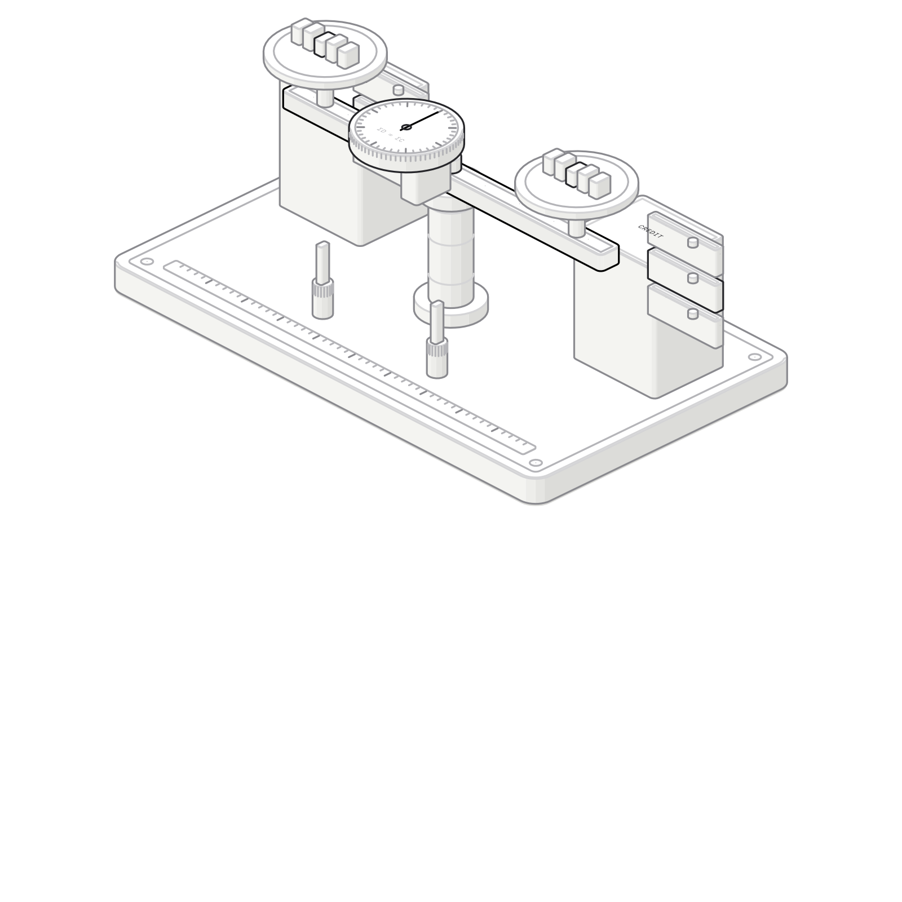
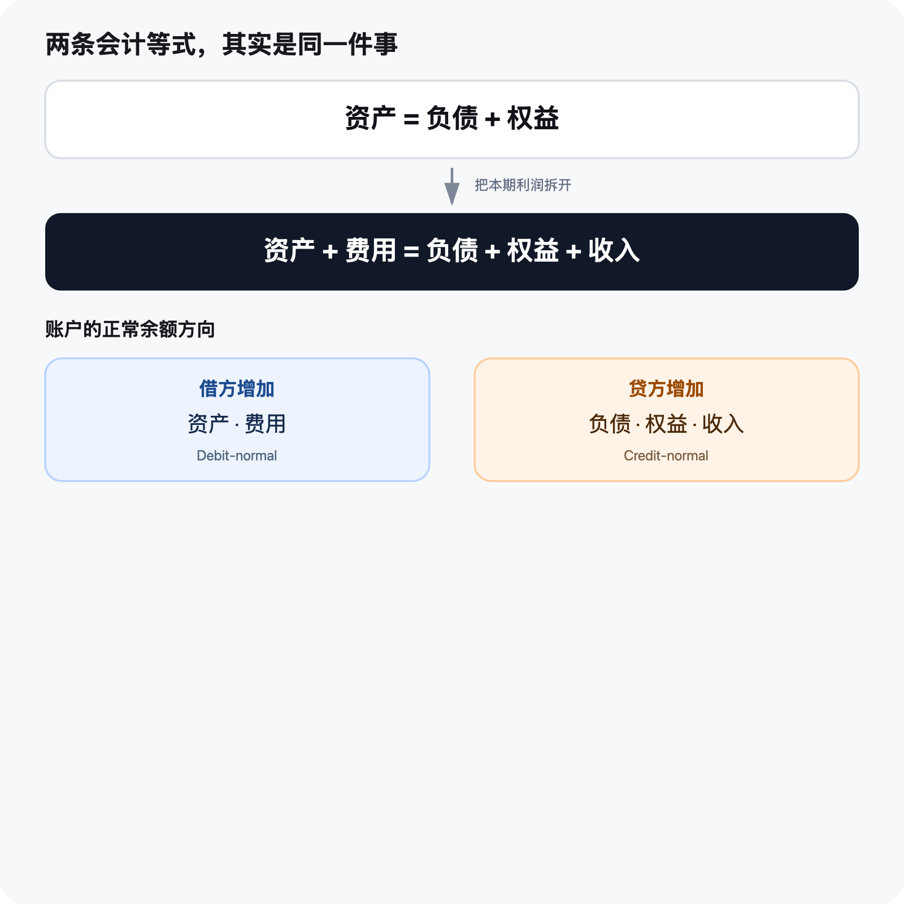
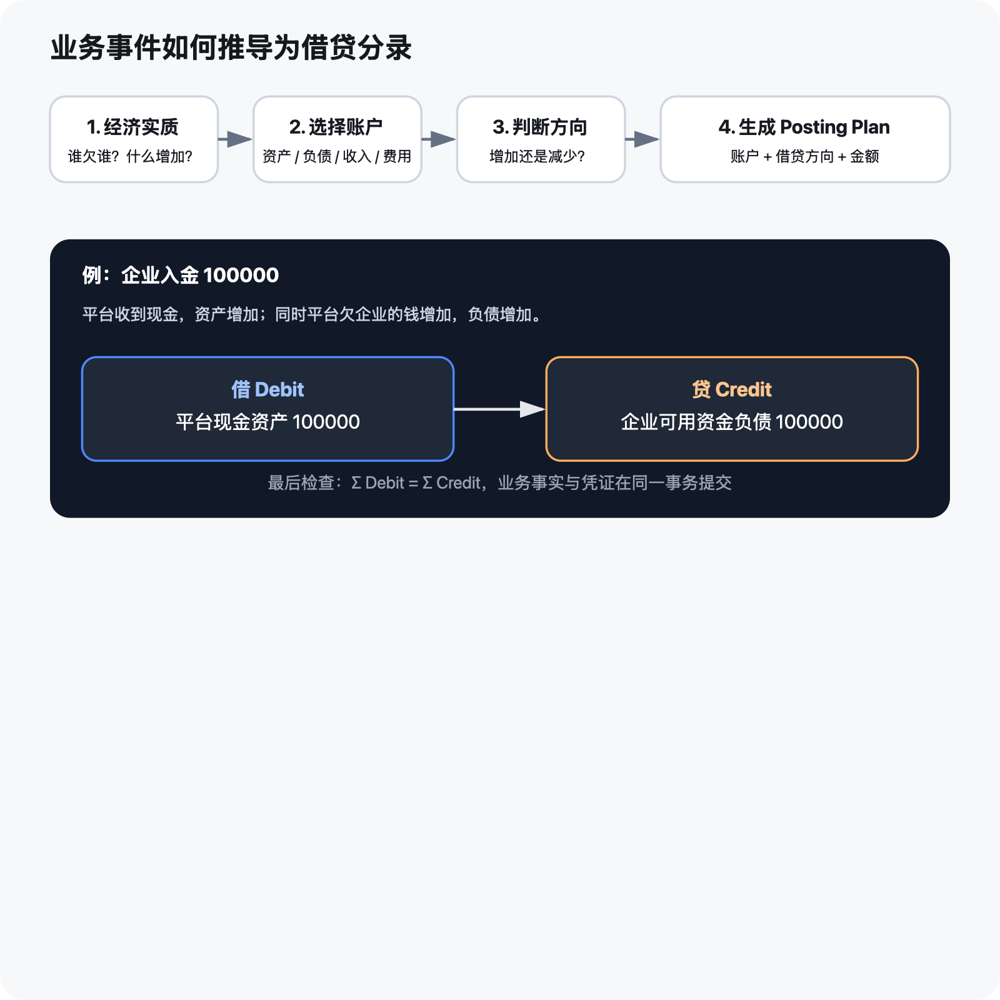
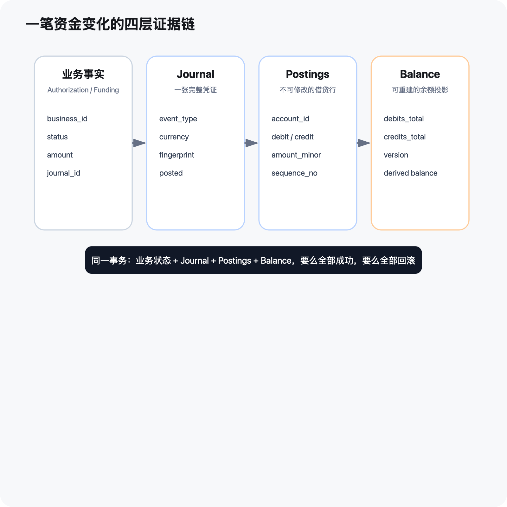
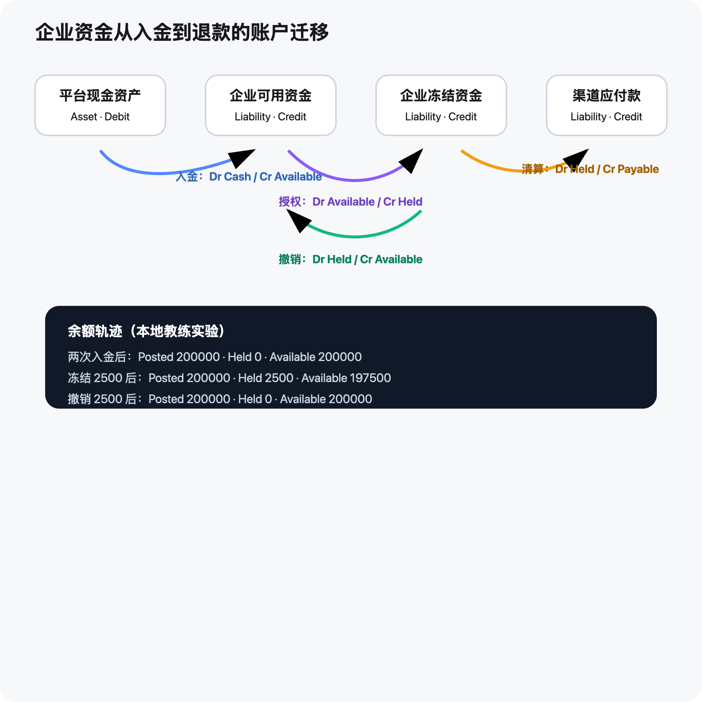

# 从 100000 入金开始：亲手搭建一套可审计的复式账本

> 这不是一篇让你背“借、贷”的会计教材，而是一场面向工程师的教练式实战：我们从一笔企业入金出发，推导资产、负债、权益、收入和费用，设计 Journal、Posting 与 Balance，再用本地集群亲手验证入金、授权冻结、幂等重放、冲突请求与撤销。

很多账户系统最初只有一张表、一个 `balance` 字段：入金就加，消费就减。它能跑，却很难回答五个问题：

1. 余额为什么是这个数字？
2. 同一个请求重试，会不会多加一次钱？
3. 一次业务操作改了三张表，中途失败怎么办？
4. 已经记错的账，谁修改过、为什么修改？
5. 余额表坏了，能不能从历史事实重建？

复式账本的价值，不是把简单问题复杂化，而是让每一次资金变化都留下完整、平衡、不可篡改、可重放的证据。



---

## 一、先建立一个最重要的视角：我们站在谁的账上看？

本文始终站在“平台”的视角。

企业向平台入金 100000（金额统一使用最小货币单位）时，平台同时得到两件东西：

- 银行或渠道中的现金增加了，这是平台的**资产**；
- 平台欠企业的可用资金增加了，这是平台的**负债**。

因此分录是：

```text
借：平台现金资产          100000
贷：企业可用资金负债      100000
```

这里最容易犯的错误，是把“企业账户余额”误认为平台的资产。企业可以要求提现或消费这笔钱，所以从平台视角看，它是平台对企业承担的偿付义务，也就是负债。

换一个视角，答案也会变化。如果站在企业自己的账上看，这笔余额可能是企业的资产。因此，推导任何分录前都要先问：**这是哪一个法律主体、哪一本账？**

---

## 二、两条会计等式为什么看起来不一样？

我们先看资产负债表的静态等式：

```text
资产 = 负债 + 权益
```

其中：

- **资产（Asset）**：平台控制、未来能带来经济利益的资源，例如银行存款、渠道应收款；
- **负债（Liability）**：平台需要向外部履行的义务，例如企业余额、渠道应付款；
- **权益（Equity）**：资产扣除负债后，真正属于所有者的剩余权益。

权益不是“现金账户”，也不是“利润账户”。它是一个剩余量：

```text
权益 = 资产 - 负债
```

如果资产只有 10 万、负债却有 100 万，那么：

```text
权益 = 10 万 - 100 万 = -90 万
```

这在数学和会计上完全成立，只是说明企业已经资不抵债，净资产为负。

### 收入和费用从哪里来？

本期利润会改变权益：

```text
期末权益 = 期初权益 + 收入 - 费用
```

把这条关系代入 `资产 = 负债 + 权益`，把本期收入和费用展开，就得到工程实现中常见的扩展等式：

```text
资产 + 费用 = 负债 + 权益 + 收入
```

所以这不是两套互相矛盾的规则，而是同一件事的两种视角：

- `资产 = 负债 + 权益`：看某一时点的财务状况；
- `资产 + 费用 = 负债 + 权益 + 收入`：把本期经营结果拆开，方便逐笔记账。



### 经营亏损也必须记账

假设平台原有资产 100 万，同时欠客户 100 万。后来平台发生 90 万经营支出：

```text
借：经营费用              900000
贷：平台现金资产          900000
```

费用增加记借方，现金资产减少记贷方。期末结转后，亏损会使权益减少 90 万：

```text
资产 10 万 = 负债 100 万 + 权益（-90 万）
```

账仍然平衡，但它揭示了一个严重经营问题。复式记账不会让风险消失，它会让风险无法被一个“余额数字”掩盖。

---

## 三、借方和贷方不是“增加”和“减少”

借方（Debit）与贷方（Credit）本质上只是账簿的左边和右边。到底哪边表示增加，由账户类型决定。

| 账户类型 | 正常余额方向 | 增加记 | 减少记 |
|---|---|---|---|
| 资产 Asset | 借方 | 借 | 贷 |
| 费用 Expense | 借方 | 借 | 贷 |
| 负债 Liability | 贷方 | 贷 | 借 |
| 权益 Equity | 贷方 | 贷 | 借 |
| 收入 Revenue | 贷方 | 贷 | 借 |

因此余额投影不能简单做 `credit - debit`，而应根据账户的 `normal_side` 计算：

```text
借方正常账户余额 = 借方累计 - 贷方累计
贷方正常账户余额 = 贷方累计 - 借方累计
```

我们在系统里明确保存 `account_type` 与 `normal_side`，不是为了重复信息，而是为了：

- 在建账时校验账户语义；
- 在算余额时不靠业务代码猜测；
- 在审计时清楚说明“为什么这一边会增加”；
- 为未来扩展收入、费用、权益账户留下稳定边界。

---

## 四、权益、收入、费用：最容易混淆的三兄弟

### 1. 权益是所有者的剩余索取权

股东投入 500000，平台收到现金：

```text
借：平台现金资产          500000
贷：实收资本权益          500000
```

它不是收入。股东投入不会因为“钱进来了”就成为经营收入，否则利润会被严重高估。

### 2. 收入是经营活动带来的权益增加

假设平台从企业可用资金中收取手续费 100：

```text
借：企业可用资金负债      100
贷：手续费收入            100
```

企业可用资金负债减少，所以记借；平台收入增加，所以记贷。收入最终通过利润增加权益，但日常记账时应保留在收入账户，才能回答“利润来自哪里”。

### 3. 费用是经营活动导致的权益减少

假设渠道向平台收取处理费 30，尚未付款：

```text
借：渠道处理费用          30
贷：渠道应付款负债        30
```

费用增加记借，应付款负债增加记贷。等平台实际付款时：

```text
借：渠道应付款负债        30
贷：平台现金资产          30
```

第二笔只是清偿负债，不会再产生一次费用。

### 4. 为什么运营账本不能冒充法定总账？

本文实现的是**运营资金账本**：它优先保证业务事件、账户余额、幂等与审计一致。正式会计还需要科目治理、会计期间、结账、税务、汇兑损益、权责发生制、财务报表等能力。

更稳妥的边界是：

```text
业务系统 → 运营账本 → 会计映射/汇总 → 法定总账
```

运营账本可以使用资产、负债、权益、收入、费用这些会计语义，但不能因此直接宣称自己已经满足全部财务合规要求。

---

## 五、不要背分录：用四步推导法

遇到新业务场景，不要先问“借什么、贷什么”，而要依次问：

1. **经济实质是什么？** 谁欠谁？什么资源增加或减少？
2. **应该选择哪些账户？** 资产、负债、权益、收入还是费用？
3. **这些账户是在增加还是减少？**
4. **根据正常余额方向翻译成借贷分录。**

最后做两次检查：

- 借方合计是否等于贷方合计；
- 分录是否真实表达业务事件，而不是仅仅为了凑平。



这也是系统为什么不能让客户端直接提交任意 Posting。账本引擎可以通用，但“业务事件如何转换为分录”属于受控的会计策略，必须由服务端可信代码决定。

---

## 六、账本的四层证据链

一笔资金变化不应该只落一个余额。我们把它拆成四层：

### 1. Business Fact：业务事实

例如一次入金、授权、撤销或清算。业务表保存其状态、金额以及关联的 `journal_id`。

### 2. Journal：凭证

Journal 表示一次完整、原子的经济事件。它回答：

- 哪一本账 `book_id`；
- 哪类业务 `business_type`；
- 哪个业务编号 `business_id`；
- 哪个事件阶段 `event_type`；
- 使用什么币种；
- 请求指纹是什么；
- 是否已经 `posted`。

### 3. Posting：分录行

Posting 是 Journal 内的一行借方或贷方记录：账户、方向、金额、顺序。一个最简单的 Journal 至少有两条 Posting。

### 4. Balance：余额投影

Balance 保存借方累计、贷方累计、派生余额与版本号。它是为了高效查询而存在的投影，不是不可解释的唯一真相；必要时可以从已入账 Postings 重建。



四层必须处于同一个数据库事务：

```text
业务状态 + Journal + Postings + Balance
要么全部成功，要么全部回滚
```

---

## 七、一个通用入账命令应该长什么样？

我们的核心命令可以抽象为：

```go
type PostJournalCommand struct {
    BookID            string
    BusinessType      string
    BusinessID        string
    EventType         string
    Currency          string
    EffectiveAt       int64
    CommandFingerprint string
    Postings          []PostingPlan
}

type PostingPlan struct {
    AccountID   string
    Side        string // debit | credit
    AmountMinor int64
}
```

账本内核只负责稳定的通用约束：

1. 锁定业务身份；
2. 查询是否已有相同 Journal；
3. 相同指纹返回原结果，不重复改余额；
4. 不同指纹复用同一业务身份则返回冲突；
5. 校验币种、账户状态、金额和借贷平衡；
6. 锁定相关账户；
7. 写 Journal 与 Postings；
8. 更新余额投影及版本号；
9. 将 Journal 标记为 `posted`；
10. 与业务状态一起提交事务。

而“企业入金应该借现金、贷可用资金”属于上层 Accounting Policy。以后新增手续费、争议款、渠道应收或退款场景，需要新增明确的业务策略，但不应复制一套新的账本存储引擎。

---

## 八、企业卡资金生命周期如何翻译成分录？

我们采用“企业可用资金 + 企业冻结资金”的负债子账户模型。

| 业务事件 | 借方 | 贷方 | 经济含义 |
|---|---|---|---|
| 企业入金 | 平台现金资产 | 企业可用资金负债 | 平台收到钱，同时欠企业的钱增加 |
| 授权冻结 | 企业可用资金负债 | 企业冻结资金负债 | 只是负债内部迁移，平台总负债不变 |
| 授权撤销 | 企业冻结资金负债 | 企业可用资金负债 | 释放冻结额度 |
| 交易清算 | 企业冻结资金负债 | 渠道应付款负债 | 对企业的负债转成对渠道的负债 |
| 向渠道付款 | 渠道应付款负债 | 平台现金资产 | 清偿渠道负债，现金减少 |



退款需要特别谨慎。如果渠道尚未退钱，但平台先把钱退给企业，可以先形成渠道应收：

```text
借：渠道应收资产
贷：企业可用资金负债
```

渠道后来真正退回现金时：

```text
借：平台现金资产
贷：渠道应收资产
```

这比“退款时直接把企业余额加回来”多了一个账户，却准确揭示了平台正在垫资，避免把渠道尚未归还的资金当成已经到账。

---

## 九、教练实战一：为什么余额突然变成了 200000？

我们在本地 Kind 集群中先向同一企业资金账户发起两次入金，每次 100000。结果余额为：

```text
Posted   = 200000
Held     = 0
Available= 200000
```

一开始很容易怀疑“幂等失败，重复加钱”。但查询后发现，两次请求使用的是两个不同的 `entry_id`。从业务角度看，它们是两笔独立入金，所以生成两张 Journal 完全正确。

这一步教会我们的不是“看到 200000 就找 Bug”，而是先检查业务身份：

```text
(book_id, business_type, business_id, event_type)
```

它们共同回答：这到底是不是同一件事？

---

## 十、教练实战二：真正的幂等为什么曾经返回 409？

我们用完全相同的 `entry_id` 和请求体重放入金，预期应该返回第一次结果，不再改变余额；实际却返回：

```text
409 Conflict
idempotency key belongs to another request
```

排查过程非常有价值。

### 第一步：先让失败可重复

我们补了一条 PostgreSQL 集成测试。测试先红，证明不是命令行偶发问题。

### 第二步：比较请求指纹

系统用 `command_fingerprint` 区分：

- 同一业务身份 + 同一内容：精确重放；
- 同一业务身份 + 不同内容：冲突复用。

问题是指纹包含了服务端每次生成的 `EffectiveAt`。即使客户端请求完全相同，两次调用的时间戳也不同，于是被误判为不同请求。

### 第三步：修正语义，而不是绕过校验

新的指纹只包含客户端真正控制、能表达业务意图的稳定字段；服务端生成时间不再参与新指纹。同时保留对历史指纹的兼容校验，避免部署后旧 Journal 无法正确重放。

修复后的结果：

```text
精确重放：HTTP 200，余额仍为 200000
改金额重放：HTTP 409，余额仍为 200000
```

数据库证据保持：

```text
authorization_rows = 1
journal_rows       = 1
posting_rows       = 2
```

幂等的重点不是“有唯一键就够了”，而是同时具备：

- 稳定的业务身份；
- 规范化请求指纹；
- 并发互斥；
- 唯一约束最终兜底；
- 原结果可重放；
- 冲突复用可识别。

---

## 十一、教练实战三：亲眼看见 2500 如何从可用转到冻结

账户初始状态：

```text
Posted   = 200000
Held     = 0
Available= 200000
```

发起一笔 2500 的授权后，接口返回：

```text
decision = approved
Posted   = 200000
Held     = 2500
Available= 197500
```

对应 Journal 有两条 Posting：

```text
借：企业可用资金负债      2500
贷：企业冻结资金负债      2500
```

数据库中的累计值也能互相验证：

```text
可用账户：debits 2500，credits 200000，balance 197500
冻结账户：debits    0，credits   2500，balance   2500
```

注意：可用与冻结都是平台负债，正常余额方向都是贷方。因此可用资金减少时记借方，冻结资金增加时记贷方。

再次重放同一授权：返回第一次的 approved 结果，余额不变。把金额改为 2600、复用同一授权号：返回 409。最终仍只有一条授权、一张 Journal、两条 Posting。

---

## 十二、教练实战四：撤销不是删除，而是一张反向凭证

撤销授权后，余额回到：

```text
Posted   = 200000
Held     = 0
Available= 200000
```

系统没有修改或删除原来的 hold Journal，而是新增 release Journal：

```text
借：企业冻结资金负债      2500
贷：企业可用资金负债      2500
```

hold 与 release 合起来一共有四条 Posting。最终累计值是：

```text
可用账户：debits 2500，credits 202500，balance 200000
冻结账户：debits 2500，credits   2500，balance      0
```

这就是不可变账本最核心的思想：**错误和状态变化都通过新事实纠正，历史事实不被覆盖。**

正式系统还应通过数据库约束阻止：

- 修改或删除已入账 Posting；
- 给已 `posted` 的 Journal 追加 Posting；
- 删除已入账 Journal；
- 在关闭账户上继续入账；
- 让借贷不平衡的 Journal 进入 `posted`。

---

## 十三、账户如何支持更多业务，而不越做越乱？

我们没有把“卡号”直接当作资金账户。卡通过 Funding Source 绑定到资金账户组：

```text
企业
 ├─ 默认共享资金账户组
 │   ├─ available
 │   └─ held
 └─ 专项预算账户组
     ├─ available
     └─ held

卡 A ─→ 默认共享账户组
卡 B ─→ 默认共享账户组
卡 C ─→ 专项预算账户组
```

因此同一企业、同一币种可以拥有多个账户，用于部门、项目、预算或独立卡资金隔离。绑定时至少校验：

- 账户用途必须正确；
- 卡与账户币种一致；
- 账户没有关闭；
- 同一张卡不能同时存在两个有效资金来源；
- 共享账户和独立预算账户的默认规则明确。

扩展新场景时，通常新增三样东西：

1. 新账户用途或账户组合；
2. 明确的 Accounting Policy；
3. 对应的分录矩阵和契约测试。

账本内核本身仍复用同一个 `PostJournal` 流程。

---

## 十四、并发、事务与余额版本为什么缺一不可？

两个相同请求可能在同一毫秒到达。如果只依赖“先查询、再插入”，两边都可能查询到不存在。

完整防线应该是：

```text
规范化业务指纹
      ↓
按业务身份做事务互斥
      ↓
锁定相关账户余额行
      ↓
写 Journal / Postings / Balance
      ↓
唯一约束最终兜底
```

余额行上的 `version` 不是金额的一部分，它是并发与审计证据。一次真正改变余额的入账会推进版本；精确重放不会推进版本。这样可以快速识别“接口返回一样，但后台是不是又动了一次账”。

---

## 十五、如何证明系统不是“看起来能跑”？

一次完整验收至少要交叉检查四类证据：

### 1. 接口证据

- 第一次请求成功；
- 精确重放返回相同结果；
- 冲突重放返回 409；
- 余额不足、卡冻结等业务拒绝不改变余额。

### 2. 业务表证据

- 一条业务事实只保留一行；
- 状态机转换符合预期；
- 业务记录关联正确的 Journal。

### 3. 账本证据

- 一个事件只有一张 Journal；
- Posting 数量、账户、方向、金额正确；
- 每张 Journal 借贷相等；
- 已入账记录不可改写。

### 4. 余额与对账证据

- Balance 等于 Postings 重算结果；
- 业务余额与账本余额一致；
- 重放不推进余额版本；
- 对账扫描没有不平衡 Journal、孤立 Posting 或错误关联。

本地演练中，对账结果为健康状态；但这只证明当前本地数据与已实现规则一致，不等于已经完成生产级财务认证。

---

## 十六、当前实现与生产系统之间还有哪些距离？

这次实验刻意控制了边界：模拟渠道、单币种、固定金额、无真实卡数据。进入生产前还需要补齐：

- 部分清算、部分撤销、多次部分退款；
- 手续费、渠道费、收入与费用策略；
- 跨币种、汇率来源、汇兑损益；
- 渠道应收应付和真实银行流水对账；
- 争议、拒付、追偿和资金垫付；
- 会计期间、关账与法定总账映射；
- 科目表与 Accounting Policy 的审批、版本和生效时间；
- 数据迁移、期初余额凭证和历史只读策略；
- 分库、热点账户、并发性能与灾难恢复；
- 监控告警、审计访问控制和敏感数据治理。

尤其要记住：**借贷平衡只证明数学平衡，不证明业务一定正确。** 借错两个账户也能平衡，所以每个业务场景都必须先有经过评审的分录矩阵，再写代码和测试。

---

## 十七、把整场实践浓缩成七句话

1. 先确定站在哪个主体的账上看。
2. 先判断经济实质，再选择账户和借贷方向。
3. 资产与费用借方增加；负债、权益与收入贷方增加。
4. Journal 是完整事件，Posting 是不可变分录行，Balance 是可重建投影。
5. 业务状态与账本写入必须处于同一事务。
6. 精确重放返回原结果，冲突复用必须拒绝。
7. 账本引擎可以通用，但 Accounting Policy 必须显式、受控、可测试。

如果你只记住一个判断方法，请记住：

```text
谁的账？
谁欠谁？
什么增加或减少？
账户属于哪一类？
正常余额在哪一边？
借贷是否相等？
业务事实与账本是否在同一事务？
```

当这七个问题都能清楚回答，一笔看似难懂的资金业务，就能被稳定地推导成可审计、可验证、可扩展的账本事实。

---

## 附：发布前自查清单

- [ ] 文中金额均为实验数据，不对应真实客户或真实卡；
- [ ] 未包含私钥、Secret、Token、邮箱、组织编号等敏感信息；
- [ ] 未把本地实验描述为生产能力；
- [ ] 每个分录都标明平台视角；
- [ ] 收入、费用、权益的关系推导一致；
- [ ] 手工实测与自动化测试的证据边界明确；
- [ ] 生产缺口已单独列出。
