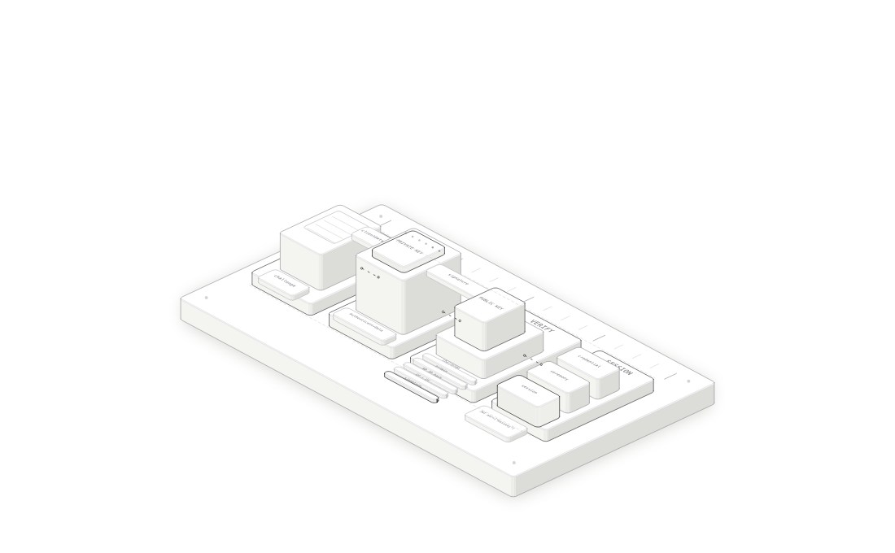

# 密码没有上网：我们在本地 Kubernetes 集群里完整跑通了 Passkey

> 从手机扫码、Face ID，到服务端公钥验签、Redis 会话和 JWT 签发，一次把 Passkey 的原理与工程落地讲透。

登录页面上那句“使用 Passkey 登录”看起来很简单，背后却跨越了浏览器、手机安全硬件、WebAuthn 协议、服务端认证、Redis 会话和 JWT。

这次我们没有停留在概念和架构图，而是在本地 Kind Kubernetes 集群里完整跑通了一条真实链路：先用密码登录并注册 Passkey，再退出账号，通过电脑页面展示的二维码调用手机上的 Passkey，使用 Face ID 完成签名，最后访问受保护接口。

最值得关注的结果不是“登录成功”，而是整个过程中：

- 密码没有参与 Passkey 登录；
- 私钥始终留在手机或密码管理器中；
- 网络上传输的是一次性挑战、公开凭证和数字签名；
- 服务端只保存公钥，使用公钥验签；
- 验证通过后复用现有的 JWT、Refresh Token 和设备会话体系；
- JWT 中的 `amr` 明确记录本次认证方式是 `passkey`。



## 一、Passkey 到底是什么

Passkey 是 WebAuthn/FIDO2 在用户产品中的常见名称。它不是“更复杂的密码”，而是一对非对称密钥：

```text
注册时
验证器在本地生成：私钥 + 公钥
私钥：留在设备、安全芯片或端到端加密的凭证系统中
公钥：交给服务端保存

登录时
服务端：生成一次性 challenge
验证器：使用私钥对本次请求签名
服务端：使用已保存的公钥验签
```

这里的“验证器”可以是手机、电脑的 Touch ID/Windows Hello、硬件安全密钥，或者支持 Passkey 的密码管理器。

私钥不会像密码一样发送给网站，也不会由服务端数据库保存。服务端数据库即使泄露，攻击者拿到的也是公钥；公钥可以验证签名，却不能生成合法签名。

## 二、本地系统的职责边界

我们的请求链路是：

```text
浏览器
  │ HTTPS + WebAuthn + Cookie
  ▼
本地 ALB
  │ TLS 终止
  ▼
APISIX
  │ 路由、限流、网关 HMAC
  ▼
API BFF
  │ HTTP/JSON ↔ gRPC/Protobuf
  ▼
user-service
  │ WebAuthn 注册与验签、Token 签发
  ▼
Redis
  ├─ 一次性 ceremony
  ├─ Passkey 公钥凭证
  ├─ Refresh Token
  └─ 设备会话与用户认证版本
```

几个边界尤其重要：

1. 浏览器负责调用 `navigator.credentials.create()` 和 `navigator.credentials.get()`。
2. 手机或系统验证器负责生成私钥、执行用户验证和数字签名。
3. BFF 负责浏览器协议适配、安全 Cookie 和统一会话出口，不自行伪造 WebAuthn 结果。
4. user-service 负责 challenge、Origin、RP ID、签名等 WebAuthn 核心校验。
5. Redis 保存短期 ceremony、长期公钥凭证和登录后的会话状态。

## 三、注册 Passkey：把公钥绑定到账号

注册不是匿名操作。用户必须先通过已有认证方式登录，系统才能确认“这个新公钥要绑定给谁”。本地演练先通过密码登录，然后执行下面两步。

### 第一步：获取注册参数

```http
POST /api/v3/auth/passkey/register/options HTTP/1.1
Host: localhost:18443
Origin: https://localhost:18443
Cookie: access_token=<redacted>
X-CSRF-Token: <redacted>
```

user-service 生成密码学安全的随机 challenge，并返回 WebAuthn 创建参数。与此同时，服务端把本次临时状态写入 Redis：

```text
auth:passkey:ceremony:{ceremonyId}
TTL = 5 分钟
```

`ceremonyId` 不是 Credential ID，也不是 Session ID。它只是连接“获取参数”和“提交结果”两次 HTTP 请求的一次性关联编号。

### 第二步：验证器创建密钥对

浏览器把服务端返回的参数交给：

```javascript
navigator.credentials.create({ publicKey })
```

验证器完成用户确认后，在本地生成新的私钥和公钥：

```text
私钥 ── 留在验证器中，不导出
公钥 ── 随注册响应交给服务端
```

浏览器把 Credential ID、客户端数据和 Attestation 响应提交给：

```http
POST /api/v3/auth/passkey/register/verify HTTP/1.1
```

服务端验证 challenge、Origin、RP ID 和用户验证标志，随后保存公钥凭证：

```text
auth:passkey:user:{userID}
  └─ Credential ID 集合

auth:passkey:credential:{credentialID}
  └─ 公钥、用户、Flags、AAGUID、计数器、创建时间等
```

我们的本地凭证显示：

```json
{
  "userId": "local-user",
  "status": "active",
  "credential": {
    "id": "<redacted>",
    "publicKeyEncodedLength": 104,
    "attestationType": "none",
    "flags": {
      "userPresent": true,
      "userVerified": true,
      "backupEligible": true,
      "backupState": true
    },
    "authenticator": {
      "attachment": "cross-platform"
    }
  }
}
```

`cross-platform` 与这次实践相符：Passkey 实际在手机侧完成，电脑浏览器通过二维码发起跨设备认证。`backupEligible` 和 `backupState` 表示该凭证可以被安全同步且当前已有备份；它不意味着私钥以明文存放在云端。

## 四、登录 Passkey：私钥签名，公钥验签

Passkey 登录同样分成两次请求。

### 第一步：服务端发出一次性挑战

```http
POST /api/v3/auth/passkey/login/options HTTP/1.1
Origin: https://localhost:18443
```

服务端生成新的 challenge 和 `ceremonyId`，保存到 Redis，五分钟后过期。浏览器调用：

```javascript
navigator.credentials.get({ publicKey })
```

本次实验中，浏览器弹出“扫码”与“安全密钥”选项。选择扫码后，手机读取二维码，用户通过 Face ID 确认。

### 第二步：验证器生成签名

浏览器生成 `clientDataJSON`，其中包含：

```json
{
  "type": "webauthn.get",
  "challenge": "<server-random-challenge>",
  "origin": "https://localhost:18443"
}
```

验证器生成二进制 `authenticatorData`，主要由以下部分组成：

```text
rpIdHash    32 字节，SHA256("localhost")
flags        1 字节，包含 UP、UV 等状态
signCount    4 字节，签名计数器
extensions   可选扩展数据
```

随后，验证器使用私钥对下面这段字节签名：

```text
signedData = authenticatorData || SHA256(clientDataJSON)
```

这里的 `||` 不是逻辑“或”，而是字节拼接：先放完整的 `authenticatorData`，紧接着放 `clientDataJSON` 的 SHA-256 摘要。

为什么要同时签这两部分？

- `authenticatorData` 把签名绑定到 RP ID、用户在场状态、用户验证状态和计数器；
- `clientDataJSON` 把签名绑定到服务端 challenge、当前 Origin 和本次操作类型；
- 任意一部分被修改，公钥验签都会失败。

浏览器最终提交的不是私钥，而是：

```text
Credential ID
clientDataJSON
authenticatorData
signature
userHandle
ceremonyId
```

## 五、服务端究竟如何判断这次登录有效

user-service 收到登录结果后，按顺序完成以下检查。

### 1. 原子消费 ceremony

服务端使用类似 `GETDEL` 的原子语义读取并删除：

```text
auth:passkey:ceremony:{ceremonyId}
```

这样同一个 challenge 不能被再次使用。Key 不存在、已经过期或已经消费，登录都会失败。

### 2. 校验 challenge

服务端解码 `clientDataJSON`，要求其中的 challenge 与 Redis 中保存的原始值完全一致。攻击者不能拿旧签名响应新的登录挑战。

### 3. 校验 Origin

本地允许的 Origin 是：

```text
https://localhost:18443
```

如果钓鱼页面运行在另一个域名，即使它诱导用户触发验证器，`clientDataJSON.origin` 也不匹配。

### 4. 校验 RP ID Hash

服务端计算：

```text
SHA256("localhost")
```

并与 `authenticatorData` 中的 `rpIdHash` 比较。Origin 绑定页面来源，RP ID 绑定凭证所属站点，二者共同形成 Passkey 抗钓鱼的核心边界。

### 5. 校验 UP 与 UV

- UP（User Present）：用户确实触碰、确认或操作了验证器；
- UV（User Verified）：验证器已通过 Face ID、指纹、PIN 等确认用户身份。

本地策略要求 UV，因此只“有人碰了安全密钥”还不够。

### 6. 使用公钥验签

服务端根据 Credential ID 找到已保存的 COSE 公钥，再验证：

```text
Verify(
  publicKey,
  authenticatorData || SHA256(clientDataJSON),
  signature
)
```

是的，这里就是“私钥签名，公钥验签”。私钥在手机中生成合法签名；服务端持有的公钥只能回答签名是否真实，无法反向推出私钥，也不能替用户登录。

### 7. 更新凭证使用信息

验证成功后，服务端更新 `lastUsedAt` 和签名计数器。计数器可辅助发现被克隆的硬件凭证；但同步型 Passkey 的计数器可能长期为 0，不能把它当成唯一安全依据。

## 六、WebAuthn 成功后，为什么还需要 JWT 和 Redis

WebAuthn 解决的是“这一次认证是否成功”，它不是每个业务请求都重复执行的会话协议。验签成功后，系统复用已有会话体系：

```text
Passkey 验签成功
  ↓
创建 Redis 设备会话
  ↓
签发 Access Token + Refresh Token
  ↓
BFF 写入安全 Cookie
  ↓
后续业务请求执行 JWT + sid + ver 校验
```

我们手工解码的 Access Token，脱敏后如下：

```json
{
  "iss": "local-platform-lab",
  "aud": "api-bff",
  "sub": "local-user",
  "sid": "<redacted-session-id>",
  "jti": "<redacted-token-id>",
  "ver": 2,
  "amr": ["passkey"],
  "auth_time": 1792582249,
  "iat": 1792582249,
  "exp": 1792584049
}
```

这里最直观的证据是：

```json
"amr": ["passkey"]
```

它说明本次会话由 Passkey 建立，而不是密码或 TOTP。高风险接口可以据此要求更强的认证方式或更近的 `auth_time`。

Redis 中对应的设备会话为：

```json
{
  "ID": "<same-as-jwt-sid>",
  "UserID": "local-user",
  "UserVersion": 2,
  "AuthMethods": ["passkey"],
  "AuthenticatedAt": 1792582249,
  "Status": "active"
}
```

我们还验证了三项关联：

```text
JWT.sid == Redis Session.ID
JWT.sub == Redis Session.UserID
JWT.ver == Session.UserVersion == auth:user-version:{sub}
```

Session TTL 接近 7 天，Access Token 有效期是 30 分钟。短期 Access Token 缩小泄露窗口，长期设备会话和轮换型 Refresh Token 保持登录体验；退出设备时把 Session 标记为 revoked，就能立即拒绝该设备下所有尚未过期的 Access Token。

## 七、我们如何手工验收整条链路

### 验收 1：Passkey 登录后访问受保护接口

```http
GET /api/v3/profile HTTP/1.1
Cookie: access_token=<redacted>
```

响应：

```json
{
  "userId": "local-user",
  "verificationStatus": "not_started",
  "source": "user-service-generic-grpc"
}
```

HTTP 200 证明 Passkey 建立的会话已经通过 APISIX、BFF、JWT、Redis Session 和下游 gRPC 的完整校验。

### 验收 2：解码 JWT

我们检查了 `sub`、`sid`、`jti`、`ver` 和 `amr`。其中 `amr=["passkey"]` 证明认证方式没有在会话签发过程中丢失。

### 验收 3：检查 Redis Session

```text
GET auth:session:{sid}
GET auth:user-version:{sub}
TTL auth:session:{sid}
```

结果显示 Session 为 `active`、版本为 2、认证方式为 `passkey`，TTL 接近七天。

### 验收 4：检查 Credential 公钥记录

```text
SMEMBERS auth:passkey:user:{userID}
GET auth:passkey:credential:{credentialID}
```

服务端记录中只有公钥凭证和元数据，没有手机私钥。

### 验收 5：验证一次性 ceremony

正常验证完成后，再读取同一个 ceremony Key 应该得到不存在。重复提交相同登录响应也应失败，这证明 challenge 不能被重放。

## 八、这套方案为什么比密码更抗钓鱼

传统密码是可复制的共享秘密。用户在假网站输入一次，攻击者就能把同一串字符拿到真网站使用。

Passkey 的签名同时绑定 challenge、Origin 和 RP ID：

```text
假网站 Origin 不匹配
        ↓
RP ID 也不能冒充真实站点
        ↓
验证器不会为错误站点生成可在真实站点使用的签名
```

即使攻击者观察到一次完整登录请求，也只能看到公钥信息和这一次 challenge 的签名。下一次 challenge 不同，旧签名无法重放。

不过，“抗钓鱼”不等于“系统绝对安全”。仍然需要保护：

- 登录成功后的 Cookie 和 Refresh Token；
- BFF、APISIX 与内部网络边界；
- 账号恢复与新增 Passkey 流程；
- 用户设备和云端凭证账户；
- 日志、监控和调试信息。

## 九、实践中遇到的几个关键问题

### 1. WebAuthn 必须运行在安全上下文

本地环境使用 HTTPS。自签名证书未被系统信任时，浏览器可能直接拒绝 WebAuthn。我们先让 macOS 信任本地证书，再从 `https://localhost:18443` 发起操作。

### 2. 二维码不是公钥或 Secret

跨设备登录中的二维码主要建立电脑与手机之间的安全协作通道。真正的私钥仍在手机验证器中，二维码本身不是可永久复用的登录凭证。

### 3. `clientDataJSON` 不在 Redis 中预先保存

`clientDataJSON` 由浏览器在当前操作中创建；`authenticatorData` 由验证器创建。Redis 保存的是服务端先前生成的 challenge 和临时 ceremony 状态，服务端收到响应后再把双方数据进行比对。

### 4. `attestationType: none` 不代表没有签名

Attestation 回答“注册时是否证明了验证器的型号或来源”；Assertion Signature 回答“登录时是否持有对应私钥”。选择 `none` 只是不要求厂商级设备证明，不会取消后续公钥验签。

### 5. 认证数据绝不能进入普通访问日志

实践中我们发现 gRPC 访问日志会打印密码和完整 WebAuthn 响应。这不是协议问题，却是非常真实的工程风险。随后我们为敏感认证 RPC 配置了内容忽略规则，并增加回归测试，确保：

- 登录、刷新、TOTP、Passkey 请求体不进入普通日志；
- 邮箱、密码、签名、Credential 响应不被记录；
- 错误日志只保留必要的错误码、Trace ID 和脱敏上下文。

安全系统最怕“密码学做对了，日志却把秘密抄了一份”。

## 十、从本地实验走向生产还需要什么

当前实现已经证明了协议与会话链路，但生产环境还应补齐：

1. 持久化数据库：凭证、公钥和状态不应只依赖单实例 Redis。
2. 多凭证管理：支持命名、查看、撤销多台设备上的 Passkey。
3. 安全恢复：恢复账号或新增 Passkey 必须是高风险操作，防止恢复通道绕过 Passkey。
4. 风险审计：记录注册、登录、撤销、异常 Origin、验签失败和恢复事件，但不能记录秘密材料。
5. 速率限制：对 options、verify 和账号恢复接口分别限流。
6. 原子一致性：ceremony 必须一次性消费，Refresh Token 必须轮换，凭证状态更新要防并发覆盖。
7. 密钥与版本治理：JWT 使用 `kid + JWKS` 轮换签名密钥，Passkey 公钥则按 Credential ID 独立管理。
8. 跨浏览器测试：覆盖 Safari、Chrome、Edge、Windows Hello、Android、iOS 和硬件安全密钥。
9. 高风险操作 Step-up：提现、改密、解绑认证方式等操作可要求最近完成 Passkey 或另一项强认证。

## 十一、最后总结

这次本地实践把一个容易被误解成“手机扫码登录”的功能拆回了完整安全链路：

```text
服务端生成一次性 challenge
        ↓
浏览器绑定 challenge 与 Origin
        ↓
验证器绑定 RP ID、UP、UV，并用私钥签名
        ↓
服务端原子消费 ceremony，用公钥验签
        ↓
创建 Redis 设备会话
        ↓
签发 amr=["passkey"] 的 JWT 和轮换型 Refresh Token
        ↓
后续请求继续接受 sid、ver 和 Session 治理
```

Passkey 最关键的价值，不是把密码换成了 Face ID，而是改变了认证秘密的流动方式：私钥不再交给网站，服务端也不再保存可用于冒充用户的共享密码。浏览器、验证器和服务端通过 challenge、Origin、RP ID 与数字签名，共同证明“正确的用户，正在正确的网站上，批准这一次操作”。

而真正可上线的 Passkey，也从来不只是一段 WebAuthn 示例代码。它必须和 HTTPS、会话治理、Refresh Token 轮换、CSRF、网关边界、日志脱敏、账号恢复与审计一起工作。只有把这些环节连起来，Passkey 才从一个漂亮的登录按钮，变成一套可以被验证、撤销和运营的认证系统。
