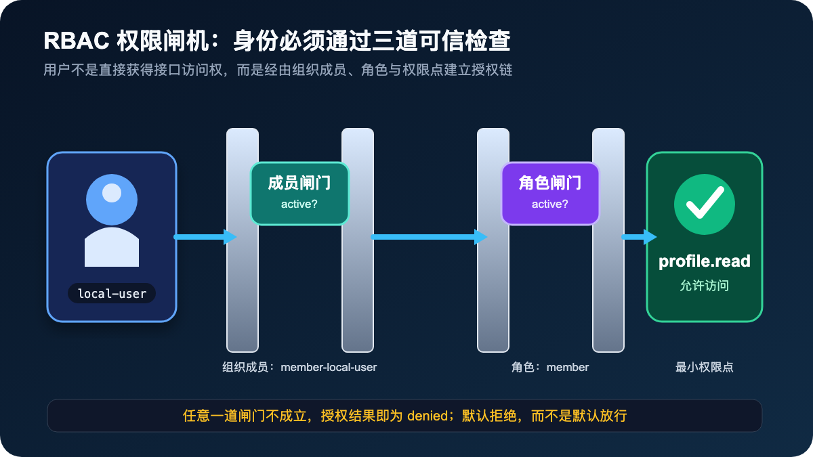
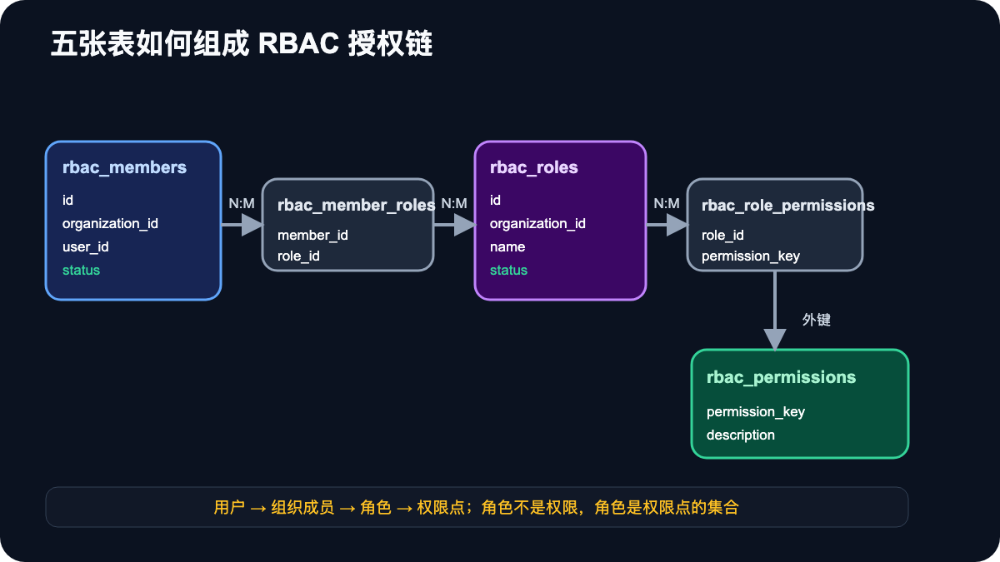
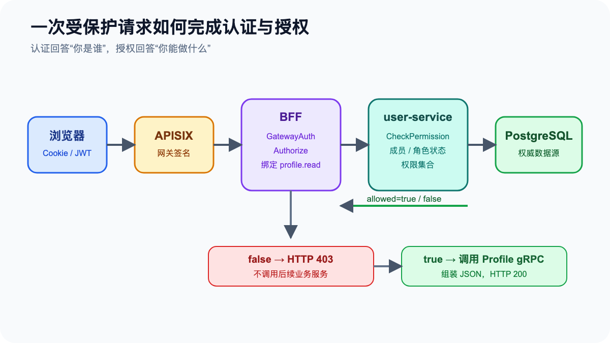
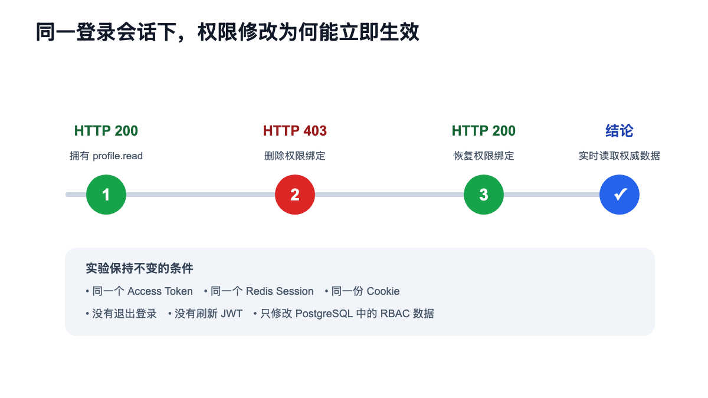

# 从“登录成功”到“允许访问”：在本地 Kubernetes 集群落地一套可实时生效的 RBAC

登录成功，不代表用户可以访问系统里的所有接口。

认证解决的是“你是谁”，授权解决的是“你能做什么”。如果只完成 JWT 登录认证，却没有独立的授权模型，那么系统最终往往会出现两种极端：要么在业务代码里散落大量 `if user.IsAdmin`，要么把过多权限交给网关，导致组织、角色和业务数据边界难以表达。

本文记录一次完整的本地实践：在 Kind Kubernetes 集群中部署 PostgreSQL，以它作为 RBAC 权威数据源；由 BFF 声明接口所需权限，通过 gRPC 请求 user-service 判定权限，并用同一登录会话完成 `200 → 403 → 200` 的实时权限变更实验。



## 一、先把三个概念分清楚

### 1. 认证：你是谁

用户登录后获得 Access Token。BFF 验证 Token 的签名、有效期、设备会话 `sid` 和用户认证版本 `ver`，确认请求来自一个有效身份。

认证失败通常返回 HTTP `401 Unauthorized`。它表达的是：系统不能确认你的身份，或者你的登录状态已经失效。

### 2. 授权：你能做什么

身份有效之后，系统仍需判断该用户能否执行当前操作。例如：

```text
profile.read       读取用户资料
profile.update     修改用户资料
account.read       读取账户信息
member.manage      管理组织成员
role.assign        分配角色
```

已经登录但缺少权限时，应返回 HTTP `403 Forbidden`。它表达的是：系统知道你是谁，但不允许你执行这项操作。

### 3. RBAC：通过角色组织权限

RBAC 的全称是 Role-Based Access Control，即基于角色的访问控制。

用户通常不直接绑定大量权限点，而是先成为某个组织的成员，再被授予一个或多个角色，角色最后包含若干权限点：

```text
用户 → 组织成员 → 角色 → 权限点
```

例如：

```text
local-user
  → local-org 中的 member-local-user
  → member 角色
  → profile.read
```

`profile.read` 是权限点，不是角色。`member` 才是角色，角色本质上是权限点的集合。

## 二、为什么必须保留组织成员这一层

最简单的实现可能是：

```text
user_id → role_id
```

但在多组织系统中，这会丢失角色生效的边界。同一个用户完全可能在不同组织中拥有不同角色：

```text
同一个 local-user
  ├─ 在 local-org 中是 member
  └─ 在 another-org 中是 admin
```

因此角色应该绑定到“用户在组织中的成员身份”，而不是直接绑定到全局用户。授权请求也必须包含三个维度：

```text
userID + organizationID + permissionKey
```

这可以避免用户把 A 组织中的管理员权限带到 B 组织。

## 三、五张表如何组成授权模型

本次实践采用五张表：



### rbac_members

记录用户在组织中的成员身份：

```text
id              = member-local-user
organization_id = local-org
user_id         = local-user
status          = active
```

如果成员状态变成 `disabled`，即使后续角色和权限绑定仍然存在，也必须拒绝访问。

### rbac_roles

定义组织内的角色：

```text
id              = role-member
organization_id = local-org
name            = member
status          = active
```

角色也有独立状态。停用角色可以一次切断所有使用该角色的成员权限，而不需要删除关联数据。

### rbac_permissions

它是系统合法权限点的目录：

```text
permission_key = profile.read
description    = Read the authenticated user profile
```

独立权限目录可以通过外键阻止拼写错误的权限进入授权关系。

### rbac_member_roles

它将组织成员与角色关联起来：

```text
member-local-user → role-member
```

一个成员可以拥有多个角色，一个角色也可以分配给多个成员。

### rbac_role_permissions

它定义角色所拥有的权限点：

```text
role-member → profile.read
```

一个角色可以包含多个权限点，同一个权限点也可以被 member、support、admin 等多个角色复用。

## 四、权限到底由谁检查

本次实现采用清晰的职责拆分：

```text
BFF：当前 HTTP 接口需要什么权限？
user-service：这个用户在该组织是否拥有该权限？
```



以 `GET /api/v3/profile` 为例，服务端路由声明：

```go
Authorize(ctx, "profile.read", ProfileHandler(ctx))
```

权限点固定在可信的服务端代码中，客户端不能通过 Header 或 Query 参数自行指定权限点。

统一授权中间件取得经过认证的用户身份后，通过 gRPC 调用：

```text
CheckPermission(
  userID         = "local-user",
  organizationID = "local-org",
  permissionKey  = "profile.read",
)
```

user-service 查询 PostgreSQL 并返回 `allowed=true/false`。BFF 收到 `false` 后直接返回 `403`，不会继续调用资料服务；只有 `true` 才会执行后续业务逻辑。

这里有一个重要原则：授权服务异常时不能默认放行。数据库超时或 gRPC 调用失败，应返回服务不可用，而不是把“无法判断”误判成“拥有权限”。

## 五、授权算法：默认拒绝

本次 `CheckPermission` 遵循以下规则：

```text
找不到组织成员            → denied
成员状态不是 active       → denied
没有绑定任何角色          → denied
角色状态不是 active       → 忽略该角色
活动角色不包含目标权限     → denied
至少一个活动角色包含权限   → allowed
数据库查询失败             → error，不放行
```

授权系统最重要的默认值不是 `true`，而是 `false`。只有完整授权链能够被证明时才允许访问。

## 六、为什么第一阶段不用 Redis 做权限缓存

Redis 非常适合缓存，但缓存会引入新的问题：

- 权限修改后缓存何时失效？
- 多个 BFF 实例如何同时感知变更？
- 删除角色后，旧缓存还能存活多久？
- 缓存与数据库不一致时应该相信谁？

因此第一阶段让 PostgreSQL 成为唯一权威数据源，每次权限检查都读取数据库。这样最容易确认模型和安全边界是正确的。

当调用量确实需要缓存时，再引入带版本号的权限快照或短 TTL，并明确：Redis 只是加速层，PostgreSQL 仍是最终事实来源。

## 七、Kind 集群中的实际部署

本地集群新增了一个 PostgreSQL StatefulSet：

```text
PostgreSQL 17
1 个副本
1Gi PersistentVolumeClaim
数据库凭据存放在 Kubernetes Secret
```

真实密码在部署时随机生成，仅写入集群中的 Secret，不进入 Git 仓库。user-service 通过 Secret 中的 DSN 连接 PostgreSQL。

PostgreSQL、user-service 和 api-bff 都由 Argo CD 管理，最终状态为：

```text
postgres       Synced / Healthy
user-service   Synced / Healthy
api-bff        Synced / Healthy
```

## 八、最关键的手工实验：200 → 403 → 200

为了证明权限修改确实实时生效，我们保持以下条件完全不变：

- 同一个 Access Token；
- 同一个 Redis Session；
- 同一份浏览器 Cookie；
- 不退出登录；
- 不刷新 JWT。

唯一变化是 PostgreSQL 中的权限数据。



### 第一步：拥有权限

`role-member` 包含 `profile.read`，访问资料接口：

```text
GET /api/v3/profile
HTTP 200
```

### 第二步：删除权限绑定

```sql
DELETE FROM rbac_role_permissions
WHERE role_id = 'role-member'
  AND permission_key = 'profile.read';
```

继续使用同一份 Cookie 请求：

```json
HTTP 403
{
  "error": "permission denied"
}
```

### 第三步：恢复权限

```sql
INSERT INTO rbac_role_permissions (role_id, permission_key)
VALUES ('role-member', 'profile.read');
```

再次请求立即恢复为 HTTP `200`。

我们还停用了 `role-member` 的状态。在不删除权限绑定的情况下，同一个请求也立即变成 `403`。这证明成员状态和角色状态都真实参与了授权决策。

## 九、为什么把授权做成 BFF 中间件

最初可以在 Profile Handler 里直接调用 `CheckPermission`，但随着接口数量增长，会出现大量重复代码：

```text
读取身份 → 调权限服务 → 处理错误 → 判断 allowed → 返回 403
```

统一中间件后，路由本身就是可读的权限清单：

```go
Authorize(ctx, "profile.read", ProfileHandler(ctx))
Authorize(ctx, "account.read", AccountHandler(ctx))
Authorize(ctx, "member.manage", MemberHandler(ctx))
```

它带来三个直接收益：

1. 业务 Handler 只处理业务，不再重复授权代码；
2. 权限点与路由的关系集中、可审查；
3. 统一保证 `401`、`403` 和授权服务异常的处理方式。

但并不是所有权限都应只检查到接口级。对于“只能修改自己创建的订单”这类资源归属规则，RBAC 只能完成第一层粗粒度授权，业务服务仍需校验具体资源是否属于当前用户或组织。

## 十、几个容易混淆的问题

### APISIX 为什么不直接做 RBAC

APISIX 适合 JWT 校验、限流、IP 策略和网关签名等通用能力。组织成员状态、角色关系和业务权限依赖数据库实时数据，更适合由后端授权服务处理。

### JWT 中为什么不直接塞入全部角色和权限

这样虽然减少数据库查询，但角色修改后旧 JWT 在过期前仍携带旧权限。需要实时权限治理时，短期身份 Token 与服务端授权状态应该分开。

### 角色停用和用户封禁一样吗

不一样。停用组织角色影响使用该角色的授权；停用组织成员只影响用户在该组织中的访问；全局封禁用户则属于认证与账号治理，需要通过 Session、用户版本或账号状态处理。

### 401 和 403 如何选择

```text
身份无效或未登录：401
身份有效但权限不足：403
授权服务不可用：503
```

## 十一、下一阶段怎么演进

这套最小实现已经验证了正确的授权边界，后续可以按以下顺序演进：

1. 为 account、member、role 等接口增加权限点；
2. 增加审计日志，记录谁在何时修改了角色和权限；
3. 增加资源级授权，处理“自己的数据”和“组织的数据”；
4. 引入短 TTL 或版本化 Redis 权限缓存；
5. 增加角色管理后台，但所有操作仍必须经过授权接口；
6. 增加跨组织隔离、并发修改和数据库故障测试。

## 结语

RBAC 的价值不只是多建几张表，而是建立一条可解释、可审计、可立即撤销的授权链：

```text
身份可信
  → 组织成员有效
  → 角色有效
  → 角色拥有目标权限
  → 才允许执行业务操作
```

这次实践最重要的结果也不是接口返回了 `200`，而是我们能够在不修改 JWT、不退出登录的情况下，仅通过改变权威授权数据，让同一个请求立即变为 `403`，并在恢复授权后重新回到 `200`。

这说明认证、会话与授权已经成为彼此独立、边界清晰的系统能力。
