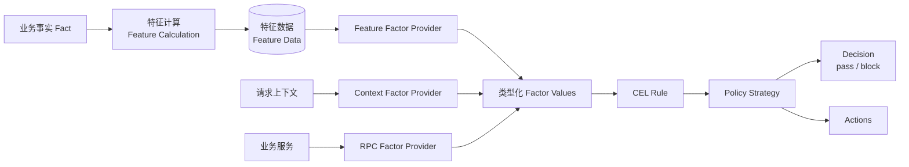
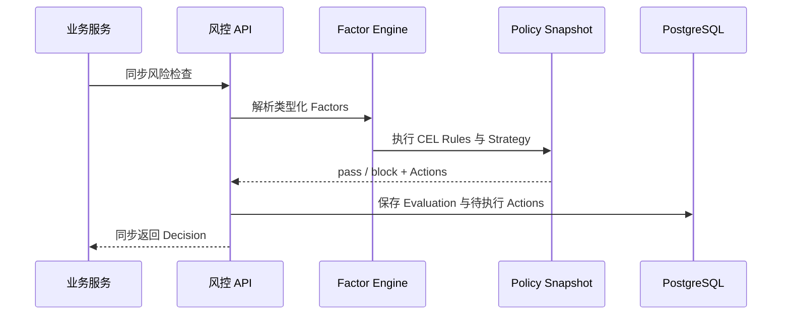
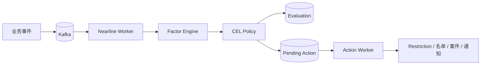
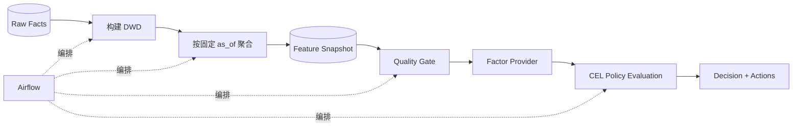
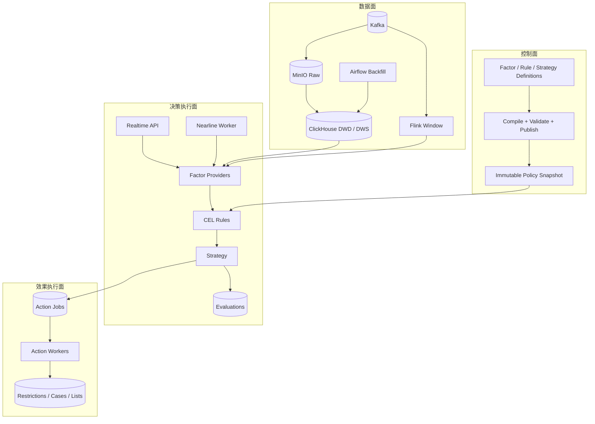
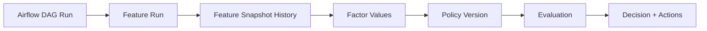
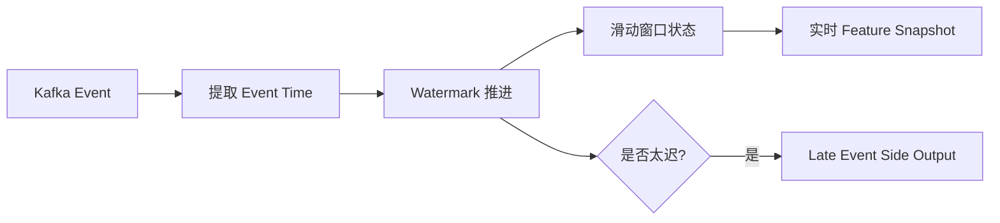
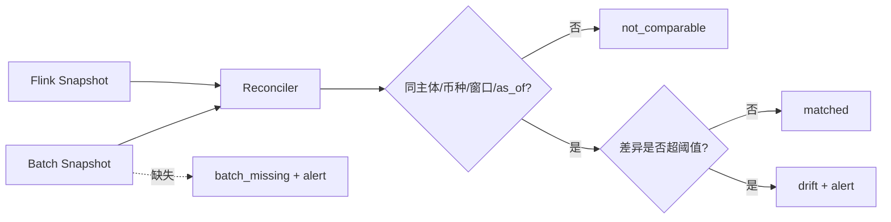

# 从一次同步拦截到实时、近线与离线：在 Kind 集群搭建一套可解释风控平台

> 这不是一篇“装几个中间件就算建成风控平台”的文章。我们会从风控到底要解决什么问题开始，逐层拆解事实、特征、因子、规则、策略、决策与动作，再把实时、近线、离线、数仓、流计算和任务编排放回各自正确的位置。最后，我们会用一条“资金快速流入又快速流出”的风险链路，在本地 Kind 集群中把整个系统跑通。

## 一、先问一个根本问题：风控系统到底是什么

很多系统的风控，最初都长成这样：

```go
if amount > 50000 && accountAge < 7 {
    return "block"
}
```

这段代码并没有错。真正的问题是，随着业务发展，我们很快会继续问：

- 这个金额从哪里取得，是否可信？
- “最近 24 小时”按业务时间还是服务器当前时间计算？
- 规则修改后，历史决策还能否解释？
- 同一个判断能否同时用于同步请求、Kafka 事件和历史回算？
- 命中规则后，是直接拦截，还是加入名单、创建案件、限制提现？
- 流式计算与批量计算结果不一致时，应该相信谁？

因此，风控平台真正要解决的不是“如何写一个 if”，而是四件事：

1. **取得可信、可复现的判断依据；**
2. **用可治理、可版本化的方式表达判断逻辑；**
3. **在不同时间尺度上稳定执行；**
4. **把决策转成可审计、可重试、可撤销的业务效果。**

如果把一次业务事件看作一个“点”，那么：

- 实时风控观察当前这个点；
- 近线风控把不断到来的点连接成一条线；
- 离线风控在更长周期内把多条线连接成一张网。

这三者不是三套互不相干的引擎，而是一套共享语义、按照时效分层执行的风控平台。

## 二、先统一语言：Fact、Feature、Factor、Rule、Strategy

风控系统最容易踩的坑，不是技术选型，而是概念混用。我们的最终口径如下：



### 1. Fact：已经发生的可信事实

例如一笔入金、一笔提现、一次设备登录。Fact 应尽量保持原貌，不替某条规则提前下结论。

### 2. Feature：数仓或特征工程的产物

例如：

```text
最近 24 小时入金 = 100000
最近 24 小时出金 = 95000
最近 24 小时流出比例 = 0.95
```

Feature 关注的是：如何从历史事实中计算、聚合、版本化和回放数据。它属于数仓与特征工程。

### 3. Factor：决策引擎的类型化输入

Factor 定义“规则需要的值如何取得”。它可以来自：

- 当前请求中的可信上下文；
- PostgreSQL、Redis 中的状态；
- 已聚合的 Feature；
- 注册过的 RPC 服务；
- 其他 Factor 的表达式计算；
- 模型推理结果。

同一个 `outflow_ratio_24h = 0.95`，在数仓中是 Feature Data；被 Feature Provider 读取并送入决策环境后，是一次 Evaluation 的 Factor Value。

### 4. Rule：只负责判断，不负责取数和副作用

我们选择 CEL 作为规则表达式引擎：

```text
inflow_minor_24h >= 50000 && outflow_ratio_24h >= 0.90
```

Rule 只能引用已经解析好的 Factor，最终返回布尔值。它不能在表达式中直接调用 RPC、SQL、Redis 或 HTTP。

这条边界非常关键：如果 Rule 同时负责取数、网络调用、数学计算和业务效果，它很快会变成一段难以测试、难以回放的小程序。

### 5. Strategy：把规则命中映射成决策和动作

```text
Policy
├── Default Decision: pass
└── Strategies
    └── Rapid Outflow Strategy
        ├── Rule: rapid_outflow
        ├── Priority: 100
        ├── Decision: block
        ├── Reason Codes: rapid_outflow
        └── Actions
            └── activate_restriction(withdrawal)
```

`Decision` 只回答当前业务能否继续，例如 `pass` 或 `block`。

`Action` 表示额外要做的事情，例如限制提现、加入名单、创建案件、发送通知。Action 由独立执行器完成，不能在规则求值过程中直接修改业务状态。

## 三、实时、近线、离线为什么要分层

它们的本质区别，是业务能等待多久、能付出多少取数成本、要观察多长时间范围。

| 维度 | 实时 | 近线 | 离线 |
|---|---|---|---|
| 业务是否等待 | 同步等待 | 不等待，异步通知 | 不阻塞当前业务 |
| 典型延迟 | 毫秒级 | 秒到分钟 | 分钟到小时 |
| 观察范围 | 当前请求、短窗口 | 多事件窗口、状态变化 | 30/90/180 天、全量历史 |
| 入口 | HTTP / gRPC | Kafka | Airflow 等调度器 |
| 失败处理 | fail-open / fail-closed | 重试、幂等、DLQ | 重跑、断点恢复、Backfill |

### 实时链路



实时风控的第一目标是稳定的延迟预算。高成本查询不能因为“也是风控数据”就塞进同步路径。

### 近线链路



近线风控不要求原业务请求原地等待，因此可以观察更多事件、调用更昂贵的因子，并通过 Action 异步影响后续业务。

### 离线链路



Airflow 不是规则引擎，也不是数据计算引擎。它解决的是：哪个任务先执行、失败后是否重试、下游能否继续、历史区间如何回算，以及每次运行如何审计。

## 四、总体架构：控制面、执行面、数据面、效果面



这四个平面各自解决不同问题：

- **控制面**：策略如何定义、检查、发布和回滚；
- **数据面**：事实如何保存、聚合、回放和流式计算；
- **决策执行面**：同一份 Factor 与 Policy 如何在三种时效下复用；
- **效果执行面**：副作用如何异步、幂等、可重试地落地。

## 五、关键模块分别解决什么问题

| 模块 | 解决的问题 | 不应该承担的职责 |
|---|---|---|
| Factor Registry / Provider | 定义类型、来源和依赖，取得规则输入 | 决定 pass/block |
| Factor Engine | 按依赖拓扑求值，保证单次请求内只取一次 | 保存策略、执行 Action |
| CEL Rule Engine | 编译并执行布尔表达式 | 调 RPC、写数据库 |
| Policy / Strategy | 管理优先级、默认决策、原因和 Actions | 直接限制账户 |
| Policy Snapshot Runtime | 原子切换不可变已发布版本 | 在请求中拼装半成品策略 |
| Evaluation Store | 保存当时使用的策略、因子、轨迹和结果 | 覆盖历史结果 |
| Action Worker | 可靠执行限制、名单、案件、通知 | 重新解释 Rule |
| Kafka | 解耦事件生产者与近线消费者 | 代替业务幂等和 Schema 治理 |
| MinIO Raw | 保存不可变原始事实，支持回放 | 直接服务低延迟规则查询 |
| ClickHouse | 保存逐笔事实和聚合快照，支持分析查询 | 提供关系库式唯一约束 |
| Airflow | 编排依赖、重试、Backfill 和运行状态 | 承担规则求值语义 |
| Flink | 按 Event Time 持续维护窗口状态 | 完全替代历史批量回算 |
| PostgreSQL | 策略、Evaluation、Action、血缘、幂等注册 | 承担高吞吐 OLAP 扫描 |

## 六、教练实战：用“快进快出”串起完整链路

我们使用一个刻意简化的场景：某主体最近 24 小时入金 100000，出金 95000。

```text
inflow_minor_24h  = 100000
outflow_minor_24h =  95000
outflow_ratio_24h =   0.95
```

规则是：入金不少于 50000，并且流出比例不少于 90%。

```text
inflow_minor_24h >= 50000 && outflow_ratio_24h >= 0.90
```

命中后的 Strategy 输出：

```text
Decision = block
Reason   = rapid_outflow
Action   = activate_restriction
Target   = withdrawal
```

注意：`block` 是本次决策；`activate_restriction(withdrawal)` 是需要异步执行的持续效果。两者不是一回事。

### 第一关：先证明规则发布前就能发现错误

CEL 编译 Gate 验证了三类错误：

- 引用了不存在的 Factor；
- 用字符串和整数做不合法比较；
- Rule 最终没有返回布尔值。

这些错误应在策略发布阶段暴露，而不是等用户发起提现时才发现。

### 第二关：证明同一套引擎可以解释结果

Factor Engine 按依赖顺序生成 Factor Snapshot，CEL 返回 Rule 是否命中，Strategy Trace 记录哪个规则、哪个策略生效。这样一次决策可以回答：

```text
哪版 Policy？
使用了哪些 Factor Values？
命中了哪条 Rule？
由哪条 Strategy 产生 block？
生成了哪些 Actions？
```

### 第三关：证明 Kafka 的“至少一次”不会重复处罚

近线 Worker 使用 `evaluation_id` 做业务幂等。同一事件重复投递时：

- Evaluation 仍只有一条；
- Action Job 仍只有一条；
- Restriction 不会重复激活；
- 冲突复用相同 ID、不同内容时必须拒绝。

只看 Kafka Offset 归零不够。真正需要验证的是业务效果没有重复。

### 第四关：让离线计算可以穿越时间

离线任务必须显式传入 `as_of`，窗口固定为：

```text
(as_of - 24h, as_of]
```

不能在任务内部偷偷使用“当前时间”。否则历史 Backfill 在不同日期重跑，会得到不同结果，形成未来数据泄漏。

Airflow DAG 按顺序执行：

```text
build_feature_snapshot
        ↓
validate_feature_snapshot
        ↓
evaluate_risk_policy
```

如果快照为空、数据质量不合格或上游失败，下游不得继续产生 Decision。

### 第五关：理解 Backfill 和血缘

Backfill 是按历史业务时间重新计算。例如补算过去七天的每日快照，而不是把今天的结果复制七份。

我们保存的血缘关系是：



于是可以回答：“这次 block 是哪次回算、哪个 `as_of`、哪版 Feature、哪版 Policy 产生的？”

同一个 Run ID 对应相同内容允许幂等重放；同一个 Run ID 对应不同内容必须冲突报警。因为 ClickHouse 不提供关系数据库式唯一约束，所以 Run 指纹先在 PostgreSQL 中原子注册，再允许写入 ClickHouse。

### 第六关：Flink 的实时性到底体现在哪里

Flink 消费 Kafka 事件，按事件真正发生的时间维护窗口，而不是简单按消息到达服务器的时间计算。



- **Event Time**：业务事件真正发生的时间；
- **Watermark**：系统对“事件大致已经到齐”的进度判断；
- **Late Event**：晚于允许迟到范围的事件，不能悄悄丢弃；
- **Checkpoint**：保存流任务状态，Pod 重启后继续计算而不是从零开始。

本地演练验证了正常窗口、真正的 Late Event，以及 TaskManager 重启后从 Checkpoint 恢复。

### 第七关：为什么 Flink 不能直接取代批处理

流计算擅长及时，批处理擅长完整和可回放。两者需要 Shadow 对账，而不是直接宣布其中一个是唯一真相。



我们最终定义了四种结果：

- `matched`：可比较且差异在阈值内；
- `drift`：可比较但差异超阈值；
- `not_comparable`：版本、窗口或点时不同；
- `batch_missing`：流结果存在，但对应批结果尚未产生。

第一次对账还暴露了一个很“工程化”的问题：ClickHouse 的定长字符串带有尾部 NUL，直接写入 PostgreSQL JSONB 会失败。修复后，相同 Kafka 消息重放只保留一条不可变对账证据，并标记 replay。

这也是实践的价值：架构图上的箭头不会告诉你序列化边界会在哪里出错。

## 七、我们现在到底完成到了什么程度

| 阶段 | 当前结论 | 已证明 | 尚未证明 |
|---|---|---|---|
| 统一因子与策略 | 本地纵向闭环完成 | 类型化 Factor、依赖求值、CEL Gate、Strategy、不可变 Snapshot | 全量真实业务 RPC、多 Pod 发布一致性 |
| 实时决策 | 本地纵向闭环完成 | HTTP 决策、Evaluation、Action Job、提现限制 | 生产延迟、容量、容灾 |
| 近线决策 | MVP 完成 | Kafka 消费、类型安全、幂等、重试、Action Worker | 业务 Outbox、Schema Registry、完整 DLQ、多种 Action |
| Raw / DWD / DWS | 本地纵向闭环完成 | 不可变 Raw、Parquet、ClickHouse、固定点时快照 | 生产数据规模、HA、生命周期治理 |
| Airflow 离线编排 | 本地纵向闭环完成 | 质量闸门、Backfill、断点恢复、运行血缘 | 大规模并行、租约取消、生产调度治理 |
| Flink Shadow | S3a/S3b 纵向闭环完成 | Event Time、Watermark、Late Event、Checkpoint、流批对账 | 连续匹配率、正式 24h 容量、HA JobManager |
| 策略治理 | 尚未完整建设 | 编译 Gate、版本发布、单进程原子切换 | 草稿、测试、审批、灰度、全量、回滚完整流程 |
| Feature Store | 暂缓 | 已证明 Feature Provider 边界 | 尚无足够跨业务复用证据，不应为了名词提前引入 |

准确定位是：**我们完成了一套实时、近线、离线、数仓、流计算与效果执行贯通的本地平台级 MVP，并获得了关键一致性证据；它还不是生产级风控平台。**

## 八、现在是否适合告一段落

答案是：**适合，但要先完成工程收口。**

原因不是“已经没有东西可做”，而是当前最重要的架构假设都已通过纵向实践：

- Feature 与 Factor 的边界成立；
- Factor 取值与 Rule 判断能够解耦；
- Rule、Strategy、Decision、Action 职责清晰；
- 同一 Policy 内核能够服务实时、近线和离线；
- Kafka 至少一次交付下的业务幂等可验证；
- 固定 `as_of`、Backfill 和血缘能够保证历史可复现；
- Flink 的 Event Time、状态恢复和流批对账可落地。

继续横向增加组件，会从“验证架构”变成“模拟生产规模”，但没有真实业务量、SLA 和组织流程作为约束，容易做出昂贵却没有使用证据的抽象。

告一段落前还应完成五项收口：

1. 审查当前未提交的应用代码与 GitOps 清单；
2. 运行全量测试、静态检查和敏感信息扫描；
3. 将应用源码与 GitOps 变更按独立提交边界提交、推送；
4. 使用正式镜像版本重新部署，并执行一次最终 Kind 验收；
5. 固化验收证据、已知限制和恢复手册。

这五项完成后，就可以停止继续扩张实验平台。下一次重启建设，应由真实需求触发，例如：

- 接入第一条真实提现或支付链路；
- 第二个业务域需要共享 Feature；
- 真实流量要求多 Pod 策略一致性；
- 运营团队需要策略审批、灰度与回滚；
- Shadow 连续匹配率达到切换门槛，需要评审在线数据源切换。

## 九、如果你要从零实践，建议按这个节奏

不要一开始就安装 Kafka、Flink、Airflow 和 ClickHouse。建议按学习目标逐层推进：

### 第 1 阶段：单进程决策内核

- 类型化 Factor；
- CEL Rule；
- Strategy 输出 Decision 与 Actions；
- Trace 与单元测试。

### 第 2 阶段：持久化与实时链路

- Policy 版本和发布 Gate；
- 不可变 Snapshot；
- Evaluation 与 Action Job；
- 幂等和冲突测试。

### 第 3 阶段：Kafka 近线闭环

- 事件契约；
- 至少一次消费；
- Action Worker；
- 重复投递和死信演练。

### 第 4 阶段：离线数仓

- Raw 不可变事实；
- DWD 标准化；
- 固定 `as_of` 的 Feature Snapshot；
- Feature Provider 转 Factor。

### 第 5 阶段：Airflow 与历史回放

- 质量闸门；
- Backfill；
- 失败恢复；
- Run、Feature、Policy、Evaluation 血缘。

### 第 6 阶段：Flink Shadow

- Event Time 和 Watermark；
- Late Event；
- Checkpoint 恢复；
- 流批同点时对账；
- 在连续匹配前，绝不切换在线数据源。

## 十、最后的复盘：我们真正学到的是什么

风控平台最重要的并不是某个中间件，而是边界：

- Fact 是事实，不提前夹带判断；
- Feature 属于数据加工，Factor 属于决策输入；
- Factor 负责取数，Rule 只负责判断；
- Strategy 决定命中后得到什么 Decision 和 Actions；
- Decision 回答本次能否继续，Action 负责后续处置；
- Airflow 编排任务，Flink维护流状态，ClickHouse承载分析，PostgreSQL守住事务与唯一性；
- 流计算追求及时，批处理追求完整，二者必须用可比点时和不可变证据对账；
- Kind 中跑通的是架构与契约证据，不是生产容量证明。

当这些边界清晰后，技术组件可以替换，业务语义仍然稳定。反过来，如果边界混乱，即使堆上所有热门组件，也只会得到一套更昂贵、更难解释的 if-else。

这正是我们搭建这套本地风控实验平台最大的收获：不是“已经拥有一个生产风控系统”，而是已经知道一套风控系统为什么要这样设计、每个模块解决什么问题、哪些结论已经被实践证明，以及下一步应该由什么真实需求来驱动。
