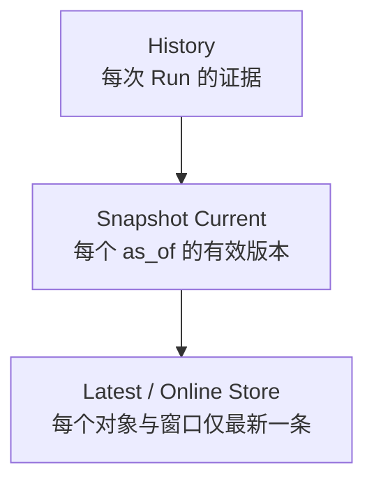
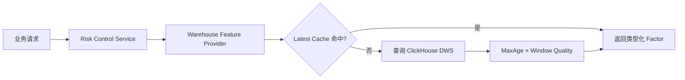
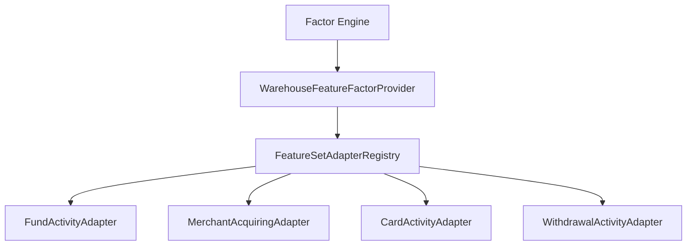
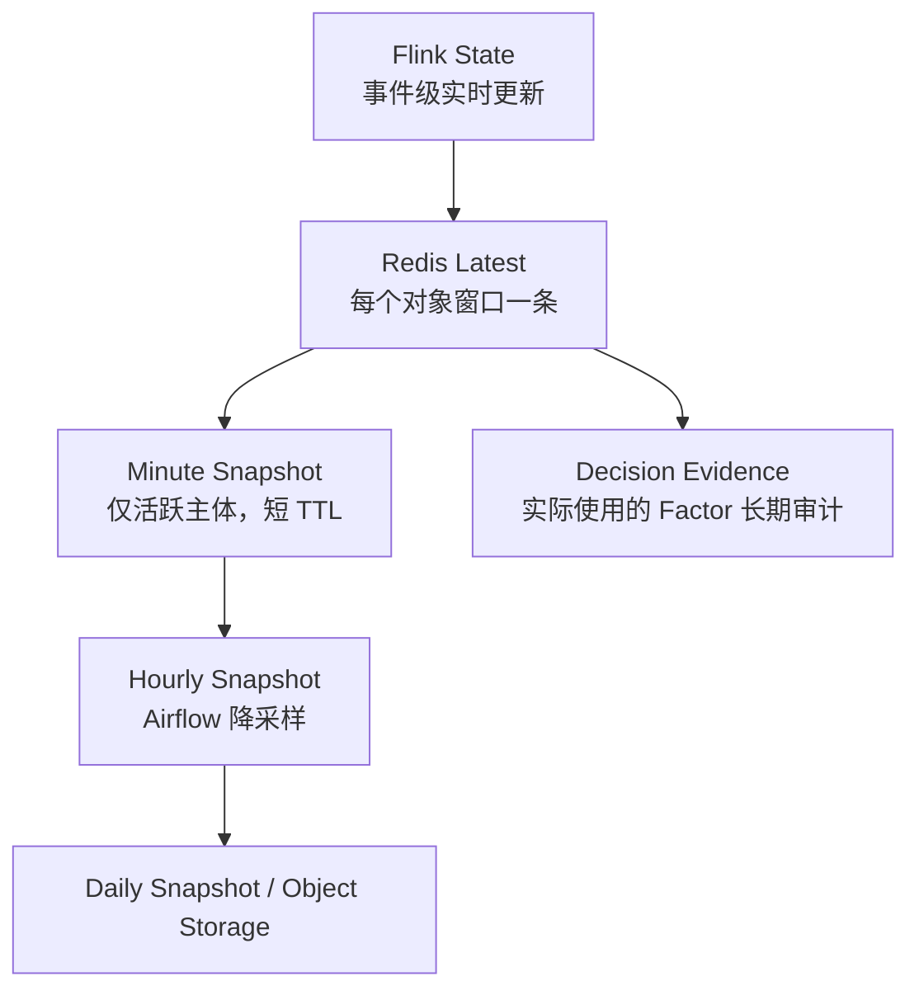

# 一张风险画像为什么会越存越多：从 DWD、DWS 到 Feature Factor 的教练实战

> 这是一篇面向工程师的教练式实践文章。我们不接入真实业务数据，也不把所有风险指标塞进一张万能表；只使用本地 Kind 集群和合成数据，逐步回答五个问题：不同业务域为什么要分 DWD、DWS 为什么按风险主题分表、同一窗口为什么会有多条记录、ClickHouse 能不能服务在线风控，以及不同结构的 Feature 如何抽象成统一 Factor。

## 一、先从一行容易误解的数据开始

本地 ClickHouse 中有一张表：

```text
risk_warehouse.dws_merchant_acquiring_activity_history_v1
```

其中一行数据是：

| 字段 | 值 |
|---|---:|
| `feature_set_key` | `merchant_acquiring_activity` |
| `window_type` | `24h` |
| `merchant_id` | `merchant-risk-demo-001` |
| `currency` | `USD` |
| `total_attempts` | 5 |
| `succeeded_attempts` | 3 |
| `failed_attempts` | 2 |
| `attempted_amount_minor` | 100000 |
| `succeeded_amount_minor` | 80000 |
| `success_rate` | 0.6 |
| `unique_payers` | 5 |

先别急着看表结构，教练先问三个问题：

1. `100000` 为什么不是 100000 美元？
2. `success_rate=0.6` 为什么不是 `80000/100000=0.8`？
3. 既然叫 24 小时窗口，明天是不是还会产生另一行？

答案分别是：

- `amount_minor` 使用最小货币单位，USD 下 `100000` 表示 1000 美元；
- `success_rate` 是笔数成功率 `3/5=0.6`，金额成功率则是 `80000/100000=0.8`；
- 同一个 `window_type` 会随着 `as_of` 推进产生新的窗口实例，因此会有多条时间快照。

这三个问题，正好把我们带进风险数据面的核心。

## 二、先把 Fact、Feature、Factor 分开

风险系统最常见的问题，是把“发生了什么”“观察到了什么”“规则使用什么”混在一起。


### 1. DWD：一行是一件稳定事实

例如：

```text
一次收单支付尝试
一次企业卡授权
一次提现订单
一次账户安全事件
```

这些事实的主键、状态、时间语义和修正方式不同，不能为了少建表而混进一张“万能事件表”。

本地实验采用八张类型化 DWD：

| 业务事实 | DWD |
|---|---|
| 资金移动 | `dwd_fund_movements_v2` |
| 收单支付尝试 | `dwd_acquiring_payment_attempts_v1` |
| 企业卡授权 | `dwd_card_authorizations_v1` |
| 提现订单 | `dwd_withdrawal_orders_v1` |
| 账户安全事件 | `dwd_account_security_events_v1` |
| 客户认证事件 | `dwd_customer_verification_events_v1` |
| 主体关联边 | `dwd_subject_relationship_edges_v1` |
| 渠道操作事件 | `dwd_provider_channel_events_v1` |

### 2. DWS：一行是一张窗口风险画像

DWS 不再描述单笔事实，而是回答：

> 某个主体，在某个时间窗口内，整体表现如何？

例如：

```text
merchant-risk-demo-001
过去24小时
共尝试支付5次
成功3次
笔数成功率60%
```

### 3. Feature：可复用的数据观察

收单 DWS 中的这些字段都是 Feature Data：

```text
total_attempts
succeeded_attempts
attempted_amount_minor
succeeded_amount_minor
success_rate
unique_payers
```

### 4. Factor：一次决策真正使用的类型化输入

规则不会直接拿整张 DWS 表，而是读取明确的 Factor：

```text
acquiring_success_rate_24h = 0.6
acquiring_attempted_amount_24h = 100000
acquiring_unique_payers_24h = 5
```

Feature 属于数仓和特征工程；Factor 属于决策引擎。相同数字在两个阶段承担不同职责。

## 三、DWS 为什么按风险主题分表

不同 Feature Set 的结构不同：

```text
merchant_acquiring_activity
├── total_attempts
├── succeeded_attempts
├── success_rate
└── unique_payers

subject_card_activity
├── total_authorizations
├── declined_authorizations
├── decline_rate
├── cross_border_count
└── unique_merchants

subject_relationship_risk
├── active_relation_count
├── shared_device_count
├── shared_ip_count
└── high_risk_related_subject_count
```

把它们强行塞进一张表，会得到大量空字段、无法稳定演进的 JSON，以及难以治理的类型契约。

因此采用“按稳定风险主题显式分表”：

| Feature Set Key | DWS |
|---|---|
| `merchant_acquiring_activity` | `dws_merchant_acquiring_activity_*` |
| `subject_fund_activity` | `dws_subject_fund_activity_*` |
| `subject_card_activity` | `dws_subject_card_activity_*` |
| `subject_withdrawal_activity` | `dws_subject_withdrawal_activity_*` |
| `subject_security_activity` | `dws_subject_security_activity_*` |
| `subject_profile_risk` | `dws_subject_profile_risk_*` |
| `subject_relationship_risk` | `dws_subject_relationship_risk_*` |
| `provider_channel_quality` | `dws_provider_channel_quality_*` |

这里的 `feature_set_key` 不是动态表名，而是稳定的业务身份。它进入统一 Feature Manifest、Run 注册和血缘系统后，仍能说明这份数据属于哪一种特征模型。

## 四、同一个对象为什么要有多个窗口

同一个对象通常需要同时观察多个时间尺度：

```text
rolling_5m  → 突发行为
rolling_1h  → 短时频率异常
rolling_24h → 当日资金周转
rolling_7d  → 近期行为趋势
rolling_30d → 长期基线变化
```

只要主体粒度、指标字段和业务语义相同，不需要为每个窗口建一张表。

```text
dws_subject_fund_activity_current_v2
```

可以同时保存：

| subject | window_type | as_of | inflow | outflow | ratio |
|---|---|---|---:|---:|---:|
| `org-001` | `rolling_5m` | 12:10 | 10000 | 9000 | 0.90 |
| `org-001` | `rolling_1h` | 12:10 | 50000 | 40000 | 0.80 |
| `org-001` | `rolling_24h` | 12:10 | 200000 | 175000 | 0.875 |

关键是区分四个时间概念：

| 字段 | 回答的问题 |
|---|---|
| `window_type` | 使用什么窗口定义？ |
| `window_start` | 本次实际从什么时候开始统计？ |
| `window_end` | 本次实际统计到什么时候？ |
| `as_of` | 这张风险画像对应哪个业务观察时点？ |
| `computed_at` | 计算任务什么时候真正完成？ |

对于滚动24小时窗口：

```text
as_of=12:00 → (昨日12:00, 今日12:00]
as_of=12:05 → (昨日12:05, 今日12:05]
as_of=12:10 → (昨日12:10, 今日12:10]
```

它们是同一种 `window_type` 的多个窗口实例。

## 五、History、Snapshot Current 和 Latest 不是一回事

这三个名字如果不拆开，很容易导致线上查询和存储失控。



### 1. History

逻辑身份包含 `source_run_id`：

```text
subject + window_type + as_of + source_run_id
```

同一个 `as_of` 重算两次，两次都能保留：

```text
org-001 / rolling_24h / 12:10 / run-001
org-001 / rolling_24h / 12:10 / run-002
```

它用于审计、回放、流批对账和问题调查。

### 2. Snapshot Current

逻辑身份不包含 `source_run_id`：

```text
subject + window_type + as_of
```

同一个 `as_of` 多次重算后，只保留当前有效版本；但 12:00、12:05、12:10 三个时点仍然是三行。

当前实验中的 `_current_` 表实际属于这一类。

### 3. Latest / Online Store

逻辑身份不包含 `as_of`：

```text
subject + window_type
```

每个主体、每种窗口永远只保留最新一条。它适合实时 Factor 读取，可以由 ClickHouse Latest Projection 或 Redis 承担。

## 六、线上取值不能精确匹配窗口起止时间

假设风险请求发生在：

```text
evaluation_as_of = 12:10:30
window_type      = rolling_24h
```

错误做法是要求：

```text
window_start = 昨日12:10:30
window_end   = 今日12:10:30
```

计算任务稍有延迟就会查不到数据。

正确契约是：

```text
Feature Set + Subject + Currency + Window Type
    ↓
选择 max(as_of)，且 as_of <= evaluation_as_of
    ↓
执行 MaxAge 检查
    ↓
验证实际窗口边界
    ↓
返回 Factor，或者 stale/missing/error
```

示例查询：

```sql
SELECT *
FROM risk_warehouse.dws_subject_fund_activity_current_v2 FINAL
WHERE feature_set_key = 'subject_fund_activity'
  AND feature_set_version = 2
  AND subject_type = 'organization'
  AND subject_id = 'org-001'
  AND currency = 'USD'
  AND window_type = 'rolling_24h'
  AND as_of_millis <= {evaluation_as_of_millis:Int64}
ORDER BY as_of_millis DESC
LIMIT 1;
```

查到最近值后仍然不能立即信任：

```text
evaluation_as_of = 12:10:30
snapshot_as_of   = 12:10:00 → 可接受

evaluation_as_of = 12:10:30
snapshot_as_of   = 10:00:00 → stale_feature
```

`window_start/window_end` 主要用于审计和质量校验，不是线上点查主键。

## 七、预聚合到底是什么

如果每次风险请求都扫描过去24小时的 DWD：

```text
业务请求
  ↓
扫描几十万条明细
  ↓
过滤、分组、求和、计算比例
  ↓
返回结果
```

延迟和资源消耗都会随数据量增长。

预聚合就是提前把题算好：

```text
几十万条 DWD
     ↓ Flink / ClickHouse MV / Airflow
一条 DWS Feature Snapshot
     ↓
线上请求点查一行
```

常见技术分工：

| 技术 | 作用 |
|---|---|
| Flink | Event Time 下实时维护滚动窗口 |
| ClickHouse Materialized View | 写入时增量聚合固定逻辑 |
| Airflow | 固定 `as_of` 批量聚合、回算与降采样 |
| Redis | 保存已经算好的 Latest Feature |
| ClickHouse DWS | 保存近线快照、历史分析和审计证据 |

## 八、ClickHouse 能不能直接服务在线风控

可以查询，但不能把“可以连接”理解成“业务服务应该随意执行 SQL”。

本地 Kind 集群对一条完整主键过滤的 DWS 查询执行 200 次基准：

| 指标 | 本地结果 |
|---|---:|
| P50 | 约 1ms |
| P95 | 约 1ms |
| P99 | 约 5ms |
| P99.9 | 约 11ms |

这是小数据量、热缓存、单并发、同集群环境，不是生产承诺。

风险服务应该通过受控的 Feature Provider 读取：



Provider 负责固定查询模板、连接池、超时、只读权限、缓存、熔断、时效检查和降级。严格低延迟的支付授权、提现拦截更适合 Redis Online Feature Store；ClickHouse适合近线、离线、回溯和降级来源。

## 九、Feature 数据结构不同，Factor 怎么统一

答案不是为每种 Feature Set 创建一种 Factor Type。

Factor Type 表达“如何取值”：

```text
value             从请求参数读取
expression        根据其他 Factor 计算
rpc               调用注册过的远程能力
warehouse_feature 从 DWS / Feature Store 读取
```

不同 DWS 的结构差异由内部 Adapter 隔离：



Factor 定义应引用：

```text
Feature Set Key
Feature Set Version
Field
Window Type
Max Age
```

例如：

```text
Factor Key  = acquiring_success_rate_24h
Factor Type = warehouse_feature
Value Type  = double

Feature Set = merchant_acquiring_activity
Version     = 1
Field       = success_rate
Window Type = rolling_24h
Max Age     = 2m
```

同一张 DWS 快照可以产生多个 Factor：

```text
merchant_acquiring_activity Snapshot
├── acquiring_total_attempts_24h
├── acquiring_success_rate_24h
├── acquiring_success_amount_24h
└── acquiring_unique_payers_24h
```

一次 Evaluation 应只加载一次快照，再提取多个 Factor；不能为三个字段执行三次 ClickHouse 查询。

## 十、窗口快照会不会无限膨胀

会。如果把每次 Flink 状态变化都永久写入 History，数据量会迅速失控。

假设：

```text
100万个主体
8种窗口
每分钟保存一次
```

每天将产生：

```text
1,000,000 × 8 × 1,440 = 115.2亿行
```

正确方法不是取消窗口，而是分层保存：



建议的初始生命周期：

| 数据 | 初始策略 |
|---|---|
| Redis Latest | 持续覆盖，只保留最新值 |
| 分钟级 Snapshot | 7天 TTL |
| 小时级 Snapshot | 30～90天 TTL |
| 每日 Snapshot | 1～3年或对象存储归档 |
| 实际决策证据 | 按审计要求长期保留 |

真正值得长期保留的是“这次决策实际使用了哪些 Factor”，而不是所有主体每分钟的全部风险画像。

## 十一、跟着教练查询真实数据

### 第一关：查看收单 DWS History

```bash
kubectl --context kind-local-platform \
  -n risk-control-lab \
  exec deploy/risk-clickhouse -- \
  clickhouse-client --query "
    SELECT *
    FROM risk_warehouse.dws_merchant_acquiring_activity_history_v1 FINAL
    FORMAT Vertical
  "
```

观察：

```text
total_attempts         = 5
succeeded_attempts     = 3
attempted_amount_minor = 100000
succeeded_amount_minor = 80000
success_rate           = 0.6
```

### 第二关：回到 DWD 看五次尝试

```bash
kubectl --context kind-local-platform \
  -n risk-control-lab \
  exec deploy/risk-clickhouse -- \
  clickhouse-client --query "
    SELECT
      event_id,
      result_status,
      amount_minor,
      payer_subject_id,
      toDateTime(occurred_at_millis / 1000, 'UTC') AS occurred_at
    FROM risk_warehouse.dwd_acquiring_payment_attempts_v1 FINAL
    ORDER BY occurred_at_millis
    FORMAT PrettyCompact
  "
```

教练问题：哪三笔构成 `succeeded_amount_minor=80000`？失败的两笔是否应该计入 `attempted_amount_minor`？

### 第三关：观察 Feature Run 血缘

```bash
kubectl --context kind-local-platform \
  -n postgres exec postgres-0 -- \
  sh -lc 'PGPASSWORD="$POSTGRES_PASSWORD" psql \
    -U local_platform \
    -d local_platform \
    -P pager=off \
    -x \
    -c "SELECT
          run_id,
          feature_set_key,
          as_of,
          status,
          snapshot_count
        FROM risk_control.feature_runs
        ORDER BY feature_set_key;"'
```

再对照 DWS 的 `source_run_id`，确认每张快照都能追溯到 PostgreSQL 的权威 Run 注册。

### 第四关：测量 DWS 点查延迟

```bash
kubectl --context kind-local-platform \
  -n risk-control-lab \
  exec deploy/risk-clickhouse -- \
  clickhouse-benchmark \
    --iterations 200 \
    --concurrency 1 \
    --query "
      SELECT success_rate
      FROM risk_warehouse.dws_merchant_acquiring_activity_current_v1 FINAL
      WHERE feature_set_key = 'merchant_acquiring_activity'
        AND merchant_id = 'merchant-risk-demo-001'
        AND currency = 'USD'
        AND as_of_millis = 1794096000000
      FORMAT Null
    "
```

不要只看 P50；在线风控更应该关注 P95、P99、超时率，以及持续写入和并发情况下的尾延迟。

## 十二、把今天的结论收成一组设计规则

1. Raw 可以使用统一信封，DWD 必须按稳定事实语义分表；
2. DWS 按主体、风险主题、窗口族和行粒度分表，不按单个 Factor 分表；
3. 同一 Feature Set 的多个窗口优先放在同一表，用 `window_type` 区分；
4. `window_type` 是定义，`window_start/window_end` 是具体窗口实例；
5. 在线读取选择决策时点之前最新 `as_of`，再执行 MaxAge 和窗口质量检查；
6. History 保存每次 Run，Snapshot 保存每个 `as_of`，Latest 只保存每个对象窗口的最新值；
7. Feature 属于数据工程，Factor 属于决策引擎；
8. 使用统一 `warehouse_feature` Factor Type，通过每 Feature Set 的 Adapter 兼容不同结构；
9. 一张 Feature Snapshot 可以产出多个 Factor，同一次 Evaluation 只能加载一次；
10. Flink负责及时，Airflow负责回算和降采样，Redis负责最新点查，ClickHouse负责分析与历史；
11. 通过 TTL、分层采样和对象存储归档控制数据膨胀；
12. 真正参与过 Decision 的 Factor Values 必须单独固化，不能依赖会过期的在线快照解释历史决策。

## 结语

风险数据面真正困难的地方，不是选择 ClickHouse、Flink 还是 Redis，而是明确每一层保存的是什么事实、服务哪个时效、承担哪种正确性责任。

```text
DWD 告诉我们：发生了什么
DWS 告诉我们：一个窗口里表现如何
Feature 告诉我们：观察到了什么
Factor 告诉规则：这次判断使用什么值
Decision Evidence 告诉审计：当时为什么这样决定
```

当这五句话能够落实到表结构、查询契约、TTL、血缘和可执行实验时，风控系统才真正从“写几个规则”走向“可解释、可回放、可治理的数据与决策平台”。
