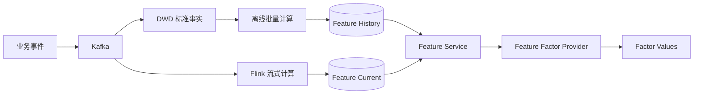
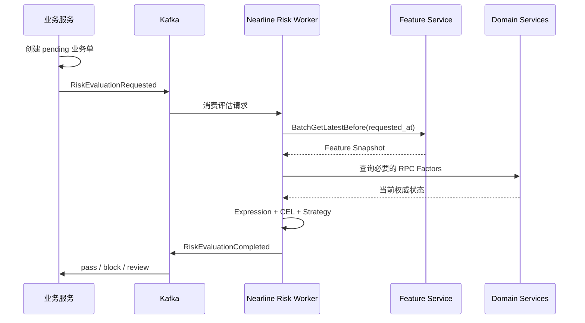
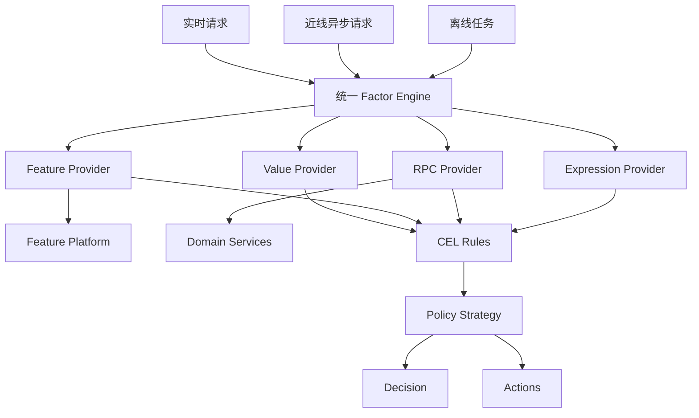

# 从一次提现风控说起：如何设计可复用的风险因子体系

> 一篇从用例分析出发，讲清 Value、Expression、RPC、Feature 因子，以及实时、近线、离线风控如何共享同一套决策模型的教练式实践文章。

很多团队第一次建设风控系统，会先从规则写起：

```text
过去 24 小时流出比例超过 90%，并且本次提现超过 5 万，就阻断提现。
```

这条规则看起来很简单。但真正开始实现时，问题马上出现：

- “本次提现金额”从哪里来？
- “过去 24 小时流出比例”由谁计算？
- 账户是否冻结，要不要现场调用账户服务？
- 实时、近线、离线是否分别实现一套规则？
- 规则执行时，是让表达式直接访问数据库和 RPC 吗？
- 离线计算出的数据，能不能给实时风控使用？

这些问题表面上在讨论数据来源，实质上是在设计风控系统最核心的抽象之一：**Factor，因子**。

本文不从类图或数据库表开始，而是从真实用例逐步推导因子体系。

---

## 一、先不要设计因子，先看业务到底要完成什么

假设平台支持企业提现，现在需要完成三类风险评估。

### 用例一：实时提现拦截

用户提交提现后，业务系统需要立刻知道是否放行：

```text
提现请求
  → 同步调用风控
  → pass / block
  → 继续创建提现单或直接拒绝
```

实时链路对延迟非常敏感，只能使用能够在严格时间预算内取得的因子。

### 用例二：近线异步审核

某些高风险或复杂场景允许先受理，再异步完成判断：

```text
提现请求
  → 创建 pending 业务单
  → 发送 RiskEvaluationRequested
  → 近线风控异步评估
  → 发送 RiskEvaluationCompleted
  → approved / rejected / manual_review
```

近线仍然由**业务请求触发**，不是由 Feature 更新触发。它只是允许更多时间读取复杂数据、调用模型或者查询关系网络。

### 用例三：离线存量扫描

每天凌晨扫描全部企业，发现长时间范围内的异常：

```text
调度任务
  → 固定 as_of
  → 批量读取历史特征
  → 执行策略
  → 生成 Finding、案件或限制动作
```

离线评估可以覆盖更长时间范围，也适合回放和 Backfill，但必须保证点时一致性，不能把今天的数据带进昨天的决策。

这三个用例的触发和时间预算不同，但它们都可能使用：

```text
过去 24 小时入金
过去 24 小时出金
90 天拒付率
当前账户状态
本次交易金额
```

因此，我们首先得到一个重要结论：

> 实时、近线、离线不是三套因子体系，而是三种 Evaluation Mode。因子类型、因子产生方式、评估模式必须彼此分离。

---

## 二、Factor 到底是什么

Factor 不是某个数据库字段，也不是 Feature 的另一个名字。

更准确的定义是：

> Factor 定义规则输入如何取得或计算，以及它的类型、依赖、时效、失败和降级语义。

一次评估中，Factor 被执行后产生 Factor Value：

```text
Factor Definition
        ↓ 策略发布时编译
Factor Provider.NewFactor
        ↓
Immutable Factor
        ↓ 单次评估时 Fetch
Factor Result
        ├─ success + value
        ├─ missing
        └─ error
```

例如：

```text
Factor Key   = outflow_ratio_24h
Value Type   = double
Factor Value = 0.95
Status       = success
```

规则只看到这个类型化结果：

```cel
outflow_ratio_24h >= 0.90
```

规则不应该知道这个值来自 ClickHouse、Feature Service、RPC、Redis，还是由另两个因子计算出来。

---

## 三、为什么要按取值语义划分因子类型

因子类型不应该按业务域划分。

不建议设计：

```text
AcquiringFactor
CardFactor
WithdrawalFactor
CustomerFactor
```

因为收单、卡、提现都可能同时需要请求参数、业务服务状态、历史特征和表达式计算。

真正稳定的变化轴是：

```text
这个值怎么取得？
取得时会不会访问外部系统？
是否依赖其他因子？
失败和超时意味着什么？
能否历史回放？
```

由此可以得到四类核心因子：

| 因子类型 | 回答的问题 | 典型数据 |
|---|---|---|
| Value Factor | 本次评估上下文带来了什么 | 金额、币种、主体、设备、IP |
| Expression Factor | 已有因子还能计算出什么 | 比率、差额、归一化值 |
| RPC Factor | 哪个业务服务拥有当前权威状态 | 账户状态、KYC 状态、当前限制 |
| Feature Factor | 长时间历史行为聚合出了什么 | 24 小时流出比例、90 天拒付率 |

下面逐一拆解。

---

## 四、Value Factor：读取本次请求的可信上下文

Value Factor 解决的问题是：

> 同一条策略每次面对的业务请求不同，如何把这次请求的事实安全地送入引擎？

例如：

```yaml
key: withdrawal_amount_minor
type: value
value_type: int
param_key: amount_minor
```

运行时从 Evaluation Context 读取：

```json
{
  "subject_id": "org-123",
  "amount_minor": 100000,
  "currency": "USD",
  "device_id": "device-456",
  "requested_at": "2026-11-14T12:10:00Z"
}
```

适合成为 Value Factor 的数据包括：

- 本次支付、提现或授权金额；
- 币种；
- 用户、企业、商户、账户标识；
- 设备、IP、国家；
- 业务场景；
- 请求发生时间；
- 来自可信网关或认证上下文的身份信息。

### Value 不等于常量

这里的 Value 是 Runtime Value，不是规则阈值。

例如 `50000`、`0.90` 这样的固定阈值，更适合放在 Rule 或 Strategy 参数中：

```cel
withdrawal_amount_minor >= 50000
```

为了减少误解，设计文档中也可以把它称为：

```text
Input Factor
或 Context Factor
```

### 安全边界

Value Factor 读取的必须是经过业务入口验证的上下文，而不是允许策略任意读取 HTTP Header 或未经校验的 JSON 字段。

缺少必填参数时，应返回：

```text
status     = missing
error_code = missing_param
```

而不是静默写成零。

---

## 五、Expression Factor：把已有因子变成新的可复用值

Expression Factor 不查询数据库，也不调用 RPC。它只对已经取得的因子做纯计算。

假设已有：

```text
inflow_minor_24h  = 100000
outflow_minor_24h = 95000
```

可以定义：

```cel
double(outflow_minor_24h) / double(inflow_minor_24h)
```

得到：

```text
outflow_ratio_24h = 0.95
```

它适合：

- 比率；
- 差额；
- 单位转换；
- 归一化；
- 风险分段前的中间值；
- 当前请求与历史特征的组合。

例如，历史特征不包含当前提现请求：

```text
historical_outflow_minor_24h = 95000
current_withdrawal_minor     = 10000
```

表达式因子计算：

```cel
historical_outflow_minor_24h + current_withdrawal_minor
```

得到预测值：

```text
projected_outflow_minor_24h = 105000
```

这样无需等待 Flink 先把当前请求统计进窗口，也不会重复计算同一笔业务。

### Expression Factor 与 Rule 的区别

```text
Expression Factor：产生一个新值
Rule：判断条件是否命中
Strategy：把命中结果映射为 Decision 和 Actions
```

例如：

```text
Expression Factor:
outflow_ratio_24h = outflow / inflow

Rule:
outflow_ratio_24h >= 0.90

Strategy:
命中 Rule → block + create_review_case
```

表达式适合使用 CEL 预编译，并在策略发布阶段完成：

- 未知因子检查；
- 输入输出类型检查；
- 依赖关系分析；
- 循环依赖检查；
- Program 编译。

运行阶段只执行已经编译的 Program。

---

## 六、RPC Factor：读取当前权威业务状态

有些事实变化频繁，权威所有者是业务服务，而不是数仓：

- 账户当前是否冻结；
- 用户当前 KYC/KYB 状态；
- 当前是否存在提现限制；
- 卡片当前是否可用；
- 商户是否被暂停；
- 当前账户与主体的归属关系。

这类数据适合 RPC Factor。

### RPC 是因子类型，Service + Method 是 Adapter

不需要为每个 RPC 创建一种新的 FactorType。正确结构是：

```text
RPCFactorProvider
        ↓ resolver_key
RPCFactorAdapterRegistry
        ├─ customer-service/GetCustomerStatus
        ├─ account-service/GetAccountStatus
        └─ device-service/GetDeviceRisk
```

Factor Definition 只引用经过代码注册的 `resolver_key`：

```yaml
key: account_status
type: rpc
value_type: string
resolver_key: account-service/GetAccountStatus
timeout: 20ms
```

这样可以避免数据库中的策略配置变成一个能够任意指定 URL、方法和请求体的万能 RPC 客户端。

### RPC Factor 的治理要求

RPC Factor 至少要具备：

- 强类型 Adapter；
- 明确超时；
- 熔断和限流；
- 失败码标准化；
- 是否允许降级的策略声明；
- 调用链追踪；
- 依赖因子声明。

### 为什么离线回放不能直接调用当前 RPC

如果回放一周前的提现，却调用 RPC 取得用户今天的账户状态，就发生了数据穿越。

因此：

```text
实时：可以查询当前 RPC
近线：可以查询当前 RPC，但必须绑定业务请求时间和超时
离线：优先读取历史状态快照，不直接使用今天的 RPC 结果
```

首次真实决策使用过的 RPC 结果，也应作为 Evaluation Evidence 保存。

---

## 七、Feature Factor：把长时间历史计算前移

Feature Factor 解决的是：

> 规则需要长时间历史行为，但不能在每次业务请求中扫描原始流水。

典型 Feature 包括：

- 过去 5 分钟失败授权次数；
- 过去 24 小时入金、出金及流出比例；
- 过去 7 天新增收款人数量；
- 过去 30 天登录设备数量；
- 过去 90 天拒付率；
- 过去 180 天主体关系风险分数。

数据生产链路通常是：



### Feature 与 Factor 不是并列概念

Feature 属于数据平台：

```text
Feature Set    = subject_fund_activity
Window         = rolling_24h
As Of          = 12:10
Outflow Ratio  = 0.95
Source Run ID  = flink-checkpoint-1024
```

进入决策引擎后，它成为一次 Evaluation 的 Factor Value：

```text
Factor Key   = outflow_ratio_24h
Value Type   = double
Value        = 0.95
Status       = success
```

所以准确关系是：

> Feature 是 Factor 的一种数据来源，Feature Factor Provider 负责把特征平台的数据转换为严格类型的 Factor Result。

---

## 八、不同 Feature 表结构不同，是否要创建不同因子类型

不需要。

`subject_fund_activity`、`subject_card_activity`、`merchant_acquiring_activity` 的数据结构当然不同，但它们的取值语义相同：

```text
按主体、特征集、版本、窗口和 as_of 读取特征快照
```

因此应采用：

```text
统一 FeatureFactorProvider
            ↓
FeatureAdapterRegistry
   ├─ SubjectFundActivityAdapter
   ├─ SubjectCardActivityAdapter
   ├─ MerchantAcquiringActivityAdapter
   └─ SubjectRelationshipRiskAdapter
```

Factor Definition 只保存引用：

```yaml
key: outflow_ratio_24h
type: feature
value_type: double

feature_ref:
  feature_set_key: subject_fund_activity
  feature_set_version: 2
  field_key: outflow_ratio
  window_type: rolling_24h
  currency: USD
  max_age: 5m
```

Adapter 负责：

- 理解 Feature Set 的 Schema；
- 提取字段；
- 类型转换；
- 判断值是否定义；
- 处理版本兼容；
- 校验单位、币种和窗口。

判断原则是：

```text
表结构不同
  → 使用不同 Feature Adapter

取值机制和执行语义不同
  → 才考虑增加 FactorType
```

---

## 九、特征究竟通过 RPC、SDK 还是直接查询数仓读取

答案不是简单三选一。

首先要统一逻辑契约：

```go
type FeatureReader interface {
    BatchGet(
        ctx context.Context,
        query FeatureQuery,
    ) (FeatureSnapshot, error)
}
```

查询条件包括：

```text
subject
feature_set_key
feature_set_version
window_type
as_of
max_age
fields
```

### 在线服务：Feature Service RPC

实时和近线通常通过 Feature Service 读取：

```text
Risk Service
  → Feature Client SDK
  → Feature Service RPC
  → Current / History Store
```

Feature Service 统一处理：

- 批量读取；
- 版本检查；
- 新鲜度检查；
- 点时语义；
- 权限；
- 降级；
- 监控；
- 底层存储路由。

### SDK 的职责

SDK 应该是 Feature Service 的客户端，而不是让每个业务服务通过 SDK 直接连接 Redis 或 ClickHouse。

SDK 可以封装：

- 请求模型；
- RPC Client；
- 批量合并；
- Timeout；
- Trace；
- 类型转换；
- 错误码。

它不应该把数据库 Schema 和连接方式扩散到所有调用方。

### 离线批量读取

离线任务仍然可以通过同一逻辑接口读取 Feature。为了吞吐量，特征平台可以在内部路由到 ClickHouse History，或者提供批量扫描接口：

```text
BatchScanFeatures(subjects, as_of_range, feature_refs)
```

直接读取 ClickHouse 是一种批量执行优化，不应该改变 Factor Definition 和 Rule。

---

## 十、实时、近线、离线都可以读取同一个特征平台

三种模式的差别不是“使用哪种 FactorType”，而是触发方式、时间预算、`as_of` 和因子准入范围。

| 维度 | 实时 | 近线 | 离线 |
|---|---|---|---|
| 触发 | 业务同步请求 | 业务异步请求 | 调度、扫描、回放 |
| 返回 | RPC 立即返回 | MQ 异步通知 | 批量结果 |
| Value Factor | 当前请求 | MQ 请求上下文 | 批处理上下文 |
| Feature Factor | 特征平台 | 特征平台 | 特征平台 |
| RPC Factor | 少量、严格超时 | 可使用更多 | 尽量使用历史快照 |
| `as_of` | 请求时间 | 业务请求时间 | 固定历史时间 |
| 结果 | pass / block | 异步 Decision | Finding / Actions |

近线的正确流程是：



注意：近线评估由业务请求触发，Feature 更新只负责维护特征平台，不负责主动触发每一条业务规则。

---

## 十一、耗时因子应该放在哪里

“耗时因子放离线”这句话还需要再拆一层，因为耗时可能发生在两个阶段。

### 情况一：计算很慢，但结果可以预计算

例如过去 180 天关系网络分析需要一分钟：

```text
离线图计算
  → relationship_risk_score_180d
  → 物化到 Feature Store
  → 实时风控快速读取
```

它是离线生产的 Feature，但可以用于实时、近线和离线评估。

### 情况二：每次现场执行都很慢

例如每个请求都要临时遍历完整关系图，且无法安全预计算：

```text
实时：禁止
近线：允许异步执行
离线：允许批量执行
```

所以更准确的原则是：

> 高成本计算尽量前移到流式或离线特征工程；实时链路读取物化结果。只有无法预计算、必须现场执行的昂贵因子，才限制为近线或离线使用。

---

## 十二、因子类型、生产方式和评估模式必须正交

可以用三张标签描述一个因子。

### 第一张标签：FactorType

```text
value
feature
rpc
expression
```

回答：这个规则输入如何取得？

### 第二张标签：MaterializationMode

```text
request
on_demand
streaming
batch
```

回答：这个值如何产生？

### 第三张标签：SupportedEvaluationModes

```text
realtime
nearline
offline
```

回答：哪些评估模式允许使用它？

例如：

```yaml
key: relationship_risk_score_180d
type: feature
value_type: double

materialization:
  mode: batch
  schedule: daily

serving:
  supported_modes:
    - realtime
    - nearline
    - offline
  max_age: 24h
  timeout: 10ms
```

虽然它由离线任务生产，但已物化为在线 Feature，所以仍然可以进入实时策略。

另一个无法预计算的图查询因子可能是：

```yaml
key: live_relationship_path_risk
type: rpc
value_type: double

serving:
  supported_modes:
    - nearline
    - offline
  timeout: 5s
```

策略发布时就应校验：实时 Policy 不允许引用这个因子。

---

## 十三、一次 Evaluation 中的数据应该如何保存

Feature 的权威数据保存在 Feature Store，不应该长期缓存在 Risk Worker 内存中。

一次评估的生命周期是：

```text
1. 收到评估请求
2. 根据 Policy 得到 Factor Fetch Plan
3. 批量读取所需 Feature
4. 放入请求级 FactorRuntime
5. 执行 Expression、Rules 和 Strategy
6. 持久化 Evaluation、Decision 和 Actions
7. 释放 FactorRuntime
8. 确认消息或返回同步结果
```

这里的 FactorRuntime 只是单次评估的临时内存，不是长期 Feature Cache。

评估记录需要保存：

```text
risk_evaluation
├── evaluation_id
├── trigger_request_id
├── business_type / business_id
├── policy_key / policy_version
├── evaluation_mode
├── requested_at / as_of
├── decision
├── reason_codes
├── feature_snapshot_refs
├── selected_factor_values
└── actions
```

`feature_snapshot_refs` 保存：

```text
feature_set_key
feature_set_version
window_type
as_of
source_run_id
content_fingerprint
```

`selected_factor_values` 只保存真正参与决策的值，而不是复制整张 Feature 表。

这样既能解释决策，也能通过快照引用完成历史复核。

---

## 十四、缺失、错误和过期不能都变成零

风控系统最危险的错误之一，是把所有取值失败都解释为默认值。

建议统一 Factor Result：

```text
success  成功取得类型化值
missing  合法但没有数据
error    取值、类型、依赖或系统失败
```

典型语义如下：

| 场景 | 推荐结果 |
|---|---|
| 请求缺少必填金额 | `missing_param` |
| RPC 超时 | `rpc_timeout` |
| Feature 没有快照 | `feature_snapshot_missing` |
| Feature 超过最大时效 | `stale_feature` |
| 比率因为分母为零而未定义 | `feature_undefined` |
| Expression 依赖因子失败 | `dependency_error` |
| 返回值与声明类型不一致 | `type_mismatch` |

Policy 再明确声明如何处理：

```text
fail_closed   阻断
fail_open     放行但记录原因
manual_review 转人工审核
fallback      使用经过批准的替代因子
```

不能由 Factor Provider 自己偷偷决定放行或阻断，因为 Decision 属于 Policy Strategy。

---

## 十五、一个完整提现策略的因子拆解

现在把所有概念放回最初的提现用例。

### 业务目标

阻断明显的资金快进快出，同时把复杂关系风险送入人工审核。

### Factor Definitions

```text
withdrawal_amount_minor       value
currency                      value
account_status                rpc
withdrawal_restricted         rpc
inflow_minor_24h              feature
historical_outflow_minor_24h  feature
relationship_risk_score_180d  feature
projected_outflow_minor_24h   expression
projected_outflow_ratio_24h   expression
```

### Expression Factors

```cel
projected_outflow_minor_24h =
  historical_outflow_minor_24h + withdrawal_amount_minor
```

```cel
projected_outflow_ratio_24h =
  double(projected_outflow_minor_24h) / double(inflow_minor_24h)
```

### Rules

```cel
account_status != "active" || withdrawal_restricted
```

```cel
inflow_minor_24h >= 50000
&& projected_outflow_ratio_24h >= 0.90
```

```cel
relationship_risk_score_180d >= 0.80
```

### Strategy

```text
账户不可用
  → block

快进快出
  → block + activate_restriction

关系风险较高
  → block 当前请求 + create_review_case

均未命中
  → pass
```

这时我们可以清楚看到：

- Factor 负责取值和计算；
- Rule 负责判断是否命中；
- Strategy 负责 Decision 和 Actions；
- Action Executor 负责真正执行限制、名单、案件和通知。

---

## 十六、教练式实践：如何验证一套因子设计是否合理

拿到一个新风险需求时，不要先问“建哪张表”，而是依次回答下面的问题。

### 第一关：列出规则真正需要的事实

例如：

```text
当前金额
当前账户状态
24 小时历史出金
180 天关系风险
```

### 第二关：标记事实的权威来源

```text
当前金额         → 请求上下文
当前账户状态     → Account Service
24 小时历史出金  → Feature Platform
180 天关系风险   → 离线图计算后的 Feature
```

### 第三关：判断是否需要预计算

问自己：如果每个请求现场计算，会扫描多少数据、调用多少系统、耗时多久？

历史聚合和关系分析通常应该预计算为 Feature。

### 第四关：确定支持的评估模式

```text
当前金额             realtime / nearline
当前账户状态         realtime / nearline
24 小时历史出金      realtime / nearline / offline
现场完整关系图查询   nearline / offline
预计算关系风险分数   realtime / nearline / offline
```

### 第五关：定义失败语义

必须回答：

- 缺失时是阻断、放行还是人工审核？
- RPC 超时怎么办？
- Feature 多旧算过期？
- 是否允许使用替代因子？
- 回放时如何获得当时的数据？

### 第六关：验证 Rule 的纯度

如果 Rule 中出现下面这些内容，说明边界出了问题：

```text
rpc(...)
sql(...)
redis.get(...)
http(...)
```

Rule 应该只引用 Factor Key。

---

## 十七、常见错误

### 错误一：按业务域创建因子类型

这会造成每个业务域重复实现 Value、RPC、Feature 和 Expression 生命周期。

### 错误二：把 Feature 和 Factor 当成两套规则输入

Feature 是数据产品，进入引擎后仍然表现为 Factor Value。

### 错误三：实时规则现场扫描历史流水

长窗口统计应该提前物化为 Feature。

### 错误四：近线由 Feature 更新直接触发业务规则

业务近线评估应由业务请求触发。Feature 更新只维护特征平台，除非某个明确的持续监控用例就是“特征变化触发扫描”。

### 错误五：Worker 长期缓存全部主体 Feature

Risk Worker 只应在一次 Evaluation 中短暂持有必要的 Factor Values。

### 错误六：SDK 让所有服务直连 Feature 数据库

SDK 应封装 Feature Service Client，而不是传播 ClickHouse、Redis Schema 和连接权限。

### 错误七：离线回放调用今天的 RPC

这会产生时间穿越。回放必须使用固定 `as_of` 的历史快照。

### 错误八：把缺失、未定义和系统错误全部当成零

三者必须拥有不同状态和错误码，再由 Policy 决定降级方式。

---

## 十八、推荐的落地节奏

### S0：冻结统一语义

明确：

```text
Feature 属于特征平台
Factor 属于决策引擎
Rule 只读取 Factor Values
Strategy 产生 Decision 和 Actions
```

### S1：完成四类 Provider 契约

实现并验证：

```text
ValueFactorProvider
ExpressionFactorProvider
RPCFactorProvider
FeatureFactorProvider
```

### S2：建立 Factor Catalog

为每个因子管理：

```text
key / version / type / value_type
owner
supported_modes
freshness
timeout
missing_behavior
materialization_mode
dependencies
```

### S3：建设统一 Feature Service

提供：

```text
BatchGetLatestBefore
BatchGetAt
BatchScanFeatures
```

并在内部屏蔽 Current、History 和 Warehouse 的存储差异。

### S4：实现 Factor Fetch Plan

一次 Evaluation 先分析全部依赖，再：

- 合并相同 Feature Set 的读取；
- 批量调用 RPC；
- 在请求级缓存不可变快照；
- 按依赖顺序执行 Expression；
- 记录每个 Factor 的耗时和状态。

### S5：完成三种 Evaluation Mode

```text
Realtime Evaluation
Nearline Evaluation
Offline Evaluation
```

共用 Factor、CEL Rule 和 Strategy，只替换触发、时间预算与结果交付方式。

### S6：流批一致和灰度切换

对比：

```text
Flink Feature
vs
ClickHouse Batch Feature
```

在窗口、币种、单位、迟到数据、缺失值和 `as_of` 全部一致后，再把实时读取切到新的 Current Projection。

---

## 结语

风控因子设计的关键，不是创造更多名词，而是把几个变化轴拆开：

```text
FactorType
  → 规则输入如何取得

MaterializationMode
  → 数据如何生产

EvaluationMode
  → 决策如何被触发和交付
```

最终形成的体系应该是：



当这个边界稳定以后，收单、企业卡、出入金、账户安全、客户风险和关系网络可以共享同一套决策基础设施；新增业务场景时，主要增加的是 Factor Definition、Feature Adapter、RPC Adapter 和 Policy，而不是重新复制一套风控引擎。

这才是因子抽象真正解决的问题：让数据来源可以演进，让策略可以复用，让实时、近线和离线在不同时间预算下仍然说同一种决策语言。
