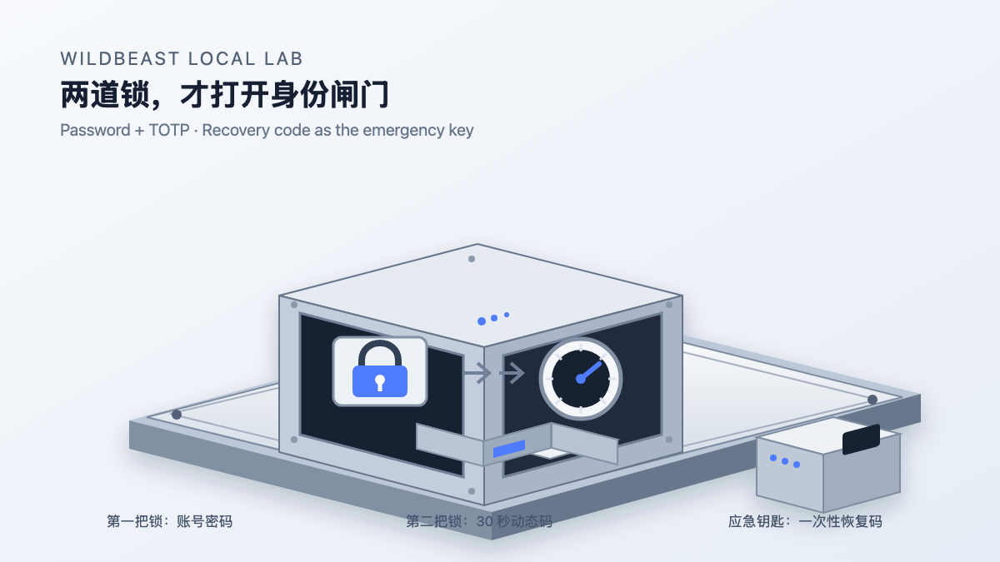
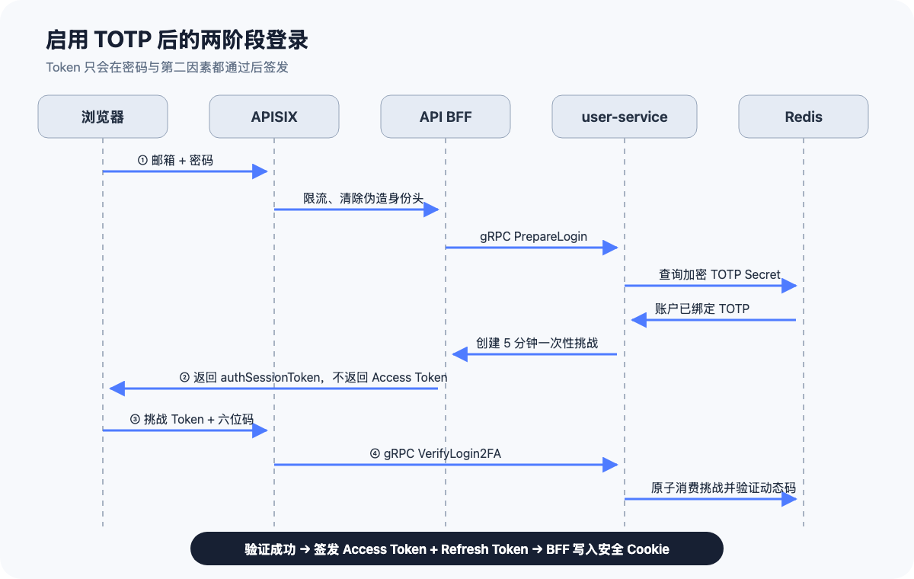

# 从密码登录到 TOTP 双因素认证：一套本地微服务的安全加固实践

> 密码回答的是“你知道什么”，动态验证码回答的是“你持有什么”。只有两项同时成立，系统才签发登录凭证。



很多系统上线之初只有账号密码登录。它足够直观，却把安全性集中在一个秘密上：一旦密码因撞库、钓鱼、恶意插件或日志泄漏而暴露，攻击者就拥有了完整的登录能力。

这次我们在一套本地 Kubernetes 微服务实验环境中加入了 TOTP 双因素认证，并完整演练了绑定、登录挑战、恢复码、解绑、网关鉴权和失败回退。本文不只展示接口，还会解释每个安全机制为什么存在、保护什么，以及它不能保护什么。

## 一、TOTP、恢复码和 Passkey 是什么关系

先澄清三个容易混淆的概念。

TOTP 是一种第二因素。用户仍然先输入密码，再输入验证器每 30 秒生成的六位数字。Microsoft Authenticator、Google Authenticator、1Password 等都能保存同一种标准的 TOTP 凭证。

恢复码属于 TOTP 方案的应急通道。手机丢失或验证器无法使用时，用户可以输入预先保存的一次性恢复码。它不是第三种日常认证因素，也不能重复使用。

Passkey 则是另一套独立登录方案。它通常基于 WebAuthn/FIDO2，用设备里的私钥完成签名，可以替代密码，也天然抵抗传统钓鱼。本文聚焦的是“密码 + TOTP + 恢复码”，不把 Passkey 混入同一条链路。

## 二、我们搭建的认证链路

本地环境中的入口和服务关系如下：



请求依次经过：

1. 本地负载均衡入口接收 HTTPS 请求。
2. APISIX 负责公开路由、登录限流、JWT 校验和可信身份头注入。
3. API BFF 把浏览器 HTTP/JSON 请求转换成 user-service 的 gRPC/Protobuf 调用。
4. user-service 校验密码、TOTP 或恢复码，并签发 Access Token 与 Refresh Token。
5. Redis 保存刷新令牌状态、加密后的 TOTP Secret、登录挑战会话及恢复码摘要。

这里有一个关键边界：APISIX 和 BFF 都不能自行判断六位验证码是否正确。TOTP Secret 只属于认证服务，验证逻辑也只在认证服务中执行。

## 三、绑定 TOTP 时发生了什么

### 1. 用户必须先完成普通登录

绑定第二因素本身是高风险操作，因此不能匿名调用。客户端先通过密码登录，APISIX 校验 Access Token 后才允许访问绑定接口：

```http
POST /api/v3/auth/2fa/totp/options HTTP/1.1
Host: localhost
Cookie: access_token=<已脱敏>
X-CSRF-Token: <已脱敏>
Origin: https://localhost:18443
```

### 2. 服务端生成随机 Secret

user-service 使用密码学安全随机数生成 TOTP Secret，然后构造标准 URI：

```text
otpauth://totp/Wildbeast%20Local:demo@local.test
?secret=JBSWY3DPEHPK3PXP
&issuer=Wildbeast%20Local
&period=30
&digits=6
```

示例 Secret 仅用于说明格式，不是系统中的真实值。

二维码并没有额外的“二维码密码学”。它只是把这段 `otpauth://` 文本编码成图像。验证器扫描后读取其中的 Secret、发行方、账号、周期和位数，并将它们保存在本机安全存储中。

### 3. Secret 先处于待确认状态

服务端不会在生成二维码后立即启用 TOTP。它先返回一个随机 `setupToken`，并把 Secret 以 AES-GCM 加密后暂存在 Redis，十分钟后自动失效。

```json
{
  "setupToken": "setup-session-example",
  "otpauthUri": "otpauth://totp/..."
}
```

用户必须输入验证器生成的当前验证码：

```http
POST /api/v3/auth/2fa/totp/confirm HTTP/1.1
Content-Type: application/json

{
  "setupToken": "setup-session-example",
  "code": "123456"
}
```

只有验证码正确，Secret 才会成为正式认证凭证。这样可以避免用户没有成功扫码，账户却已经被锁进 2FA 流程。

## 四、六位动态码是如何计算的

TOTP 建立在 HOTP 之上。双方共同拥有同一个 Secret，并把当前时间切成固定窗口：

```text
counter = floor(unixTime / 30)
digest  = HMAC-SHA1(secret, counter)
offset  = digest 最后一个字节的低 4 位
binary  = 从 digest[offset] 开始取 31 位正整数
code    = binary mod 1,000,000
```

结果补足六位，就是验证器显示的数字。验证器和服务端不需要联网同步验证码，只要双方时间基本一致并持有同一个 Secret，就能独立计算出相同结果。

本地实现使用 30 秒周期、六位数字和 SHA-1，并允许前后各一个时间窗口，用来容忍少量时钟偏差。这不代表验证码在 90 秒内可以无限尝试：入口仍需要限流，登录挑战本身也必须短时、一次性。

## 五、启用 2FA 后的登录流程

### 第一步：校验账号密码

```http
POST /api/v3/auth/login/prepare HTTP/1.1
Content-Type: application/json

{
  "email": "demo@local.test",
  "password": "local-demo-password"
}
```

密码正确且账户未启用 TOTP 时，服务可以直接签发 Token。启用 TOTP 后，返回的是一次性登录挑战，而不是 Token：

```json
{
  "secondFactorRequired": true,
  "authSessionToken": "short-lived-one-time-session"
}
```

`authSessionToken` 的作用，是证明“密码这一步已经通过”。它五分钟过期、只能消费一次，也不能当作 Access Token 请求业务接口。

### 第二步：提交动态码

```http
POST /api/v3/auth/login/verify-2fa HTTP/1.1
Content-Type: application/json

{
  "authSessionToken": "short-lived-one-time-session",
  "code": "123456"
}
```

user-service 原子消费登录挑战，验证动态码后才生成：

- 短期 Access Token，用于访问业务接口；
- 长期 Refresh Token，用于轮换 Access Token；
- CSRF Token，用于保护依赖 Cookie 的状态变更请求。

BFF 把这些凭证写入 Cookie。Access Token 和 Refresh Token 使用 `HttpOnly + Secure + SameSite=Strict`，浏览器脚本无法直接读取，且只通过 HTTPS 发送。

## 六、为什么还需要恢复码

TOTP 把“手机可用”变成了登录条件。如果手机损坏、丢失或验证器数据被清除，用户需要安全的逃生通道。

绑定成功后，服务端生成十个恢复码，例如：

```text
q7m2k-9x4pa
h3v8c-2n6rt
```

生成过程使用密码学安全随机数和无偏字符采样。明文只在生成时返回一次；服务端保存的是：

```text
HMAC-SHA256(recoveryCodePepper, normalizedRecoveryCode)
```

登录时，服务端对用户输入执行相同计算，再从 Redis 集合中原子删除对应摘要。删除成功才代表恢复码有效，因此并发请求也只能有一个成功。

恢复码应该离线保存，例如密码管理器或纸质备份。截图保存在同一部手机里，会让“手机丢失”和“恢复手段丢失”同时发生。

## 七、Secret 为什么不能明文保存

密码可以只保存单向哈希，因为服务器验证密码时不需要还原原文。TOTP 不同：服务器每次验证动态码，都必须使用原始 Secret 重新计算验证码，因此 Secret 不能只做不可逆哈希。

本地实现采用 AES-GCM 加密：

```text
密文 = AES-GCM(加密密钥, 随机 Nonce, TOTP Secret)
```

AES-GCM 同时提供保密性和完整性。如果密文被修改，解密会失败。加密密钥来自 Kubernetes Secret，不写进 Git，不与 JWT 密钥或恢复码 Pepper 共用。

当前实验环境把加密后的 Secret 存在 Redis。它适合本地演练，但生产环境更推荐：

- PostgreSQL 保存用户与 2FA 状态；
- KMS/HSM 管理主密钥；
- 每条凭证使用独立数据密钥或信封加密；
- Redis 只保存短期登录挑战和会话状态。

## 八、网关、BFF 和认证服务分别负责什么

### APISIX

- 登录接口按来源地址限流；
- 业务接口校验 JWT；
- 清除客户端伪造的身份请求头；
- 写入可信用户身份；
- 使用独立 HMAC 密钥签名发往 BFF 的请求。

### API BFF

- 处理浏览器 HTTP/JSON；
- 校验 Origin 与 CSRF Token；
- 调用 user-service 的强类型 gRPC 接口；
- 设置和清除安全 Cookie；
- 不保存 TOTP Secret，也不自行签发 Token。

### user-service

- 校验密码；
- 生成、加密和验证 TOTP Secret；
- 管理一次性登录挑战与恢复码；
- 签发 Access Token 和 Refresh Token；
- 阻止旧登录 RPC 绕过第二因素。

最后一项非常重要。如果只把 BFF 改成两步登录，而 user-service 的旧 `Login` RPC 仍能直接签发 Token，集群内部调用者就可能绕过 2FA。因此旧 RPC 在检测到已绑定 TOTP 时，也必须返回“需要第二因素”。

## 九、本次提供的接口

| 接口 | 是否需要已登录 | 用途 |
|---|---:|---|
| `POST /api/v3/auth/login/prepare` | 否 | 校验密码并决定是否进入 2FA |
| `POST /api/v3/auth/login/verify-2fa` | 否 | 使用 TOTP 或恢复码完成登录 |
| `POST /api/v3/auth/2fa/totp/options` | 是 | 创建待确认 Secret 和扫码 URI |
| `POST /api/v3/auth/2fa/totp/confirm` | 是 | 验证首个动态码并正式绑定 |
| `POST /api/v3/auth/2fa/recovery-codes/regenerate` | 是 | 验证第二因素后废弃旧恢复码并重新生成 |
| `POST /api/v3/auth/2fa/unbind` | 是 | 使用密码和第二因素解绑 |

## 十、我们实际演练了什么

这套链路不是只通过单元测试。它被部署进本地 kind 集群，并完成了以下真实请求：

```text
普通登录
  → 绑定 TOTP
  → 使用当前动态码确认
  → 退出登录
  → 密码验证后收到 2FA 挑战
  → 使用 TOTP 完成登录
  → 访问受保护业务接口
  → 重新生成恢复码
  → 使用恢复码登录
  → 重复使用同一恢复码被拒绝
  → 使用密码 + TOTP 解绑
  → 恢复普通登录
```

同时验证了：所有 Argo CD 应用处于 `Synced / Healthy`，TOTP 密钥只存在 Kubernetes Secret 中，演练结束后测试账号自动解绑，没有残留测试状态。

## 十一、这套方案能防住什么

它可以显著降低以下风险：

- 单纯密码泄漏或撞库；
- 数据库泄漏后直接得到 TOTP Secret；
- 恢复码数据库被拖走后直接登录；
- 恢复码并发重复消费；
- 客户端伪造用户身份头；
- 绕过 BFF 直接调用旧登录 RPC；
- 跨站请求触发绑定、解绑或刷新操作；
- 对登录接口进行高速暴力尝试。

但它不能解决所有问题：

- 实时钓鱼代理可能同时转发密码和当前 TOTP；
- 用户设备被完全控制后，攻击者可能窃取会话；
- 认证服务运行内存被读取时，解密后的 Secret 可能暴露；
- 管理员密钥管理、审计、风控和账号恢复流程仍需单独建设。

如果目标是进一步抵抗钓鱼，下一阶段应该引入 Passkey/WebAuthn，而不是把 TOTP 当作终点。

## 结语

双因素认证真正困难的部分，不是生成六位数字，而是把所有旁路一起封住：绑定前确认、短期挑战、旧接口兼容、恢复码单次消费、Secret 加密、Cookie 安全、CSRF、网关限流、密钥隔离，以及失败时保持旧状态可用。

本次本地实践证明，这些能力可以在不改变现有 HTTP → BFF → gRPC 主链路的前提下逐步加入。先在可重复的本地集群里把绑定、登录、恢复和解绑全部跑通，再迁移到持久化数据库与托管密钥系统，是一条更稳妥的生产化路径。
