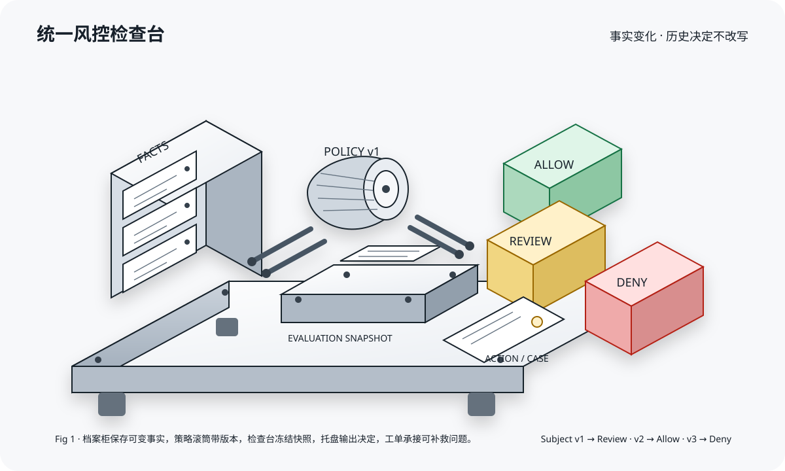
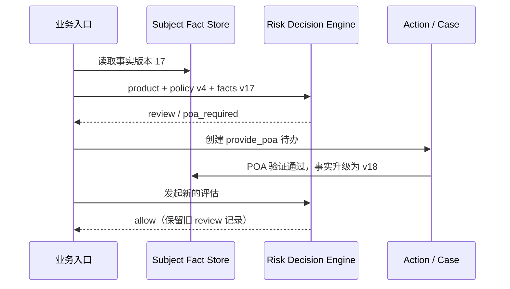
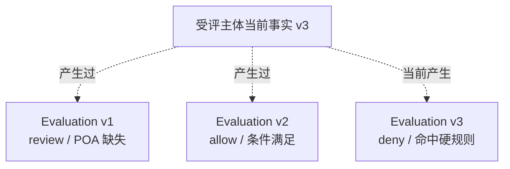
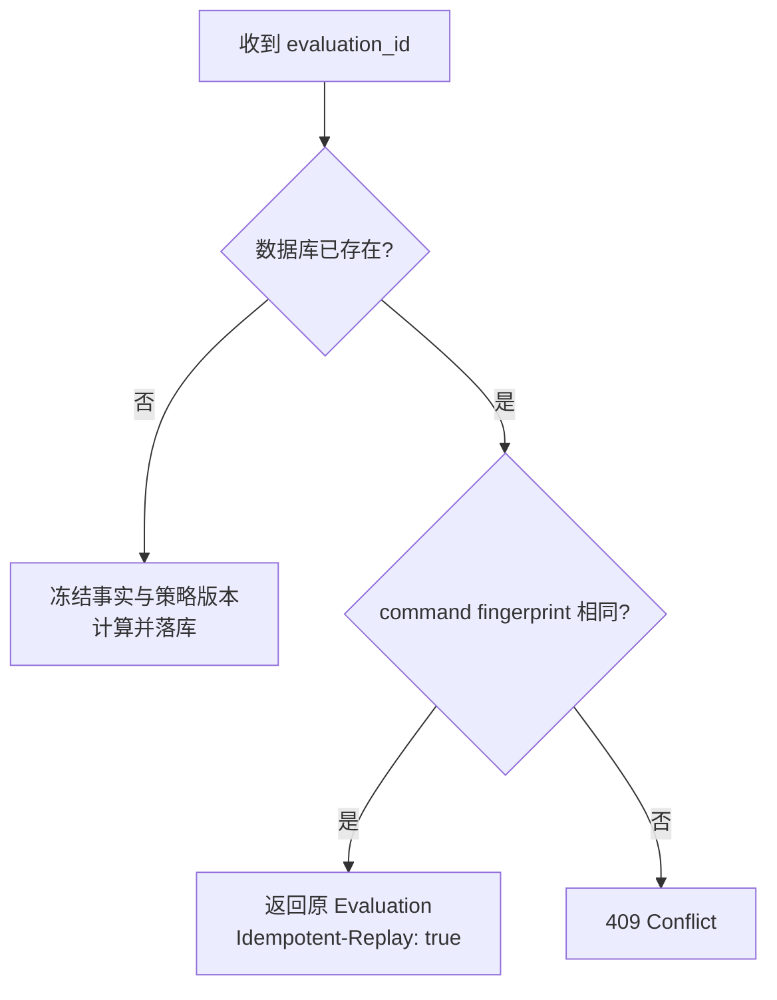

# 把主体事实与能力准入接成一条线：从“资料档案”到统一风控决策平台

> 这是一篇教练式实战文章。我们不从一张“大而全”的架构图开始，而是先回答四个最容易混淆的问题，再把答案落到一个真实运行于 Kind、PostgreSQL 之上的最小系统中。



## 一、先做一道判断题

假设一个企业已经完成主体核验，是否就应该立即开通企业卡？

答案是：**不一定。**

主体核验通过，只说明某次材料与身份检查得到了通过结果；平台还要形成自己的风险结论，业务能力还要判断该主体是否符合当前准入策略，外部渠道最后仍可能拒绝处理。

这四件事必须分开：


如果把它们压成一个 `status=approved`，后面一定会遇到三个问题：不知道谁批准的、不知道按哪版规则批准的、不知道事实变化后旧结论为什么还存在。

## 二、受评主体域和能力准入域分别负责什么

可以把它们想成“档案室”和“准入检查台”。

### 受评主体域：档案室

受评主体代表接受风险判断的真实主体，可能是自然人，也可能是法人。它不是登录用户，不是钱包账户，也不是一张卡。

它保存的是受信事实与证据：

- 主体基本信息；
- 个人或企业主体核验结果；
- 身份证件、企业文件、地址与 POA；
- 问卷和补件结果；
- 事实来源、版本与更新时间。

### 能力准入域：准入检查台

能力准入域不应再造一份主体数据。它拿指定时刻的主体事实快照，结合指定能力和策略版本，得到一次准入决策：

- `allow`：可以继续申请或开通流程；
- `review`：可以补救，需要补件、问卷或人工审核；
- `deny`：命中不可补救的硬拒绝。

因此，正确关系不是“资料域完成后，准入域再随意查几张表”，而是：



## 三、统一风控框架的四层

### 第 1 层：Fact——系统知道什么

Fact 是经过平台信任边界确认的事实或风险信号。例如：

```text
verification_status = approved
residence_country    = SG
poa_verified         = false
```

客户端不能直接说“我是低风险用户”。它只能提交材料；服务端验证后，才可以形成可信 Fact。

### 第 2 层：Policy——这次按什么规则判断

策略必须带版本。因为今天的规则和下个月的规则可能不同，而审计会问：“2026 年 10 月 25 日为什么放行？”

本地实验的策略版本 1 很简单：

```text
verification 必须 approved
POA 必须验证通过
命中实验用禁入国家列表则 deny
缺少可补救材料则 review
```

规则简单不是问题；规则没有版本、修改后覆盖历史才是问题。

### 第 3 层：Evaluation——在某个时刻做了什么决定

Evaluation 是不可变的决策快照，至少包含：

- subject_id；
- product_code；
- policy_version；
- fact_version 与完整 fact_snapshot；
- decision；
- reason_codes；
- evaluated_at。

它不是受评主体当前状态的“视图”，而是一张历史凭证。

### 第 4 层：Action / Case——下一步谁做什么

`review` 不是失败，它是“系统还缺什么”。例如：

- `complete_verification`；
- `provide_poa`；
- `complete_questionnaire`；
- `manual_review`。

Action 是机器可以自动编排的任务；Case 是需要人工受理、分派、备注和 SLA 的案件。第一阶段可以共用骨架，生产环境应把权限和审计做得更细。

## 四、为什么不能只在主体表上放一个 risk_status

因为下面三条结论可以同时成立：

```text
受评主体当前事实：已补齐 POA
昨天的企业卡评估：review
今天的企业卡评估：allow
```

如果只有一个 `risk_status`，今天的更新会把昨天的原因覆盖掉。统一风控真正需要的是：



## 五、动手实践：第一关，缺材料不是拒绝

我们在 Kind 中创建一个受评主体：身份核验已通过、居住地为 SG，但 POA 尚未验证。

调用评估接口后，实际得到：

```json
{
  "decision": "review",
  "reason_codes": ["poa_required"],
  "actions": [{"action_type": "provide_poa", "status": "open"}],
  "policy_version": 1,
  "fact_version": 1
}
```

教练提问：为什么不是 `deny`？

因为 POA 缺失是可补救问题。把可补救问题写成拒绝，会让重试、用户体验和运营统计全部失真。

## 六、第二关：完成 Action 不会篡改旧决定

我们完成 `provide_poa` Action。系统做两件事：

1. 把 POA 事实改为 `true`，事实版本从 1 升到 2；
2. 把 Action 标成 completed。

它不会偷偷把旧 Evaluation 从 review 改成 allow。我们显式发起第二次评估，才得到：

```json
{
  "decision": "allow",
  "reason_codes": ["policy_satisfied"],
  "policy_version": 1,
  "fact_version": 2
}
```

这叫“追加历史”，而不是“覆盖历史”。

## 七、第三关：硬拒绝优先于补件

为了验证分支，我们把居住国家改为实验策略中的禁入值，再评估：

```json
{
  "decision": "deny",
  "reason_codes": ["residence_country_denied"],
  "actions": [],
  "fact_version": 3
}
```

这里没有再创建 POA 或问卷任务。因为硬拒绝条件已经决定了结果，继续让用户补件只会制造没有意义的任务。

> 文中的国家列表只是本地分支测试数据，不构成真实业务或合规政策。

## 八、第四关：相同评估只能落一份

网络超时后，调用方很可能重试。系统以 `evaluation_id` 表示业务身份，再用请求指纹区分“精确重放”和“编号冲突”：



精确重放不会再次创建 Action，也不会重新计算一遍；相同编号换受评主体或能力代码则必须冲突。

## 九、不要只信 HTTP 200：去数据库找三份证据

这次实验分别检查了：

1. 受评主体当前事实确实到了版本 3；
2. 三条 Evaluation 分别保存版本 1、2、3 的事实快照；
3. `provide_poa` Action 从 open 变为 completed。

观察结果如下：

| fact_version | snapshot | decision | reason |
|---:|---|---|---|
| 1 | SG，POA=false | review | poa_required |
| 2 | SG，POA=true | allow | policy_satisfied |
| 3 | 实验禁入值，POA=true | deny | residence_country_denied |

服务返回成功，只能证明入口接受了请求；数据库中的事实快照、评估和任务记录才构成可审计证据。

## 十、把框架扩展到更多风控场景

统一并不等于“一套规则包打天下”。统一的是协议与生命周期：

```text
场景输入
  ↓
可信 Facts / Signals
  ↓
版本化 Policy
  ↓
不可变 Evaluation
  ↓
Decision + Reasons + Actions
```

因此它可以服务于：

- 产品准入：企业卡、VA、付款、收款；
- 交易风控：金额、频率、收款人、设备和行为；
- 持续尽调：材料过期、制裁名单变化、受益人变化；
- 运营限制：冻结、限额、禁止特定能力；
- 人工案件：EDD、异常交易、资料真实性复核。

但每个场景仍应拥有独立的 policy namespace、reason code 和状态机，不能把所有规则塞进一个巨大 JSON。

## 十一、生产化还缺什么

本地实验已经证明架构骨架，但它不是生产风控平台。至少还需要：

- Fact 字段级来源、证据引用、有效期、置信度与 PII 权限；
- 策略 maker-checker、审批、灰度、回滚、历史回放与影响分析；
- 外部依赖超时与 unavailable 语义，明确哪些场景 fail-open、哪些 fail-closed；
- Case 分派、SLA、四眼原则、附件、备注与完整审计；
- Outbox/事件流、指标、告警、数据保留与加密；
- 模型风险治理、误杀/漏放监控和申诉流程；
- 将“平台合规结论、产品准入、外部渠道结果、产品实例状态”保留为不同状态机。

## 十二、最后带走三句话

第一，**受评主体域保存事实，能力准入域消费事实做决策**，两者不应互相复制数据。

第二，**事实会更新，评估快照不能更新**；新事实必须产生新 Evaluation。

第三，**review 必须落成可执行 Action/Case**，否则它只是换了名字的模糊状态。

当这三条边界守住后，个人身份核验、企业主体核验、能力准入、交易风险和持续尽调才能逐步接入同一套骨架，而不会退化成散落在每个接口里的 `if/else`。
