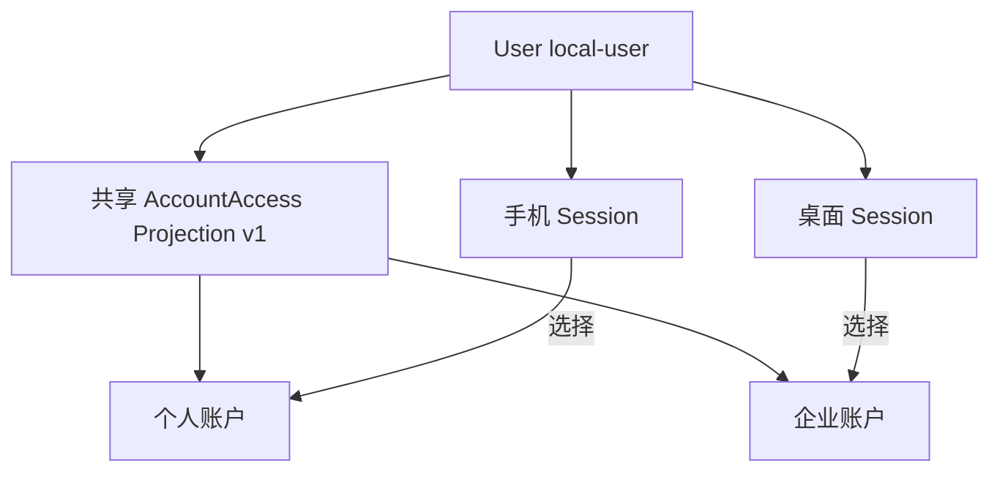
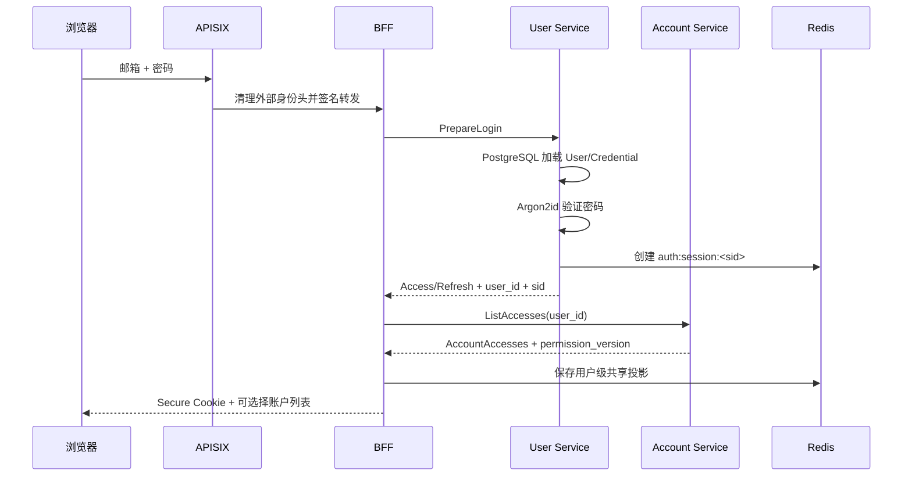
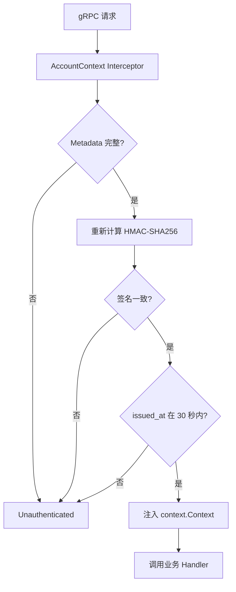

# 从“用户登录”到“账户上下文”：在 Kind 集群实战 User、BFF 与可信 RPC

很多系统把登录成功当成终点：密码校验通过，发一个 JWT，后面的服务读取 `user_id` 就可以开始处理业务。

这种设计在“一个用户永远只有一个账户”的演示系统里似乎没有问题。可一旦进入真实业务，问题马上出现：

- 同一个用户既有个人账户，又是某个企业账户的管理员；
- 用户在手机上操作个人账户，在电脑上处理企业财务；
- 两台设备同时在线，但当前选择的业务主体不同；
- BFF 调用下游微服务时，客户端不能自行伪造企业、成员、角色和权限；
- 权限被收回后，旧会话不能继续使用过期的账户上下文。

这次我们没有只画架构图，而是在本地 Kind Kubernetes 集群中完成了一条可以运行的纵向链路：

```text
用户登录
  → User Service 验证凭证并建立设备会话
  → BFF 查询用户可访问的账户
  → Redis 保存共享账户权限投影
  → 每个 Session 独立选择当前账户
  → BFF 生成并签名 AccountContext
  → gRPC Metadata 传给 Account Service
  → 服务端拦截器验签并注入 context.Context
  → RPC Handler 只使用经过验证的账户身份
```

本文会用教练式的方式讲清楚三个问题：

1. User、Account、Session 为什么必须分开；
2. AccountContext 如何在多个微服务之间可信传递；
3. 如何亲手查看 Cookie、JWT、Redis 和 RPC 的真实数据。

---

## 一、第一道思考题：登录的是“人”，操作的是谁？

先看一个使用者用例。

小王拥有一个个人账户，同时也是“示例科技”的财务成员。他有两台设备：

```text
小王（User: user-1）
  │
  ├── 手机 Session
  │      当前选择：个人账户
  │
  └── 电脑 Session
         当前选择：示例科技企业账户
```

如果系统只在 JWT 里保存：

```json
{
  "user_id": "user-1"
}
```

下游服务只能知道“这是小王”，却不知道：

- 小王现在代表个人还是企业；
- 他通过 Owner 关系还是 Member 关系获得访问权；
- 他在企业中是哪一个 Member；
- 当前角色和权限属于哪个版本；
- 当前账户是在哪个设备会话中选择的。

因此要先建立一个非常重要的领域区分：

| 概念 | 回答的问题 | 生命周期 |
|---|---|---|
| User | 登录的人是谁 | 长期稳定 |
| Credential | 他如何证明自己 | 密码、Passkey、TOTP 等 |
| Session | 哪台设备完成了哪次登录 | 一次设备登录周期 |
| Account | 当前操作的业务主体是谁 | 个人或企业业务主体 |
| AccountAccess | User 为什么能访问 Account | Owner、Member、Role 等关系 |
| AccountContext | 本次请求代表哪个 Account | 单次内部请求 |

一句话记忆：

> User 负责认证，Account 负责业务归属，Session 负责设备状态，AccountContext 负责一次请求的业务身份。

---

## 二、不要把所有状态都塞进 Session

理解完领域，再回答一个数据库和缓存问题：同一用户在多个设备登录，Redis 是不是要保存多份完整账户清单？

答案是不应该。

账户访问关系大部分与设备无关：

```text
user-1 可以访问：
  personal-user-1
  enterprise-local
```

而“当前选中哪个账户”与设备有关：

```text
session-phone   → personal-user-1
session-desktop → enterprise-local
```

所以我们把 Redis 模型拆成两部分。

### 1. 用户级共享账户权限投影

```text
auth:account-access-version:<user_id>
auth:account-access:<user_id>:<permission_version>
```

示例投影：

```json
{
  "user_id": "local-user",
  "permission_version": 1,
  "accesses": [
    {
      "accountId": "account-personal-local-user",
      "accountUid": "personal-local-user",
      "accountType": "personal",
      "relationship": "owner"
    },
    {
      "accountId": "account-enterprise-local",
      "accountUid": "enterprise-local",
      "accountType": "enterprise",
      "organizationId": "org-local",
      "memberId": "member-local-user",
      "roleIds": ["finance_member"],
      "relationship": "member"
    }
  ]
}
```

这里保存的是 Account Service 权威数据的缓存投影，不是第二套可以独立修改的权限事实。

### 2. Session 级账户选择

```text
auth:session-account:<sid>
```

值只需要保存：

```json
{
  "account_uid": "enterprise-local",
  "permission_version": 1,
  "selected_at": 1794
}
```

因此两个设备的最终结构是：



它同时满足两个目标：

- 不在每台设备重复保存完整权限清单；
- 不让一台设备切换账户时影响另一台设备。

---

## 三、登录阶段到底发生了什么

登录不是 BFF 自己查数据库，也不是 Account Service 负责密码。

完整时序如下：



### 1. User Service 做什么

User Service 是认证事实的拥有者：

- 根据规范化邮箱加载 User；
- 从 PostgreSQL 读取密码摘要；
- 使用 Argon2id 验证密码；
- 检查用户是否 active；
- 创建新的设备 Session；
- 签发短期 Access Token 与一次轮换的 Refresh Token。

Access Token 中包含：

```text
sub       用户 ID
sid       设备会话 ID
jti       当前 Token ID
ver       用户认证版本
amr       本次认证方式
auth_time 真正完成认证的时间
iat/exp   Token 签发与过期时间
```

### 2. BFF 做什么

BFF 拿到 `user_id + sid` 后，才具备建立账户上下文的条件：

```text
AuthenticationContext
  user_id + session_id
            ↓
Account Service ListAccesses
            ↓
AccountAccess Projection
```

如果只有一个可访问账户，BFF 可以自动选择；如果有多个候选账户，登录只返回列表，不替用户擅自决定。

### 3. 浏览器拿到什么

Token 不放进 JSON，而是放在安全 Cookie：

```text
access_token   HttpOnly + Secure + SameSite=Strict
refresh_token  HttpOnly + Secure + SameSite=Strict
csrf_token     Secure + SameSite=Strict
```

JSON 只返回非秘密的账户候选列表：

```json
{
  "authenticated": true,
  "expiresIn": 1800,
  "tokenType": "Bearer",
  "accountAccesses": [
    {
      "accountUid": "personal-local-user",
      "accountType": "personal",
      "relationship": "owner"
    },
    {
      "accountUid": "enterprise-local",
      "accountType": "enterprise",
      "organizationId": "org-local",
      "relationship": "member"
    }
  ]
}
```

---

## 四、账户切换不是修改 User，而是修改 Session 选择

客户端选择企业账户：

```http
POST /api/v3/auth/account-context/select
Content-Type: application/json
X-CSRF-Token: <csrf-token>

{
  "accountUid": "enterprise-local"
}
```

BFF 不能相信客户端同时提交的组织、成员、角色或权限，例如下面这些字段都不应由客户端决定：

```json
{
  "organizationId": "org-admin",
  "memberId": "member-admin",
  "roleIds": ["owner"],
  "permissionVersion": 999
}
```

BFF 只接受 `accountUid`，然后在服务端投影中查找完整访问关系：

```text
客户端 accountUid
       ↓
当前 User 的 AccountAccess Projection
       ├─ 找不到 → 403 account is not accessible
       └─ 找到   → 保存 sid 对应的 Selection
```

当 `Selection.permission_version` 与最新投影版本不一致时，旧选择被视为 stale，用户必须重新加载权限并选择。这是权限回收能够及时生效的基础。

---

## 五、为什么 BFF 不能只把 AccountContext 放进普通 Header

假设 BFF 直接向下游发送：

```text
X-Account-ID: account-enterprise-local
X-Role: owner
```

下游无法判断：

- Header 是不是可信 BFF 写的；
- 中间代理有没有修改；
- 是否有人绕过 BFF 直连服务；
- 这个上下文是不是很久以前生成的。

因此我们为内部 AccountContext 增加 HMAC-SHA256 签名。

### 1. AccountContext 包含什么

```json
{
  "user_id": "local-user",
  "session_id": "session-desktop",
  "account_id": "account-enterprise-local",
  "account_uid": "enterprise-local",
  "account_type": "enterprise",
  "organization_id": "org-local",
  "member_id": "member-local-user",
  "role_ids": ["finance_member"],
  "permission_version": 1,
  "selected_at": 1794,
  "issued_at": 1794
}
```

### 2. 签名公式

```text
payload = JSON(AccountContext)

signature = HMAC-SHA256(
  INTERNAL_CONTEXT_SIGNATURE_KEY,
  payload
)
```

随后以 Base64URL 放入 gRPC Metadata：

```text
x-account-context           = Base64URL(payload)
x-account-context-signature = Base64URL(signature)
```

注意：Base64URL 是编码，不是加密。任何能读取 Metadata 的人都能解码载荷。HMAC 提供的是完整性和来源证明，生产环境仍需要 mTLS 保护传输机密性和服务身份。

### 3. BFF 发送端代码

核心逻辑可以缩写为：

```go
resolved, err := accountContexts.Resolve(
    request.Context(),
    Actor{UserID: userID, SessionID: sessionID},
)

rpcContext, err := signer.Attach(
    request.Context(),
    resolved,
)

result, err := accountRPC.CallRoute(
    rpcContext,
    "get-account-summary",
    requestBody,
)
```

`Attach` 会写入 `issued_at`、序列化 JSON、计算 HMAC，并把载荷和签名附加到 outgoing gRPC context。

---

## 六、Account Service 拦截器如何验签

服务端不应该让每个 Handler 都复制一遍验签逻辑。因此验签放在统一 Unary Server Interceptor 中：



关键代码：

```go
mac := hmac.New(sha256.New, secret)
mac.Write(payload)

if !hmac.Equal(signature, mac.Sum(nil)) {
    return Unauthenticated
}
```

为什么使用 `hmac.Equal`，而不是把两个字符串直接用 `==` 比较？因为 `hmac.Equal` 使用恒定时间比较，减少根据响应耗时推测签名内容的时序攻击风险。

验签成功后，拦截器才把业务 AccountContext 注入 Go 的 `context.Context`：

```go
verified := context.WithValue(
    ctx,
    accountContextKey{},
    accountContext,
)

return handler(verified, request)
```

这里要区分两个同名概念：

- `AccountContext`：我们的业务身份数据；
- `context.Context`：Go 中伴随一次请求向下传递取消信号、截止时间和请求级数据的容器。

### Handler 最后怎样读取

```go
func (s *AccountServer) GetSummary(
    ctx context.Context,
    _ *GetSummaryRequest,
) (*GetSummaryResponse, error) {
    accountContext, ok := accountcontext.FromContext(ctx)
    if !ok {
        return nil, status.Error(
            codes.Unauthenticated,
            "account context is required",
        )
    }

    return &GetSummaryResponse{
        AccountId: accountContext.AccountID,
        Status:    "active",
    }, nil
}
```

请求参数被写成 `_`，意味着 Handler 不再使用请求体中的 `user_id` 决定账户。

即使攻击者提交：

```json
{"user_id":"forged-user"}
```

只要验签后的 AccountContext 是企业账户，业务就只会处理企业账户。

---

## 七、哪些 RPC 可以不带 AccountContext

不能简单地把所有 RPC 一刀切，否则会形成鸡生蛋问题：登录时还没选择账户，BFF 如何调用 `ListAccesses` 获取候选账户？

本地实验设置了两个明确白名单：

```text
/account.v1.AccountService/ListAccesses
/grpc.health.v1.Health/Check
```

- `ListAccesses` 是建立 AccountContext 前的引导接口；
- `Health/Check` 是 Kubernetes 探针，天然没有用户上下文。

其他账户业务 RPC 必须携带有效签名。

这次实践还真的踩到了这个边界：初版拦截器把 Kubernetes gRPC 健康探针也拒绝成 `Unauthenticated`，新 Pod 因此不断重启。我们没有关闭安全校验，而是把标准健康检查精确加入白名单。

生产环境中，`ListAccesses` 仍不应成为任意内部服务都能匿名调用的接口。后续需要用 mTLS、SPIFFE 或服务身份 Token 证明调用方是 BFF。

---

## 八、跟我做：在 Kind 中完成双设备实战

下面是可以重复执行的教练式实验。示例假设入口为：

```bash
export BASE_URL=https://localhost:18443
export ORIGIN=https://localhost:18443
export DEMO_EMAIL=demo@local.test
export DEMO_PASSWORD='<local-demo-password>'
```

### 第 1 关：模拟两台设备登录

```bash
curl -k -sS \
  -c /tmp/phone.cookies \
  -X POST "$BASE_URL/api/v3/auth/login" \
  -H "Origin: $ORIGIN" \
  -H 'Content-Type: application/json' \
  --data-binary '{
    "email":"'"$DEMO_EMAIL"'",
    "password":"'"$DEMO_PASSWORD"'"
  }' | jq

curl -k -sS \
  -c /tmp/desktop.cookies \
  -X POST "$BASE_URL/api/v3/auth/login" \
  -H "Origin: $ORIGIN" \
  -H 'Content-Type: application/json' \
  --data-binary '{
    "email":"'"$DEMO_EMAIL"'",
    "password":"'"$DEMO_PASSWORD"'"
  }' | jq
```

观察点：

- 两次登录产生不同 `sid`；
- 两个响应返回相同账户候选列表；
- JSON 中没有 Access Token 或 Refresh Token；
- Cookie 文件中有 Access、Refresh 和 CSRF Cookie。

### 第 2 关：查看 Redis 共享投影

```bash
kubectl --context kind-local-platform \
  -n redis exec deploy/redis -- \
  redis-cli --scan \
  --pattern 'auth:account-access:local-user:*'
```

我们实测得到：

```text
projection_rows=1
```

虽然登录了两台设备，但共享投影仍只有一份。

### 第 3 关：两台设备选择不同账户

```bash
PHONE_CSRF=$(awk '$6 == "csrf_token" {print $7}' /tmp/phone.cookies)
DESKTOP_CSRF=$(awk '$6 == "csrf_token" {print $7}' /tmp/desktop.cookies)

curl -k -sS \
  -b /tmp/phone.cookies \
  -X POST "$BASE_URL/api/v3/auth/account-context/select" \
  -H "Origin: $ORIGIN" \
  -H "X-CSRF-Token: $PHONE_CSRF" \
  -H 'Content-Type: application/json' \
  --data '{"accountUid":"personal-local-user"}' | jq

curl -k -sS \
  -b /tmp/desktop.cookies \
  -X POST "$BASE_URL/api/v3/auth/account-context/select" \
  -H "Origin: $ORIGIN" \
  -H "X-CSRF-Token: $DESKTOP_CSRF" \
  -H 'Content-Type: application/json' \
  --data '{"accountUid":"enterprise-local"}' | jq
```

Redis 中应该出现两条 Selection：

```text
auth:session-account:<phone-sid>   → personal-local-user
auth:session-account:<desktop-sid> → enterprise-local
```

### 第 4 关：调用同一个账户接口

```bash
curl -k -sS \
  -b /tmp/phone.cookies \
  "$BASE_URL/api/v3/account/summary" | jq

curl -k -sS \
  -b /tmp/desktop.cookies \
  "$BASE_URL/api/v3/account/summary" | jq
```

本次实测结果：

```json
{
  "accountId": "account-personal-local-user",
  "status": "active",
  "source": "account-service-generic-grpc"
}
```

```json
{
  "accountId": "account-enterprise-local",
  "status": "active",
  "source": "account-service-generic-grpc"
}
```

这是整场实践最有价值的证据：两个 RPC 请求体仍携带同一个 `local-user`，但 Account Service 根据各自签名 AccountContext 返回了不同账户。

### 第 5 关：验证负向场景

第三台设备登录后不选择账户，直接访问摘要：

```text
HTTP 409
{"error":"account selection required"}
```

尝试选择不属于自己的账户：

```text
HTTP 403
{"error":"account is not accessible"}
```

篡改 AccountContext 载荷但沿用旧签名：

```text
gRPC Unauthenticated
invalid account context
```

---

## 九、测试为什么要按四个边界拆

这次没有直接写一条巨大的端到端测试，而是按风险边界分成四层。

### 1. Resolver 契约

验证：

- 多设备只写一份共享投影；
- 每个 Session 保持独立选择；
- 选择必须属于当前 User；
- permission version 不匹配时拒绝旧选择。

### 2. Redis Adapter 契约

验证真实键模型、JSON 和 TTL：

```text
一份 version key
一份 versioned projection
两个 session selection
```

### 3. BFF Handler 契约

验证：

- 登录返回可选择账户，但不泄露 Token；
- 选择接口绑定 JWT 中的 `user_id + sid`；
- AccountContext 确实进入 outgoing gRPC Metadata；
- 未选择和越权选择返回正确 HTTP 状态。

### 4. 下游 Interceptor 契约

验证：

- 正确签名能注入 `context.Context`；
- 缺少签名被拒绝；
- 修改载荷但复用签名被拒绝；
- Handler 使用 AccountContext，而不是请求体身份；
- 健康检查白名单不会破坏 Kubernetes 探针。

这种拆法让问题更容易定位：Redis 错误不会被误判成 HMAC 错误，RPC 拦截器错误也不会隐藏在 HTTP 502 后面。

---

## 十、这套设计解决了什么，又没有解决什么

### 已经解决

1. User 与业务 Account 不再混为一谈；
2. 多设备可以选择不同业务主体；
3. 账户访问权限不会在每台设备重复保存；
4. 客户端无法自行声明组织、Member 和 Role；
5. BFF 到下游的 AccountContext 具备防篡改签名；
6. RPC Handler 从统一 `context.Context` 读取可信业务身份；
7. 权限版本为后续权限回收提供失效机制。

### 尚未完成

当前 Account Service 返回的个人账户和企业账户仍是演示投影，尚未接入正式的：

```text
Account
Organization
OrgMember
OrgRole
MemberRole
RolePermission
AccountAccess
```

进入生产前还需要补齐：

- PostgreSQL 权威 Account/Organization 数据模型；
- AccountAccess 变更事件和 Redis 投影失效；
- 多 BFF Pod 下的权限版本一致性；
- BFF 到下游的 mTLS 或 SPIFFE 服务身份；
- 签名绑定 RPC Method、Audience 和 Request ID；
- Action、审计日志和敏感操作 Step-up Verification；
- Account Service 不可用时的登录补偿，避免留下客户端未获得的孤儿 Session；
- 服务端根据资源归属再次校验，而不是把 AccountContext 当作绕过领域规则的万能通行证。

HMAC 当前把 `issued_at` 的有效窗口限制为 30 秒，可以缩小重放窗口，但不能完全消灭窗口内重放。高风险资金操作仍必须使用业务幂等键、请求唯一编号和领域状态机。

---

## 十一、最后复盘：把六个 Context 分清楚

整个系统中容易混淆的“上下文”其实有六层：

```text
Credential
  证明“你是谁”

AuthenticationContext
  描述“这次登录如何完成”

Session
  描述“哪台设备仍在线”

AccountAccess Projection
  描述“这个 User 能访问谁”

Session Account Selection
  描述“这台设备当前选择谁”

AccountContext
  描述“这次内部业务请求代表谁”
```

最后再记住三句话：

> 登录的是 User，业务归属是 Account。

> 账户权限属于 User，当前账户选择属于 Session。

> AccountContext 由 BFF 根据服务端事实生成并签名，下游服务验签后才能使用。

当这三个边界建立起来后，个人账户、企业成员、多设备登录、权限回收和微服务调用才有机会在同一个模型中自然演进，而不是不断向 JWT 和 Session 里追加互相矛盾的字段。
