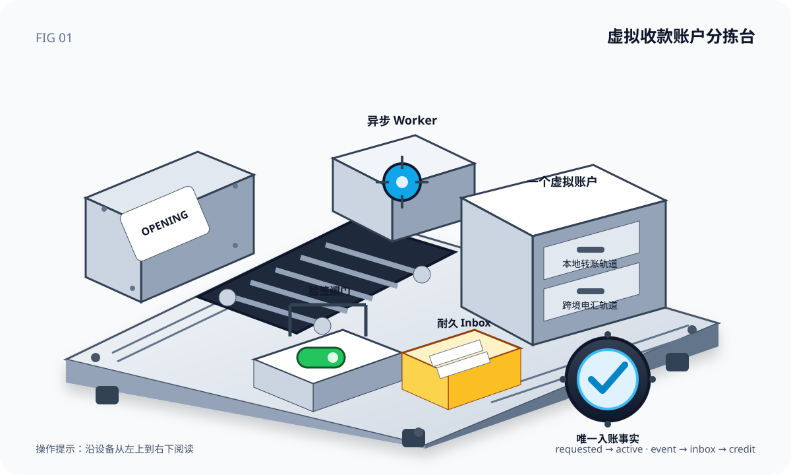

# 别把虚拟账户当成一串银行卡号：从异步开户到可信入账的完整实战

> 这是一篇可以跟着做的教练式文章。我们不连接真实银行，不使用真实个人信息，也不复制任何现成业务系统；只在本地 Kind 集群里，用合成数据验证一套可迁移的虚拟收款账户架构。



## 一、先回答最容易误解的问题

虚拟账户不是“银行返回的一串账户号”。对平台而言，它至少包含四层：

1. **能力**：系统能否提供 USD、本地转账、电汇；
2. **开户**：某个主体能否获得这项能力，当前审批到哪一步；
3. **收款指令**：账户号、路由码、参考附言等具体 Rail；
4. **入账事实**：哪一笔渠道交易最终被平台确认并记入用户资金。

把四层塞进一个同步接口，常见后果是：渠道超时后不知道是否开户成功；同一回调重复记账；前端把产品目录误当成用户已开通状态；一种转账方式就复制一个“账户”。

正确心智模型是：

```text
产品能力目录
    ↓ 主体准入
开户工单 ──→ 渠道操作 ──→ 一个虚拟账户
                                ├─ 本地转账 Rail
                                └─ 电汇 Rail

渠道交易 ──验签──→ Inbox ──→ Pay-in ──→ Credit ──→ 余额投影
```

一个虚拟账户可以展示多条 Rail。Rail 是“怎么把钱送进来”，账户是平台管理的稳定资源，两者不是一回事。

## 二、为什么开户必须是异步的

真实开户通常跨越主体审核、渠道客户创建、账户开立和收款轨道同步。网络超时只代表“本次调用没有拿到答案”，不代表渠道没有执行。

因此 API 只承诺接单：

```text
POST opening
  ├─ 同一事务写 Opening(requested)
  └─ 同一事务写 ChannelOperation(pending)

Worker
  ├─ 锁定 pending Operation
  ├─ 使用稳定 request id 调渠道
  ├─ 查询或接收渠道结果
  └─ 原子写 Account + Rails + Opening(active)
```

重试的关键不是“多试几次”，而是始终使用稳定业务身份。我们的唯一身份是开户幂等键；同一个键、同一组参数返回原 Opening，同一个键换了参数则必须报冲突。

## 三、数据模型为什么要这样拆

本地实验使用七组核心表：

```text
va_openings
    │ 1:1
va_channel_operations
    │
    └──完成──> va_accounts ──1:N──> va_account_rails

va_provider_event_inbox
    │ 1:1
va_payins
    │ 1:1
va_credit_entries ──投影──> va_balances
```

`Opening` 记录用户意图，`ChannelOperation` 记录副作用的执行；二者分开，才能安全暂停、重试和排查。`CreditEntry` 是唯一入账事实，`Balance` 只是可重建的查询投影。

需要注意：本文的余额投影是教学实现，不是复式总账。生产资金系统应把最终 Credit 交给独立账本，以借贷平衡、不可变分录和冲正凭证管理资金。

## 四、第一关：亲眼看见异步边界

我们先把 Worker 缩容为 0，再提交开户：

```json
{
  "idempotency_key": "coach-opening-...",
  "owner_id": "org-coach-demo",
  "currency": "USD"
}
```

观察到的响应是：

```json
{
  "opening_id": "opening-4f6c...",
  "status": "requested",
  "account_id": "",
  "rails": []
}
```

PostgreSQL 也显示 `requested`。这证明 API 没有假装同步完成。恢复 Worker 后，同一 Opening 变为 `active`，并返回一个账户、两条 Rail：

```json
{
  "account_id": "va-d733...",
  "status": "active",
  "rails": [
    {"type":"local_transfer","masked_account":"******9c64"},
    {"type":"wire","masked_account":"******c7b6"}
  ]
}
```

这里刻意只输出掩码账户号。真实收款指令属于敏感数据，应做字段级加密、最小化展示和审计访问。

## 五、第二关：重复开户为什么不会多开账户

我们原样重放同一请求，返回的 `opening_id` 和 `account_id` 完全相同。数据库约束形成最后一道防线：

- Opening 的 `idempotency_key` 唯一；
- 一个 Opening 只能有一个 ChannelOperation；
- 一个 Opening 只能生成一个平台 Account；
- 一个 Account 的同类 Rail 只能有一条。

但唯一约束还不够。服务必须保存规范化参数的指纹：相同键 + 相同指纹是安全重放；相同键 + 不同指纹是 `409 Conflict`。否则客户端误用旧键时，系统会悄悄返回一笔语义不同的旧结果。

## 六、第三关：渠道事件为什么要先进入 Inbox

渠道发送入账事件时，我们签名：

```text
canonical = timestamp + "." + event_id + "." + raw_body
signature = HMAC-SHA256(secret, canonical)
```

Receiver 必须按这个顺序处理：

```text
限制报文大小
  ↓
读取原始字节（不能先反序列化再签）
  ↓
校验时间戳、event_id、签名
  ↓
验证事件结构
  ↓
以 event_id 唯一写入 Inbox
  ↓
快速返回 received
```

为什么用原始字节？因为 JSON 中的空格、字段顺序和数字格式都会改变字节序列。发送方签什么，接收方就必须验什么。

## 七、第四关：把“至少一次投递”变成“一次业务效果”

同一事件第一次到达：

```json
{"received":true,"duplicate":false}
```

第二次原样投递：

```json
{"received":true,"duplicate":true}
```

最终数据库证据：

```text
Inbox rows       1
Pay-in rows      1
Credit rows      1
Credited minor   12500
```

这不是“消息只收到一次”，而是“消息可以收到多次，但业务效果只发生一次”。三个唯一约束分别防住三层重复：Inbox 防重复接收，Pay-in 防重复业务单，Credit 防重复入账。

## 八、第五关：篡改为什么进不了数据库

我们保留原签名，却把金额从 `12500` 改成 `99999`。服务返回 `401 invalid signature`，查询 Inbox 得到 0 行。

这条证据很重要：安全校验必须位于耐久化之前。若先落库再异步验签，伪造事件会污染运营查询、告警和重试系统。

## 九、从实验走向生产，还缺什么

本地结果只证明设计骨架，不代表生产就绪。至少还要补齐：

- 主体准入、角色权限和制裁筛查；
- 真实渠道适配器、查询补偿、指数退避和死信运营台；
- Webhook 时间窗、Nonce、密钥双版本轮换；
- 账户号字段加密、脱敏、审计和数据保留策略；
- 入账进入复式总账，而不是直接改余额；
- 渠道流水、银行结单、平台 Pay-in 和总账四方对账；
- 部分到账、退回、冻结、人工审核、币种精度和汇兑；
- 指标、追踪、SLO、备份恢复和故障演练。

尤其不要把“HTTP 200”当成入账成功。可靠验收需要三份独立证据：Receiver 已接受、Inbox 已处理、资金事实已生成。

## 十、教练总结

请记住五句话：

1. 能力目录回答“能提供什么”，开户状态回答“这个主体得到什么”；
2. 一个虚拟账户可以拥有多条收款 Rail；
3. 外部开户是耐久操作，不是一次 HTTP 调用；
4. Webhook 的正确目标是至少一次投递、一次业务效果；
5. Pay-in 是业务事实，余额是投影，最终资金必须进入专业账本。

当你能分别指出 Opening、Operation、Account、Rail、Inbox、Pay-in 和 Credit 的职责时，虚拟账户就不再是一串神秘的银行卡号，而是一条可以暂停、恢复、审计、对账和扩展的可靠链路。
