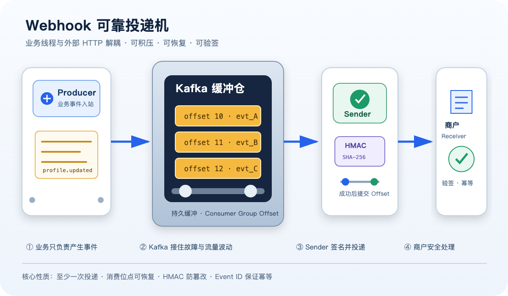
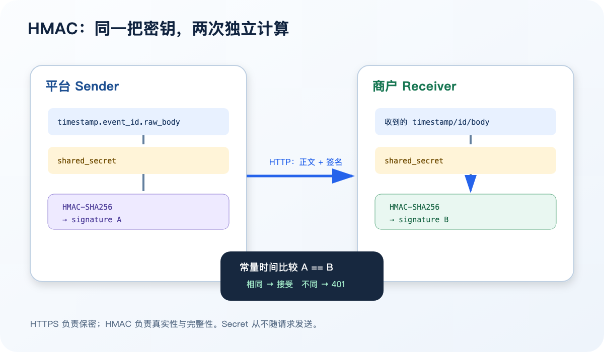
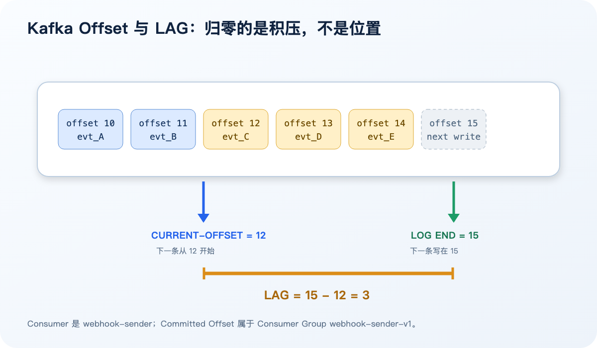
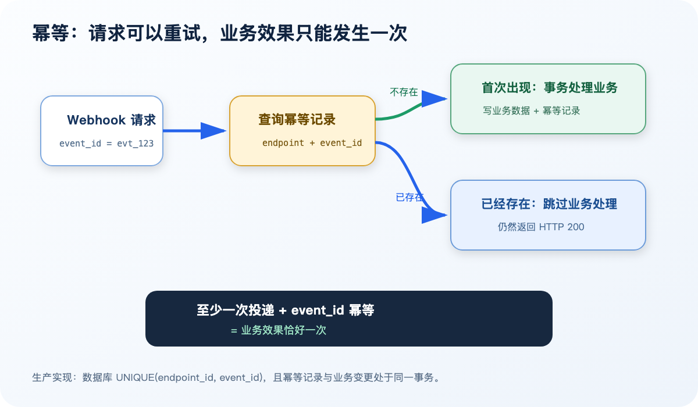
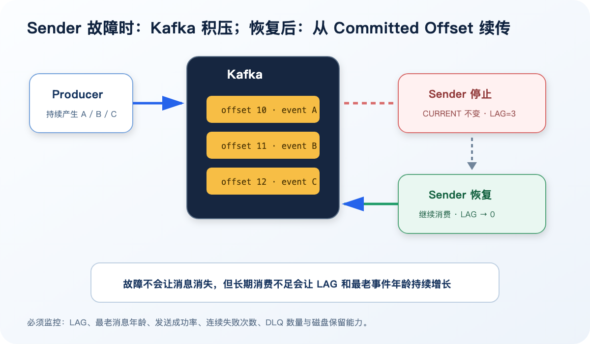

# 从一条 `profile.updated` 开始：亲手搭建可靠 Webhook 的原理与实践

> 很多系统第一次实现 Webhook，只做了一件事：业务完成后发一个 HTTP POST。真正上线后才发现，网络会超时、商户会宕机、请求会重复、正文会被篡改，密钥还需要轮换。
>
> 这篇文章不从概念清单开始，而是以教练视角，带你在本地 Kind 集群中亲手完成一条可观察、可验签、可积压、可恢复的 Webhook 链路。



## 一、我们究竟在解决什么问题

假设用户资料更新完成，平台需要通知商户：

```json
{
  "id": "evt_HJY-5wzlvphfnGAXqTtWOXmb",
  "event": "profile.updated",
  "version": 1,
  "occurred_at": 1792669436,
  "data": {
    "user_id": "local-user",
    "verification_status": "verified"
  }
}
```

如果业务服务直接同步请求商户，会出现三个耦合：

1. 商户响应变慢，拖慢平台业务请求。
2. 商户宕机，平台必须立刻决定如何重试。
3. 平台进程重启时，内存中的待发送事件可能丢失。

因此本次实践采用：

```text
业务事件生产端
    → Kafka
    → webhook-sender
    → 商户 webhook receiver
```

各组件只承担一种职责：

| 组件 | 职责 |
|---|---|
| `webhook-event-producer` | 把业务变化包装成稳定的事件信封并写入 Kafka |
| Kafka | 持久保存事件，承接流量与故障期间的积压 |
| `webhook-sender` | 消费事件，生成 HMAC 签名并发送 HTTP 请求 |
| `merchant-webhook-receiver` | 模拟商户，校验时间、签名和事件幂等性 |
| Argo CD | 从 GitOps 仓库同步部署配置 |
| Kubernetes Secret | 向发送端和接收端注入共享密钥 |

需要先说明实验边界：当前本地 Kafka 没有挂载持久卷，适合验证协议与故障恢复流程，但不能据此推断 Pod 被删除后数据仍然存在；生产部署必须配置持久存储、副本与容灾策略。模拟商户接收端的幂等记录同样只保存在内存中，Pod 重建后会丢失，后文会给出数据库实现方式。

## 二、第一课：先理解事件，而不是先写 HTTP

Webhook 传输的不是一段随意 JSON，而是一个有稳定身份的业务事件。

其中最重要的字段是：

- `id`：事件唯一编号，也是幂等依据；
- `event`：事件类型；
- `version`：事件契约版本；
- `occurred_at`：业务事件发生时间；
- `data`：事件负载。

需要特别区分两个时间：

```text
occurred_at
→ 业务事件发生时间
→ 重试时保持不变

X-Webhook-Timestamp
→ 本次 HTTP 投递时间
→ 每次重试重新生成
```

如果把两者混为一谈，几天前发生但今天重试的事件，就可能被误判为重放攻击。

## 三、第二课：HMAC 不是加密，而是带密钥的消息认证

本次约定的签名原文是：

```text
timestamp + "." + event_id + "." + raw_body
```

发送端计算：

```text
signature = HMAC-SHA256(shared_secret, canonical_payload)
```

并通过请求头发送：

```http
X-Webhook-Event-Id: evt_123
X-Webhook-Timestamp: 1792681503
X-Webhook-Signature-Version: v1
X-Webhook-Signature: daa3801a...
```



HMAC 和对称加密都使用共享 Secret，但目标不同：

| 技术 | 解决的问题 | 是否隐藏正文 |
|---|---|---|
| AES 等对称加密 | 保密性 | 是 |
| HMAC-SHA256 | 来源真实性与完整性 | 否 |

Webhook JSON 仍是明文，保密性由 HTTPS 提供；HMAC 负责证明请求来自持有 Secret 的一方，并且正文没有被修改。

### 亲手验签得到的三个结论

我们先使用相同 Secret 和原始正文计算签名，请求返回 `200`。随后进行了两次攻击实验。

第一种，只把：

```json
"verification_status": "verified"
```

改为：

```json
"verification_status": "rejected"
```

但继续携带旧签名，接收端返回：

```http
HTTP/1.1 401 Unauthorized

invalid signature
```

第二种，只修改 `X-Webhook-Event-Id`，也返回 `401`。这证明签名同时绑定了正文、时间戳和事件编号。

即使我们使用正确 Secret 为伪造的 Header Event ID 重新签名，接收端仍返回：

```http
HTTP/1.1 400 Bad Request

invalid event
```

因为 Header 中的 Event ID 与 Body 中的 `id` 不一致。这形成了两层边界：

```text
签名无效                  → 401：调用方无法证明身份
签名有效但事件结构错误    → 400：可信调用方提交了无效数据
```

### 为什么要使用原始 Body

JSON 重新序列化后，即使语义相同，字节也可能不同：

```json
{"a":1,"b":2}
```

和：

```json
{ "b": 2, "a": 1 }
```

因此验签必须读取收到的原始字节，先验签，再反序列化；不能先解析成对象后重新生成 JSON 来验签。

## 四、第三课：Kafka 消费成功，不等于消息被删除

Kafka 中每条消息都位于某个 Topic 的某个 Partition，并拥有递增 Offset：

```text
Partition 0
├── offset 10 → 事件 A
├── offset 11 → 事件 B
└── offset 12 → 事件 C
```

`webhook-sender` 就是 Consumer，它属于消费者组 `webhook-sender-v1`。消费进度属于消费者组，不属于某个临时 Pod。



消费者组常见的三个指标是：

| 指标 | 含义 |
|---|---|
| `CURRENT-OFFSET` | 下一条应该读取的位置 |
| `LOG-END-OFFSET` | 分区下一条新消息将写入的位置 |
| `LAG` | 尚未确认的消息数量 |

公式是：

```text
LAG = LOG-END-OFFSET - CURRENT-OFFSET
```

例如：

| 阶段 | CURRENT | LOG END | LAG |
|---|---:|---:|---:|
| 正常 | 10 | 10 | 0 |
| Sender 停止后产生 3 条消息 | 10 | 13 | 3 |
| 恢复并消费一条 | 11 | 13 | 2 |
| 全部追平 | 13 | 13 | 0 |

归零的是 `LAG`，不是 Offset。Offset 仍然向前推进。

消息消费完成后仍会保留在 Kafka，直到达到 Topic 的保留条件。提交 Offset 的含义只是：

> `webhook-sender-v1` 已经确认完成此前的消息，下次从这个位置继续。

## 五、第四课：为什么发送成功后才能提交 Offset

正确顺序是：

```text
从 Kafka 获取事件
        ↓
向商户发送 Webhook
        ↓
商户返回 2xx
        ↓
提交 Kafka Offset
```

如果发送前就提交 Offset，随后 HTTP 请求失败，那么 Kafka 会认为消息已经消费，事件可能永久丢失。

如果商户已处理成功，但 200 响应在网络中丢失，Sender 会重试同一事件。这也是为什么接收端必须实现幂等。

## 六、第五课：至少一次投递 + 幂等 = 业务效果一次

接收端以 `event_id` 作为幂等键：



在实践中，我们把完全相同的事件重新签名并投递：

```text
第一次：HTTP 200，事件数量从 0 变成 1
第二次：HTTP 200，事件数量仍然是 1
```

为什么重复事件也返回 200？

因为 `200` 表示：

> 这个事件已经被安全接收，发送方不需要继续重试。

如果重复事件返回 500，Sender 会持续重试，制造没有意义的流量。

本地演练使用内存 Map 保存已处理事件。生产环境应该使用持久化数据库，并建立唯一约束：

```sql
UNIQUE (endpoint_id, event_id)
```

幂等检查和业务写入还应处于同一个数据库事务中，避免“已经标记成功，但业务尚未完成”的中间状态。

## 七、第六课：亲手制造积压，理解 Kafka 的价值

我们把 `webhook-sender` 缩容到 0，但保持 Producer 与 Kafka 运行，然后继续生产三条事件。

结果是：

```text
CURRENT-OFFSET 保持不变
LOG-END-OFFSET 增加 3
LAG 增加到 3
```

恢复 Sender 后，它以同一个消费者组名称重新加入，从 Kafka 保存的 Committed Offset 继续：

```text
CURRENT-OFFSET 逐步前进
LAG 从 3 降至 0
```



这个实验说明：

1. Producer 与 Webhook 发送过程已经解耦；
2. Sender 暂停不会要求业务服务同步等待；
3. 消费进度保存在 Kafka，而不是只存在 Pod 内存；
4. 新 Sender Pod 可以从原有消费者组进度继续；
5. LAG 是判断发送能力是否追得上生产速度的关键指标。

但 Kafka 不是无限缓冲区。如果生产速度长期大于发送速度，LAG 会持续增长，最终受到磁盘容量和保留策略约束。因此生产环境必须监控：

- LAG 数量与增长速度；
- 最老未处理消息的年龄；
- HTTP 成功率和响应时间；
- 单商户连续失败次数；
- 死信队列数量；
- Sender 的吞吐量。

## 八、Secret 如何安全交付与轮换

HMAC 双方必须拥有同一个 Secret。本地实验由脚本生成随机值，保存到被 Git 忽略的 `.local-secrets/`，再写入 Kubernetes Secret。

生产环境中应该：

1. 平台生成至少 32 字节密码学随机 Secret；
2. 通过 HTTPS 管理后台仅展示一次；
3. 商户保存到 Vault、云 Secret Manager 或 Kubernetes Secret；
4. 平台数据库只保存 KMS 加密后的密文；
5. 日志只记录 `secret_id`，禁止记录 Secret；
6. 创建、查看和轮换操作记录审计日志。

轮换不能直接覆盖旧 Secret，否则 Sender 与 Receiver 更新时间不一致时会全部验签失败。推荐携带：

```http
X-Webhook-Key-Id: whsec_2026_10
```

并经历：

```text
生成 S2
  → 商户部署 S2，同时接受 S1/S2
  → 平台切换为 S2 签名
  → 观察成功率
  → S1 标记 revoked
```

每个商户必须使用独立 Secret。一个商户 Secret 泄露，不应影响其他商户。

## 九、当前实现的安全检查顺序

接收端建议按以下顺序处理：

```text
限制 Body 大小
    ↓
检查签名版本和必要 Header
    ↓
检查 Timestamp 时间窗口
    ↓
使用原始 Body 验证 HMAC
    ↓
解析 JSON
    ↓
校验 Header Event ID == Body ID
    ↓
检查事件类型与版本
    ↓
数据库幂等写入
    ↓
执行业务并返回 2xx
```

时间窗口能限制截获请求的可重放时间，但不能取代幂等；Event ID 幂等能防止同一业务事件重复执行，但不能取代签名。安全来自多层约束，而不是一个 Header。

## 十、生产化还缺什么

这次本地纵向链路已经验证了核心原理，但距离生产系统还有几个明确阶段：

### 第一阶段：可靠重试

- 指数退避并增加随机抖动；
- 限制最大重试次数或最大重试时长；
- 区分可重试错误和永久错误；
- 超限事件进入死信队列；
- 支持人工查询和重放。

### 第二阶段：多商户治理

- Endpoint 与 Secret 持久化；
- 每商户独立并发、限流和熔断；
- Secret 的 `key_id` 与双密钥轮换；
- Endpoint 停用、测试发送与审计记录。

### 第三阶段：出站安全

- SSRF 防护；
- 禁止内网、环回、云元数据地址；
- DNS 解析与重绑定防护；
- 只允许 HTTPS；
- 请求超时、响应大小上限和受控重定向。

### 第四阶段：可观测与运维

- 每次 Delivery Attempt 独立记录；
- 端到端 Trace ID；
- LAG、最老事件年龄和成功率告警；
- 按商户查看投递历史；
- 可审计的人工重放。

## 十一、最后回到一句话

可靠 Webhook 不是“发一个 HTTP 请求”，而是一条具有明确安全边界和恢复能力的异步交付流水线：

```text
稳定事件契约
  + Kafka 解耦与持久缓冲
  + HMAC 来源认证与防篡改
  + 时间窗口限制重放
  + Event ID 幂等
  + 成功后提交 Offset
  + 重试、死信与可观测
  = 可长期运营的 Webhook 系统
```

真正理解它最好的方式，不是背下这些名词，而是亲手完成四次实验：合法签名、正文篡改、重复投递、消费者停机恢复。当你能从 HTTP 状态、Kafka Offset 和 LAG 中解释系统正在发生什么，这套机制才真正变成你的工程能力。
