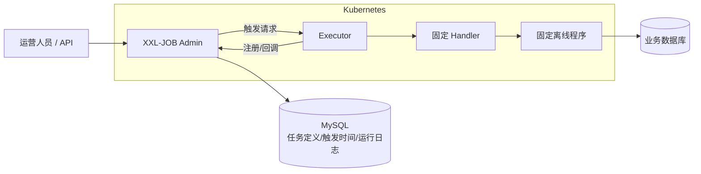
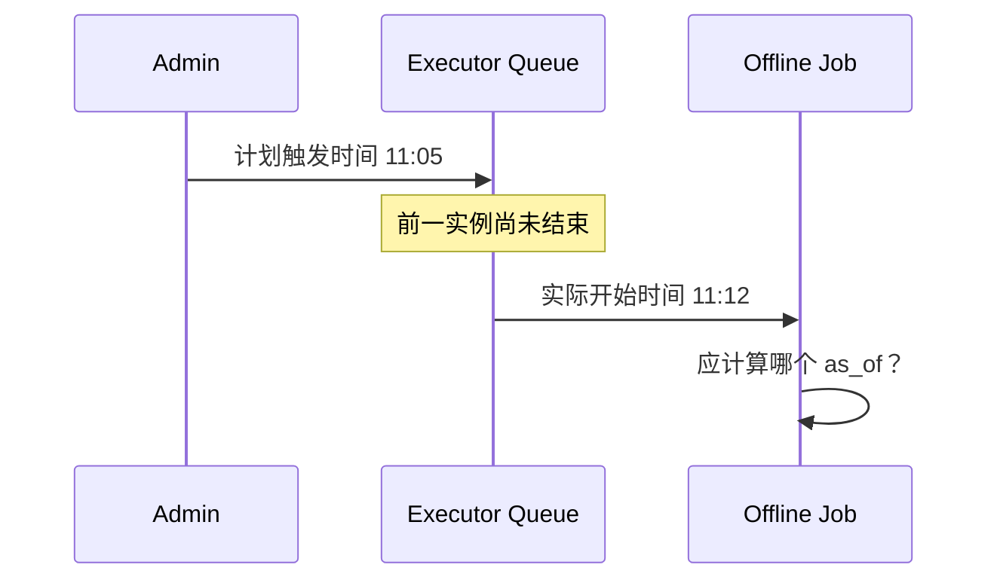
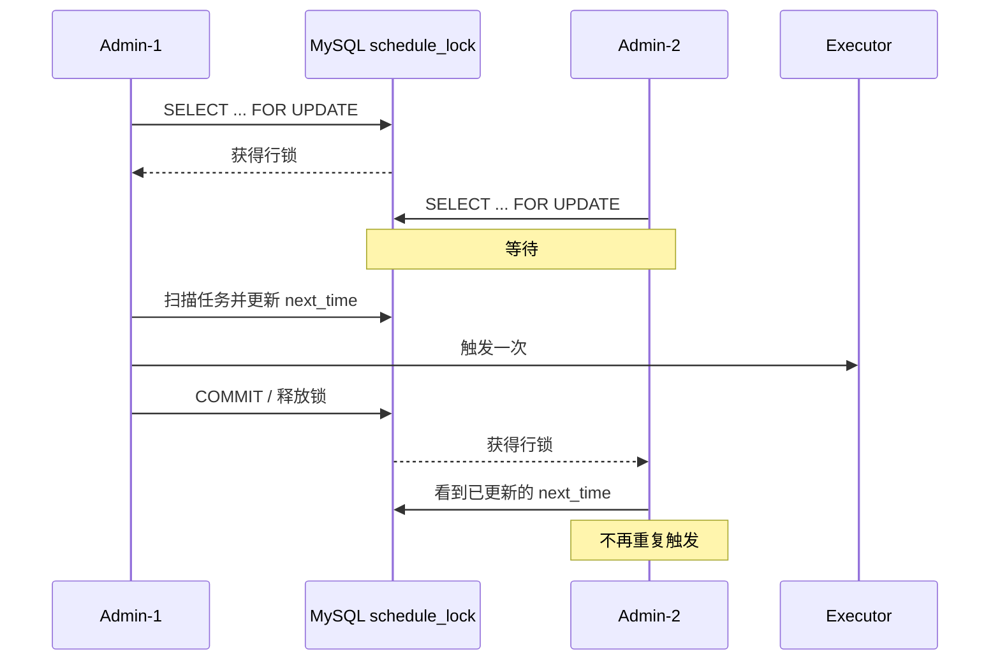
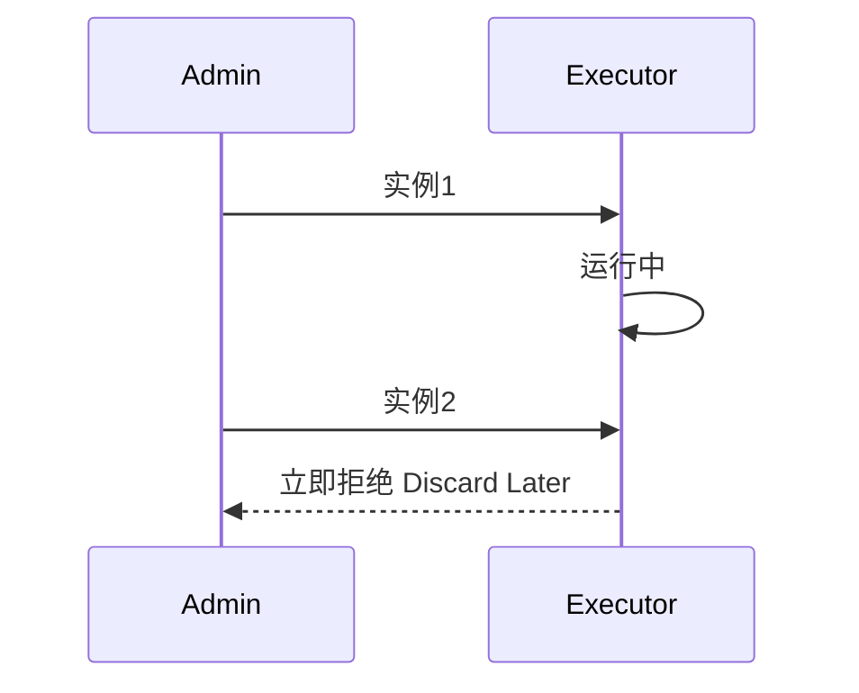
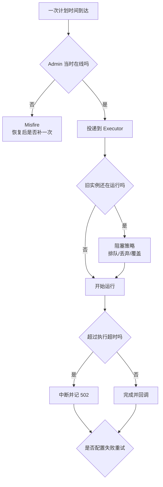
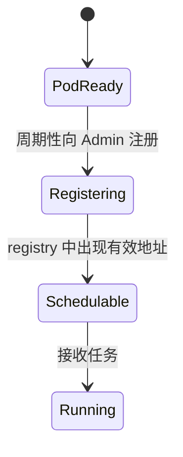
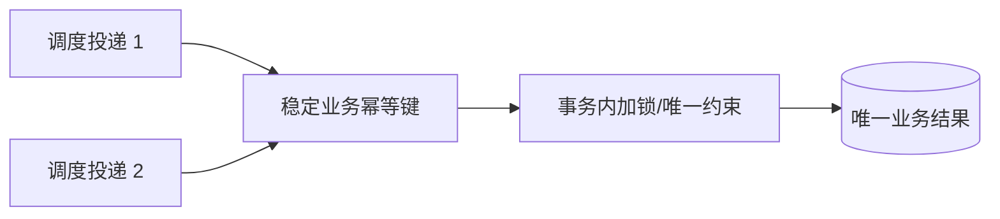

# 从 CronJob 到任务中心：一次把 XXL-JOB 调度、阻塞、超时、补跑与幂等讲清楚

> 这不是一篇“把 XXL-JOB 跑起来就结束”的安装笔记。我们会把一个小时级离线风控任务放进本地 Kind 集群，亲手制造重叠执行、任务超时、调度中心停机、执行器重启和重复投递，观察系统究竟如何反应，再由实验结果反推生产最佳实践。

## 一、先说结论：XXL-JOB 解决的不是“会不会定时”

Kubernetes CronJob 已经能按 Cron 表达式创建 Job。只有三五个简单任务时，它通常足够。

任务数量增多后，我们真正缺少的往往是统一管理能力：

- 谁在什么时候触发了什么任务；
- 任务被投递到了哪个执行器；
- 上一次没结束时，新任务应该等待、丢弃，还是覆盖；
- 调度中心停机时，错过的时间点是否补跑；
- 任务运行太久时，谁负责中断；
- 失败后能否重试，重试会不会重复产生业务结果；
- 多个调度中心实例如何避免重复触发；
- 如何人工触发、审计、暂停和恢复。

因此，更准确的定位是：

```text
CronJob = Kubernetes 原生时间触发器 + 一次性 Pod
XXL-JOB = 调度控制面 + 执行器协议 + 运行记录 + 运营入口
```

XXL-JOB 的主要价值确实来自 Admin，但 Admin 不是一块“好看的页面”。它背后保存了任务定义、下次触发时间、路由策略、阻塞策略、Misfire 策略和运行日志，并负责可靠地把一次触发交给 Executor。

## 二、先建立全局心智模型



一次调度可拆成五步：

1. Admin 的调度线程扫描即将到期的任务；
2. Admin 选择 Executor 地址并创建调度日志；
3. Executor 按 Handler 名找到预先注册的函数；
4. Handler 执行固定业务程序；
5. Executor 将最终状态回调给 Admin。

这里最容易混淆的是：Admin 负责“何时执行、投递到哪、如何管理”；Executor/Handler 负责“具体做什么”。

## 三、为什么我们只开放固定 Handler

本地实验没有开放任意 Shell 或任意 HTTP Handler，而是只允许固定的：

```text
offlineRiskScan         正式离线扫描
offlineRiskScanShadow   无副作用预演
schedulerOverlapProbe   仅供重叠/超时故障演练
```

探针参数也不是自由命令，只接受：

```json
{
  "probe_id": "serial-01",
  "sleep_seconds": 12
}
```

并施加了三层限制：

- 只允许 `probe_id` 与 `sleep_seconds`；
- 运行时间限定在 1–120 秒；
- `probe_id` 只能使用安全字符。

这条边界很重要。调度平台一旦能执行任意命令或任意 URL，实际上就成为了高权限远程执行平台。生产环境应优先采用“固定 Handler + 类型化参数 + 白名单能力”，而不是把万能脚本能力直接交给运营界面。

## 四、调度时间不等于实际开始时间

假设任务计划在 11:05 执行，但由于前序任务排队，到 11:12 才真正启动。



如果程序直接读取当前时间，它会错误地计算 11:12 所在窗口，破坏重放、对账和幂等。

正确契约是：

```text
显式 as_of（人工补跑）
        优先于
XXL 计划触发时间 logDateTime
        优先于
当前机器时间（只作为脱离 XXL 的兼容兜底）
```

本次实现补充了 `execute(rawParameter, scheduledAt)`：

- 正常定时运行使用 XXL 的计划触发时间，并截断到小时；
- 人工历史补跑传入显式、小时对齐的 `as_of`；
- 相同 `as_of + policy version` 形成相同业务 Run ID。

这使任务具备确定性：无论延迟、重启还是换一台机器运行，同一个业务时间点都能得到同一身份和同一计算窗口。

## 五、Admin 多实例为什么不会重复调度

当 Admin 扩成两个副本时，两个实例都会运行调度循环。如果没有协调，同一个时间点就可能被触发两次。

XXL-JOB 的关键做法是在调度扫描事务中锁定数据库里的调度锁记录：



实战中把 Admin 扩成两个副本，让探针每 5 秒运行一次。连续多个调度槽中，每个 `trigger_time` 都只有一条日志，验证了数据库锁的互斥效果。

但要注意：这解决的是“Admin 调度扫描重复”，不等于业务 Exactly Once。网络超时、回调丢失、人工重试仍可能导致任务被再次投递，业务层必须继续幂等。

## 六、上一个实例没结束，新实例到底怎么办

XXL-JOB 的阻塞策略发生在 Executor 侧。相同 Job 在一个 Executor 内由对应的 JobThread 和队列管理。

### 1. SERIAL_EXECUTION：排队串行

```mermaid
gantt
    title 串行：后来的任务等待
    dateFormat  ss
    axisFormat  %S秒
    任务1 :active, 00, 6s
    任务2 :       06, 6s
```



两次请求在同一秒触发、每次睡眠 6 秒。结果：

| 实例 | 从触发到完成 |
|---|---:|
| 第一笔 | 约 7 秒 |
| 第二笔 | 约 13 秒 |

第二笔没有并发运行，而是在队列中等待第一笔结束。

适用场景：不能丢数据、允许延迟、任务严格按顺序处理。

风险：生产速度长期小于触发速度时，队列会持续增长。串行不是流量控制的替代品。

### 2. DISCARD_LATER：丢弃后续



结果是第一笔正常完成，第二笔在触发阶段直接失败，没有进入 Handler。

适用场景：高频刷新、监控采样等“下一次还会再来，漏一次可接受”的任务。

风险：不能用于资金入账、账务结算或必须逐笔处理的任务。

### 3. COVER_EARLY：覆盖前序

第一笔计划运行 12 秒；2 秒后触发第二笔：

```text
旧实例：2 秒时被中断 → 失败
新实例：独立运行 3 秒 → 成功
```

适用场景：只关心最新配置或最新全量结果，而且任务支持安全中断。

风险：Java 线程中断是协作式的。如果业务代码忽略中断，或者启动了未被管理的子进程，旧任务可能继续产生副作用。

因此，“覆盖”绝不是强 Exactly Once，也不是万能的 kill -9。

## 七、超时、阻塞、Misfire、重试是四个不同问题



### 超时

探针运行 10 秒，Executor 超时设为 3 秒：

```text
旧任务：约 3 秒被中断，handle_code = 502
后续 1 秒任务：成功
```

为了避免两层超时争抢，本地正式离线程序采用：

```text
内部子进程超时 55 秒
XXL 外层超时   60 秒
```

内部层先结束子进程并清理资源，外层再作为最终兜底。

### Misfire

Misfire 只讨论 Admin 停机期间错过的计划时间。

我们让任务每 10 秒执行一次，再停止 Admin：

```text
DO_NOTHING:
恢复后从下一个 10 秒整点继续，停机区间形成空档。

FIRE_ONCE_NOW:
恢复时在非整点立即补 1 次，随后回到 10 秒整点节奏。
```

`FIRE_ONCE_NOW` 不是把停机期间每个错过点全量回放。需要逐小时、逐日历史回算时，应使用显式 Backfill 流程和固定 `as_of`，而不是依赖 Misfire。

### 失败重试

重试意味着同一业务请求可能再次执行。它只能建立在业务幂等之上。没有幂等时，自动重试可能把一次偶发故障放大成重复扣款、重复发信或重复入账。

## 八、为什么必须清理子进程树

Java Handler 可能启动 Go、Python 或 Shell 子进程。只中断 Java 线程，并不保证操作系统子进程退出。


本次先写失败测试：启动一个长睡眠子进程，中断 Launcher 后检查其 PID 是否仍存活。旧实现下子进程继续运行；修复后 Launcher 在 `finally` 中按后代到父进程的顺序终止整个进程树。

最佳实践：

- 捕获 `InterruptedException` 后恢复线程中断标记；
- 在 `finally` 中回收后代与父进程；
- 内部超时应短于 XXL 外层超时；
- 任务必须设计可中断点，数据库事务要短；
- 对已经提交的外部副作用，使用补偿或幂等，而不是幻想进程终止能回滚一切。

## 九、Pod Ready 不等于 Executor 已可调度

Executor Pod 重启实验给出了三段状态：



我们在 20 秒探针运行期间删除 Executor Pod：

- 旧任务收到容器销毁信号，被记录为失败，而不是成功；
- 新 Pod 很快达到 Kubernetes Ready；
- 紧接着的一次触发仍失败，因为 Executor 尚未重新注册；
- 等待注册周期后再次触发成功。

因此，发布验收至少应同时检查：

1. Deployment Ready；
2. `xxl_job_registry` 中存在新鲜的 Executor 地址；
3. 运行一个无副作用健康探针并收到成功回调。

只检查 Pod Ready 会产生“看起来上线了、实际上任务投不进去”的灰色窗口。

## 十、回调延迟不等于业务仍在运行

Admin 暂时不可用时，Executor 可能已经完成任务，但回调尚未写回调度日志。恢复后，Executor 的回调线程会重试并补写结果。

所以调度日志中的 `handle_code = 0` 只能表示“尚未收到最终回调”，不能直接解释为：

- 业务一定还在运行；
- 业务一定没有成功；
- 可以安全地再执行一次。

自动补偿前应查询业务 Run、幂等键或业务结果表，区分“未知结果”和“确认失败”。

## 十一、Exactly Once 为什么必须落在业务层

本次生产离线任务使用确定性 Run ID：

```text
offline-{policy_key}-v{policy_version}-{as_of}
```

同一个 `as_of` 连续触发两次：

```text
XXL 运行日志：2 次成功
业务数据库：  1 Run / 1 Finding / 2 Evaluations
```



可靠任务系统的实际语义通常是：

```text
调度层：至少一次投递
业务层：幂等收敛为一次结果
```

建议同时使用：

- 规范化请求指纹，识别“同键同请求”与“同键冲突请求”；
- 唯一约束作为最终防线；
- 事务锁或 advisory lock 处理并发首次写入；
- 业务结果与副作用记录处于同一事务，或使用 Outbox；
- 重放返回原结果，不重复执行外部副作用。

## 十二、完整实践清单与结论

| 关卡 | 做法 | 观察到的结果 |
|---|---|---|
| 固定 Handler 安全边界 | 拒绝未知字段与任意命令 | 参数越界在执行前失败 |
| 计划时间语义 | XXL `logDateTime` 作为默认 `as_of` | 排队不改变业务时间 |
| 子进程中断 | 中断 Launcher 并检查子 PID | 修复后进程树被回收 |
| 串行阻塞 | 同秒触发两个 6 秒任务 | 第二笔约 13 秒完成 |
| 丢弃后续 | 运行中再次触发 | 第二笔触发阶段失败 |
| 覆盖前序 | 2 秒后用新任务覆盖 | 旧失败、新成功 |
| 执行超时 | 10 秒任务、3 秒超时 | 约 3 秒记为 502，后续可恢复 |
| Admin 双实例 | 两副本、每 5 秒调度 | 每个时间槽只有一条日志 |
| DO_NOTHING | Admin 停机后恢复 | 不补错过点 |
| FIRE_ONCE_NOW | Admin 停机后恢复 | 立即补一次，再恢复正常节奏 |
| Executor 重启 | 运行中删除 Pod | 旧任务失败；注册完成后新任务成功 |
| 业务幂等 | 同 `as_of` 生产运行两次 | 两次调度、一个业务结果 |
| 现场恢复 | 删除临时任务、恢复镜像与 GitOps | Argo Synced / Healthy，验收通过 |

## 十三、生产最佳实践清单

### 任务设计

- 任务必须有稳定业务幂等键；
- 业务时间必须显式传递，不偷偷读取当前时间；
- Backfill 必须指定 `as_of` 或时间区间；
- 长任务应分片或设置检查点，不依赖无限加大超时；
- 外部副作用应通过 Outbox、状态机或补偿管理。

### 调度配置

- 默认从 `SERIAL_EXECUTION` 开始，明确证明可丢弃或可覆盖后再换策略；
- `DISCARD_LATER` 只用于允许漏执行的刷新型任务；
- `COVER_EARLY` 只用于可安全中断、只关心最新结果的任务；
- 内部资源超时短于 XXL 外层超时；
- 自动重试次数从 0 开始，先验证幂等与故障分类；
- Misfire 与历史 Backfill 分开设计。

### 发布与运维

- Executor 使用固定 Handler 和不可变镜像；
- Admin 多副本共享同一可靠 MySQL；
- 同时监控触发失败、执行失败、超时、排队时长和注册新鲜度；
- readiness 之外增加 Executor 注册与探针验收；
- 变更阻塞策略、超时、Misfire 前先跑无副作用 Shadow；
- 保留一键暂停、人工补跑和回滚手册。

### 安全

- 不向普通运营角色开放任意命令执行；
- Access Token 放在 Secret，不写入 Git 或任务参数；
- Executor 使用最小网络与数据库权限；
- 调度参数限制长度、字段、格式和范围；
- 日志不得输出密码、Token、完整个人信息或敏感业务载荷。

## 十四、何时继续用 CronJob，何时选择 XXL-JOB

继续使用 CronJob，如果：

- 任务很少、依赖简单；
- 不需要统一补跑、阻塞策略与运营页面；
- 每个任务天然是一次性 Pod；
- 团队希望尽量少维护一个控制面和 MySQL。

选择 XXL-JOB，如果：

- 任务数量和运营频率持续增长；
- 需要集中审计、人工触发、暂停、失败告警；
- 需要明确处理重叠执行、Misfire、路由与重试；
- 多个服务希望复用统一任务治理规范。

两者也不必永久二选一。迁移时更稳妥的节奏是：

```text
保留 CronJob
  → XXL 手动触发
  → XXL 定时 Shadow
  → 同 as_of 对比业务输出
  → suspend CronJob
  → 观察稳定
  → 正式退役 CronJob
```

## 结语

真正可靠的定时任务系统，不是“到了时间能调用一个函数”，而是能回答：谁触发、何时触发、业务时间是什么、重复了怎么办、卡住了怎么办、停机错过怎么办、执行器重启怎么办，以及最终业务结果是否只产生一次。

XXL-JOB 给我们提供了调度控制面、Executor 协议和管理工具，但它不会自动替业务完成幂等、事务、补偿和数据一致性。最稳妥的分工是：

```text
XXL-JOB 保证任务可管理、可观察、可重试；
业务系统保证结果可重放、可收敛、不会重复产生副作用。
```

当你亲手跑过本文这些故障实验后，看到“成功”不再只是看到一个绿色按钮，而是能够说明：调度成功、执行成功、回调成功、业务幂等成功，以及系统在失败后仍然可以安全恢复。
